# construe — user guide

*Русская версия: [guide.ru.md](guide.ru.md). Both versions are kept in sync.*

construe is a parametric part modeler. A part is built as a **history**: sketches on planes, then features (extrude, revolve, fillet, chamfer). Any dimension or parameter can be changed at any time — the whole model after it is rebuilt. The interface follows what users of parametric CAD programs are used to.

The program interface is available in Russian and English (Program settings → Language, section 8a). This guide names menu items and buttons as they are labelled in the English interface. New objects (parts, sketches, features, drawings) get names in the interface language (“Sketch1”, “Cut1” in English; section 8a). The standard parts library and the connection wizard follow the interface language too (catalog sections, item names, attachments, wizard places and options); designations by the standards — the text that goes to the specification and the bearing size names — stay as the standard writes them, in Russian.

Contents: [1. Main window](#1-main-window) · [2. Navigating the 3D view](#2-navigating-the-3d-view) · [3. Your first part in 5 minutes](#3-your-first-part-in-5-minutes) · [3a. Lesson: constraints, dimensions, snaps](#3a-lesson-constraints-dimensions-snaps) · [3b. Lesson: a complex profile](#3b-lesson-a-complex-profile) · [3c. Lesson: a shaft — revolve, chamfers, fillets, shell, a hole](#3c-lesson-a-shaft--revolve-chamfers-fillets-shell-a-hole) · [3d. Lesson: a bracket — rib, mirror, pattern, sweep, loft](#3d-lesson-a-bracket--rib-mirror-pattern-sweep-loft) · [3e. Lesson: a part drawing](#3e-lesson-a-part-drawing) · [4. Sketch](#4-sketch) · [5. Features](#5-features) · [5a. Part properties](#5a-part-properties) · [5b. Sheet metal part](#5b-sheet-metal-part) · [5c. Gear rim](#5c-gear-rim) · [6. Tree and history](#6-tree-and-history) · [6a. Assemblies](#6a-assemblies) · [6b. Drawings](#6b-drawings) · [6c. Manufacturing information in 3D](#6c-manufacturing-information-in-3d) · [6d. Specifications (parts lists)](#6d-specifications-parts-lists) · [6e. Standard parts library](#6e-standard-parts-library) · [6f. Standard connections](#6f-standard-connections) · [7. Variables and expressions](#7-variables-and-expressions) · [8. Units](#8-units) · [8a. Program settings](#8a-program-settings) · [9. Files and export](#9-files-and-export) · [9a. Import and design recognition](#9a-import-and-design-recognition) · [9b. Reporting a problem](#9b-reporting-a-problem) · [9c. Exchange with FreeCAD](#9c-exchange-with-freecad) · [9d. Updating the program](#9d-updating-the-program) · [10. Undo and redo](#10-undo-and-redo) · [11. Error messages](#11-error-messages) · [12. Keyboard shortcuts](#12-keyboard-shortcuts)

---

## 1. Main window

At start the program window opens entirely within the screen — above the taskbar, centered; if the screen is smaller
than the usual window size (1600 × 980), the window opens maximized.

- **Menu** at the top: “File”, “Edit” (“Undo”, “Redo”, “Rebuild”, “Recognize design”, “Delete”, “Select all”), “Help”. There is no separate “View” menu: views, “Fit” and the style are buttons above the ribbon on the right (section 2), “Variables” is a button there too.
- **Ribbon** under the menu — command buttons with icons; the command name and its key are shown in the tooltip. Tabs: “Part”, “Sketch”, “Assembly”, “Drawing”; the tab switches by itself according to what you are doing. Button groups are separated by a line. Buttons with variants have an arrow ▾: the arrow opens the list, the button itself starts the last chosen variant. A button tooltip appears when the mouse rests on the button for about a third of a second (also when the program window is not active), stays while the mouse is on the button, comes back after a click, and moves to a neighbor button at once.
- **Above the ribbon** on the left — New, Open, Save ▾ (the button menu has “Save as”), Undo, Redo and **Rebuild** (“Rebuild”, circular arrows, Ctrl+Q — recompute the whole model); after a divider — **New part**, **New assembly**, **New drawing**: new objects in the same file. On the right — the view buttons: **“Isometric”**, **“Fit”** and **“Style”** (section 2), followed by **“Variables”** — show or hide the variables panel (section 7); this button is in the upper right corner in every mode. The icons above the ribbon are as large as the ribbon icons.
- **Buttons are available only when pressing them makes sense**; the others are gray. For example, “Fillet” is unavailable while the part has no body, “Mate” — while the assembly has fewer than two instances, PDF export — while no drawing is open. A command that waits for a selection after you press it is available if there is something to select: “Extrude” works in an empty part — a click on a plane opens a sketch on it right away (section 5).
- **Feature tree** on the left — the objects of the document, reference geometry (origin, planes “Front”, “Top”, “Right”, X, Y, Z axes) and features in build order. While there is no body, the reference planes are shown in the 3D view; once there is a body they are hidden and appear while the cursor is over the plane in the tree (or while it is selected).
- **3D view** in the center. Its top right corner holds the confirmation buttons: in a sketch — the green ✓ (exit sketch) and next to it “Normal to”; in command panels — ✓ (OK) and ✗ (Cancel).
- **Property panel** opens on the left under the tree when you create or edit a feature, export, import or change settings; the tree stays visible and you can pick in it. The ✓ (OK) and ✗ (Cancel) buttons are in its header; all command panels (features, section, annotation, mate, weld, instance pattern, import, export, document settings) work alike: ✓ in the header, ✓ in the view corner, Enter in an input field and Ctrl+Enter accept; ✗ in the header or in the corner and Esc cancel. The connection wizard and the standard parts library open in a panel on the right of the view. A side panel can be narrowed with the mouse, but a panel the program opens always gets a working width.
- **Context bar** — a row of icons at the cursor that appears after you select something in the view: the commands that suit the selection (for a plane — “Sketch” and “Normal to”, for a sketch — “Extrude”, “Revolve”, “Edit sketch”, in a sketch — the allowed constraints, “Dimension”, “Construction”, “Delete”). When you move the cursor away, the bar fades and hides.
- **Status bar** at the bottom — hints, cursor coordinates, sketch state (degrees of freedom), document units (click to open the document settings). When the program waits for you to pick something (a face, an edge, a plane, a place in the wizard), the left of the status bar always says what to pick.
- **“Working” bar:** when the program is busy for more than a moment (model rebuild, adding a view to a drawing — including a 3D view of an assembly, rebuilding drawing views, building the 3D view of a large assembly), a thin running bar appears at the top of the window above the view — wait until it disappears; quick operations do not show it. The same in a part, an assembly and a drawing.
- **Notifications** appear in a corner of the view and disappear by themselves; some have action buttons, for example “Undo”.
- **“Help” → “Help”** — the help window: a tree of topics on the left, the chosen topic on the right (the first one when the window opens). In the tree “Guide” holds the sections of this guide with screenshots, “Commands” — a reference of the ribbon buttons by ribbon page (above the ribbon on the left and on the right, “Part”, “Sketch”, “Assembly”, “Drawing”: icon, name, tooltip and what the guide says about the button) and the “Hotkeys” topic — the full table of keys. Links of the guide to other sections open their topics. The help language — Russian or “English” at the top (Russian is listed by its own name, in Russian) of the window (the topic stays when the language changes); the window does not block your work, “Close” is at the bottom.
- **“Help” → “Hotkeys”** — the same help window, right on the “Hotkeys” topic.
- **“Help” → “About”** — the version with the build number — the date and time of the build (UTC) — and the kind of OpenGL: hardware or software. If the graphics card does not support OpenGL 3.0, the program switches to software OpenGL by itself and says so here.

There are almost no modal windows: only file dialogs, the unsaved-changes question and the progress window of a long operation (import, recognition) with the “Abort” button (section 9a). Everything else is a panel that does not hide the model. Panels that can be hidden (“Variables”, “Properties”, “Interference”, the drawing panel with the title block, “Print” and “Export PDF”) close with the ✕ cross in their top right corner; command panels close with the ✓/✗ buttons.

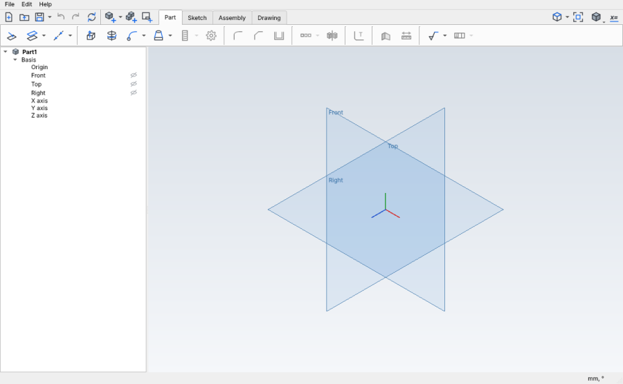

## 2. Navigating the 3D view

The default mouse profile is **“Rotate with middle button”**. For laptops without a middle button there is the **“Rotate with right button (for laptops)”** profile: “File” → “Program settings”, the “Mouse and wheel” tab (section 8a).

| Action | Rotate with the middle button | Rotate with the right button |
|---|---|---|
| Rotate | middle button (MMB) | right button (RMB) |
| Pan | Ctrl + MMB | MMB or Ctrl + RMB |
| Smooth zoom | Shift + MMB (up — closer) | Shift + RMB |
| Step zoom | wheel (towards the cursor) | wheel |
| Select | left button | left button |
| Context menu | RMB click | RMB click without dragging |

Rotation is around the point under the cursor. Wheel zoom direction can be inverted in the same place — the “Invert wheel zoom” check box.

**Standard views**: Ctrl+1 front, Ctrl+2 back, Ctrl+3 left, Ctrl+4 right, Ctrl+5 top, Ctrl+6 bottom, Ctrl+7 isometric, Ctrl+8 "normal to" the selected plane or planar face (press again to look from the other side), F — fit the model. A standard view fits the model into the window and centers it at once. Transitions are smooth; any mouse or key movement interrupts a transition. Above the ribbon on the right there is the **“Isometric”** button: a click gives the isometric view, the arrow lists all standard views; next to it is **“Fit”** (F). The arrow menu lists “Front”, “Back”, “Left”, “Right”, “Top”, “Bottom”, “Isometric”.

**Keyboard** (focus in the view): arrows — rotate, Shift+arrows — rotate 90°, Alt+←/→ — rotate in the screen plane, Ctrl+arrows — pan, Shift+Z / Z — zoom in / out.

**Selection**: hovering highlights a face, edge or vertex, click selects, Ctrl+click (or Shift+click) adds to the selection or removes from it, a click on empty space clears the selection.

**Display style** — the “Style” button at the right above the ribbon: “Shaded with edges”, “Shaded”, “Hidden lines removed”, “Hidden lines dashed”, “Wireframe”. The style applies to the whole view and is remembered between sessions. Faces and edges can be selected in any style; in wireframe you can also pick an edge hidden behind faces. Part and face colors are shown only in the shaded styles.

## 3. Your first part in 5 minutes

A 100 × 60 × 10 plate with a Ø20 hole and a Ø30 boss 15 high; at the end — a change of the width. Every picture outlines the place to click, the number is the order of the clicks. Ribbon buttons are icons; the name of a button shows in its tooltip when you hold the mouse over it. Button names are quoted as in the English interface.

1. **Plane.** Click the “Top” plane in the tree.

   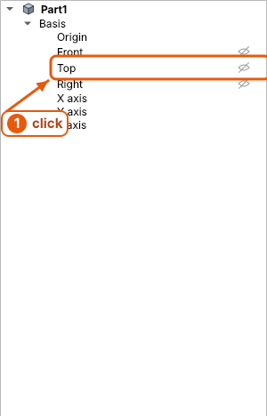

2. **Sketch.** Click the “Sketch” button on the ribbon — or press **Shift+S** (or double-click the plane). The view turns to the plane.

   

3. **Rectangle.** Click the “Rectangle” button — or press **R**. Click at the origin (the ● snap appears) and then at the opposite corner. The sketch is defined at once by pale weak dimensions (section 4.6).

   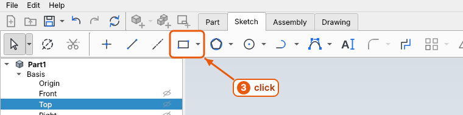

   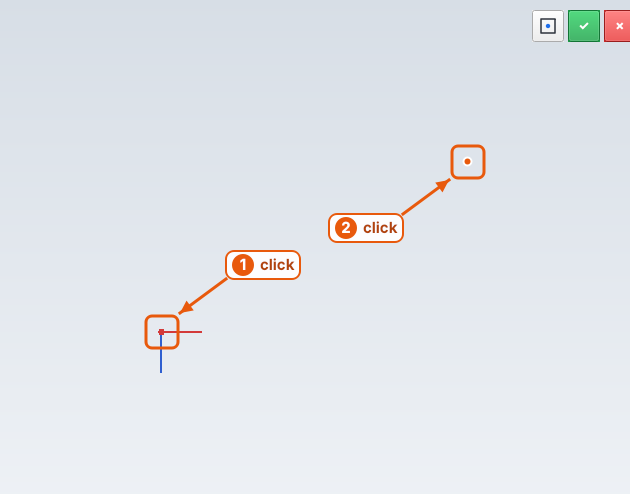

4. **Dimensions.** Double-click the pale width dimension and type `100`, Enter; same for the height (`60`). The dimensions become yours — dark.

   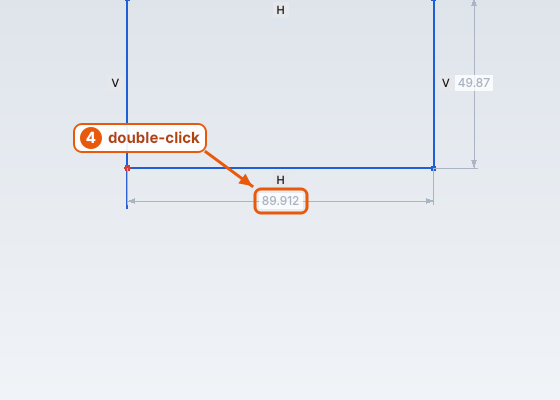

   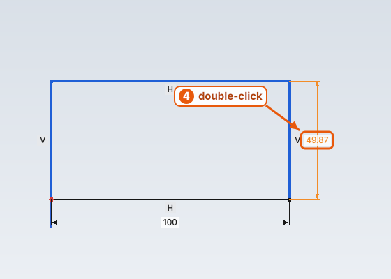

5. **Circle.** Click the “circle” button — or press **C**; click a center inside the rectangle and a point on the circle.

   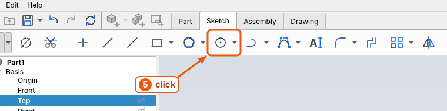

   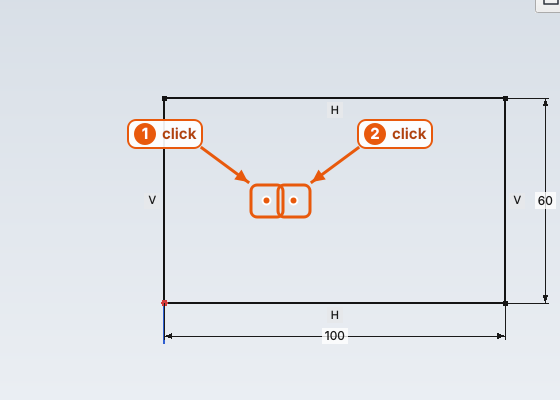

6. **Diameter.** Click the “Dimension” button — or press **D**; click the circle, then the label position, and type `20`, Enter.

   

   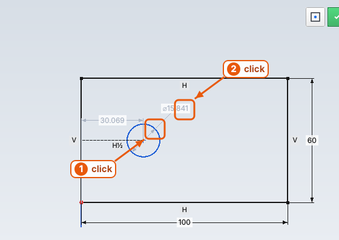

7. **Leave the sketch.** Click the “Exit sketch” button — or press **Ctrl+Enter** (or ✓ in the corner of the view).

   

8. **Extrude.** Click the “Extrude” button — or press **Shift+E**: the sketch is already selected, the circle becomes a hole.

   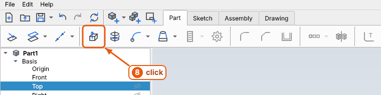

9. **Depth.** Click the depth field of the panel and type `10`.

   

10. **OK.** Click “OK” — or press **Enter**. The plate with the hole is ready.

    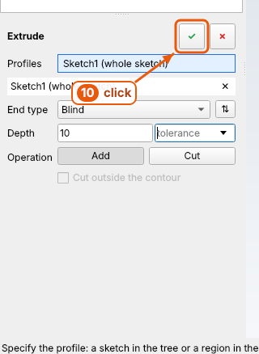

11. **A face for the boss.** Click the top face of the plate (the view — “Isometric”, the button above the ribbon).

    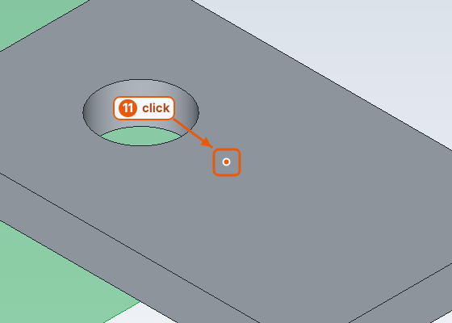

12. **A sketch on the face.** Click “Sketch” — or **Shift+S**.

    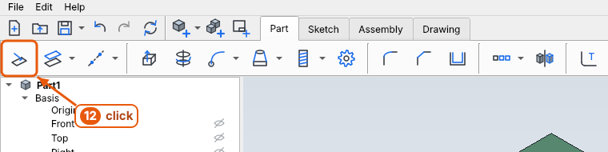

13. **The boss circle.** As in steps 5–6: a circle next to the hole and the diameter `30`.

    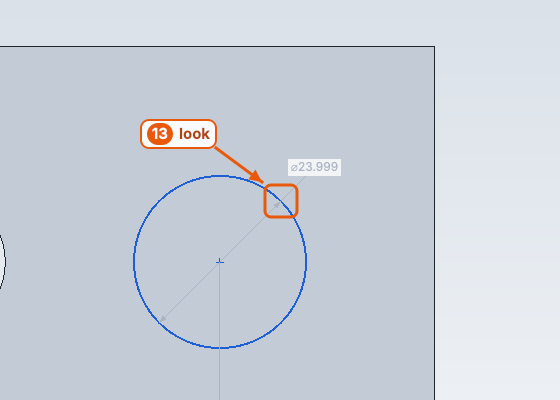

14. **Leave the sketch** — “Exit sketch” or **Ctrl+Enter**.

    

15. **Extrude the boss.** “Extrude” or **Shift+E**.

    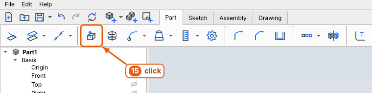

16. **Boss height.** Type `15` into the depth field.

    

17. **Add.** Click the “Add” operation — the boss joins the plate.

    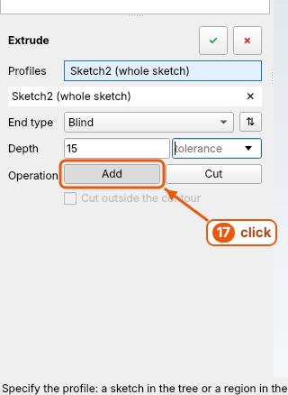

18. **OK** — or **Enter**.

    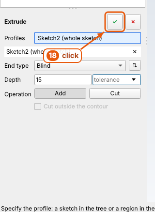

19. **Edit.** Double-click “Sketch1” in the tree — the sketch opens.

    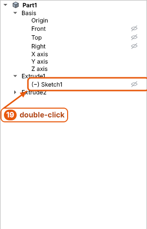

20. **A new width.** Double-click the `100` dimension and type `140`, Enter.

    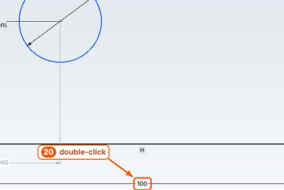

21. **Leave.** “Exit sketch” or **Ctrl+Enter**. The whole model is rebuilt, the boss stays on the top face.

    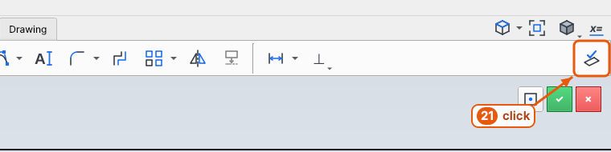

    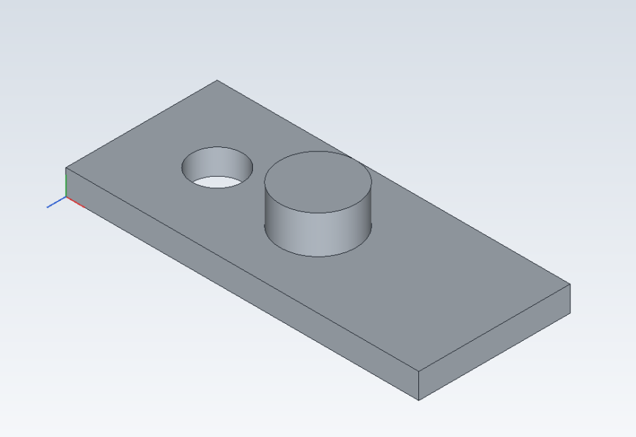

## 3a. Lesson: constraints, dimensions, snaps

A clamp profile of segments and arcs in one chain: snaps put the coincidences and tangencies, inference hints put horizontal and vertical while you draw; the legs are symmetric about a centerline; three dimensions — and the sketch is “Fully defined”; the leg length is a document variable. Every picture outlines the place to click, the number is the order of the clicks.

1. **Plane.** Click the “Front” plane in the tree.

   

2. **Sketch.** Click the “Sketch” button on the ribbon — or press **Shift+S**.

   

3. **Segment.** Click the “Line” button — or press **L**; click the bottom and the top of the right leg. The segment becomes vertical by itself — an inference hint while drawing.

   

   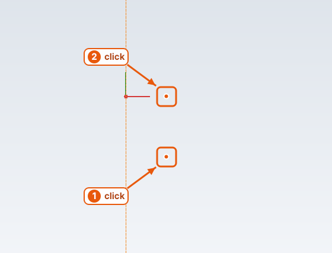

4. **Tangent arc.** Click the “Tangent” variant in the “arc” group — or press **T**: the next piece of the chain is an arc tangent to the segment. Click its end above the left leg, then the bottom of the left leg with **Ctrl** held (no snaps and hints: the symmetry of step 6 places it), the bottom and the top of its inner side: the segments continue the chain, the ends coincide by the snap.

   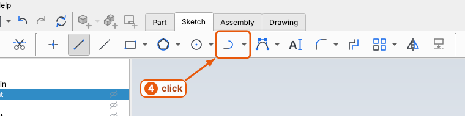

   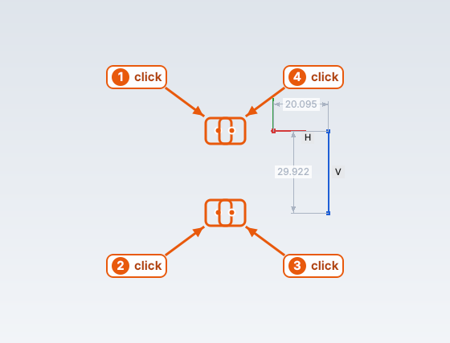

5. **Second arc.** Again “Tangent” (**T**): the inner arc, then down the right leg and back to the first point — the outline is closed. The arc centers are pulled to the origin and to each other — the arcs are concentric without a command.

   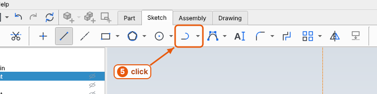

   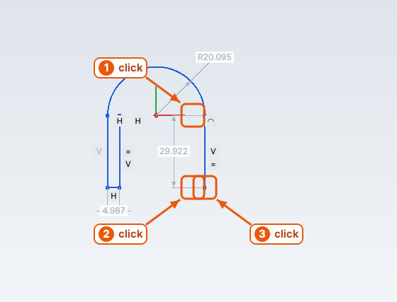

   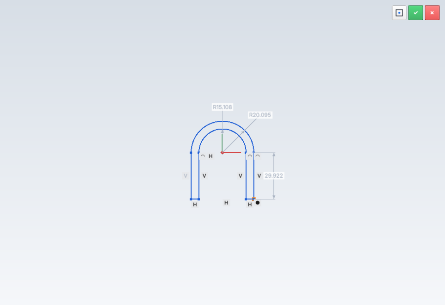

6. **Centerline and symmetry.** Click the “Centerline” button and draw a vertical centerline through the origin — from the bottom up. Then click the outer bottom corner of the left leg, Ctrl+click the same corner of the right leg and the centerline, and choose “Constraints” → “Symmetric” — or press **Y**: the left leg mirrors the right one (the symmetry icon at the centerline).

   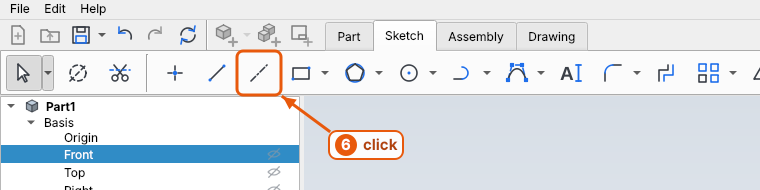

   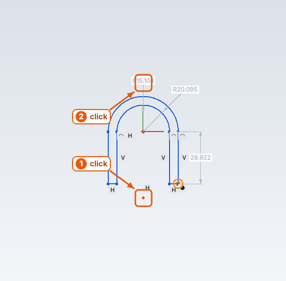

   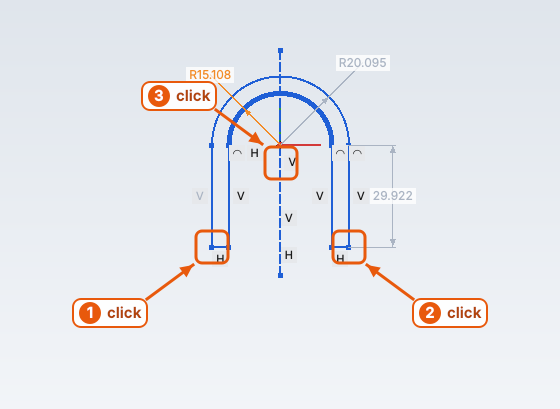

   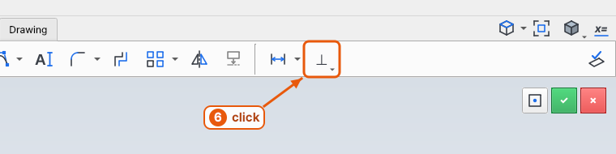

7. **Dimensions.** Click “Dimension” — or **D**; click the outer arc and the label position, type `20` (the radius); then the outer and the inner segment of the right leg — the thickness `5`.

   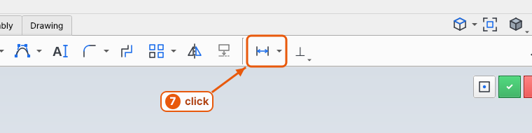

   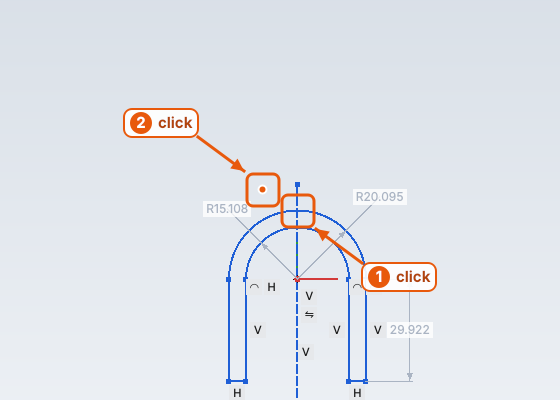

   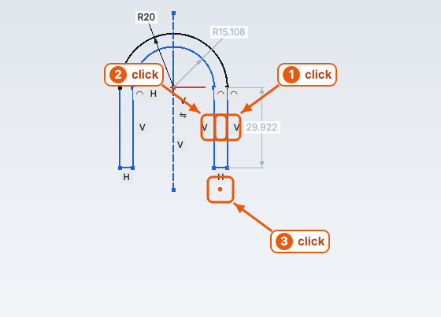

8. **Variable.** Click the “Variables” button in the upper right corner — the panel opens; click “+” and type the name `L` and the value `30`.

   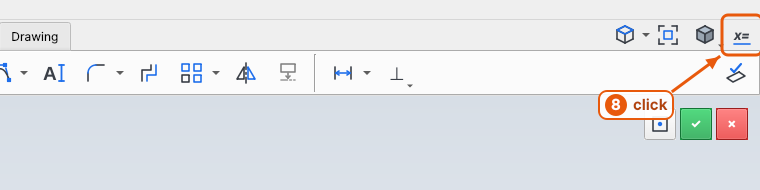

   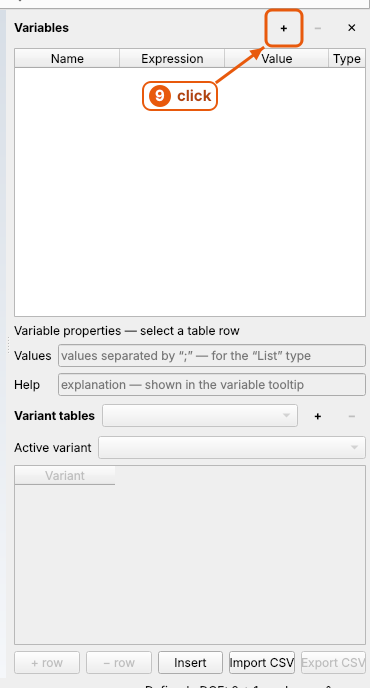

9. **A dimension by the variable.** The length of the right leg: click the segment and the label position and type `L` instead of a number. The status bar says “Fully defined”.

   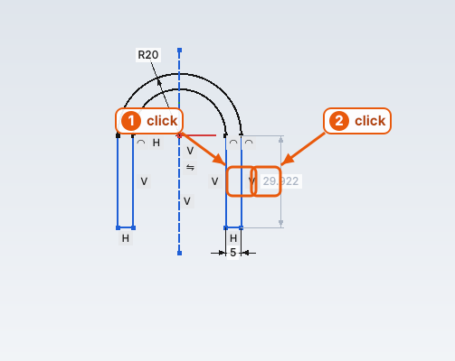

   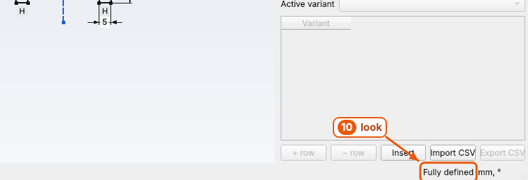

10. **Part.** “Exit sketch” (**Ctrl+Enter**), “Extrude” (**Shift+E**), depth `12`, “OK”.

    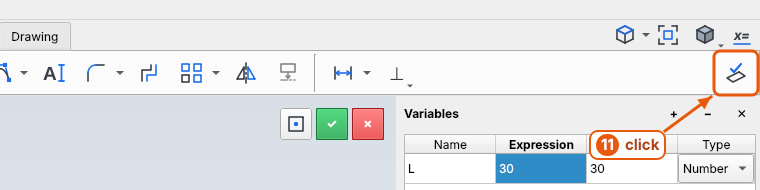

    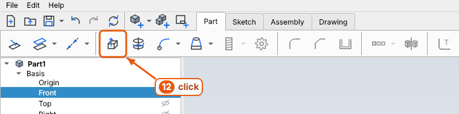

    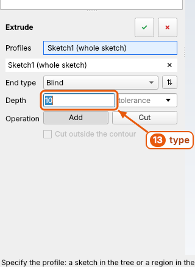

    

11. **Edit the variable.** Double-click the value of `L` in the variables panel and type `40`, Enter: the legs get longer, the part is rebuilt.

    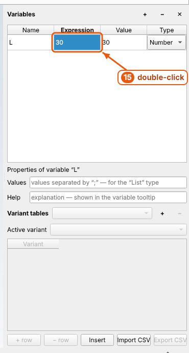

    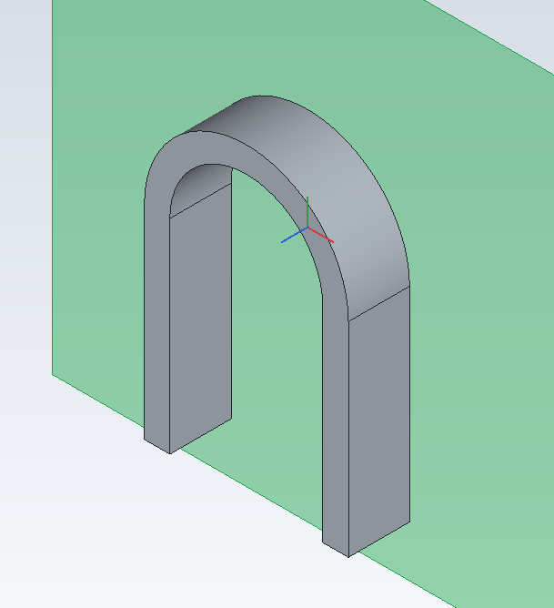

## 3b. Lesson: a complex profile

A plate with a sketch fillet and chamfer, a hole mirrored about a construction line, the hole widened by an offset with the extra trimmed away, and a boss over the hole centered by the projection of a part edge.

1. **Sketch and rectangle.** The “Top” plane in the tree, “Sketch” (**Shift+S**), “Rectangle” (**R**) from the origin; dimensions `60` and `40` (“Dimension”, **D**).

   

   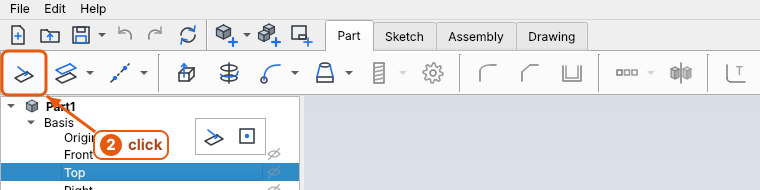

   

   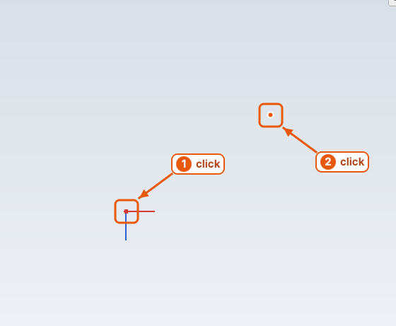

   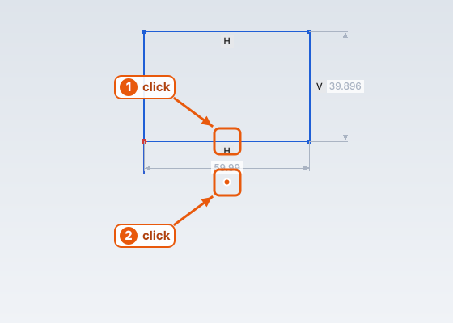

   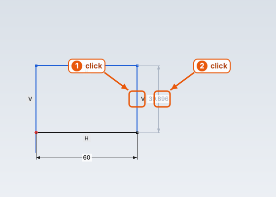

2. **Sketch fillet.** Choose “Fillet” in the “Fillet” group of the sketch ribbon, click the upper right corner and type the radius `8`, Enter.

   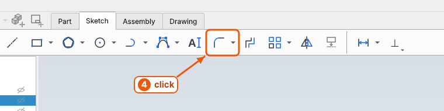

   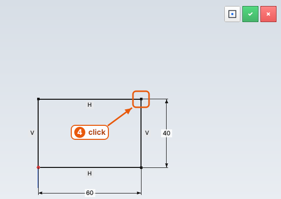

   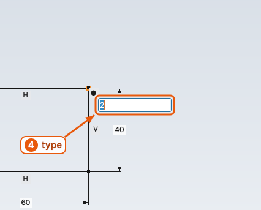

3. **Sketch chamfer.** In the same group “Chamfer”: click the lower left corner and type `5`, Enter.

   

   

   

4. **Construction line.** Turn on the “Construction geometry” button (**Q**) and draw a vertical line in the middle with “Line” (**L**) — it is dashed and is not a part of the outline; then turn construction off.

   

   

   

5. **Hole.** “circle” (**C**) on the left, diameter `10` (“Dimension”, **D**).

   

   

   

6. **Mirror.** Click the circle, then the “Mirror” button and the construction line: a copy bound by symmetry appears on the right.

   

   

   

7. **Offset.** Click the left circle, the “Offset” button, click outside the circle and type `3`, Enter — a circle 3 larger appears.

   

   

   

8. **Trim.** Click the “Trim” button — or press **M** — and click the original circle: it is highlighted before the click and removed.

   

   

9. **Extrude.** “Exit sketch” (**Ctrl+Enter**), “Extrude” (**Shift+E**), depth `10`, “OK”.

   

   

   

   

10. **Edge projection.** Click the top face, “Sketch” (**Shift+S**), the “Project” button (**U**) and the edge of the left hole — its projection, bound to the part, appears in the sketch.

    

    

    

    

11. **Boss.** “circle” (**C**): the center — a click at the center of the projection (a snap), diameter `24`. “Exit sketch”, “Extrude”, depth `5`, the “Add” operation, “OK” — a boss coaxial with the hole stands over it.

    

    

    

    

    

    

    

    

    

## 3c. Lesson: a shaft — revolve, chamfers, fillets, shell, a hole

A stepped shaft Ø20 / Ø30 / Ø20 by revolving half of the section about an axis, a shell — a hollow shaft with a bottom, — chamfers on the ends, a fillet of the collar and an M6 tapped hole in the bottom.

1. **Sketch.** The “Front” plane in the tree, then “Sketch” — or **Shift+S**.

   

   

2. **Half of the section.** “Line” (**L**): click the points in the order of the numbers — from the origin up, along the steps and back along the axis; the last click is at the first point.

   

   

3. **Dimensions.** “Dimension” (**D**): the step lengths `30`, `40`, `30`, the end radius `10` (the height of the end) and the collar radius `15` (between the collar and the axis). The sketch is “Fully defined”.

   

   

   

   

   

   

4. **Revolve.** “Exit sketch” (**Ctrl+Enter**), the “Revolve” button — or **Shift+W**; click “X axis” in the tree — the axis of revolution; “OK”.

   

   

   

   

5. **Shell.** The “Right” view (the menu of the “Isometric” button above the ribbon); the “Shell” button, click the right end face — it becomes open; wall thickness `2`, “OK”: the shaft becomes hollow (make the shell before the chamfers and the fillets — with them the kernel does not build it), a bottom 2 thick stays at the left end.

   

   

   

   

6. **Chamfers.** Click the edge of one end, Ctrl+click the edge of the other; the “Chamfer” button — or **Shift+C**; size `1`, “OK”.

   

   

   

   

7. **Fillet.** The same way both outer edges of the collar and the “Fillet” button — or **Shift+F**; radius `2`, “OK”.

   

   

   

   

8. **Hole point.** The “Left” view (the menu of the “Isometric” button above the ribbon), click the end face, “Sketch”, the “point” button (**P**) and a click at the center of the end; “Exit sketch”.

   

   

   

   

   

9. **Tapped hole.** The “Hole” button (in the “Thread” group), the type “Tapped”, the size “M6”, the end “Through all”, “OK” — a tapped hole in the bottom with the conventional thread depiction.

   

   

   

   

   

   

## 3d. Lesson: a bracket — rib, mirror, pattern, sweep, loft

An angle extruded symmetrically, a rib in the mid plane on projected edges, a hole in the base and its mirror copy, a row of holes in the wall by a linear pattern, a hook swept along a path and a tapered foot by a loft.

1. **Angle profile.** The “Front” plane, “Sketch” (**Shift+S**), “Line” (**L**) — the points in the order of the numbers, the last at the first.

   

   

   

   

2. **Dimensions.** “Dimension” (**D**): the base `40`, the height `30`, the flange thicknesses `5` and `5`.

   

   

   

   

3. **Symmetric extrude.** “Exit sketch”, “Extrude” (**Shift+E**), the end “Symmetric”, depth `30`, “OK” — an angle 30 wide, 15 to each side of the “Front” plane.

   

   

   

   

   

4. **Rib.** “Front” and “Sketch” again; the “Project” button (**U**) and clicks on the two inner edges of the angle; “Line” — a triangle: the inner corner, the midpoint of the base edge and the midpoint of the wall edge (the ◆ “midpoint” snap), back to the corner. No dimensions are needed — the snaps hold the vertices (legs 17.5 and 12.5).

   

   

   

   

   

   

5. **Extrude the rib.** “Exit sketch”, “Extrude”, “Symmetric”, depth `4`, the “Add” operation, “OK”.

   

   

   

   

   

   

6. **Hole in the base.** Click the top of the base, “Sketch”, a circle near the edge with the diameter `6`, “Exit sketch”, “Extrude”, the end “Through all”, the “Cut” operation, “OK”.

   

   

   

   

   

   

   

   

7. **Mirror feature.** The “Mirror” button of the part ribbon, click “Cut1” in the tree (what to mirror) and the “Front” plane (about what), “OK” — the hole appears on the other side.

   

   

   

   

8. **Hole in the wall.** The “Left” view, click the outer side of the wall, “Sketch”, a circle `6`, exit, “Extrude” “Through all”, “Cut”, “OK”.

   

   

   

   

   

   

   

   

9. **Linear pattern.** The “Pattern” button → “Linear”, “Cut2” and “Y axis” in the tree, count `2`, spacing `12`, “OK” — a row of two holes.

   

   

   

   

   

   

10. **Path.** The “Front” plane, “Sketch”; “Line” (**L**) — from the outer side of the wall at height 20 outwards by 12, then “Tangent” (**T**) — an arc down (a quarter circle R8); “Exit sketch”.

    

    

    

    

    

    

    

11. **Section.** The “Left” view, click the outer side of the wall, “Sketch”, a circle `6` centered at the start of the path, “Exit sketch”.

    

    

    

    

12. **Sweep.** The “Sweep” button (the “Sweep” group): click the “Profile” field and the circle sketch in the tree, the “Path” field and the path sketch in the tree, “OK” — a bent Ø6 hook comes out of the wall.

    

    

    

    

    

    

13. **First loft section.** The “Top” plane (the bottom of the base lies on it), “Sketch”, “Rectangle” (**R**) 12 × 12 under the base, “Exit sketch”.

    

    

    

    

    

14. **A plane below.** “Top” in the tree again, “Plane” → “Offset”, distance `8`, the “Flip” button — the plane below “Top”, “OK”.

    

    

    

    

    

15. **Second section.** The new plane in the tree, “Sketch”, “circle” (**C**) Ø8 under the center of the rectangle, “Exit sketch”.

    

    

    

    

    

16. **Loft.** The “Loft” button (the “Loft” group), in the tree — the rectangle sketch, then the circle sketch, “OK” — a foot tapering from the square to the circle stands under the base.

    

    

    

    

    

## 3e. Lesson: a part drawing

The drawing of the shaft from lesson 3c: an A3 sheet at 2:1, the main view, a projected view, a section along the axis, the dimensions from the model and your own dimension from the axis, roughness, a tolerance set in the drawing, a framed text of technical requirements and the PDF output. Open the shaft from lesson 3c or your own part and put the marks on it (section 6c): roughness Ra 1.6 on the collar and the fit k6 on a journal — step 7 and the dimension of step 11 bring them to the drawing. Every picture outlines the place to click, the number is the order of the clicks.

1. **New drawing.** Click the “New drawing” button above the ribbon. The sheet and the “Drawing” tab open, with the “Drawing and sheet” panel on the right.

   

2. **Format and orientation.** In the panel on the right choose the format “A3” and the orientation “Landscape”.

   

3. **Scale.** Type `2:1` into the “Scale” field, Enter (or choose it from the GOST 2.302 list).

   

4. **Main view.** Click “View ▾” on the “Drawing” tab, choose “Shaft” (the name of the part) and click on the sheet where the view goes.

   

   

5. **Projected view.** While the main view is selected, click “Projected view” and then to the right of the main view — a view from the left appears, aligned with the main one.

   

   

6. **Section along the axis.** Click the main view (a frame selects it), the “Section” button, hover the shaft axis — it is highlighted — and click: the section line goes along the whole axis and is bound to it (after an edit of the shaft the section stays on the axis). The third click — below the view — places the section.

   

   

   

7. **Additional information.** Click “Place all additional information” — the marks of the model appear on the views: the roughness sign of the collar.

   

8. **Moving a mark.** Drag the roughness sign with the mouse to a free place — the leader goes to the nearest point of the surface by itself. Delete removes the selected sign, Ctrl+Z brings it back.

   

9. **Dimensions from the model.** Click “Insert all model dimensions” — the dimensions of the shaft sketch appear on the views (the roughness sign is already moved away and does not get in the way).

   

10. **Dimension from the axis.** Click “Dimension”, then the shaft axis (it is highlighted before the lines it coincides with), the top line of the collar and the place of the dimension — the collar radius `15`. Esc leaves the dimension mode.

    

    

11. **Tolerance set in the drawing.** “Dimension”, click the top and the bottom lines of the journal and the place — the dimension `Ø20k6` (the fit of the model); Esc — the dimension stays selected. In the panel on the right turn on “Set in drawing” and type `h6` into the tolerance field, Enter: this drawing shows `Ø20h6` (purple on screen), the fit of the part does not change.

    

    

    

    

12. **Framed text.** Click “Text” and stretch a frame with the mouse on a free place of the sheet; type the heading “Technical requirements”, Enter, and the text of a requirement — the lines wrap to the frame width by themselves; **Ctrl+Enter** — done, the text stays selected. In the “Text” block of the panel on the right select the heading and click “B” (bold; while typing on the sheet — **Ctrl+B**, **Ctrl+I**, **Ctrl+U**), **Ctrl+Enter**.

    

    

    

13. **PDF.** File → Export → PDF… — a list of the drawings appears on the right with the current one checked; click “OK” and give the file name. The sheet is saved as a vector A3 PDF.

    

    

## 4. Sketch

### 4.1. Entering and leaving

- New sketch: select a plane or planar face → Shift+S (or the “Sketch” button, or double-click a plane in the tree). If nothing is selected, “Sketch” waits for a click: click a reference plane or a datum plane (in the view or in the tree) or a planar face of a body — including a planar end face of a revolved body; Esc cancels.
- Edit: double-click the sketch in the tree or “Edit sketch” in the context menu.
- On entering, the view turns "normal to" the sketch plane and fits the sketch together with the part into the window. The arrows of small dimensions that have no room on the dimension line move outside by themselves.
- Leave: Ctrl+Enter, ✓ in the corner of the view, the “Exit sketch” button. If nothing was changed in the sketch, Esc (with no tool and no selection) closes it, like ✗; after changes Esc does **not** leave the sketch — so that work is never lost by accident.
- **Cancel**: the red ✗ next to the green ✓ in the corner of the view — leave the sketch cancelling all its changes since you opened it (in one step; Ctrl+Z brings them back). A new sketch left empty is deleted, and its plane or face stays selected — you can start again at once.

  

- All changes are recorded immediately; every action is a separate undo step. Ctrl+Z in a sketch undoes one action and keeps the sketch open; the view does not change.

### 4.2. Drawing tools

The first button of the “Sketch” tab is **“Select”** (the default mode; its menu has “Select all”, Ctrl+A), next to it are “Construction geometry” and “Trim”. The button of the current tool is shown pressed. Esc and the end of one-shot commands return to the Select mode.

Variants of one tool are grouped into a button with an arrow: “Rectangle”, “Primitives”, “circle”, “arc”, “Spline”, “Fillet”, “Pattern”. The arrow opens the list of variants; the button itself starts the last chosen one (after the program starts — the first in the list; for “arc” it is “Tangent”).

| Tool | Key | How to draw |
|---|---|---|
| “point” | P | click |
| “line” | L | click — click — …: a chain; a click on the start of the chain closes the contour, a double-click or Esc ends the chain; you can also press at the start, drag and release at the end — a single line |
| “Rectangle” → “By corners” | R | two clicks at opposite corners |
| “Rectangle” → “From center” | Shift+R | center, then a corner |
| “Inscribed N-gon (by vertex)” / “Circumscribed N-gon (by side midpoint)” | — | center, then a vertex (inscribed) or the middle of a side (circumscribed); number of sides (3…40) — the “Sides” field in the left panel under the tree, 6 by default |
| “Star” | — | center, then a ray tip; number of rays — the “Rays” field in the left panel under the tree (5 by default); the inner diameter is half the outer one |
| “Circle” → “By center” | C | center, then a point on the circle |
| “By 3 points” | — | three points on the circle |
| “Ellipse” | — | center, the end of the first semi-axis (its length and tilt), then a click that sets the second semi-axis |
| Spline (“Spline”: “By control points”, “Through points”) | — | clicks at the points; a second click on the last point (or a double click, Enter) finishes; a click on the first point gives a closed spline |
| “Arc” → “Tangent” | T | from the end of a line or arc; in a line chain — the next segment as an arc, then the chain goes on with lines |
| “Arc” → “By 3 points” | A | start, end, point on the arc |
| “Arc” → “From center” | Shift+A | center, start, end |
| “Centerline” | ribbon button | construction line (axis for revolve) |
| “Construction geometry” | Q | with curves selected — toggles them between construction and normal (construction curves take part in constraints but not in profiles); with nothing selected — turns the **construction mode** on and off: while the button is pressed, everything you draw is created as construction geometry, and a click on an element (with no drawing tool) toggles it. If after a toggle a construction element lies exactly on another one (for example, a construction line under a normal one), the extra one is removed and its constraints and dimensions move to the remaining one — the drawing does not change; if that is not possible, both stay and the status bar shows a hint. Esc turns the mode off; it is off every time a sketch is opened |
| “Text” | ribbon button | a click sets the start of the first line; in the box — text, font, capital height, angle; the text may have several lines (Enter — a new line, Ctrl+Enter or OK — done); the “B”, “I”, “U” buttons (Bold, Italic, Underline; Ctrl+B, Ctrl+I, Ctrl+U) make the selected words bold, italic or underlined (the styles are built by the program from the regular font, the underline is a strip below the line); the “⌀°±” button next to them is a menu of symbols (⌀, R, □, ⌒, °, ±, × and others): the symbol is inserted at the cursor. The text field grows with the number of lines (up to half the window height, then it scrolls); drag its bottom right corner to resize it. Double-click a text to edit it; drag a text by the text itself. Letters can be extruded or cut like ordinary regions; stencil fonts come from the fonts folder: Sowjetschablone (Soviet stencil) by default, plus the GOST 2.304 stencil Construe Stencil GOST A and B (letters with closed loops are cut into strokes: “O” into two halves, the bowl of “B”, “P” is separated from the stem — the insides of letters do not fall out); GOST (OpenGost) and ISO (osifont) drafting fonts are in the list too. The default font is changed in the program settings |
| “Trim” | M | hover a piece of a curve — it is highlighted; click removes it up to the nearest intersections (a circle without intersections is removed whole). If constraints were lost in the process, a notification says so and offers to undo |
| “Project” | U | click a body edge or vertex — it appears in the sketch dash-dotted and follows the model |

While an element is being drawn, its preview lies in the sketch plane: seen at an angle, a circle looks like an ellipse. An element that is too small is not created — the hint “Element too small” appears. Snap symbols at the cursor (H, V, ∥, ⊥, =, ◠) are large and bold; when a radius or length is almost equal to an existing one (as close as for the other snaps), the sample element is outlined and the new element gets “Equal”.

**Snaps to edges outside the plane.** You can snap to vertices and edges of parts that lie above or below the sketch plane (lines, arcs, circles) at any view angle — to their projection onto the sketch plane: move the cursor to where the edge's projection lies in the sketch plane (in the “normal to” view — right onto the edge), and the target is highlighted; the click creates a construction projection by itself and attaches the point to it, and when the part changes, the point follows the edge. An edge perpendicular to the sketch plane is a point target. Where a part edge or a line of another sketch pierces the sketch plane there is a piercing point target: a click there puts the point exactly at the piercing point, and when the model changes it moves to the new piercing point (there is no separate “Pierce” button any more). In the “Dimension” and “Constraint” tools the object a click will take (a part edge without a projection, a silhouette, an axis included) is highlighted before the click. Only the target under the cursor is highlighted; when several are in one place, the one nearest to the sketch plane wins.

**Snaps to bodies of revolution.** When the axis of a shaft, a tube or a hole lies in the sketch plane (or is parallel to it), you can snap to the side surface directly, without the “Project” button: to the generator lines of cylinders and cones (their outermost lines, outer and inner), and for torus fillets and other curved surfaces — to the profile point farthest from and nearest to the axis. A point lands on the generator, a dimension can start from it; when the part diameter changes, the sketch follows. The generator the snap caught is highlighted.

**Sketch fillet and chamfer** — the “Fillet” button: click the corner of two lines and type the radius (for a chamfer — “3” for equal sides, “3; 4” for two sides, “3; 45°” for a side and an angle). If the same outline already has fillets, the field suggests the radius of the nearest one. The sides of the corner do not move, they are only shortened. The corner stays as a “virtual sharp”: side dimensions are still measured from it, and the fillet is kept when they change.

**Mirror and offset.** “Mirror”: select entities, press the button and click the axis (a line, a projected line or a sketch axis) — mirrored copies linked by symmetry appear. “Offset”: select entities (projections and construction lines too), press the button, click on the side to offset to, type the distance — an offset copy appears. With nothing selected: press “Offset” and click an element — a menu offers **“Line”** (offset only it) or **“Contour”** (the whole closed contour the element belongs to, also one made of projections or construction lines): for a contour you type the value at once — positive offsets outward, negative inward; the corners join by themselves, arcs change radius. A click on a **body edge** (the button works in an empty sketch too) projects the whole visible contour the edge belongs to and asks for the offset value at once. An offset contour has **one value** and one dimension label: change it and the whole contour moves; a value with a minus puts the whole contour on the other side. The offset contour does not over-define the sketch: tangent joints (a line with an arc, an arc with an arc) stay tangent without redundant constraints; documents of earlier versions get their offsets in this form when opened. Double-click the offset contour to edit it: Ctrl+click an element to add it to the contour or remove it, Enter applies, Esc leaves without changes. Offset lines are always regular (a profile for extrusion), even from construction lines and projections. Ellipses are mirrored and patterned the same way as circles.

**Primitives.** The N-gon and the star stay linked: double-click a side or a vertex to open the primitive box — the number of sides and the kind (inscribed or circumscribed) for an N-gon, the number of rays and two diameters for a star. Dimensions and constraints you put on sides and vertices are kept (those on sides that disappear are removed with them). “Unlink” in the box turns the primitive into ordinary lines with constraints.

**Ellipse.** Dimension an ellipse with the “Dimension” tool: click the ellipse, then click near the end of the semi-axis you want — the major (“a”) or minor (“b”) semi-axis; the dimension's context menu switches between the semi-axes and the rotation (“∠”). An ellipse can be tangent to a line, a circle, an arc or another ellipse (“Tangent”), pass through a point (“Coincident” of a point and the ellipse) and be concentric with a circle; two ellipses can be made equal (“Equal”). It is extruded like any closed profile. The “Trim” tool trims an ellipse like a circle: a click on the part between two intersections removes it and an **ellipse arc** remains; it is trimmed like an arc and trims other lines itself. An ellipse arc forms profiles together with lines and arcs (e.g. half an ellipse and a line through its center). An ellipse or ellipse arc that crosses other lines anywhere but at its ends is left out of profiles (a warning appears).

**Spline.** “By control points” builds a smooth curve from control points (poles): the curve starts at the first point, ends at the last one and is pulled towards the ones in between (a dashed polygon joins them). Two to four points give a Bezier curve, more give a B-spline; a click on the first point closes the curve. “Through points” builds a curve passing through all the points. Drag the poles to change the shape; undo reverts it in one step. Put dimensions on the poles (distances, coordinates); “Dimension” on a pole and its spline sets the pole **weight** (the larger, the more the curve is pulled towards it). Where a spline meets a line, an arc or another spline (ends joined with “Coincident”), “Tangent” and “Equal curvature” make the joint smooth. A point can be put on a spline (“Coincident” of the point and the spline). Closed profiles with splines are extruded, revolved and cut like any other; the “Trim” tool trims a spline and a spline trims other lines; a part with splines is saved to STEP.

**Sketch pattern.** The “Pattern” button: select entities (lines, circles, arcs, ellipses, points) and choose “Linear pattern” — a box appears with the number of copies, the spacing and the direction along two axes (the second axis is used when its count is above 1); “Circular pattern” — then click the center (a point or the origin) and set the number of copies and the angle (360° spreads them evenly). While the box is open the copies are shown dashed; OK creates them. The fields accept expressions with document variables (e.g. the count `n` and the spacing `p`): changing a variable rebuilds the pattern. The “By line” button in the linear pattern box, then a click on a sketch line: the axis directions are measured from that line, and the pattern turns with it. “Direction 2” has its own “By line” button: the second axis is then set by another sketch line — the copies form a grid along the two lines, and the second axis follows the turn of its line. The pattern stays linked: double-click any copy to open the box again, and editing the original entities (dimensions, dragging) moves all copies at once. “Unlink pattern/primitive” in the “Pattern” menu, below the separator — available only while a pattern copy or a primitive side is selected; its tooltip explains what it does — or “Unlink” in the edit box turns the pattern (and an N-gon or a star) into ordinary geometry: the copies stay in place, held to the originals by “translate” ⇉ or “rotate” ↻ relations that you can delete. Delete on a copy removes the whole pattern; a copy can be trimmed or filleted only after “Unlink”.

**Dimension while drawing.** After placing the start of a line (or the center of a circle), just type a number — a field appears at the cursor; Enter creates a line of that length towards the cursor (a circle of that diameter) together with the dimension.

### 4.3. Snaps and automatic constraints

While drawing, the cursor snaps; an icon next to it shows to what:

- ● to a point (ends, centers, origin) → coincident;
- ✕ to the intersection of two curves → a point on both;
- ◆ to the midpoint of a line → midpoint;
- ⌒ onto a curve or its extension → point on curve;
- H / V horizontal / vertical → constraint on the line;
- ⊥ / ∥ perpendicular / parallel to the previous line (or to a line you hovered for a moment);
- ◠ tangent continuation of an arc; the same at any joint with an arc: a line or an arc started or ended at the end of a line or an arc nearly along its tangent (within 20°) becomes tangent to it — a rounded rectangle drawn as “line, arc, line, arc…” gets all its tangencies even if the points are placed inexactly;
- alignment lines with other points and line midpoints (dashed) → the point goes onto the same horizontal or vertical with them.

Everything highlighted at the moment of the click becomes a constraint. These automatic constraints give way to yours: if a dimension or relation you place contradicts them, the extra automatic constraint is removed by itself (a notification offers “Make reference” if you only wanted to see the value).

**Body geometry in the sketch plane** is available right away: vertices and edges of bodies that lie in the sketch plane (for example, the bottom outline of a block standing on that plane) act as snap points and curves. When such a snap is used, the program adds a construction projection of that vertex or edge by itself — your element will follow the body when it changes.

Hold **Ctrl** while clicking to place a point without snaps and automatic constraints.

### 4.4. Constraints

Select entities and press a key (or click an icon on the context bar) — or press a key and click entities (the tool stays active for the next ones). All constraints are also in the “constraints” list on the ribbon.

| Constraint | Key | For |
|---|---|---|
| Coincident / on object | I | point + point; point + curve |
| Horizontal | H | line; two points; point + line (on one horizontal with its midpoint) |
| Vertical | V | line; two points; point + line (with the midpoint) |
| Parallel | Shift+L | two lines |
| Perpendicular | Shift+T | two lines |
| Tangent | N | line + circle/arc; two circles/arcs |
| Equal | E | two lines; two circles/arcs |
| Concentric | O | two circles/arcs |
| “Collinear” | — | two lines on one straight line |
| “Coradial” | — | two circles/arcs: common center and radius |
| Midpoint | Shift+M | point + line; point + arc |
| “Point at intersection” | — | point + two curves (the point lies on both) |
| “Path length (sum of lengths)” | — | two or more lines/arcs — a dimension of their total length (with the “Σ” prefix; the button icon is Σ) |
| Symmetric | Y | two points + axis line |
| Fix | X | point, circle, ellipse (whole — it becomes fully defined), line (for an arc, fix its points) |

With several entities selected at once: several lines + H or V — each gets its own constraint; three or more lines (circles) + “Parallel”, “Equal”, “Concentric” — each with the first one selected. A constraint that already exists is not added a second time. A constraint can also be placed to a body edge or vertex — the projection is created automatically.

Constraint icons are shown next to entities; the “Show constraints” item at the end of the “constraints” button menu on the “Sketch” tab (or Shift+C) hides and shows them. Coincident and point-on-curve are shown only while the cursor is over the point. A selected icon is deleted with Del.

**Sketch axes.** The horizontal and vertical axes through the sketch origin are not drawn, but you can use them: click near an axis while placing a constraint (“Symmetric”, “Tangent”, “Coincident” etc.) or a dimension — the axis is picked and the constraint is attached to it. From then on the axis is shown in the sketch as a construction line. You do not need to draw a centerline to make geometry symmetric about an axis. A point placed near an axis while drawing is aligned with the origin automatically, i.e. it lies on the axis.

### 4.5. Dimensions

One tool, **D**, picks the right dimension itself: line — length; two points — distance; circle — diameter; arc — radius; ellipse — a semi-axis; two parallel lines — the distance between them; two non-parallel lines — angle (which one depends on the sector the cursor is in); point and line — distance to the line; a point, line or circle and the rim of another circle — the nearest distance to the circle (to its center — click the center point). For a line or two points the cursor position chooses a horizontal, vertical or aligned dimension. A dimension can be placed to a projection, and also directly to a body edge or vertex — the projection is created automatically.

How to place: click one or two objects (they are highlighted), then click the empty spot where the dimension should go: a line and a spot — the line length; a line, a second line and a spot — the distance between them (or the angle). If you hold the mouse still without clicking, the program shows in a pale color which dimension would be placed there by a click; moving the mouse hides it. Esc clears what you have picked (as if nothing had been clicked), a second Esc leaves the mode. The “Dimension” mode stays on, so you can place the next dimension right away. Placing a dimension does not move the geometry: the dimension first gets the current value.

A just placed dimension is selected at once and its bar appears next to it: for example, “Diameter from axis” can be switched on without leaving the tool. In the “Dimension” tool a click on the label of any dimension opens its bar, and the label can be dragged. After placing, the value field opens at once: type a number or an expression (`= L/2`), Enter; Esc keeps the measured value. Dimensions are always positive: typing a negative number moves the geometry to the other side. Double-click a dimension to change it (in any sketch mode; after you type the value, the tool stays the same). A dimension with an expression is shown with the “ƒ” prefix. In the Select mode a dimension can be dragged by its text or dimension line — only the label position changes.

Dimension context menu: “Edit value”, “Radius”/“Diameter”, for an arc “Arc length” and “Central angle”, for an ellipse “Major semi-axis”, “Minor semi-axis”, “Rotation”, for a distance to a circle “Far”/“Nearest”, for a dimension from a point or a line to an axis (centerline), and from a point on an axis (e.g. the origin or a point on a centerline) across the axis, the “Radius from axis”/“Diameter from axis” switch (for revolved bodies the value is entered and shown as Ø and drawn symmetrically on both sides of the axis; the geometry does not change; also Shift+D or “Ø” on the context bar; a model dimension on a drawing is Ø too). The axis may also be a reference axis of the part (“Axis1” etc.): in the “Dimension” tool click a point, then the axis in the view — the dimension goes to its projection into the sketch and switches to Ø as well. A dimension between a line and a centerline is measured from the axis, “Reference”/“Driving”, “Tolerance”, “Delete”. Deleting a dimension does not delete relations. In the “Dimension” tool you can, without leaving it, click an existing dimension (it is highlighted) and press Delete — the dimension is deleted. A click on any dimension, a pale weak one included, shows the dimension bar at the cursor; for a weak one it has “Edit value” and “Diameter / radius from axis” (the dimension then becomes ordinary).

If a new dimension would over-define the sketch, it becomes driven (shows the value but does not control it) — a notification says so and offers “Make driving”.

### 4.6. Sketch state

Curve color: **blue** — held only by weak dimensions (can be dragged), **black** — fully defined by your dimensions and relations, **red** — conflict. Construction geometry is dashed in the same color, projections are dash-dotted. Status bar indicator: “Defined: 0 + n weak”, “Fully defined”, “Redundant constraints”, “Constraint conflict”, “Not solved” (“Under-defined” — only for free construction geometry attached to nothing).

**Weak dimensions.** A sketch is always fully defined: the dimensions you did not place are "guessed" by the program from how you drew, and shown pale. Where possible these are widths and heights (side lengths, horizontal and vertical distances between the ends of slanted lines), and the position of each contour is set by one of its reference points. Only the first figure of an empty sketch is measured from the origin; the following figures are measured from the nearest points of those already drawn, and if the sketch has projections of body vertices — from the nearest of them. A figure already tied to the origin (for example, a rectangle from the center at the origin) is measured by its own size — width and height, not from the origin to the corners; the sides of a construction rectangle also get a width and a height. You can choose the reference point yourself: right-click a point — “Make anchor”; the choice is saved in the file. A pale dimension behaves like an ordinary one: drag its label (the dimension becomes ordinary at the new place), or double-click it to open the value field — type the exact value, Enter — the dimension becomes ordinary. A click on a pale relation (glyph) makes it ordinary at once. Standalone points are drawn as large circles with a white outline, line ends as small squares, so you can see where you placed a point. If you place a dimension or relation that contradicts a weak dimension, the weak one simply disappears — there is no conflict. When you change your own dimension, the rest is held by weak dimensions: e.g. changing a rectangle's width moves one of its sides, not both, while changing a corner coordinate moves the whole rectangle.

**Dimension the main geometry / Dimension everything** — the “Dimension main geometry” and “Dimension all, including splines” items of the “Dimension” button menu on the “Sketch” tab (available when the sketch has weak dimensions): the weak dimensions and relations become ordinary (the first item leaves the spline point dimensions weak, the second dimensions them too), without moving what you drew; undone by one Ctrl+Z. Dimensions go to the main geometry and to the construction geometry it relies on (an axis gets no length); the labels are laid out so that they do not overlap each other or the geometry. A notification says how many dimensions became ordinary.

Geometry held only by weak dimensions can be dragged with the mouse — weak dimensions change with it, the solver keeps your constraints.

On a **conflict** a conflict panel opens in a corner of the view: the list of conflicting constraints, a suggestion what to delete (marked “suggested”), a bin icon on each row, buttons “Delete suggested” and “Undo last action”. The panel collapses with its arrow; a click on the indicator in the status bar opens it again (for redundant constraints — only this way). The model does not break.

### 4.7. Selecting and deleting in a sketch

Click — select, Ctrl+click — add. Box selection from an empty spot: left to right — only entities fully inside, right to left — entities touched. Ctrl+A — select all. Del — delete the selection (an end point cannot be deleted separately from its curve).

Esc works step by step: close the input field or the pattern box → cancel dragging → close a menu → clear what is picked in “Dimension” → leave the tool → clear the selection.

## 5. Features

Commands are on the “Part” tab or on keys. **Two “Part” ribbons.** An ordinary part has no sheet metal tools on the tab, a sheet metal part has no revolve, sweep, loft or shell (section 5b): the ribbon changes by itself when another part becomes active and when a part is converted. Rarer tools are in the menus of group buttons (the ▾ arrow on the right of a button; the main part of the button runs the last chosen variant): “Sweep” — “Sweep” and “Coil / custom thread”, “Loft” — “Loft” and “Draft”, “Thread” — “Thread” and “Hole”, “Roughness” — “Roughness” and “Roughness of other surfaces”. Part properties — the “Properties” item of the part's context menu in the tree. If a sketch (or edges for a fillet) is selected before the command, it goes straight into the right field; a sketch that has just been drawn and is not used yet is filled in by itself. The model shows a preview while you change parameters: added material in a semi-transparent color, removed material in the cut color. ✓, Enter or Ctrl+Enter — create, ✗ or Esc — cancel. If the preview shows an error, the feature can still be created — it is marked with an error in the tree, and you can finish it later.

**You do not have to draw the sketch first.** If a command waits for a sketch (extrude, revolve, sweep, loft, hole) and you click a plane (in the view or in the tree) or a planar face of a body, a new sketch opens on it right away. Draw it and exit the sketch: the command panel comes back with the values you already entered, and the new sketch is in its field. With a loft you can build the sections one after another this way.

**Selected first, then pressed.** If you select a plane (in the tree or in the view) or a planar face and press “Extrude”, “Revolve”, “Sweep”, “Loft” or “Hole”, the program creates a sketch on it at once; after you leave the sketch, the command panel opens with this sketch. A sketch selected in the tree and the “Sketch” button — the sketch opens for editing.

**Extrude “Through all”** switches the operation to “Cut” at once (when there is already a body). If you then reverse the direction, the operation follows the material on the new side: no material — “Add”, the whole profile over material — “Cut”. As soon as you press “Add” or “Cut” yourself, the program no longer changes the operation. A cut from a sketch on a body face points into the material from the start. A cut is named “Cut1”, “Cut2”… in the tree; if you change the operation by editing, the name “Extrude N” ↔ “Cut N” changes by itself as long as you have not renamed it.

| Feature | Key | Parameters |
|---|---|---|
| “Extrude” | Shift+E | profiles (whole sketch or single regions — click a region in the view); end: “Blind”, “Symmetric”, “Through all”, “Through all both sides” (Through all, both directions — only with “Cut”: a through cut on both sides of the sketch plane), “Up to next”, “Up to” (to a chosen object: a face or a plane — up to it; a vertex or an edge parallel to the sketch — up to the plane through them parallel to the sketch; a circle or a planar curve — up to its plane; two edges or an edge and a vertex — up to the plane through them; “Offset” — stop short of the object by this amount; pick the objects in the view or in the tree, ✕ removes one); depth (you can drag the arrow manipulator in the view, Shift — no rounding); reverse direction; operation: “Add” or “Cut” (inside the contour; the “Cut outside the contour” check box cuts outside) |
| “Revolve” | Shift+W | profiles; axis — a sketch line or a reference axis (if the sketch has exactly one centerline, it is picked automatically); angle: “Full turn”, “By angle”, “Symmetric”; operation |
| “Fillet” | Shift+F | body edges; radius |
| “Chamfer” | Shift+C | body edges; “Type”: “Distance”, “Distance and angle” or “Two distances”; ⇅ — measure the distance on the other face of the edge |
| “Coil” | — | a profile (a circle or another contour) and an axis in its plane — a sketch centerline or an origin axis; “Pitch”; “Number of turns” or “Height”; “Right-hand”/“Left-hand”; “Start angle”; operation — springs and turns of a non-standard thread |

Nested sketch loops become holes: a rectangle with a circle inside extrudes into a plate with a hole. If sketch curves cross each other, they are split at the crossings and give all closed regions: e.g. two crossing circles give three regions (a lens and two crescents), any of which can be extruded alone by clicking it. The exception is a circle touching another curve at a single point: then no regions are built (move the curves apart or trim them, M). Projected edges that cross your curves are left out of profiles (a message warns about it). If “Add” did not change the body, the feature gets a warning.

Editing a feature: double-click it in the tree or “Edit” in the context menu. A feature with an error can be edited too: every selected item in the panel fields (edges, faces, pattern features, axes, path…) has a ✕ cross that removes that item; in a single-item field it clears the field; hovering an item row highlights it in the 3D view, and clicking the row keeps the view direction but pans and zooms so that the item takes about a third of the window; for example, in a pattern whose source feature is suppressed, remove it with the cross and click another one in the tree. Selection fields work the same in every panel, including the section, annotation, mate, weld and instance pattern panels: the field header shows a prompt while the field is empty, the caption of the object (“Face 3”, “Front”, “Part1 <1>: planar face”) when one is picked and the count (“Edges: 2”) when several are; where a panel has several fields and a click goes into one of them, the active field is highlighted blue, clicking a header makes that field active, and an empty required field is written in red.

Hovering over a tree row highlights in the view what this feature built (its faces and edges); hovering over a sketch row shows the sketch. Selected body edges are drawn green and thick.

**Reference planes and axes** — the “plane” and “axis” buttons on the “Part” tab; the construction kind can also be changed in the “Type” row of the panel:
- plane: “Offset” (from a plane or planar face by a distance; “Flip” — to the other side); “Offset up to object” (parallel to the chosen plane through a vertex, edge or face; if a plane or a planar face and a point (a vertex, a sketch point) are selected before “Offset”, the panel opens in this mode at once; or tangent to a cylindrical, conical or spherical face; the “Far tangent” check box picks the far one of the two tangents); “Offset by distance from object”; “At angle”; “Through three points”; “Midplane”;
- axis: “Through two points”, “Along edge”, “Face axis”, “Intersection of planes”.

**A plane through the selection.** If only a planar face is selected before “Offset”, the plane goes through it (distance 0); select a plane — an offset plane at a distance; three points, a line and a point, two lines or an axis — the panel opens right away with the plane through the selection.

References are picked by clicking in the view or in the tree (planes, axes, origin); clicking a reference again removes it. Reference geometry follows the model when you edit it. You can start a sketch on a reference plane: select it and press “Sketch”. A reference axis can be used as a revolve axis and as a pattern direction.

### 5.1. Selection: click what is there — the program builds what is needed

Commands do not need a "proper" selection in advance. Click what you see — the program works out what it gives for the command field and shows the result in gray (like a suggested dimension). If there is only one reading and nothing is built, it is accepted at once; if something is built or there are several variants, a hint with the **“Yes”**, **“Other”** and **“Reset”** buttons appears at the click, and nothing changes in the model until “Yes”.

- **Sketch on a plane.** A click on a plane or a planar face — the sketch at once, as before. To build a plane, start with a point: “Sketch” → click a vertex → click a face, or a plane in the tree — a gray plane appears, parallel to the face and through the vertex; “Yes” opens a sketch on it. Three vertices, an edge and a vertex, two edges of one face, a plane and an edge, a plane and a cylinder (a tangent — “Other” switches the near and far one), a plane and a circular edge work the same way. A set can also be started by Ctrl+click on a plane. The built plane is shown in the tree as a row before the sketch and can be edited; delete the sketch or undo it (Ctrl+Z) — the plane goes too.
- **Pattern direction** — anything that gives a direction: an edge, an axis (base or reference), a line or centerline of a visible sketch, a plane or a planar face (the direction is its normal), a cylindrical or conical face (its axis), a revolve in the tree (its axis; click the “Direction” field first), two points (from the first to the second, after “Yes”). The arrow in the view shows where the copies go; “Flip” turns it. The axis of a circular pattern works the same way (instead of a normal — the intersection of two planes).
- **Mirror plane** — a plane or a face at once; two parallel faces — the mid-plane, after “Yes”.
- **Keys** with the cursor in the view: Enter — “Yes”, Tab / Shift+Tab — another variant, Esc — reset the set (a second Esc cancels the command).

Example: “Pattern” → “Linear” → click the cut in the tree → click a side face of the part — the copies go along the normal of the face.

## 5a. Part properties

The “Properties” item in the part's context menu in the tree opens the property panel; the ✓ button closes it. Every change applies at once and is undone with Ctrl+Z.

- **Name** — the part name in the tree.
- **Designation** — free text; the hint shows the GOST 2.201 format (`ABVG.123456.001`) but does not check it. The default export file name is “<designation> <name>”.
- **Material** — from the library (steels St3, 20, 45, 40Kh, 12Kh18N10T; cast iron SCh20; aluminium alloys AMg6, D16T, AD31; brass L63, bronze, copper; plastics PLA, PETG, ABS, PA12) or “Custom”: name, density, Young's modulus, Poisson's ratio, yield and tensile strength, and the “Assign” button. A custom material is stored in the file.
- **Part color** — color swatches, a `#RRGGBB` field (the “…” button next to it opens a color dialog with a palette and a spectrum) or “By material”. **Face color** — click a face in the view while the panel is open and choose a color; “Reset” brings back the part color. A face keeps its color after the part is edited.
- **Mass properties**: volume, surface area, mass (when a material is set), center of mass, principal moments of inertia; recomputed after every edit.
- **Transparent in assemblies** — a check box (section 6a).

## 5b. Sheet metal part

A sheet metal part is a part of constant thickness made by bending a flat blank. The program stores it as a flat blank
split by bend lines into walls and bend zones, so the flat pattern is always exact. A sheet metal part has its own
“Part” ribbon: right after the sketch, plane and axis — the buttons **“Sheet metal part”**,
**“Base wall”**, **“Flange”**, **“Bend on line”**, **“Sheet cut”** and the **“Unfold”** toggle; in a sheet metal part the first of them is called **“Sheet parameters”**. In an ordinary part its place holds **“Convert to sheet metal part”**: the same as the tree item “Convert to sheet metal”; the button is available only when the part shape
can be converted, otherwise it is unavailable and its tooltip gives the reason. All number fields accept expressions with
variables.

**Kind of part at creation.** “New part” above the ribbon — the arrow opens “Regular part” and “Sheet metal part” (the same — “New sheet metal part”, in the tree context menu). A sheet metal part gets “Sheet1” with the default parameters at once, and its ribbon has only the tools that make sense for sheet metal: sketch, planes and axes, sheet features, extrude, hole, thread, gear rim, fillet and chamfer, pattern and mirror; there is no revolve, sweep, loft, coil, shell or draft on it. In a sheet metal part an **extrude** works with the sheet: “Cut” from a sketch on a plane parallel to a wall — a cut through the sheet (a new cut gets the “Through all” end at once) that stays on the flat pattern and in the DXF; “Add” from a sketch on an end face of a wall (a rectangle over the whole thickness) — the wall grows by the extrude depth (a tab) and unfolds with it. Other extrudes change the body as usual, with a warning that the flat pattern does not include them.

**A tab with extensions.** For “Add” to a depth in a sheet metal part the extrude panel has the “Tab left” and “Tab right” fields (empty — 0): the tab becomes wider than the profile by these lengths along the end face — to the left and to the right as you look at the sketch. The extrude depth is the tab height. A tab may be wider than its wall as long as it overlaps nothing on the flat pattern; if an extension lies over another part of the flat pattern, the feature gets an error naming that part — make the extension shorter. The values are expressions (variables allowed); flanges can be built on the tab edges.

**Converting an ordinary part to sheet metal and back.** The part's context menu in the tree: an ordinary part has “Convert to sheet metal”, a sheet metal part has “Convert to regular”. On conversion to sheet metal the program checks the shape: the thickness is the same everywhere (pairs of parallel faces at the thickness), bends are cylindrical with inner radius r and outer radius r + thickness, walls are joined by bends without a closed ring, and the flat pattern does not overlap itself. If the shape fits, a “Sheet” feature (“sheet from body”) is added at the end of the history: it recognizes the walls and bends, takes the thickness and the bend radius from the shape and builds the flat pattern; the sheet tools and “Unfold” appear. The history stays: if you later change features above the “Sheet”, it recognizes the body again. After the conversion the ribbon changes to the sheet metal one. If the shape does not fit, the part does not change; the message gives the reason (for example, “thickness is not constant”, or “there is an inclined face (bevel)”), and the face where the reason was found is selected in the view. “Convert to regular” is always available: the geometry and the history stay, the ordinary tools (fillet, revolve and others) come back. Each conversion is undone by one Ctrl+Z.

**Step by step:**
1. Create a sheet metal part (“New part ▾ → Sheet metal part”) — “Sheet1” appears in the tree (no body yet); the sheet parameters are edited with “Sheet parameters”.
2. Draw a sketch: a closed contour (a plate) or an open chain of lines and arcs (a bent profile) →
   “Base wall” → ✓. “Wall1” appears, and its sketch is hidden, as with other features.
3. Select straight edges of the wall → “Flange”, set the length and angle → ✓ (“Flange1”).
4. If needed — “Bend on line”, “Sheet cut” (a sketch on a plane parallel to the
   wall) and holes with the “Hole” button (only the “Simple” type, always through the sheet).
   **Fillet and chamfer** in a sheet metal part work on edges through the sheet thickness: corners of the wall contour
   and corners of cuts (select these short edges and press “Fillet” or “Chamfer”). Fillets and
   chamfers go to the flat pattern and the DXF too (arcs and cut corners). Edges on a face of the sheet cannot be rounded —
   the program says so.
   **Pattern and mirror** in a sheet metal part repeat cuts, holes, tabs and flanges: click a cut or a flange in the tree,
   then the direction (or the plane of symmetry). The copies go to the flat pattern. A copy must land on a wall: a flange
   copy — on a straight edge, otherwise the feature gets the error "did not land on a sheet wall". Sketched bends, the base
   wall and corner fillets cannot be repeated this way.
5. “Unfold” shows the flat pattern instead of the part (press again for the bent part); “File” → “Export” → “Flat pattern DXF” writes it out for laser cutting (section 9).

Changing the thickness in “Sheet1” rebuilds all sheet features.

| Panel | Fields (defaults) |
|---|---|
| “Sheet parameters” | “Thickness”; “Bend radius” — the inner radius of all bends (2 mm, 0 allowed); “K-factor” — position of the neutral layer from the inner bend surface, 0 to 1 (0.44); “Relief” — “Rectangular”, “Rounded”, “No relief”; “Relief width” and “Relief depth”. If the parameters already exist, the button opens them for editing: there is one set per part |
| “Base wall” | “Profiles”; “Width (open profile)” and ⇅ — put the thickness or width to the other side; “Material side” — “Material inside”, “Material outside”, “Centered”. A closed contour needs neither width nor side. An open profile is one chain without branches; corners between lines become bends of the sheet radius, an arc is allowed only tangent between two lines and sets its own radius |
| “Flange” | “Edges” — straight edges between a sheet side and a wall end face (a click adds or removes); “Length” of the straight part (20 mm); “angle” — above 0° up to 180° (90°), ⇅ — to the other side of the sheet; “Radius”; “Position” — “Material inside”, “Material outside”, “Bend line on edge”; “Start offset”, “End offset”; “Relief”. Flanges on edges meeting at a corner are shortened by themselves with a 0.5 mm gap — a tray of four flanges builds without overlaps |
| “Bend on line” | “Bend line” — a sketch with one line on a flat wall, drawn across the wall between parallel edges; “Angle”, ⇅; “Radius”; the “Right side fixed” toggle. The flat length does not change |
| “Sheet cut” | “Profiles”. The cut goes through the thickness "as on the flat pattern": if the contour reaches a bend or a neighboring wall, the cut continues through them. On the flat pattern it is always exact; in a bend zone in 3D it is exact when its boundaries run along and across the bend |

The length of a bend zone on the flat pattern is the length of the neutral layer: θ·(r + K·T), where θ is the bend
angle in radians, r the inner radius, T the thickness. “Unfold” is a display state, not an edit: it is not undone;
a sketch and a feature panel always show the bent part. Overlapping parts of the flat pattern and degenerate bends are
marked with a ⚠ warning on the feature.

**Limitations:** one sheet body and one base wall per part; no hems, jogs, corner closing or forming; a ready or
imported body cannot be unfolded; no K and radius tables per material; no flat pattern on drawings (only the display and
DXF); if an ordinary feature (an extrude outside the rules above) changed the sheet body, the following sheet features are not built.

## 5c. Gear rim

The **“Gear rim”** button on the “Part” tab (after “Thread”) cuts a straight
involute gear rim on a cylindrical face: an external one on a shaft, an internal one in a hole (the kind is taken from
the face). The basic rack is GOST 13755-2015 (20° angle). In the tree the feature is named “Rim1”, “Rim2”….

“Operation”: “Cut” — the spaces are cut into the face; “Add” — the teeth grow from the face (outward on a shaft, inward in a hole), the number of teeth is picked so that the root circle matches the face.

**Step by step:**
1. Build a shaft (e.g. a Ø44 circle extruded by 30 mm) or a hole.
2. Select the cylindrical face and press “Gear rim”.
3. Set “Module” — “Number of teeth” is filled in by itself so that the tip circle matches the
   face (Ø44, m 2 → z 20).
4. If needed — “Profile shift”, width, sector, accuracy grade; ✓. Until you type the number of teeth
   yourself, it is also recounted when the module or the shift changes — so that the tips fit on the face (Ø44, m 2,
   shift 0.5 → z 19).

| Field | What it sets (default, limits) |
|---|---|
| “face” | a cylindrical face of a shaft or hole |
| “Module” | module m (2) |
| “Number of teeth” | z: external 5…1000, internal 20…1000 |
| “Profile shift” | profile shift coefficient x, −0.8…0.8 (0) |
| “Full length” / “Width” | rim along the whole face (check box on) or of a given width; ⇅ — from the other end of the face |
| “Sector”: “from”, “Angle” | teeth only in a sector (check box off; 0° and 90°) |
| “Accuracy grade” | a GOST 1643 string (e.g. `7-C`) — only for the table on the drawing |

The line under the fields shows the diameters: “external rim on Ø44”.
If the tips do not fit on the face — an error; if the face is larger than the tip circle — the warning “Face … is turned down to the tip diameter of the teeth …” (the material outside the tip circle
is cut away). Warnings point out undercut (too few teeth without shift), a thin tip and a narrow space. Formulas:
d = m·z; external rim — da = d + 2m(1 + x), df = d − 2m(1.25 − x); internal — da = d − 2m(1 − x),
df = d + 2m(1.25 + x). The last part of the line says what the rim meshes with: rims of the same module, the center
distance by the pitch circles, a = (d₁ + d₂)/2 (with an internal one — (d₂ − d₁)/2).

**Meshing in an assembly.** Every rim has a pitch cylinder — while the “Mate” panel is open it is in the
part's “Construction” group as “pitch cylinder”. Pick the pitch cylinders of
two rims of one module — the type becomes “Gear” by itself and the line under the fields shows the gear
ratio (z₂/z₁). The gear mate puts the gears in the right place (parallel axes, center distance (d₁ + d₂)/2, with an
internal rim — (d₂ − d₁)/2) and **couples their turns**: turn one gear (drag it or the manipulator ring, set the angle of
its mate) — the other one turns by the ratio: external gears the opposite way, a pinion inside an internal rim the same
way. For the position only, without the coupling, choose “Tangent” — it works with an internal rim too.

**In a sheet metal part** the rim is cut from the sheet — this is how a sprocket or a toothed sector is made: select an
edge of a wall (the cylindrical face of a round plate or of a rounded contour corner) — the rim plane is parallel to the
wall, the teeth go through the whole thickness. The spaces (“Cut”) and the teeth (“Add”) are seen
after “Unfold” and go to the flat pattern DXF — the involutes are written there as polylines deviating at
most 0.001 mm. If the face is not an edge of a flat wall (for example, a bend surface) or the rim is narrower than the
sheet thickness, the feature gets an error: the text names the wall or bend whose face carries the rim and the reason;
the part does not change.

**On the drawing** (GOST 2.402) the teeth are not drawn: the gear is shown as a cylinder up to the tip circle, the pitch
circle and lines — thin dash-dotted, in an axial section also the root lines. A **parameter table** (GOST 2.403)
appears by itself in the top right corner of the sheet: module, number of teeth, basic rack, profile shift, accuracy
grade, pitch diameter.

**Limitations:** straight teeth only (no helical, worm, bevel gears, racks or splines); one basic rack; meshing of an
internal rim with its pinion is not checked; gear rims are not shown conventionally on assembly drawings.

## 6. Tree and history

- **Feature tree**: the top level lists the objects of the document (parts, imported bodies, assemblies, drawings, specifications); inside a part — “Basis” and the features in order; inside an extrude or revolve — the sketch it is built from (if the sketch is used again, it is marked “↗” there). Nodes collapse with the arrow.
- **Several parts in one file**: “New part” — above the ribbon on the left (after “Rebuild”) or in the tree context menu. Clicking a part in the tree makes it current — the view shows it. Rename (F2), move up/down, delete — from the part's context menu. Undo (Ctrl+Z) is shared by all parts and returns to the part where the edit was made.
- **Right column of the tree** — icons: ⓧ error, ⚠ warning; planes have an eye: clicking it keeps the plane visible even when there is a body. Sketches and annotations (roughness, tolerances, datums) have an eye too: show or hide them in the view (the same — “Show”/“Hide”, in the context menu). A sketch used by a feature is hidden by default — the eye shows it. Visibility is not saved in the file.
- **Sections** — the “Section” button on the “Part” tab. “By plane”: click a plane (in the view or in the tree) or a planar face, set the offset as a number or drag the arrow in the view; the “Flip” button cuts away the other side. “By sketch”: draw a sketch beforehand — a chain of lines, for example a step — and pick it in the list. If the sketch has a closed contour (for example, a rectangle over a quarter of the part), the section cuts it through, like an extruded cut; “Flip” keeps only what is inside the contour. A section only shows the part cut open: the part itself, its mass and export do not change; the cut face is filled with the part color, and only the visible portion can be selected. Sections sit at the bottom of the tree under “Sections”: the eye in the right column turns a section on and off, double-click edits it, the context menu renames, hides or deletes it. Several active sections work together: two planes cut away a quarter. **An active section works always** — in a sketch, in the chamfer, fillet, plane, extrude and any other panels, in mates, welds, the connection wizard, the library: so you can see and pick an inner edge or face (for example, for a chamfer or a projection into a sketch). A section is turned on and off only by the eye in the tree. Sections are saved in the file.

  

  

  

- **Measure** — the “Measure” button on the “Part” tab opens the measurement panel in the corner of the view (✕ or pressing the button again closes it). Click a face, edge, vertex or plane — the panel shows the edge length, the arc radius or circle diameter, the face area, the vertex coordinates, and the volume, mass (when a material is set) and center of mass of the body. Ctrl+click a second entity — the distance between them (points, parallel edges and faces, a point and a face, an edge and a face parallel to it; a circle center counts as a point, a cylinder axis as a line) or the angle (between faces, edges, an edge and a face), and for two different bodies — also the shortest distance between the bodies. While a distance is measured, the view shows a dimension arrow from what to what is measured (between the closest points, along the measured distance).

- **Rollback bar** — the bar in the tree. Drag it above a feature to see the model at that point of history; new features are inserted at the bar. At the end of the history the bar is transparent — it does not distract, but you can still grab it and drag it up; anywhere else it is blue. “Roll back here” and “Roll to end” are in the context menu.
- **Which feature made a face.** Click a face in the view — the row of the feature that created it is highlighted in the tree (the nodes expand, the tree scrolls to it); the tree selection does not change.
- **Pattern** — “Pattern” on the “Part” tab: “Linear” or “Circular”. Click the features to repeat in the tree (extrudes, revolves, sweeps, lofts, holes, gear rims, coils, and also other patterns and mirrors — their copies are repeated), then whatever gives the direction (an edge, an axis, a sketch line, a face — by its normal, a cylinder — by its axis, two points; section 5.1; for circular — an axis, a cylindrical face, two points or two planes), set the count and spacing (or angle). For a linear pattern the “Direction 2” check box adds a second direction; it is set the same way as the first one — by an edge, an axis, a sketch line, a face or two points. Copies act like the original feature: holes cut, bosses add. Change the count or spacing later by double-clicking the pattern in the tree.
- **Mirror** — the “Mirror” button on the “Part” tab: click the features in the tree (as for a pattern), then the plane of symmetry (a plane or a planar face). The mirrored copy follows the original feature when it is edited; a copy touching or overlapping the part merges with it into one body.
- **Shell** — the “Shell” button on the “Part” tab: click the faces to remove (e.g. the top of a box), set the wall thickness. The “Outward” toggle builds the wall outside, keeping the inner size. The shell acts on the whole body the chosen face belongs to — including parts added to it by other features.
- **Draft** — “Loft” → “Draft” on the “Part” tab: pick the neutral plane (in the tree or a planar face), click the faces to tilt, set the angle. The part narrows along the pull direction; “⇅” flips the direction. The “Select all adjacent faces” button adds all faces adjoining the neutral plane (or the faces already chosen): for a block on its bottom face — the four sides.
- **Sweep** — draw the path (a chain of lines and arcs; corners and closed chains are allowed) in one sketch and the profile in another, on a plane the path passes through: for an open path — its start, for a closed one — any of its points (put the profile point right where the path pierces the sketch plane: there is a ● snap there, and the point stays on the path when the path changes). The “Sweep” button: pick the profile sketch in the tree, then the path sketch (or click model edges — for example, all edges of the bottom face to make a groove or a bead along the outline), choose “Add” or “Cut”. The profile follows the path keeping its tilt to it; at corners the pieces meet mitred. Both sketches are shown in the tree inside the sweep (the profile first, then the path); an open path has no “open curves” warning. Splines and ellipses in the path are not supported yet — the sweep reports this with an error naming such a curve.
- **Loft** — draw the sections (one contour each) in sketches on different planes. The “Loft” button: click the section sketches in the tree in order, choose “Add” or “Cut”. The body blends smoothly from section to section (e.g. from a square to a circle). If the body comes out twisted, set **start points**: click the “Start points” field, then one vertex in each section — the section vertices are joined starting from the chosen ones; the cross in a row clears the point.
- **Hole** — place points in a sketch on a face (the “point” tool), exit the sketch, press “Thread” → “Hole”: type (simple, counterbore, countersink, tapped), fastener size (M3…M20), the pitch for a tapped hole, the fit series for the others (“Close”, “Normal”, “Loose”), the end (“Blind”, or “Through all” — through) and the depth. Diameters and counterbores come from GOST/ISO tables and are shown in a line under the fields — with what the diameter means: for a simple M6 hole it is the screw clearance Ø6.6 (larger than the screw itself), for “Tapped” — the tap drill Ø5, and the M6 thread is shown conventionally by rings inside the hole; each point makes a hole. Vertices of construction geometry count too: draw a polygon and turn its sides into construction lines — the holes go to the vertices (the polygon center does not get one). You can also press “Hole” first and click a face — a sketch opens on it.
- **Thread** — the “Thread” button: click a cylindrical face (rod or hole) — the designation is picked automatically from the face diameter, and the list keeps only the suitable ones (e.g. for a Ø6.8 hole — M8 and M8x1); the length is “Full length” or your own, “⇅” starts from the other end of the face. The thread is drawn conventionally with rings; the part shape does not change; an internal thread is accepted both on a tap-drill hole (M8 — Ø6.8) and on a hole of the nominal diameter (M8 — Ø8; then a hint below the list says the tap drill is Ø6,8). If the diameter suits no thread, the list is empty and a message below it tells which diameters the nearest thread needs and which threads are nearest (e.g. “Ø7.3 does not fit: M8 needs Ø6.5–7.0 (for tapping) or Ø7.7–8.0 (nominal); nearest: M8, M10” — "Ø7.3 does not fit: M8 needs Ø6.5–7.0 (tap drill) or Ø7.7–8.0 (nominal); nearest: M8, M10"); OK is unavailable. If the face diameter changes later and no longer suits the thread, the feature gets an error. A tapped hole creates its thread itself. **Custom thread**: the “Custom thread” check box opens the “Pitch” and “Profile height” fields (empty — the ISO 68-1 profile); use it when no standard thread suits the diameter. The designation is “M<diameter>x<pitch>”; the thread is drawn conventionally, and an STL export with the realistic thread check box builds its turns with the given pitch and height.
- **Feature order** — drag a feature in the tree up or down (together with its sketch); the model rebuilds. A feature cannot go above what it relies on (e.g. a sketch on a face — above the feature that made the face): the program says so and keeps the order.
- **Order of document objects** — drag a part, assembly, drawing or specification in the tree up or down (one undo step; Esc while dragging cancels); the order does not affect references. The “Move up / down” menu items stay too.
- **Object groups** — right-click a part (assembly, drawing, specification) → “Group”: the object (and the other selected ones) goes into a new folder “Group 1”. Add more objects by dragging them onto the group row or between its objects; take one out by dragging it outside the group or with “Remove from group”. A group can be renamed (F2), dragged as a whole and dissolved with “Dissolve group”. Groups have one level — there are no groups inside groups; an empty group disappears. Groups are saved in the file.
- **A drawing of one part or assembly** is shown in the tree inside its node (like a specification inside its assembly); a drawing with views of different models stays on the top level. The node moves by itself when you add or delete views.
- **The rollback bar** is shown only where there are history features: an empty part and an assembly without features have none. In an assembly the bar moves only among the assembly features (planes, axes, sketches, cuts, holes, connections) — parts and mates are not rolled back, and the parts stay in place.
- **Suppress / Unsuppress** — temporarily exclude a feature from the model.
- **Rename** — F2; **delete** — Del (a notification offers to undo and says how many dependent features got errors).
- Sketch prefix in the tree: `(−)` — under-defined (held by weak dimensions — not yet dimensioned by you), `(+)` — over-defined or conflict, `(?)` — not solved; no prefix — fully defined.
- Features with an error are shown in red with a ⓧ icon, with a warning — with a ⚠ icon; the tooltip explains why.

References to faces and edges (sketch on a face, edge fillet, projection) are stored by stable names — after edits to earlier steps they stay on the "same" faces and edges.

## 6a. Assemblies

- **New assembly** — the “New assembly” button above the ribbon (or the tree context menu). An assembly is an object of the file, like a part; while it is active the “Assembly” tab is open.
- **Insert ▾** (“Insert”) — pick a part, an imported body or another assembly of this file. The first inserted instance is fixed. Instances are named after the part with a number: “Pin <1>”, “Pin <2>”.
- **Placing**: drag an instance with the left button — it moves parallel to the screen; with Shift it rotates. A fixed instance does not move — release it from the context menu. With mates an instance moves only as they allow (a pin in a hole rotates and slides along the axis).
- **Mates** — the “Mate” button on the “Assembly” tab: click two objects in the view (faces, edges, vertices, base planes, and also points, lines and centerlines, circles of an assembly sketch; an assembly sketch in the tree — its plane) — the chosen ones are highlighted and the panel tells what is chosen (“Part1 <1>: planar face”); clicking an object again deselects it. Pick a type — coincident, concentric (offered automatically for two cylinders), distance, angle, parallel, perpendicular, tangent, lock; enter the value for distance and angle (a distance can also be set between the axes of two cylinders); a mate does not impose a side — the part stays on the side it stands now, and the “Unfold” button (shown when the pair has a side; mates with a point have none) turns the part over to the other side keeping the other mates. The part moves into place at once, before ✓: changing the type, the value or “Unfold” shows the new placement right away, and a status line under the fields tells the mate error or how many degrees of freedom are left; ✗ or Esc puts everything back. If the parts can still move after this mate, the **“OK / Next”** button under the fields saves the mate and starts the next one for the same pair of parts at once. An angle of 0° or 180° works as parallel; a third mate added to "concentric + coincident end faces" (perpendicular, angle, parallel or coincident faces along the axis) removes the last rotation and is not marked redundant. **Inserting a part into an assembly that already has parts opens mating for it at once:** create mates one after another (✓) until the part is fully defined (the mode then closes by itself) or until you press Esc. Mates are shown in the tree under an instance — the one of the mated instances inserted last: double-click or “Edit” edits it (type, value and the objects themselves can be changed), the menu turns over (“Unfold” — the part goes to the other side), suppresses, renames, deletes. Conflicting mates are marked ⓧ (the assembly stays intact), redundant ones ⚠. An instance that can still move is marked “(−)”. When a part is edited, mates stay on the same faces. **An assembly sketch as a layout:** draw a sketch with centerlines and points in the assembly and mate parts to them (e.g. a shaft axis — concentric with a centerline of the sketch, an end face — coincident with a point); editing the sketch dimensions moves the mated parts.
- **Assembly tree** — the instances; an inserted assembly shows its own instances inside. The eye at the right hides an instance. Context menu: open part, rename, fix/release, hide, suppress, “Transparent”, delete. Double-click opens the part for editing; the notification offers “Back to assembly”.
- **Transparency** — per instance (context menu) or for the whole part (the “Transparent in assemblies” check box in the part properties). You can click through a transparent part onto the parts behind it.
- **From another file** — “Insert ▾ → From file…” (save the assembly first — the path is stored relative to its folder; until the document is saved the item is unavailable): pick a file, then a part or assembly in it. “Open part” on such an instance opens that file in a separate window. If the file changed (for example, you edited and saved the part), one notification “Update links from: …” appears — the “Update” button rebuilds all such instances; the same is File → “Update references”. A missing file is an instance error with the path; the rest of the assembly stays intact.
- **Copying between projects** — in the context menu of an object in the tree (part, body, assembly, drawing) choose
  “Copy”, open another project (in this window or in another program window) and choose “Paste”
   in the menu of any object or of an empty place of the tree. For an assembly or a drawing the program asks:
  “Copy all dependencies into the project” — its parts and subassemblies are
  copied along (identical ones already in the project are not duplicated), mates and dimensions are kept; “Insert as links” — only the assembly (drawing) itself is copied, its parts stay in the source file and are
  referenced (both projects must be saved). A clashing name gets “(2)”. One undo removes the paste.
- **Copy here** — “Make local copy” in the menu of an instance of a part or assembly from another file (and of a
  drawing base view whose model is in another file): the object is copied into the project, the instance (view)
  refers to the copy, mates and dimensions stay in place.
- **Replace with** — “Replace with” in the menu of an instance (and of a drawing base view): choose an object of this
  project or “From file” — an object of another project (referenced, not copied). If it is another version
  of the same part, mates and dimensions to its faces are kept; mates whose face is missing in the new part are not
  deleted but marked with the ⓧ error and the hint “object not found” — fix or delete them.
- **Assembly section** — the “Section” button on the Assembly tab: an assembly plane, a planar face of any part or an assembly sketch (a stepped section or a closed contour — for example, a rectangle cutting away a quarter of the assembly), offset, “Flip”; in the “Do not cut” list tick the parts that must stay whole (fasteners, for example): a click on a row sets and clears its tick — as in every list with ticks. Cut faces are filled with the color of their parts.
- **Assembly planes, axes and sketches** — the “Sketch”, “plane” and “axis” buttons on the Assembly tab work as in a part; they can be based on the assembly origin planes and on faces, edges and vertices of any part. They are listed in the assembly tree after the mates; the assembly “Basis” is at the top of the tree. An assembly sketch can drive a stepped section. Parts can be mated to an assembly plane or axis if it is built from the assembly origin geometry (not from parts): click it in the view while picking mate objects (pin it visible with the eye in the tree).
- **Part in the context of an assembly** — “Insert ▾ → New part in context” creates a part right in the assembly, and “Edit in context” in an instance's menu opens a part that is already inserted. The other parts of the assembly are shown semi-transparent gray: you can put a sketch on their faces, project their edges and snap to them (for example, make a circle concentric with a hole of the neighboring part). The part follows them: if the hole in the neighboring part moves, your part is rebuilt. Such a part is marked “ →” in the tree, its features with references show “→” on the right. The part's tree menu has “Freeze references” (the part no longer follows its neighbors, marked “ →*”; “Unfreeze” resumes following) and “Break references”. Parts from other files are not offered for references; if the references of two parts would form a loop, the program does not let you create such a reference. To go back to the assembly use “Back to assembly” in the notification or, once the notification is closed, “Exit in-context editing” in the part's tree menu. Opening another part in context leaves the context of the previous one (if it has no references yet, it stops being a part in context).
- **Instance properties** — “Properties” in an instance's menu, or the “Properties” button on the Assembly tab when an instance is selected in the tree: instance name, inserted object, the part's designation, material and mass (read-only), the “Fixed”, “Hidden”, “Suppressed”, “Transparent” boxes, the **instance color** (swatches, “By part”, the `#RRGGBB` field and “…” — as “Part color”; the color is stored in the assembly and the part itself does not change, so two instances of one part can have different colors; library parts too) and the “Open object” button. Every change can be undone with Ctrl+Z. With no instance selected, the button shows the assembly properties.
- **Interferences** — the “Interference” button on the “Assembly” tab: a list of part pairs that overlap, with the volume of the common part; the selected pair is highlighted in red. Touching faces do not count, and neither do threads: a bolt and a nut of the same size (a stud or a screw in a threaded hole) do not interfere in the thread zone, while a nut put off the axis or beyond the thread does. If there are none, the notification says “No interference”.
- **Contents and mass** — the instance tooltip in the tree: name, designation, material, mass. “Properties” on the Assembly tab — mass, center of mass and moments of inertia of the whole assembly (parts without a material are reported).
- Editing a part shows up at once in all its instances. Deleting an inserted part shows a warning, and its instances show an error ⓧ; the document stays intact. Renaming a part also renames its instances that have default names.
- **Assembly cut and hole** — the “Cut” and “Hole” buttons on the “Assembly” tab (after
  “Sketch”, “Plane”, “Axis”): machining "in place" after assembly or welding. The cut and the hole exist **only in the
  assembly** — the part documents do not change (a part opened alone has none of them). “Cut” opens the “Assembly cut” panel — like extrude, but always a cut: “Profiles” — an assembly sketch (the “Sketch”
  button of the “Assembly” tab, e.g. on an instance face), end “Blind”, “Symmetric”, “Through all” or “Through all both sides”, depth, reverse direction. “Hole” opens the
  “Assembly hole” panel — like a part hole (points of an assembly sketch, type, size, end); e.g. a
  “Through all” hole through a stack of plates gives a clearance hole from the table in each of them. No
  sketch is needed beforehand: while the “Position” field is empty it says “put a point where the hole will be” — click a part face in the view where the hole should be: the program
  creates a sketch on that face with the point itself; every further click adds one more point (you can open the sketch
  later and dimension the points). The “Where to cut” row — “In assembly” or “In parts”: then the pierced parts get the hole as their own driven feature (marked with the assembly
  hole, edited only through it) and have it even when opened alone; when a part moves in the assembly its hole follows
  the assembly (the parts are updated when you leave the assembly or save the document). Both
  panels have an “Instances” list: the checked instances (a subassembly — all its parts); nothing checked —
  all the tool touches. In the assembly tree the features come after the instances (“Cut1”, “Hole1”); they are
  edited, suppressed, deleted and rolled back with the marker like part features. The cut is shown in the view, on the
  assembly drawing (dimensions can go to its faces), in sections, interference and the assembly mass; the specification
  does not change. Mates are solved before the assembly features, so you cannot mate to a face of an assembly cut. A
  “Tapped” hole in an assembly does not create a thread.
- **Instance pattern** — the “Pattern” button on the “Assembly” tab repeats a part (an instance) of
  the assembly. Press the “Instance” button in the panel and click the part in the view (or select the
  instance in the tree before the command), then choose “Type”:
  - “Linear” — click “Direction”: an edge or axis of a part, the “X/Y/Z” axis in the tree, a
    line or centerline of an assembly sketch (a planar face — by its normal); set “Count”
    and “Spacing”;
  - “Circular” — “Axis” (a cylinder axis, an edge, “Y axis” in the tree, a centerline of an
    assembly sketch), “Count” and “Angle”;
  - “By part pattern” — click the part whose holes are made by a pattern and choose “Part pattern”: the copies go into the copies of the holes (mate the source instance to the original hole).

  The “Flip” button flips the side. Count, spacing and angle are expressions (variables can be used). The source
  instance is mated as usual; the copies have no mates of their own and follow it and the pattern parameters. The tree
  shows the “Instance pattern 1” node with the copies inside (“Pin <1> [1]”, “Pin <1> [2]”…):
  “Edit”, “Suppress”, “Rename”, “Delete” (the copies go with the
  pattern). The bill of materials counts the copies in the part quantity. Not yet available: a second direction in the
  panel, skipping single copies, mates to the copies.
- **Free-degree manipulator** — select an instance that can still move (in the tree or by clicking its face): an icon
  with arrows and a circular arrow appears at the center of the part. Drag it with the mouse — the part moves where you
  pull, but only as its mates allow: if moving is forbidden it turns (a pin in a hole spins about its axis; a part on a
  lever turns together with the lever), a part with a single plane coincidence slides on the plane. Pull the center —
  freely; an arrow — only along it; the circular arrow — a turn about the axis pointing at you (within the mates). A plain
  drag of a part with the mouse (without the icon) works the same: the mated parts follow it. Releasing is one
  action, undone by Ctrl+Z. A subassembly moves the same way — as a whole (select it in the tree or click any of its
  parts). While the “Mate” panel is open, the icon is at the part being mated: you can move it along the mates
  already created without closing the panel and without losing the chosen objects.
- **Several parts at once** — select them with a box (press the mouse button on an empty place of the view and drag:
  left to right picks the parts entirely inside the box, right to left — the parts it touches; with Ctrl — add to the
  selection) or click the parts with Ctrl held. The group gets one common icon with arrows and a circular arrow at its
  center: the group moves and turns as one whole (in the exploded view too), releasing is one action, undone by one
  Ctrl+Z. Mates to parts outside the group are satisfied after the release. If the group has a fixed or fully defined
  part, there is no icon. **In the exploded view** the group can also take the fasteners of the connection wizard
  (bolts, nuts, washers): the box picks each bolt, nut and washer separately, like a part; Ctrl+click — on a fastener in
  the view or on its row under the connection in the tree. A group of parts and fasteners moves together, and the
  fasteners stay where they were moved (saved in the file).
- **Add mate** — the “Add mate” item of an instance's context menu in the tree: opens mating for
  this part (as after an insertion). A fixed or fully defined part has no such item. The “Mate” button is
  on the ribbon right after “Insert”.
- **Deleting a part** from an assembly deletes everything attached to it as well: its mates (also the ones shown under
  other parts), weld seams and bolted joints with it (together with the fasteners). Assembly cuts and holes stay — with
  a lost-reference error. Deleting several selected parts is one action; Ctrl+Z brings everything back.
- **Order of parts** in the assembly tree can be changed by dragging a part or subassembly node. A mated part cannot go
  above the part it is mated to (nor a base below the parts mated to it): at such a place the cursor shows "forbidden"
  and a tooltip names the mate in the way. The placements do not change; Ctrl+Z returns the order.
- **Mates with the parts' construction:** while the “Mate” panel is open, the tree shows a “Construction” group under each part (below its mates) with its “Front”, “Top”, “Right”
  planes, axes, origin, reference planes and axes, pitch cylinders of gear rims and sketch planes; once the panel is closed the groups are gone. The
  planes have an eye, closed by default: open it (or hover over the row) and the plane appears in the view, where it can
  be clicked. The panel's “Part sketches” checkbox shows the points, lines and centerlines of the parts'
  sketches in the view. Pick all of these as mate objects like faces: for example, a face coincident with the “Right” plane of a part, concentric with a centerline of a part sketch, or a sketch point (even off the body)
  coincident with a face. Editing the part re-solves the mate.
- **The mate type follows the pair:** if “Coincident” is impossible for the chosen objects (for example,
  because of the mates already made) while “Parallel” is possible, the type switches by itself and the
  reason is shown under the fields. If parallel is impossible too, “Distance” or “angle” with the
  current value is set — the parts stay where they are. Choose a type in the list yourself — it is not changed any more.
- **Movable subassembly** — if the parts inside a subassembly are not fully fixed by its mates (for example, a hinge: a
  pin and a lever on it), every instance of it in an assembly has its own placement of those parts. A click on the
  subassembly — the manipulator moves it as a whole; a second click on a part of the already selected subassembly (or
  selecting the nested part in the tree) — the manipulator of that part: the lever turns about the pin in this instance
  only, the other instances and the subassembly itself (opened separately) do not change. Mates of the assembly may also
  reference parts of the subassembly — they turn its movable parts. The placements are saved in the assembly file. A
  fully determined subassembly moves only as a whole.
- **A subassembly looks as when opened by itself:** its welds, reference axes and planes and visible sketches (at any
  nesting depth) are shown in the assembly in place and move with the subassembly. In the “Mate” panel
  their axes, planes (when shown), sketch points, lines and circles can be clicked in the view and used to mate the
  assembly's parts; ellipses and splines of the subassembly's sketches are shown too.
- **Exploded view** — the “Exploded view” toggle on the “Assembly” tab: the parts move apart
  automatically — from the assembly center along their mates (a bolt leaves its hole along the axis). In this mode the
  parts can be pulled apart with the mouse (along the remaining mates — e.g. a bolt slides along the hole axis), and the
  mode's mates can be suppressed or enabled in the tree; the working placements and mates do not change. Pressing the
  button again assembles, the next press brings back exactly your exploded view; it is saved in the file. “Explode again” — the automatic explosion anew. The parts
  are only moved apart, never turned; the transition to the exploded view and back is smooth. Mates belong to the
  assembled state: in the exploded view their icons do not change and no warnings such as “redundant”
  appear. **On a drawing:** in the view properties of an assembly view
  set “Assembly” to “Exploded”; such a view shows the exploded view and follows its editing (model
  dimensions are not placed on it). **Fasteners** (library bolts, screws, nuts, washers, studs and the fasteners of
  standard connections) move apart by their own rule: a bolt comes out along its axis entirely above the bearing face of
  its head and 2 of its diameters more, a nut and a washer move 2 diameters away from their face (and do not overlap each
  other); a fastener moves together with the part it bears on. You can drag it with the mouse by itself — then it stays
  where you left it and no longer follows the part (“Explode again” restores the rule). Weld seams are
  not shown on the exploded view (they reappear once the assembly is assembled again). Dragging in the exploded view starts from where the part stands
  — it does not jump to its assembled place. Library parts (bearings, eyebolts and the others, except fasteners) are
  exploded and dragged with the mouse just like your own parts. A part inserted and mated after the exploded view was
  saved is exploded automatically too the next time the exploded view is shown, and its mates do not hold it to the
  neighboring part. In a file saved by an earlier version of the program such a part could stay “glued” to its
  neighbor — then choose “Explode again” once.
- **Welds** — the “Weld” button on the “Assembly” tab (after “Mate”; available when the assembly
  has at least two instances). A weld is a GOST 2.312 symbol; it does not change the part geometry. Press “Weld” and
  click the **faces of the parts to be welded** — e.g. the side face of the web and the top face of the base of a tee,
  or the end face of a sleeve and the cylinder of a pipe (a second click removes a face): the weld line — where the parts
  touch — is found by itself, no edge needs to be picked (clicking edges still works — the former way). Fill in the panel
  and press ✓:
  - “Standard” — GOST 5264-80 (manual arc welding) or GOST 14771-76 (gas-shielded); “Type” — e.g.
    “T1 — tee, no bevel, one-sided” (butt types are C…, corner — U…, tee — T…, lap — N…); “Process” — for GOST 14771-76 (IN, INp, IP, UP);
  - “Leg”, “Side” — “Arrow side” or “Other side”;
  - check boxes “All around”, “Field weld”, “Remove reinforcement”,
    “Smooth transition”, “Intermittent” (then “Segment length”, “Pitch” and
    “Arrangement”: “Chain” or “Staggered”);
  - the “Designation” line shows the text at once, e.g. “GOST 5264-80-T3-⊿6-50Z100”.

  A weld is shown in 3D as the **weld body** — the red deposited metal: a "triangle sausage" with the weld leg along
  the line for corner and tee welds, a bead for butt welds. The weld body is shaded and hidden by parts in front of it
  like an ordinary part (a weld is not seen through parts); there are no separate weld lines; the body follows the
  parts. A click on the weld body selects the weld, Delete deletes it (the body is only shown: it is not in
  the mass, the specification or the drawing). In the tree — the “Welds” node (“Weld 1”, “Weld 2”…): double-click or “Edit” — edit, “Rename”, “Delete”. On the **assembly drawing** welds are placed by the “Place all additional information” button (only the assembly's own welds; the same button places its technical requirement symbols, section 6c):
  the visible part as a thick line, the hidden part dashed, the designation with a leader and shelf once per drawing
  (the leader with a one-sided arrow from the weld image; if the weld is hidden on that view, the leader goes from the
  dashed line and the text is below the shelf, as for the other side; “Side: other side” — also below
  the shelf; all around — a circle, field weld — a flag at the bend; the text — standard, type, process, the leg sign and
  the leg, intermittence, auxiliary signs). If an edge or a face is gone (the part changed, the instance was deleted) or
  the chosen faces do not touch, the weld gets an ⓧ error. Not yet available: spot welds,
  ISO 2553 symbols, welds on sections and detail views, welds in the specification.

## 6b. Drawings

A drawing is built from the 3D model: you can set up its sheets, place views of a part or an assembly, sections and detail views, add dimensions, fill in the title block and export a sheet to PDF, SVG and DXF.

- **New drawing** — the “New drawing” button above the ribbon. A drawing is an object of the file, like a part or an assembly; it is created with one A3 landscape sheet at scale 1:1 (the standard and the projection method come from the program settings). While a drawing is active, the sheet is shown instead of the 3D view and the “Drawing” tab is open. With its first view the drawing “Drawing1” is named after the model by itself — “Drawing Shaft” (with a number if the name is taken); a name you set by renaming is not changed any more.
- **Sheet:** format (A4…A0 and the GOST 2.301 extra formats), orientation and scale — in the top block “Drawing and sheet” of the panel to the right of the sheet (it is open from the start; the “Edit title block data” button hides and shows it, double-clicking the drawing in the tree shows it too); pick the scale from the GOST 2.302 series or type your own (“1:3”). The mouse wheel zooms at the cursor, the middle button pans the sheet.
- **Sheets of a drawing:** “New sheet” — in the arrow menu of the “Edit title block data” button on the “Drawing” tab; sheets are listed in the tree under the drawing, clicking a sheet shows it; delete a sheet from its context menu (the last sheet cannot be deleted).
- **Base view:** “view” on the “Drawing” tab — choose a part, a body or an assembly, then click on the sheet where the view goes. The view is built from the 3D model with exact hidden line removal: visible edges are drawn with the thick line. The orientation (front, back, top, bottom, left, right, isometric) and the view scale (“From sheet” — as the sheet, or your own) are changed in the “view” block of the panel on the right while the view is selected.
- **3 views:** “3 views” on the “Drawing” tab — choose a model and click on the sheet: the main view, the top view and the left view (the right view with third angle) appear with gaps for dimensions. The views are placed inside the frame clear of the title block: click near an edge and they move into the sheet. On a new drawing, until you change the sheet scale, the scale goes down the standard series (1:2, 1:2.5, 1:4…) by itself so that a large part fits; a scale you have chosen is never changed. They are ordinary views: each can be moved, changed or deleted; one undo removes all three. A model of another file — the last item “From file” in “3 views” and “view”: choose the file (the drawing must be saved, otherwise the item is unavailable), then click on the sheet.
- **Projected views** (ESKD, first-angle projection): select a view and press “Projected view” (or press the button and then click the parent view), then click to one side of it: below — top view, above — bottom view, to the right — left view, to the left — right view (for an ISO drawing with third-angle projection it is the other way round: the top view goes above, the left view to the left). A projected view is always aligned with its parent and moves with it.
- **Working with views:** a click selects a view (a frame is shown), dragging moves it; a main view moves together with all its projected views as one whole, while a projected view moves alone and only along its line of alignment with the main view (the main view stays). Right-click a view on the sheet or in the tree — “Hidden lines”, “Tangent edges”, “Delete” (together with the projected views made from it). Esc cancels placing a view or clears the selection.
- **Section** (GOST 2.305): select a view and press “Section” on the “Drawing” tab (or press the button and then click the view), then click the two points of the cutting line — draw it across the picture (the section is taken from the view the line is drawn over, even if another view was selected before), the line strokes go beyond its ends; with the third click choose where the section goes: the viewing direction (arrows) points that way, and the section is placed in projection with the view. The section shows the cut area hatched at 45° (GOST 2.306) with the label “A–A” above it, and the view gets the cutting line with arrows and letters. Letters go in the order of the Russian alphabet (skipping the letters that look like digits or are easily confused). In the section's context menu: “Section only” — show only the figure in the cutting plane, “Reverse direction” — look the other way. The cutting line snaps to the view: while you enter it, the axis, circle center, vertex, edge midpoint or edge under the cursor is highlighted; a click on an axis draws the line along the whole axis at once, a click on a point puts the line end there. A snapped line follows the model: after sizes change the section still goes through the same axis or center. If the snap is lost (the element was deleted), the section is built along the old line with a warning.
- **Detail view:** select a view and press “Detail view” (or click the view after pressing it), click the center and then a point on the circle — which part of the view to enlarge, and with the third click the place. The detail scale is twice the view's (the nearest one from the GOST 2.302 series); change it in the “view” block of the panel on the right. The view gets a thin circle with a letter on a leader shelf, the detail gets the label “B (2:1)”; lines beyond the circle are cut off.
- **Center lines and threads** are drawn automatically: axes of holes and shafts seen from the side and center lines of circles seen end-on — thin chain lines extending 3 mm beyond the outline; model threads (the “Thread” feature and tapped holes) per GOST 2.311: a thin line along the minor diameter of an external thread or the major diameter of an internal one, the thread end line, and end-on a 3/4 circle arc. To turn center lines off for a view, clear “Center lines” in the view's context menu. Deleting a view deletes the sections and detail views made from it. Esc cancels entering a section or detail view at any step.
- **Views follow the model:** after you edit a part, its views are rebuilt automatically. If the model is deleted, the view is marked with a red ⓧ in the tree and the tooltip explains why; the drawing itself is kept.
- **Dimensions** (GOST 2.307): the “Dimension” button on the “Drawing” tab turns the dimension mode on (press again or Esc to turn it off). The edge or vertex of a view under the cursor is highlighted. Click an edge, then the place for the dimension line: you get the edge length; the type (horizontal, vertical or aligned) follows where you click. Clicking a second object of the same view before placing gives the distance between them (from the center of a circle), two non-parallel edges give an angle. A circle gives a diameter “Ø”, an arc a radius “R”. On bodies of revolution (shafts, bushes) circles seen from the side are dimension objects too: a click on such a circle (it looks like a line) gives a diameter “Ø”, two such circles give the distance between them. Outline lines without an edge of their own can be picked too: the side lines of a cylinder or cone (click both and the place — the diameter of a shaft or hole “Ø20”) and the outline of a sphere, and on a section — the cut lines. Curves can be picked too — spline and ellipse edges and the outline of a body of revolution with a spline profile (e.g. a Bezier curve): the dimension goes to the extreme point of the curve along the dimension (the one farther from the second object), so clicks on the upper and lower outline of such a body and a place to the side give its greatest diameter “Ø”, and an edge with a spline give the distance to the “top” of the spline; with a curve the dimension is only horizontal, vertical or perpendicular to the picked edge. The number is the model size in millimetres (the view scale does not change it), 3.5 mm text, arrows and extension lines per GOST (on an ISO drawing — per ISO 129: 30° arrows, a gap at extension lines). If the number does not fit between the arrows, it goes beyond the extension line, and if the arrows do not fit either — onto the shelf of a leader. Dimensions can also be placed on sections and detail views; on a detail view a dimension is clipped by its circle.
- **Working with dimensions:** a click selects a dimension — the “Dimension” block appears in the panel on the right: “Type”, “Prefix”, “Text”, “Suffix” (the “Prefix”, “Text” and “Suffix” fields have a down arrow at the right: a menu of the GOST 2.307 symbols — diameter ⌀, radius R, square □, arc ⌒, sphere S⌀ and SR, thread M, degree °, minute ′, second ″, ±, ×, slope ⌳, taper ⌲; a click on a symbol inserts it at the cursor — Enter applies), “tolerance” — how to show the tolerance from the model (a fit on the face or a sketch dimension tolerance): field with deviations (“Ø10H7(+0,015)”, the default), hide, field only (“Ø10H7”) or deviations (“Ø10 +0,015”), — and the “Broken” check box (the dimension line with one arrow goes past the middle — for half of a symmetric view). Dragging moves the dimension line; Delete or “Delete” in the context menu removes it. Dimensions are listed in the tree under their views.
- **Model dimensions:** the “Insert all model dimensions” button on the “Drawing” tab puts the dimensions defined in the model onto the sheet views. For a part — all of them: sketch dimensions — on the view where the sketch is seen true to size (if a corner is cut by a fillet or chamfer, the dimension is tied to the neighboring edges), extrusion depth — on a side view, fillet radii (“R3”), chamfers (“2×45°”), hole diameters, the revolve angle (also over 180°), arc lengths (“⌒40”) and arc central angles, path length, the distance to the near or far point of a circle, shell thickness, draft angle, linear pattern spacing (“3×20”), plane offset (e.g. between loft sections), the thread designation (“M10” instead of the number); reference sketch dimensions and dimensions of parts from other files are transferred too; on bodies of revolution dimensions from the axis become diameters. Extra dimensions can simply be deleted. Linear dimensions are laid out in rows above and to the left of the view: a chain in one row, smaller dimensions closer to the view. For an assembly — only the dimensions defined in the assembly itself (non-zero “Distance” and “angle” mates) and the overall dimensions of the whole assembly along all three axes as reference ones in parentheses, e.g. “(90)” (the extreme point may also lie on the outline of a cylinder or sphere, on a spline or on the outline of a body of revolution). A part gets overall dimensions in parentheses too — but only where the overall size is not given by another dimension yet: so a body of revolution with a spline profile gets its length and greatest diameter “(Ø50)”, and a box already dimensioned by its sketch gets no extra overall dimensions. Each dimension is placed once per drawing — pressing the button again or other sheets with the same model add no duplicates. They are ordinary drawing dimensions (move, change, delete them). Dimensions that cannot be tied to model edges are skipped.
- **Model dimensions by view:** if a view is selected before pressing “Insert all model dimensions”, the dimensions go onto that view first, and those that cannot be shown on it — onto other views of the same model; with no selection — onto the connected views of each model, the main view first if there is room on it (a dimension must not leave the frame, enter the title block or cover other views), otherwise onto another view with room. Dimensions are not placed on top of each other: if the place is taken, the dimension moves further from the view (a diameter turns its leader). A dimension already standing on any view of the same model is not repeated on another one. On a shaft with chamfered ends and steps, step lengths and distances to the end faces are tied to the circles of the end faces and steps, and a diameter set from an axis point to the generatrix — to the circle or the outline of the cylinder.
- **Item numbers on an assembly drawing:** on the “Drawing” tab click “Item number” and click a line of a part on a view — the part gets its item number from the assembly specification on a shelf with a leader line ending in a dot on the part (GOST 2.109, GOST 2.316). You can click parts one after another; Esc exits. Drag the shelf of a number with the mouse (for example, to line the numbers up in a column); the leader follows the part, and when the view is moved the number moves with it. The number follows the specification: when the items are renumbered, the number on the drawing changes by itself. Delete removes a number.

- **Parts list on the sheet:** the “Parts list” button on the “Drawing” tab places the table of the items of the drawing's assembly above the title block, with the GOST columns item, designation, name, quantity and note — the same rows as in the specification, fasteners of joints included. The table updates itself when the assembly changes; drag it with the mouse, Delete removes it.

- **Show undimensioned:** the “Show undimensioned” toggle (the icon is a dimension with an eye) on the “Drawing” tab draws in blue everything from the model that is not on the drawing yet: dimensions (with the model tolerances) and annotations — roughness, geometric tolerances, datums, welds. A double click on a blue dimension or annotation places it on the drawing (it becomes an ordinary black one); pressing the button again hides the blue ones. With a view selected the blue items are shown on it first (as “Insert all model dimensions” and “Place all additional information” would place them with that view), and a double click places them there; without a selection annotations go onto views where they do not get in the way of what is already there. On an assembly drawing the item numbers of the parts that have no item number yet are shown in blue too (connection fasteners included): the number comes from the assembly specification, one per part; with a view selected they are on it, without a selection on the main view; a double click on a blue number places it as an ordinary item number. Blue items go neither to PDF nor to print.

- **Dimensions from an axis or a center:** in the dimension mode you can also pick the axis lines of cylinders and cones (side view) and the centers of circles (end view) — whatever a click would pick is highlighted as you hover, and an axis or a center wins over the lines that coincide with it. Click the shaft axis, its side line and a place — the radius; the hole center, an edge and a place — the distance from the center. After the model changes the dimension stays on the same axis or center.
- **Tolerance set in the drawing:** select a dimension and tick “Set in drawing” in its panel; type for example “h6” into “Tolerance field” — the tolerance applies only to this drawing dimension, the part tolerance does not change and no longer affects it. Untick it — the model tolerance again. On screen such dimensions (and annotations set in the drawing) are purple; in PDF, SVG, DXF and on paper they have the normal color.
- **Annotations set in the drawing:** the “Roughness” and “Geometric tolerance ▾” buttons of the “Drawing” tab (its arrow menu has “Datum”) — click the line of a surface on a view, set the values in the panel on the right and press ✓: the annotation exists only in this drawing and does not go into the part (purple on screen). A double click on a roughness, tolerance or datum sign on the sheet opens the same panel: for an annotation from the model tick “Set in drawing” to give it its own values in this drawing (the part does not change); untick it — the model values again.
- **Roughness of other surfaces on a drawing:** on the “Drawing” tab “Roughness” → “Roughness of other surfaces” — the same fields as for a part, but the value is stored only in the drawing (the part does not change; the sign is purple on screen and normal in PDF and print). When the part has a roughness of other surfaces too, the drawing value applies on this drawing; “not set” removes the drawing value.
- **Dimensions follow the model:** after you edit the part, the number and position of a dimension update by themselves — the dimension stays on the same edges. If an edge disappears (for example, the hole was deleted), the dimension is marked with ⓧ in the tree and is not drawn; delete it from its context menu.
- **Frame and title block** (GOST 2.104) are drawn on every sheet automatically: form 1 (185 × 55 mm) on the first sheet, form 2a (185 × 15 mm) on the others, the binding-margin boxes on the left (original inventory no. etc.) and the designation rotated by 180° at the top left. The font is the GOST drafting type B (OpenGost Type B). Designation, name, material and mass come from the properties of the part of the drawing's first view (mass — when the part has a material); scale, format, sheet number and number of sheets come from the drawing; when the part properties change, the title block follows. The drawing's own designation, if set, replaces the part's one. Surnames, the organization and other fields that are the same on your drawings are set once in the program settings, the “Default title block values of drawings” tab — a new drawing fills its title block with them. **Date:** any field takes the template `{now:d.m.Y}` — the sheet, PDF and print show today's date (“05.03.2026”), the file keeps the template; `d` — day, `m` — month, `Y` — year, `y` — two-digit year (`{now:d.m.y}` → “05.03.26”); plain text stays as it is.
- **Fill in the title block:** the “Edit title block data” button on the “Drawing” tab opens a panel to the right of the sheet (press again to hide it). It holds the boxes of the current sheet: designation, name, material, mass, letter, organization, names and dates (“Drawn by”, “Checked by”, “Tech. control”, an extra row, “Std. control”, “Approved by”), inventory numbers. An empty field shows the default value in gray (from the model or from the first sheet); typed text replaces it, clearing the field brings the default back. A change applies on Enter or when you move to another field and is undone like any action (the “Undo” button, or Ctrl+Z outside the input field). Boxes of the first sheet also apply to the other sheets unless a sheet has its own value. Text that is too long is made smaller to fit its box.
- **GOST or ISO standard:** the “Drawing and sheet” block of the panel on the right has “Standard” and “Projection method”. The standard applies to the whole drawing. ISO: frame per ISO 5457 (20 mm margin on the left, 10 mm on the other sides, centering marks), ISO 7200 title block 180 mm wide with English field names (responsible dept., technical reference, document type and status, legal owner, created by, approved by, title, identification number, revision, scale, material, mass, date of issue, language, sheet “1/2”) and the projection method symbol, ISO 3098 font (osifont). The ISO fields are filled in the same title block panel (for ISO it shows only the ISO fields); common fields you filled in are kept when the standard changes. Changing the projection method moves the projected views to the other side of the main view: with third angle the top view is above the main view and the left view is to its left. The standard and the method for new drawings are set in the program settings, the “Drawing style” tab. The parts list (specification) is always GOST.
- **Sheet export:** “File” → “Export” → PDF… or SVG… — the current sheet as vector graphics, page size = sheet format, lines per GOST 2.303, texts as letter outlines (the file looks the same on any computer, no fonts needed). The default file name is the drawing's designation and name (plus the sheet name if there are several sheets). Export runs in the background; a notification appears when it is done.
- **PDF of several drawings and specifications:** with a drawing or a specification open, File → Export → PDF… first shows a list of the project's drawings and specifications with check boxes to the right of the sheet (the current one checked; “Select all”, “Clear all”); the title block panel is hidden meanwhile. “OK” — choose the file, all sheets of the checked drawings and all pages of the checked specifications go into one PDF, a page per sheet; “Cancel” or the cross in the top right corner of the list — close the list (the title block panel comes back).
- **Print:** File → Export → “Print” — the same list of drawings and specifications, then the usual system print dialog: the sheets are printed as in the PDF, each sheet on a page of its own format.
- **Text on a sheet:** the “Text” button on the “Drawing” tab, then a click on the sheet — a text field right on the sheet: Enter — new line, Ctrl+Enter — done, Esc — cancel. A click on a text selects it: the “Text” block of the right panel has a large field for editing, the font (“As in drawing” or any font of the list: the fonts shipped with the program and your fonts from the `fonts` folder in the program data folder and from your own font folders in the settings; the system fonts of Windows are not listed), the size (GOST 2.304: 2.5, 3.5, 5, 7…) and the rotation; a double click — edit on the sheet, dragging — move, Delete — remove. Texts go to PDF, SVG, DXF and to print. As in a sketch text, selected words can be made bold, italic or underlined — the “B”, “I”, “U” buttons above the field or Ctrl+B, Ctrl+I, Ctrl+U; the “⌀°±” button is a menu of symbols (⌀, R, □, ⌒, °, ±, × and others), the symbol is inserted at the cursor. Next to them are the buttons aligning the line with the cursor: left (the default), center, right (in a frame — by its width, without a frame — by the longest line); the alignment is kept in PDF, SVG and print. **Text frame:** a selected text has a frame with four corner handles; drag a corner to change the frame width, and the lines wrap by words by themselves (the font size does not change). A new text can be created in a frame right away: after the “Text” button, stretch a frame with the mouse instead of clicking.
- **Construction lines:** the “Construction ▾” button on the “Drawing” tab draws thin lines on a view by GOST 2.303 — “Line”, “Circle” (a center and a point on the circle), “Arc” (a center, a start and an end counterclockwise), “Pitch circle” and “Centerline” (through two points). The points snap to the model: to a vertex, to a hole center (click its circle), to the middle or a point of an edge — what the point will snap to is highlighted; a click on an empty place of the view puts a free point. For example, the circle of a coupling's holes: “Pitch circle”, clicks on three or more holes, Enter. The pitch circle and the centerline are thin dash-dot lines, the others are thin solid; the line type and the circle radius are changed in the “Construction” block of the right panel. Constructions are bound to the model: they follow when the model is edited and when the view is dragged; a dimension put on a construction with the “Dimension” button (a circle — a diameter) follows too. If the model element a point was bound to is gone, the construction stays where it was and is shown in red — bind it again. The free points of the selected construction are dragged with the mouse; Delete or “Delete” in the context menu removes the construction together with the dimensions on it. Constructions go to PDF, SVG, DXF and to the printer.
- **View properties:** the “view” block of the right panel has, besides the orientation and the scale, “Model”, “Projection plane” (the view looks straight at the chosen plane: “Front”, “Top”, “Right” or a reference plane of the model; the view orientation then reads “By plane”), “Display” (“Standard drawing” or “Render”, a picture of the model as in the 3D window: part colors, shading; printed and in PDF — the same picture, while SVG and DXF show such a view in lines, as a usual drawing) and “Sheet metal part” (“Folded” or “Flat pattern”: a sheet metal part can be shown flat in any view, e.g. bent in the isometric view and flat in the front view with dimensions; the flat view follows the part changes), “Assembly” (“Assembled” or “Exploded”: an assembly view in its exploded view, see “Exploded view” in section 6a). The view properties also open with a right click on the view — “Properties”: the panel then shows only the view settings, the drawing settings and the title block are hidden (and back — the “Edit title block data” button shows the drawing settings). **The right panel always shows one thing:** a selected view — its properties, a dimension — the dimension properties, a text — the text properties, an annotation (roughness, tolerance, datum, weld) — its “Annotation” block with the “Edit” and “Delete” buttons; a click past them or Esc brings back “Drawing and sheet” with the title block (when the “Edit title block data” button is pressed). The annotation panel for placing and editing an annotation on a drawing opens on the right too. **Sections on a view:** when the part or assembly has sections, the view properties have “Sections” check boxes, one per section; the sections enabled in the model are checked at once and the view shows the model cut (in the isometric view too); clear or set a check box — the view is rebuilt. Every view has the check boxes, the top and side views too: a section is turned on or off on one view while the linked views stay as they were; where the section cuts material, the cut is hatched.
- **Sheet export to DXF:** “File” → “Export” → DXF… — first the same list of drawings and specifications with check boxes as for PDF; each sheet of the checked drawings is a file of its own: the first under the chosen name, the next ones ending with “-2”, “-3”… (`plan.dxf`, `plan-2.dxf`); a file is a sheet for other CAD programs (DXF of AutoCAD 2000, units — mm, 1:1 to the sheet). Lines are put on layers by purpose: `FRAME` (border), `TITLEBLOCK` (title block), `VISIBLE` (visible lines), `HIDDEN` (hidden lines), `TANGENT` (tangent edges), `CENTER` (center lines), `THREAD` (threads), `HATCH` (section hatching), `DESIGNATION` (section and detail designations), `TRIM` (sheet boundary); line types per GOST 2.303 (`GOST_DASHED`, `GOST_DASHDOT`…), line weights 0.7 and 0.35 mm. Texts are shown as filled letter outlines (as in PDF); editable copies of the texts are on the switched-off layer `TEXT-EDITABLE` — turn it on if you need to edit the texts (their look then depends on the fonts on your computer).
- **Cut plan** (for laser cutting and engraving): in the “Drawing and sheet” block choose “Standard” → “Cut plan”. A cut plan has no frame and no title block, the scale is always 1:1, and the sheet is large on purpose (2500 × 1250 mm) and grows by itself when a part is moved past its edge — 20 mm margins stay. “view” → a sheet metal part — the part is placed at once in a row to the right of the ones already there: the contour of the flattened part in black, under it a blue label with the material and thickness (“Steel 3, 6 mm”; without a material — the thickness only). There are no other drawing lines. Parts are moved with the mouse like views. One sheet holds parts of one thickness: a part of another thickness, a part that is not sheet metal, projected views, sections and “3 views” are not placed (a message appears); for another thickness add a sheet (“New sheet”). Free sketches for engraving lettering — visible sketches on the surface of the part (on a wall of the bent or flat part) that no feature is built on — are shown in red at their place on the flat pattern; a suppressed sketch and a sketch a cut or a wall is made from are not shown. Texts (“Text”) on a cut plan are blue, as the part labels. In DXF the contours, engraving and texts have layers and colors of their own: `CUT` (contour, white/black), `ENGRAVE` (engraving, red), `LABEL` (labels and texts, blue). In the PDF and print lists cut plans are not checked by default; in the DXF list they are checked.

## 6c. Manufacturing information in 3D

Surface roughness, size tolerances, geometric tolerances and datums are set right on the 3D part model and stay on
their face when the part is edited. The buttons are on the “Part” tab: **Roughness** and
**Geometric tolerance** (its menu has “Geometric tolerance” and “Datum”); available when the part has a body. There is no separate “Size tolerance”
button: a tolerance is part of the dimension (see below).

- **How to add:** press the button, click a face in the view, fill in the fields in the left panel and press ✓ (Esc
  or ✗ cancels). The symbol is placed where you clicked the face. Numbers may be typed with a comma.
- **Roughness** (GOST 2.309): the symbol (no machining specified, material removal required, material removal
  prohibited), parameter Ra, Rz or Rmax and its value in µm, machining method and lay direction.
- **Size tolerance** (GOST 25347 / ISO 286) on a cylindrical face — a hole or a shaft: select the face in the view —
  the bar next to the cursor shows the “Size tolerance” button. A tolerance class (H7, h6,
  js9…; by default H7 for a hole, h6 for a shaft) — the program takes the limit deviations from the standard tables
  (sizes up to 500 mm, grades 5–14) and shows them at once: “⌀8H7: +0,015 / 0”; or explicit deviations — upper and
  lower, in mm.
- **Sketch dimension tolerance** is part of the dimension itself; there is none by default. To the right of the
  dimension value field (when you place a dimension or double-click it) there is a tolerance field: Tab moves into it,
  Enter applies the value and the tolerance together (one undo). Type it as in the label: “h6”, “H7(+0,015)” (class
  with deviations), “±0,1”, “+0,1/−0,05”; an empty field removes the tolerance. The down arrow in the tolerance field
  (or F4) opens the list of standard classes — for a hole (H7, H8, …) and for a shaft (h6, f7, …), frequent ones first:
  the picked one is put into the field. The dimension text gets the tolerance as the standard shows it — the class
  with deviations (“40h6(−0,016)”, “Ø30h6(−0,013)”, “20 +0,1/−0,05”), and the same tolerance stands at this dimension
  on all drawings. The tree does not list dimension tolerances separately — they are part of the dimension. The same can be set in a
  box: right-click a dimension → “Tolerance”.
- **Feature dimension tolerance** works the same way for every dimension in the feature panels: extrusion depth,
  revolve angle, fillet radius, chamfer distance, shell thickness, draft angle, pattern spacing, plane offset, sheet
  metal dimensions, thread length, gear width and others. To the right of the value field there is a tolerance field
  (empty by default; Tab moves into it, Enter is the panel's OK), written the same way: “h6”, “H7(+0,015)”, “±0,1”,
  “+0,1/−0,05”, with the same list of standard classes behind the down arrow. For a hole the tolerance field stands to the right of the “Dimension” list — it is the tolerance of
  the hole diameter; the “Size tolerance” button on the wall of such a hole opens the hole for editing
  right in this field (there is one tolerance). An invalid record gets a red frame and OK does not accept it. The
  feature tolerance appears at its dimension on the drawing placed by “Insert all model dimensions” (“20 ±0,1”, “Ø9H7”); “Set in drawing” at a drawing dimension replaces it with
  its own, as before. The pattern instance count, the K factor, the gear module and number of teeth, the thread pitch
  are not dimensions and have no tolerance field.
- **Geometric tolerance** (GOST 2.308): the characteristic (flatness, parallelism, position, runout and others),
  value in mm, the ⌀ sign, material condition Ⓜ/Ⓛ and up to three datums. Form tolerances need no datums — those fields
  are disabled.
- **Datum:** a letter (by default the next free one in the Cyrillic alphabet order) on a face.
- **On an assembly** — the same symbols on faces of the assembly's parts: on the “Assembly” tab the
  **Roughness** and **Geometric tolerance** (with “Datum” in the
  menu) buttons; a hole or shaft tolerance — the button next to the cursor after selecting a cylindrical face. The
  symbols are stored in the assembly (not in the part), shown in the assembly tree, hidden by the parts and dragged the
  same way; in the exploded view a symbol moves away with its part and comes back with it when the assembly is
  assembled again; on the **assembly drawing** they are placed by “Place all additional information”; symbols set in the parts themselves go only to the part drawings.
- **“Roughness of other surfaces”** — “Roughness” → “Roughness of other surfaces”: the roughness symbol
  for the surfaces that have no symbol of their own; it is a property of the whole part, no face is picked. Fields:
  “Symbol”, “Parameter” and “Value, µm”
  (by default — material removal, Ra 6.3). The symbol is shown only on the drawing — in the top right corner of the
  sheet where the part is shown first (GOST 2.309); if the part also has symbols on its faces, it is followed by a √
  symbol in brackets (“other surfaces”).
- **In the view** the symbols are drawn next to their face with a leader and always face the screen; the symbol of a
  face hidden by the model (for example, the bottom face seen from above) is not shown. The roughness symbol stands on
  the leader shelf with an arrow at the face, as on the drawing (GOST 2.309). Double-click a symbol to edit it. A symbol can be **dragged** with the mouse: by the symbol itself — it follows the cursor and the attachment point on the face adjusts; by the attachment point (the leader end at the face) — it slides over the same face and the symbol stays above it along the normal at the same distance. The position is stored in the annotation and is undone with Ctrl+Z.
- **In the tree** — the “Annotations” node (roughness, geometric tolerances, datums, tolerances on faces; a sketch dimension tolerance is in the dimension text, not in the tree): double-click to edit; the context menu has “Edit”, “Show” / “Hide” and “Delete”, or press Delete. A symbol whose face or dimension
  is gone or whose datum is not defined is shown in red, and its tooltip explains why.
- Every action can be undone (Ctrl+Z) and is saved in the file.
- **On the drawing** the part's roughness, geometric tolerances and datums are placed by the “Place all additional information” button on the “Drawing” tab (a new view shows only its image) — once per drawing:
  on the first view where the face is seen edge-on as an outline line (otherwise on the first view facing the face,
  with a leader from a dot on the face). The roughness symbol stands on the outline or on the shelf of a leader with an
  arrow, the tolerance frame sits on a leader with an arrow to the outline, a datum is a filled triangle on the outline
  with its letter in a box. A sign (roughness, tolerance frame, datum, weld shelf) can be dragged with the mouse — the
  leader arrow moves by itself to the nearest point of its face line and stays on that face after the part changes; the
  Delete key removes the selected symbol; pressing the button again places everything that is not on the sheet, deleted
  symbols included, and does not duplicate symbols already placed. “Insert all model dimensions” works the same way: a deleted model dimension appears again. To hide the symbols on a view, clear “Technical requirements” in the view's context menu; cleared before pressing the button, the symbols go
  to the next suitable view. The tolerance of a hole or shaft goes
  into the text of a diameter dimension of that face: “Ø10H7”, “Ø10H7(+0,015)”; the dimension's own suffix replaces it,
  clearing the suffix brings it back.

## 6d. Specifications (parts lists)

A parts list (specification) of an assembly per GOST 2.106 is built from the assembly automatically. It is a GOST
document: its section names stay in Russian in any interface language — on the sheet, in the panel table and
in the “Section” list; this guide gives them in English (“Parts”, “Assembly units”, “Standard products” and so on).

- **New specification** — open an assembly and click “New bill of materials” on the “Assembly” tab (or right-click the assembly in the tree — “Create bill of materials”). In the tree the specification is shown inside its assembly. A specification is a file object, like a drawing; while it is active, an A4 sheet with the parts list replaces the 3D view, and a panel with rows and the title block is shown on the right.
- **Rows:** every part, body or subassembly inserted into the assembly is one row; the quantity is the number of its instances (suppressed ones are not counted). Parts and bodies go to “Parts”, subassemblies to “Assembly units”; an assembly drawing of the assembly, if there is one, goes to “Documentation” with the assembly designation plus “SB”. Designation and name come from the object properties, rows within a section are sorted by designation, item numbers are assigned in order. The “Format” column shows the format of the part drawing or “BCh” if the part has no drawing.
- **The specification follows the assembly:** insert another instance and the quantity grows; insert a new object and a new row appears.
- **Fasteners of standard joints** — the bolts, nuts and washers placed by the joint wizard — go to “Standard products”, like library parts: equal products of all joints of the assembly make one row, the quantity counts all bolts (a joint on 8 holes with a bolt, two washers and a nut gives “Bolt …” 8, “Washer …” 16, “Nut …” 8). Change the number of bolts or the bolt length and the quantities and rows follow the joint.
- **Editing rows** — double-click in the panel table: for a row from the assembly — the item number (e.g. to leave a gap; the following rows continue from it) and the note; for a manual row — all columns. “Add row” adds a manual row to the section chosen in the “Section” list (e.g. “Materials” or “Other products”); “Delete row” removes the selected manual row.
- **Title block** — form 2 on the first sheet, 2a on the following ones; designation and name are those of the assembly, the sheet count follows the number of rows. The title block fields are in the panel, as for a drawing.
- **Sheets** are added automatically when the rows do not fit on one sheet; they are listed in the tree under the specification, clicking a sheet shows it. A long name wraps to the next row.
- **Export:** File → Export → PDF… or SVG… — the current sheet of the specification.
- If the assembly is deleted, the specification node in the tree shows ⓧ and the panel explains why; manual rows are kept.

## 6e. Standard parts library

The library is a catalogue of parametric parts with size tables by standards: fasteners, washers, bearings, rings, keys,
pins. An item is inserted into an **assembly**; a copy of it is put into the file, so the document opens without the
library, on any computer. The copies are not updated by themselves — only with “Update from library”.
**Library language** — the interface language: in the English interface the sections, item names, attachments and
variable hints are in English, and a new instance gets an English name (“Bolt <1>”); designations by GOST (the text
for the specification, bearing size names) stay in Russian, as in the standard. Switching the language does not
rename instances already inserted.

**Inserting.** Make an assembly active → “Insert” → “From library”. The “Standard parts library” panel opens on the right of the view (the tree stays on the left):
1. **Search** — “Search: name, standard, designation”: every word of the
   query is looked up in the name, section, standard number (and the corresponding GOST ↔ ISO standards) and size
   designations. Case, the Russian letters yo and ye (treated as one), Russian letters that look like Latin ones, spaces and hyphens do not matter: “m10x40”
   finds M10×40 bolts, “7089” — the GOST 11371 washer (through the corresponding ISO 7089), “36205K6” — the GOST 831
   bearing. Bearings are also found by their **ISO designation**: “NU220” finds the same item as “32220” (GOST 8328),
   “7208C” — the angular contact bearing 36208; manufacturers' spellings work too (“6205-2RS”, “6205 2RS”, “6205ZZ” =
   “6205-2Z”). When you select the found item, the found size is already chosen in the “Size” list.
2. **Catalogue** — sections (“Fasteners” → “Bolts”, “Screws”, “Nuts”, “Washers”,
   “Studs”, etc.) and items “<name> - <standard>”, e.g. “Deep groove ball bearing, single row - GOST
   8338-1975”.
3. **Size** — one list “Size”: dimensions set by the standard are not chosen separately. A row of the list is the
   size number with its key dimensions, e.g. “205 (d=25,D=52,B=15)” or “M10×50 (d=10,l=50)”. For bearings, the “ISO designation” row below the
   list shows the ISO designation of the size (e.g. “6205” for 205; “none” when the interchangeability tables
   give no correspondence). The mark “analog” on angular contact bearings means: the dimensions are the same,
   but the nominal contact angle by GOST and by ISO differs (see the row tooltip).
4. “Insert”. In an empty assembly the instance is placed fixed; if the assembly already has parts, a
   mate series starts at once, as with an ordinary insert (section 6a). “Refresh catalog” rereads
   the folders (e.g. after copying a package by hand), “Close” closes the panel.

**After inserting** the instance is an ordinary part instance; its tree tooltip says “Library”,
the designation follows the standard's rule. Change the size in the instance properties (the size table among the
instance variables, section 7); dimensions set by the standard (e.g. D of a bearing) are not set there separately — their
fields are unavailable with the hint “by the standard — choose the size”. The copy of
an item cannot be opened and edited (edit the package in the library folder and run “Update from library”).
**Replacing:** a double click on a library item in the tree (or “Replace…” in its properties) opens the
library panel in the replacement mode — the item, its size and the attachment places are chosen; change the size, the
item itself or the places and press “Replace”: the item takes the same places, its mates are kept. In the **specification** library items go
to the “Standard products” section: identical ones on one row with a quantity, the full
designation in the “Name” column.

**“File” → “Update from library”**
replaces changed copies with the current library items; the chosen sizes are kept by name (a size that is gone is an
instance error). The notification tells how many items were updated and which are missing from the library. The update
is undone with one Ctrl+Z.

**Your own item.** Build a parametric part with variables (a variant table is handy, section 7) and choose “File” →
“Save as library item”. Panel fields:
- “Name”, “Standard”, “Catalog section” (Catalogue
  section) — sections separated by “/”, e.g. “My parts” by default;
- “Designation” — the rule for the specification, `{name}` inserts the value of a variable: `Bushing {d}×{L}`;
- “Size table (paste from Excel: name, then variables):” (Size table, paste from Excel: name, then
  variables) — the first row: the caption of the name column and the names of the part variables, then rows “size
  name; values”; the separator is a tab, “;” or “,”, so the table can be pasted right from Excel (by default — the
  part's first variant table);
- “Key parameters (chosen by the user):” — check boxes for the columns
  used for choosing on insert.

“Save” writes the package to the user library folder and checks it at once (an error is shown in the line
under the fields); the item is visible in the catalogue right away. A package is an ordinary folder (description, part
template, the `sizes.csv` table): it can be shared by copying, the table can be edited in Excel, then “Refresh catalog”
and “Update from library”.

**Folders** — “File” → “Program settings”, the “Library” tab (section 8a):
“User folder” (the “Change” button; the program data folder by default), “Shared folders” and the
program's system folder. If the same item is in several folders, the user folder wins, then the shared ones in list
order, then the system one; an overridden item is shown gray in the catalogue with “(overridden by an item from “…”)”
(overridden by the item from …). Folder changes apply at once.

**GOST and ISO standards** — on the same tab, the “Standards” check boxes “GOST” and “ISO”,
both checked by default. With “GOST” unchecked the catalogue keeps only the items that have an ISO designation (an ISO
standard among the corresponding ones or ISO designations of the sizes), the labels show ISO standards only, and bearings
are listed in “Size” by their ISO designations (“6205 (d=25,D=52,B=15)”; sizes without an ISO designation are
hidden); with “ISO” unchecked — the other way round, GOST only and no “ISO designation” row. Both boxes cannot be
unchecked — the program keeps the last one checked and says so. The boxes change only what the catalogue shows: instances
already inserted, their designations and the bill of materials stay as they are.

**What is supplied** (the data were entered twice from the texts of the standards and checked; sizes "in brackets" are
not included):

| Section | Items |
|---|---|
| Fasteners / Bolts | GOST R ISO 4014-2013, GOST 7798-70 (M3–M20) |
| Fasteners / Screws | GOST R ISO 4017-2013, GOST R ISO 4762-2012, GOST 11738-84 (M3–M20) |
| Fasteners / Nuts | GOST ISO 4032-2014, GOST 5915-70 (M3–M20) |
| Fasteners / Washers | plain GOST 11371-78 (M3–M20), large GOST 6958-78 and small GOST 10450-78 (M1–M36), spring GOST 6402-70 — light, normal, heavy, extra heavy |
| Fasteners / Studs | with a 1d screw-in end GOST 22032-76, 1.25d GOST 22034-76, 2d GOST 22038-76 (M3–M20) |
| Fasteners / Eye bolts | GOST 4751-73 (M8–M100×6) |
| Fasteners / Pins | parallel GOST 3128-70, taper GOST 3129-70, taper with internal thread GOST 9464-79 and with threaded stem GOST 9465-79 |
| Rolling bearings | deep groove ball GOST 8338-75, angular contact ball GOST 831-75, cylindrical roller GOST 8328-75, tapered roller GOST 27365-87, thrust ball single and double direction GOST 7872-89 |
| Connection parts / Retaining rings | external GOST 13940-86, 13942-86 and internal GOST 13941-86, 13943-86 |
| Connection parts / Keys | parallel GOST 23360-78, parallel high GOST 10748-79, Woodruff GOST 24071-97 |

Model notes:
- **Bolts, screws, nuts, the GOST 22032 stud** — with chamfers (the shank end P × 45°, hexagon corners — a 30° conical
  chamfer, on a nut — on both sides) and a **cosmetic thread** with coarse pitch (bolt thread length — by ISO 888); the
  nut bore is at the thread minor diameter. The thread does not change the body shape: on the drawing it is shown
  conventionally, and on “For printing with tolerances” export (section 9) it becomes real
  turns. Fillets under the head are not modelled.
- **Bearings** — simplified rings with the boundary dimensions from the table; the size name is the bearing designation
  (“36205K6”, “8206N”), in the specification — its GOST designation (bearing 36205K6 GOST 831-75; in Russian, as the standard writes it), even if the bearing was found by its ISO
  designation. ISO designations are taken from open interchangeability tables only where two sources confirm them;
  for GOST 27365 tapered bearings with the sign “A” — by the dimension series of the standard itself (“30206” finds
  7206A); designations with the signs “N”, “K” and the tapered 276..A have none yet. Choose the type
  (“type”) first, then d, D, B (T, H). A bearing is put on a shaft in one action — insertion by attachments (below).
- **Insertion by attachments.** Items have **attachments** — places the item is put to: a bearing has “Shaft journal”
   and “Shoulder”, bolts, nuts, washers and eye bolts — an axis (“Hole”, “Threaded hole”, “Bolt or stud”) and “Bearing surface”, keys — “Keyway bottom” and “Keyway side”. In the library panel under the buttons there is the
  “Attachments” group: click faces in the 3D view for every place and press “Insert by attachments” — the item is placed at once with its mates. For example, an eye bolt: click the threaded hole (the size
  follows its diameter) and the part surface around it.
- **Ring groove.** A retaining ring inserted by attachments cuts its groove itself into the part whose journal (or bore)
  it is put on: click the shaft journal and the flat face the ring rests against (a shoulder, a bearing face) — the cut
  “Groove” appears in the part tree, with the groove bottom and width by the standard. The groove is
  part of the part everywhere: in other assemblies, on the drawing, on export. It is changed only through the ring:
  replacing the ring rebuilds the groove, deleting the ring deletes the groove too; Ctrl+Z undoes the insertion with the
  groove. Mates on a journal split by the groove keep working. Keyways for keys are not cut yet.
- **Seat on a shaft** — the same mechanism. In the library panel choose a bearing, then click the cylindrical journal of the shaft in the 3D
  view — it appears in the places tree under the “Journal” node, and the bearing d becomes equal to the journal diameter by itself;
  press “Insert by attachments”. The program inserts the bearing and at once creates
  two mates — “Concentric” of the bore and the journal and “Coincident” of the reference
  face of the inner ring and the shoulder (the step next to the journal); only the rotation about the axis stays free,
  and a housing can be mated to the outer ring. The program finds the shoulder itself; if the journal lies between two
  steps (or there is no step), click the right flat face — it goes under the “Shoulder” node (clicking a chosen
  face again clears it). The framed node is the current one: a click in the view adds the face to it (a face of the
  other kind goes to its own place by itself); clicking a node makes that place current, the status line names it; an
  empty required place is marked “required”. If the bore diameter differs from the journal diameter or a wrong face is chosen, an
  explanation appears under the button and the assembly does not change. One Ctrl+Z undoes the seating.
- **Spring washers** are shown compressed to the thickness s (the spread ends are not modelled); **rings** — in the
  installed state, at the groove bottom; **keys** — form 2 (flat ends); GOST 22034/22038 studs, rings, keys, pins and eye
  bolts have no thread and chamfers yet.
- GOST 14034 center holes, key slots and eye bolt seats are not catalogue items but connection data (section 6f).

**Limitations:** insertion into assemblies only; a copy in the document cannot be edited directly; there is no choice
of the designation standard within one item (the old GOST and GOST R ISO are separate items; the ISO designation of a
bearing does not go into the specification); assemblies cannot be library items yet.

## 6f. Standard connections

A **connection** is a ready design method that the program applies by itself: you point at the place (a face, a hole, a
point) and choose options, and the program picks library parts (bolt, washers, nut, ring, key…) from the standards'
tables and makes the cuts needed (holes, tapped holes, grooves, slots). The methods ("solutions") are stored in the
library folders together with the parts (section 6e); a copy of the solution is put into the document, like a copy of a
library part.

**Connection wizard.** In an active assembly press the “Connection” button on the “Assembly” tab
(a "bolt with a nut through two plates" icon, after “Hole”). The “Connection wizard” panel
opens on the right (the tree stays on the left; after “OK” or “Cancel” the right panel hides):
- at the top — the list of solutions (e.g. “Bolted joint”) and under it the **places tree**
  “Connection places — click a place, then pick in the 3D view:” (Connection places — click a place, then pick in the
  3D view) — always visible whole, without scrolling; the selected (current) place is filled by clicking a part face in
  the view (face and point places accept only a planar face, an axis place a cylindrical face or another object on the
  axis, see below); under a place — what is picked: every face, axis, point on its own row with ✕ (remove), hovering
  highlights it in the view, a click shows it large; after every click the next unset required place is selected, pick
  another place by clicking it; what to pick now is always written in the status line at the bottom of the window;
- below (scrolling) — the description of the solution;
- option rows — the lists keep only the options with which the connection can be built (thread sizes that need a new
  measurement of the stack are checked in the background right after opening, and unsuitable ones leave the list a moment
  later; choosing options and entering the edit do not rebuild the parts — the heavy work is done after “OK”);
- “Where to cut:” — “In assembly” or “In parts” (below);
- “Connections: N” — how many connections will be created (the detailed plan — cuts with diameters and
  parts with designations — is the tooltip of this line); errors in red below it;
- “OK” (or ✓; available when the calculation passed without errors) creates the connection, “Cancel”
  changes nothing.

**Example: bolted joint.**
1. An assembly of two plates lying on each other; “Connection” → “Bolted joint”.
2. Click the top face of the upper plate — this is “Face under the head”, and the click point is
   “Point on face”. Then the wizard asks for “Face under the nut”
   — turn the view (e.g. “Isometric ▾ → Bottom”) and click the bottom face of the lower plate: the
   bolt length is picked by the stack between these two faces; until both faces are given the wizard computes nothing.
   The nuts go onto the face under the nut, and the holes are cut only in the parts between the face under the head and
   the face under the nut — what lies beyond the face under the nut (say, the second flange of a coupling) is not cut.
   **Several bolts at points:** click “Point on face” in the places tree and then more points on the same face — a
   bolt at every point (“Connections: 1, bolts: N”); on “OK” the program creates a sketch on the
   face with these points — open it in the tree to dimension the points, and every point added to it is one more such
   bolt. If there is already a hole, pick its cylindrical face as “Hole axis” instead of the point.
   **Several holes at once:** click “Hole axis” in the places
   tree and then all the holes you need (a second click removes an axis, so does ✕) — you get one connection with a bolt
   on every axis, and the bolt length is picked for every axis by its own stack (“Connections: 1, bolts: N”); in the tree all its bolts, washers and nuts are under it. A hole can be
   given not only by its cylindrical face but also by its circular edge (rim), a sketch circle or point at its center, a
   reference axis on its axis; the “All identical holes of the part” button adds the axes
   of all the holes of the same part with the same diameter and direction as the last picked axis (a hole pattern).
   Editing a connection opens it with all its axes; you can add or remove axes the same way — they stay in this
   connection. Files where every axis had a connection of its own open as they are.
3. Options: “Fastener” — bolt GOST R ISO 4014 (default) or GOST 7798, screws GOST R ISO 4017, 4762, GOST 11738,
   stud GOST 22032; “Thread”; “Hole series” — “Fine”, “Medium”, “Coarse” (GOST 11284 /
   ISO 273); “Washer under the head”; “Nut” — GOST ISO 4032, GOST 5915 or “No nut (thread in the part)”; “Washer under the nut”. Every washer is one
   list: “none” or a flat washer standard — GOST 11371, large GOST 6958 or small GOST 10450 (both flat washers of
   one standard and of the fastener thread size); “Spring washer” — “none” or a GOST 6402 type:
   light, normal, heavy, extra heavy (the list holds only the types that have the chosen thread: extra heavy — from M10). The spring
   washer goes under the nut, without a nut — under the screw head; its height counts in the fastener length. The
   “Fastener” list is always full, also when the joint is edited; when the chosen fastener has no current thread,
   “Thread” goes to M10 (or the nearest available one).
   In the 3D view of an assembly the fasteners placed by the wizard are slightly reddish, and library parts without a
   color of their own are slightly bluish; a color given to the instance in “Properties” wins.
4. ✓. Plates of 10 + 12 mm, M10, medium series, both washers and a nut give Ø11 holes and an M10×45 bolt; make the
   second plate 20 mm thick — the bolt changes to M10×50 by itself.

The fastener length is chosen from the thickness of the stack of parts (with the washers) the axis crosses from the given face: a bolt
sticks out of the nut by at least two thread pitches; a screw without a nut is screwed in by at least d, the last part
gets a tapped hole, the others clearance holes.

**What is created.** In the assembly tree — the “Bolted joint1” feature with its fasteners under it. The
fasteners are fixed on the connection axis and are shown in the view, interference, mass and specification of the
assembly; other parts cannot be mated to them. When the parts themselves change (plate thickness, shaft diameter), the
connection picks the cuts and fasteners again on rebuild. A double-click on the connection opens “Edit connection”
(places, options, where to cut; the solution itself does not change); while editing, the assembly is shown as it was
before this connection: its fasteners (and those of connections created after it) are hidden, the parts are shown without
its holes — the faces under the bolt can be picked again.
If the wizard panel does not fit the height (a small screen), its content scrolls, while “OK” and “Cancel” are
always visible at the bottom. Deleting the connection removes
its cuts and fasteners; creating, editing and deleting are one undo step each.

**Where to cut** — in the wizard (“Where to cut:”) and, as the default for new connections, in the program settings, the
“Library” tab (“Where to cut connections”):
- **“In assembly”** — the holes exist only in this assembly, the part documents do not change (like the
  assembly “Cut”, section 6a);
- **“In parts”** (default) — every cut becomes a feature in the part document, e.g. “Hole (Bolted joint1)” with a
  connection icon: the hole is seen in the part opened alone, on its drawing, in exports and in all its instances. Such
  a feature is edited only through the connection (editing, renaming and deleting it directly tell you to edit the
  connection). Parts from other files are rewritten when the assembly is saved (undo in the assembly does not roll that
  back); library parts are still cut only in the assembly.

**Supplied solutions:**

| Solution | Places | What it does |
|---|---|---|
| “Bolted joint” | face under the head; hole axis or point on the face | holes, fastener, washers, nut (example above) |
| “Retaining ring on a shaft” / “Retaining ring in a bore” | the shaft (hole) and its end face | a GOST 13940–13943 groove at the given “Distance from the end face to the groove” and a ring (shaft Ø20 — groove Ø18.6 × 1.4 and ring A20 GOST 13942-86) |
| “Keyed joint” | the shaft and the hub end face | shaft and hub slots and a GOST 23360 or 10748 key of the longest standard length not longer than the hub (shaft Ø30, hub 40 — key 2-8×7×40) |
| “Center hole” | the shaft and its end face | a GOST 14034 center hole of form A, B, C or E by the shaft diameter |
| “Eye bolt” | face and point | a counterbored tapped seat and a GOST 4751 eye bolt (up to M20) |
| “Pin” | face and point | a hole through the stack (parallel H7 or taper 1:50) and a GOST 3128, 3129, 9464 or 9465 pin of the shortest standard length not shorter than the stack |

**Recording your own solution** — “File” → “Record solution” (available when an assembly is
active). A solution is recorded on an example: in the open assembly you point at the inputs, and the panel shows the
result at once.
- “Name”, “Section”, “Description”;
- “Inputs” — “planar face”, “cylindrical face”, “Point on face” (a point comes after its face): “Add input”, select the input in the list and click a face in
  the view; inputs have measurements for formulas (`cyl1.diameter`, `face1.depth`);
- “Measure the part stack, probe radius” — the thickness of the stack of parts
  along the axis (`pack.thickness`);
- “Tables” — library parts or “Hole table (built-in)”;
- “Rules” — “Formula” or “Table row lookup” (Table row choice:
  column, condition, expression, order); the “Names for expressions” hint lists the names
  available;
- “Outputs” — “Cut by revolved body”, “Cut by block”
  or “Library part”; for a cut — which parts to
  cut (the input's part or the stack parts);
- “Result” — the calculation on the example, as in the wizard.

“Save as solution” writes it to the user library folder, and it appears in the connection
wizard at once. Not yet possible in the panel: options for the wizard, optional inputs, thread and tolerance class of a
cut, and opening a saved solution for editing — such things are added by editing the `solution.json` file in the
solution folder.

## 7. Variables and expressions

The “Variables” button above the ribbon on the right — a table “Name | Expression | Value | Type”; all columns fit the panel. The “+” button above the table creates a variable — dimensionless, with the value `0` (type the unit — mm, degrees — in the expression yourself: `40 mm`; a number without a unit in a length field is taken in document units), “−” deletes the selected one, the ✕ cross in the top right corner hides the panel; name and expression are edited in place (double-click or F2; Enter applies, Esc cancels the cell edit).

The rows of the table are always in alphabetical order of names (case-insensitive; numbers in names by value: `Var2` before `Var10`); a new or renamed variable takes its place at once and stays selected.

Any numeric field — sketch dimension, depth, radius — accepts an expression: `= L`, `L/2 + 5`, `2*W`. Changing a variable rebuilds the whole model. Circular and invalid expressions are highlighted with an explanation; the model does not break. Deleting a variable that is referenced shows how many references there are and offers to undo. The `=` sign is optional: just the variable name (`L`) also binds the field to it. A typo in a name does not break the sketch: the value is not applied, and the field and the status bar show “Wrong variable name: L2. Did you mean: L.”. Renaming a variable that is already used in formulas asks whether to rename it in all formulas too: “Yes” renames it everywhere (a single Ctrl+Z undoes it all), “No” keeps the old name.

Numbers may be typed with a comma (`2,5`). In a field holding a number, ↑/↓ change the value by a step (Shift — 10 times more, Ctrl — 10 times less); Tab moves to the next field.

**Variable types.** After the “Value” column comes the “Type” column; “Values” and
“Help” are fields of the **variable properties** under the table: click the variable's row, type and press
Enter. “Type” is a list: “Number”, “Integer” (a
dimensionless whole number: `7/2` or `5 mm` is an error), “String” (text, not evaluated; it cannot be used in
a number field) and “List” — the value is chosen in the “Expression” cell from the “Values”
(the “Values” field of the properties: number expressions separated by “;”, e.g. `8 mm; 10 mm; 12 mm`); choosing an
item rebuilds the model. “Help” is a
description of the variable: it is shown as a tooltip at the name and value, at the variant table column, in instance
properties and when inserting from the library. Variable values can be put into a part designation: `Bolt M{d}x{L}`
with d = 8 and L = 40 gives “Bolt M8x40” in the assembly and the specification.

**Variant tables** — the “Variant tables” block under the variable table: sets of values of
several variables by variant rows (like sizes M6, M8, M10).
1. Select the rows of the variables you need and press “+” at “Variant tables” — “Table1” appears with
   columns for these variables (with nothing selected — all variables not yet in a table) and one row “1” with the
   current values.
2. “+ row” adds a copy of the active row, “− row” deletes a row; cells and variant names (the
   first column, “Variant”) are edited by double-click.
3. “Active variant” — choose a row: the model is rebuilt with its values.

“Paste” takes a table from the clipboard — a range copied from Excel: the first row is a caption and the
names of existing variables, then rows “variant, values” (the selected table is replaced; with no tables a new one is
created). “Import CSV” and “Export CSV” do the same through a file. A variable belongs to one
table only; its “Expression” in the panel shows and edits the cell of the active variant. There can be several tables,
each with its own active variant. Deleting a table leaves the variables with their expressions. Everything is undone
with Ctrl+Z.

**Variables in an assembly.** Select an instance and open its “Properties”: if the inserted
part has variables, below the check boxes there are the line “Name in expressions”, a variant
list for each variant table of the part (“Default (…)”, or any row) and a formula field for each variable
(the default value in gray, the computed value on the right). The choice and the formulas act on this instance only:
two instances of one part can be M8 and M10 at the same time. A formula wins over a variant; an empty field removes it.
Variable and field expressions can refer to instance variables: `plate1.t` is the variable `t` of the instance
`plate1` (the instance name if it is a valid variable name, otherwise its code, e.g. `i3`), e.g.
`s = plate1.t + plate2.t`. One level works (`a.b`); a circular part ↔ assembly dependency is an error listing the
names.

## 8. Units

Units are shared by the whole document: “File” → “Document settings” or click the units in the status bar. Length: mm, cm, m, inch, foot; angle: degrees, radians.

In fields and dimensions you type and see **plain numbers** in document units — without "mm". An explicit unit can be given as an exception (`2 in`). Changing units does not change the model: numbers are converted to the new units.

## 8a. Program settings

“File” → “Program settings” — a single window with tabs; it does not block work in the main
window. Changes take effect at once and are remembered.

| Tab | What is set |
|---|---|
| Mouse and wheel | “Mouse profile” (“Rotate with middle button” — rotate with the middle button, or “Rotate with right button (for laptops)” — rotate with the right button, for laptops), “Invert wheel zoom” |
| Display | display style (same as the “Style” button) |
| Fonts | default text font; your own font folders — “Add folder”, “Remove folder” (the `fonts` folder in the program data folder is always read as well; system font folders are not used) |
| Drawing style | drawing text font for GOST (OpenGost type B by default) and for ISO (osifont); standard of new drawings (GOST or ISO) and projection method for ISO (first or third angle) |
| Import | “STEP shape healing tolerance” and “Rounding of reconstructed part dimensions” — section 9a |
| Library | the library “User folder” and “Shared folders” — section 6e; “Standards” — the “GOST” and “ISO” check boxes (section 6e); “Where to cut connections” — “In assembly” or “In parts”, section 6f |
| Print | “Printer clearance” — 0 to 0.5 mm (0.2 mm by default) for the “For printing with tolerances” export (section 9) |
| Language | “Interface language”: “System default”, Russian or “English” (each language is listed by its own name) |
| Default title block values of drawings | organization, “Drawn by”, “Checked by”, “Tech. control”, the extra field, “Std. control”, “Approved by” and their dates, the ISO fields “Department”, “Issue date”, “Language” — they fill in the title block of a new drawing (section 6b); a date can be the template `{now:d.m.Y}` — today's date on the sheet |

The **interface language** changes at once, without a restart: the ribbon, menus, panels, tooltips, messages and the
labels of the 3D view switch to the chosen language. “System default” is the language chosen in the operating system;
if the program does not know it — English. The help opens in the interface language (the help language can be changed in
its window). A few composite labels that did not update at once update at their next change or after a restart — the
settings window reminds about it. Numbers use a decimal point in every language (0.5 mm). New parts, assemblies, drawings, sketches,
features and mates get names in the interface language (“Part1”, “Concentric1” in English); the names of objects already
created do not change.

“Export settings” saves all settings to a JSON file, “Import settings” loads them
back (for example, on another computer). Unknown or invalid entries in the file are skipped — the window says which.
Document units are not here but in the document settings (section 8).

## 9. Files and export

- Ctrl+N — new, Ctrl+O — open, Ctrl+S — save, Ctrl+Shift+S — save as. The file is `.construe` (text JSON: the model is a description of the build steps). When closing with unsaved changes, the program asks (“Save”, “Don't save”, “Cancel”). A modified document is marked with “*” in the window title. “File” → “Exit” closes the program (with the same unsaved-changes question).
- **Fast reopening**: the computed model is remembered in the program's data folder, so a document you have opened before opens without recomputing. If the document or the program version changed, the model is simply recomputed. The `.construe` file itself is not affected and opens on any computer.
- **Recent files**: “File” → “Recent files” — the files you last opened or saved.
- **Autosave**: once a minute unsaved work is copied to the program's data folder. If the program closed abnormally, on the next start a notification “Unsaved work found” appears — “Restore” opens it (the document stays unsaved — save it), “Delete” discards the copy.
- **STEP**: “File” → “Export” → STEP… saves the active object — a part with all its bodies, the part color and face colors, or an assembly with its structure, instance names and positions. STEP import — section 9a.
- **STL and 3MF export** (for 3D printing): “File” → “Export” → STL… or 3MF…. In the panel: “object” — any part or assembly of the document; “Contents” — check boxes for the part's bodies or the assembly's instances (unchecked ones are not written); assembly parts are written in their positions. For STL — binary or ASCII format and the “File per part” box (pick a folder — each part is written to its own file in its own coordinates). 3MF stores every instance as a separate object with the part's name and color (and face colors). Precision — “Coarse”, “Normal”, “Fine” or “Custom”. Below the fields is the mesh check: “The mesh is closed and oriented” or a warning with the number of open, inconsistent and non-manifold edges and degenerate triangles (export is still possible). The default file name is the designation and name. Export runs in the background — you can keep working; a notification appears when it is done.
  - **“For printing with tolerances”** — a check box in the same panel. Surfaces with a size tolerance (Technical requirements → “Size tolerance” on a cylindrical face: a shaft, a hole) are printed at the middle of the tolerance zone plus the printer clearance: the shaft gets thinner, the hole wider by the clearance. Cosmetic threads (external ones and threaded holes) become real turns of the metric profile — a bolt and a nut can be printed and screwed together (fields 6g and 6H plus the printer clearance). The printer clearance is set in “Program settings” → “Print” and is shown in the check box caption. The model itself does not change — the changes are only in the file. Thread turns take a few seconds to build.
  - Example: a Ø20 h7 shaft and a Ø20 H7 hole with a 0.2 mm clearance are printed as Ø19.79 and Ø20.21; an M10 bolt — 9.77 mm major diameter. Only a “Size tolerance” on a cylindrical part face is used — sketch dimension tolerances and flat surfaces (slots, keys) are not applied; if the toleranced surface is a thread surface, the thread wins. The 6g/6H thread classes cannot be chosen; left-hand and multi-start threads are not printed as turns; in print mode the colors of single faces are not written to the file (the part color is). Shrinkage, supports and orientation are not taken into account.
- **Flat pattern export to DXF** (for laser cutting): “File” → “Export” → Flat pattern DXF… — available when a sheet metal part with a base wall or an assembly is active. In the export panel: “object” — a part or an assembly (each sheet metal part of an assembly is taken once), “Contents” — check boxes of the sheet metal parts, “Bend lines” — whether to write bend lines, “File per part” — each part into its own file in the chosen folder (otherwise all parts in one file side by side from left to right with a 10 mm gap). Below the fields is the check: the number of cut contours and the flat pattern area of each part. The file is DXF of AutoCAD 2000, units — mm, scale 1:1, the flat pattern is seen from the side the "up" bends go to. Each cut contour is one closed polyline with exact arcs (a hole circle is a circle) on the `CUT` layer; holes come before the outer contour and run clockwise, the outer contour counterclockwise. Bend lines are on the `BEND-UP` (bend up) and `BEND-DOWN` (down) layers, dash-dot-dot; if your cutting program does not need them, clear the box or turn these layers off.
  - The item is available when a sheet metal part with a base wall or an assembly with instances is active and no other export is running; how to build a sheet metal part — section 5b. The check line for each part is “cut loops N, area S mm²”. If there are no sheet metal parts with a flat pattern or a flat contour is open (“Flat pattern contour “…” is not closed: gap … mm at point (…)”), the check text is highlighted and OK is unavailable. With “File per part” each part is written to “<designation and name>.dxf”.

## 9a. Import and design recognition

**Import.** “File” → “Import” → STEP… or STL, 3MF… — pick a file, and the import panel opens on the left. It has:

- “Import as body” or “Recognize design” — build a part with history from the body right away (below);
- “Shape healing tolerance” — STEP only (below);
- “Dimension rounding” — only with “Recognize design”.

The panel values are filled in from the program settings (the “Import” tab) and apply to this import only. ✓ (or Ctrl+Enter) imports; ✗ or Esc changes nothing — the file is not even read.

- **STEP**: every part of the file becomes an **imported body** — an object in the tree with the part icon and the tooltip “Imported body”; inside are “Basis” and the “Import1” feature. A body has no construction history — features cannot be added to it, but it can be inserted into assemblies, mated, cut by sections, and given a name, designation, material and colors (“Properties”). An assembly of the file becomes an assembly of these bodies with the same positions and names.
- **STEP shape healing**: files from other programs are sometimes saved with inflated tolerances — such bodies do not accept operations. The program heals them on import (the healing tolerance is 0.05 mm by default) and reports: “Imported: “…”; shape healed (bodies: N, entity tolerance A → B mm)”. If the file's tolerance is larger than the healing tolerance or healing failed, the notification warns that design recognition will give only the “Import” base body; in that case raise the healing tolerance and import again.
- **STL and 3MF** (triangle meshes): the program recognizes planes, cylinders, cones, spheres and tori in the mesh and builds an ordinary body with exact faces from them — the notification “Imported “…”: a body of N faces”. If the surfaces cannot be recognized (for example, for a free-form part), the body is imported as a mesh — the notification says how many triangles it has (the same happens if recognizing one body takes more than two minutes: the import does not hang); such a body can be inserted into assemblies, but design recognition will give only the base body. An open (leaky) mesh is not imported — the message gives the number of open edges.

**Recognize design** — the “Recognize design” item of the body's context menu in the tree and the “Edit” → “Recognize design” menu item; available when an imported body is active (including one imported earlier without healing — its shape is healed the same way as on import). The tolerances come from the program settings, the “Import” tab. The program recognizes the operations from the last one to the first and builds a **part with history**; the part always matches the original body in shape — this is checked. A fully recognized part **takes the body's place**: it gets the body's name, every assembly instance of the body switches to it and stays where it was, mates on the body's faces move to the faces of the part in the same position, and the body itself is removed — a single “Undo” reverts all of it. If some mates could not be moved, a notification gives their number, and in the assembly such a mate is marked with an error — pick its faces again. A part that is not fully recognized is built next to the body as “history”; the body and the assemblies do not change.

- **What is recognized:** the base — an extrusion (also several layers with bosses and pockets, and a single extrusion with a casting draft of its flat and rounded side faces) or a revolution; cuts; constant-radius fillets, including chains of tangent fillets along a contour (the top contour over rounded vertical edges, all edges of a block with corner spheres, a fillet at the foot of a boss) — each as its own feature in construction order; chamfers (equal ones on straight edges and on round edges, also along a contour over fillets); holes — simple, counterbored, countersunk, tapped (the “Hole” feature), non-standard ones as cuts; a radial hole through the wall of a bush into its bore — as a blind hole up to the bore, not a through one; patterns and mirrors of holes; patterns of identical features (bosses, slots, pockets, ribs) along a line, on a grid and around a circle — "feature + pattern"; on shafts and bushes — keyways, flats, cross slots and grooves; extruded and cut texts — as a sketch of letter outlines and one operation.
- **Sketches** of the reconstructed part are fully defined by ordinary (not weak) dimensions. Values are rounded within the “Dimension rounding” setting: with 0.01 mm a dimension of 40.003 becomes 40. If the part does not match the body with rounded values, the program builds it with exact values.
- **The “Import” base body.** What is not recognized (loft, sweep, shell, variable-radius fillets, asymmetric chamfers, partial revolutions, spline outlines, etc.) stays as the first feature of the part, “Import1”, and the recognized operations are built on top of it. In the tree it is greyed out and its eye is closed: open the eye — the base body is shown over the part and the part itself becomes semi-transparent, so you can see what was recognized. A fully recognized part has no “Import” feature.
- **The result** is in the notification: “History restored: “…””, “History partly restored: “…”, the unrecognized part is in the “Import” base body” or “No operations recognized: “…” contains only the “Import” base body”; information about shape healing is added to it. A very complex body (more than 2500 faces) is not recognized, and recognition of a body with many features that cannot be removed is limited by the number of attempts — then the notification says “The body is too complex…”, and what was not recognized stays in the “Import” base body. A long recognition can be stopped with the “Abort” button.
- **A product of several bodies** (a multi-body STEP part) — each body is reconstructed into a part of its own “history, body N”, and an assembly “history” is built from them right away with the original positions (the first instance is fixed); the assembly becomes active. **Identical bodies give one part:** 25 identical bolts in different positions give one part and 25 instances of it in the assembly (the part is recognized once). Bodies are identical if they coincide after a move and a rotation; a mirror copy of an asymmetric body is a different part. The notification says how many parts were reconstructed fully, partly and as a base body only, and how many instances the assembly has.
- When you import with “Recognize design” chosen, recognition runs at once, and **one item per imported part stays in the tree**: fully recognized (down to sketches and operations) — the part with history instead of the body; not fully recognized — only the imported body (a notification says so). For a single body the result becomes active; if the file holds an assembly, each of its bodies is recognized, the assembly instances refer to the parts with history and the imported assembly stays active.
- **Names**: a part is named after the file (for example, the part from the file “shaft” is named “shaft”); for an assembly — the assembly is named after the file and its parts “file name - part name from the file”. Names do not repeat: importing the same file again gives “shaft 2”. A file with one part written by another program inside a wrapping assembly is imported as one part. Repeated occurrences of one part in the file's assembly and parts of identical shape (for example, 25 bolts written by another program as separate products) become one body with several instances in the assembly — and are recognized once. Import and recognition are undone step by step with Ctrl+Z: first the recognition (the body comes back), then the import.

**Long operations.** Importing STEP, STL and 3MF, opening a FreeCAD file and “Recognize design” run in the background: if the operation takes longer than a fraction of a second, a progress window with a bar
and the **“Abort”** button appears. The program does not "freeze" meanwhile. “Abort” stops the
operation — the document stays as it was before it, there is nothing to undo.

## 9b. Reporting a problem

“Help” → “Report a problem” opens the report window (you can keep working while it is
open):

- **Problem description** and **e-mail for a reply** are required; without them “Send” is unavailable. The
  e-mail is remembered after the first successful report and filled in next time.
- **Screenshots** — “Window snapshot” takes a picture of the program window, “Add file”
  adds a PNG or JPG image; “Remove” removes the selected one.
- **“Attach the part file to reproduce the problem”** is on by
  default: the current document is attached so that the developers can reproduce the problem. Clear it if the part must
  not be shared.
- The program log (`construe.log`), the list of your actions of the last 15 minutes (`actions.log`), the version and
  the system are always attached — the window shows them. The list of actions holds the chosen commands and menu
  items, pressed buttons, opened windows and selected objects; of the input fields — only numbers and expressions;
  the description, the e-mail and other typed texts never get there, the home folder in paths is replaced with `~`.
- **“Characters from the picture”** protects against reports sent by robots: the window shows a picture with five
  Latin letters and digits; type them into the field next to it (the case does not matter), otherwise “Send” is
  unavailable. Cannot make the characters out — “Another picture”. A picture is valid for several minutes and for one
  sending only: if the server refuses the report (wrong characters, an outdated picture or any other reason), the
  window shows a new picture at once — type its characters and send again.

If the program crashed, the next start opens “The program terminated with an error” —
the same window with the crash dump, the log and the actions before the crash already attached. “Don't send” — this crash is not offered
again.

No internet or the server is unreachable — instead of the picture the window says that it could not be loaded, and
on sending the program offers to save the report as a zip file; send it to the developers yourself. If the server refuses the report (for example, too many reports in a row), the window shows its
message.

## 9c. Exchange with FreeCAD

The program reads and writes FreeCAD 1.0 and newer documents (`.FCStd`) — FreeCAD itself is not needed for that. Parts
travel together with their build history: sketches, features, variables and assemblies stay editable. What cannot be
transferred as editable is transferred as a shape — a "base body" (an “Import” feature, as in a recognized
part, section 9a), and everything that changed or was lost is listed in the report window.

**Import.** “File” → “Import” → “FreeCAD (.FCStd)…” (File → Import), or “File” → “Open” and pick an
`.FCStd` file. The file opens as a **new unsaved document** in place of the current one (if the current one has unsaved
changes, the program asks about saving); FreeCAD objects cannot be added to an open document — save the imported
document and insert what you need with “From file”. The units of the new document are mm and
degrees. Save it with “Save as” as `.construe`. The report window opens after the import. FreeCAD 0.21
and older files are not read — the message suggests opening and saving the file in FreeCAD 1.0 or newer.

**Export.** “File” → “Export” → “FreeCAD (.FCStd)…” (File → Export) — the whole document: all parts, bodies and assemblies
and the variables sheet; drawings and specifications are not transferred. “FreeCAD — active object (.FCStd)”
(FreeCAD — active object) — only the active part or body (the item is unavailable while an assembly, drawing or
specification is active; export an assembly with the whole document). After writing — the notification “Exported to FreeCAD: “…”” and the report window. The file opens in FreeCAD with visible bodies right away
and recomputes there without errors; the same document always gives the same file.

| FreeCAD | construe |
|---|---|
| PartDesign body | part with sketches and features |
| solid of the Part and other workbenches | imported body (shape only) |
| assembly of the built-in Assembly workbench | assembly with instances and mates |
| Spreadsheet sheet | document variables (a cell with an alias — a variable of that name) |
| Pad / Pocket | extrude “Add” / “Cut” (blind, symmetric, through all) |
| Revolution / Groove | revolve “Add” / “Cut” |
| Fillet, Chamfer (equal distances), Thickness, Draft | fillet, chamfer, shell, draft |
| Hole (ISO metric thread, no counterbore or countersink) | hole (simple or tapped) |
| LinearPattern, PolarPattern, Mirrored, MultiTransform with one transformation | pattern, mirror |
| AdditivePipe / SubtractivePipe, AdditiveLoft / SubtractiveLoft | sweep, loft |
| Plane (offset from a reference plane) | reference plane “Offset” |

**Sketches** travel both ways with lines, circles, arcs, points, ellipses and their arcs, splines (Bézier curves and
B-splines with pole weights) and construction geometry, with dimensions and relations; expressions in dimensions and
feature fields (`Spreadsheet.L * 2`, units and the usual functions) become expressions with variables. FreeCAD
hyperbolas, parabolas and offset curves are not transferred. Circles in a sketch used only by holes become center
points.

**Assemblies.** Components become instances (fixed and hidden ones stay so), joints become mates: Fixed — lock,
Cylindrical — concentric, Ball — coincident points, Distance — coincident or distance, Parallel, Perpendicular, Angle —
the same. Revolute and Slider are transferred as concentric — the instance keeps one extra free motion ("approximately"
in the report). Gear and belt joints and joints whose references cannot be matched become a lock in the position from
the file; joint limits are not transferred. On export the following are not transferred: tangent, point or axis to
plane mates, axis to axis distance, mates to the assembly's own geometry, suppressed instances and instances from other
files and the library.

**Base body.** On import a part is built step by step, and after every feature the program compares the body with the
FreeCAD body. If a feature cannot be transferred or the body does not match, the whole history up to and including it
becomes an “Import” feature (the shape from the file), and the following features are built on top of it;
sketches are always transferred. Export works the same way: features without a counterpart and everything before them
go into the shape (the body's BaseFeature). **Important:** fillets, chamfers, shells, drafts and other features that
reference faces and edges can rest only on the base body in FreeCAD, so the history **before the first such feature**
goes into the shape — that feature and everything after it stay editable (all sketches are written).

**Report window** — “FreeCAD import report: “…”” or “FreeCAD export report: “…””
(FreeCAD export report); it does not block your work. Objects are sorted into groups with a count in brackets:
“Transferred, collapsed”, “Transferred approximately”, “As base body”, “Skipped”; the “What changed or why” column gives the reason, e.g. “the body does not match the FreeCAD body” or “point fix — by dimensions from the origin”. The object type is shown by its internal name: on import — the
FreeCAD type (`PartDesign::Pad`), on export — in English (`extrude`, `part`). “Copy” puts the whole report
on the clipboard as text (e.g. to attach to a problem report), “Close” closes the window. The next exchange
replaces the window contents.

**Limitations:**
- not transferred: colors and materials, drawings, string variables (a list variable — by its chosen value), variant
  tables (the current value is written), cosmetic threads, sheet metal features (they go into the shape), the placement
  of the PartDesign body itself, links to other files;
- on export, sketches on faces and reference planes are placed on the body's reference plane with an offset, without a
  link to the face; a point lock is written as dimensions from the origin; projections and texts (as letter outlines) —
  as blocked geometry; sketch patterns and primitives — as ordinary geometry, as after “Unlink”; weak
  dimensions are not written;
- assemblies of third-party FreeCAD workbenches are transferred as shapes only;
- import and export run while the window waits (busy cursor) — noticeable on large files.

## 9d. Updating the program

The program finds out about new versions by itself: at start, no more than once a week, it checks the construe
server. If the server is unreachable or there is no new version, nothing happens — the check does not get in the way.
If a new version is out, the window “A new version of construe … is out. Update?” opens with the numbers of the new and the installed versions and a short note on what changed.

- **“Download and install”** — the program downloads the new version (the progress is shown in the window; you can keep
  working while it downloads) and verifies its checksum. What happens next depends on the system:
  - **Windows** — as on exit, the program asks about unsaved changes, closes and starts the installer — the new version
    is installed over the old one, into the same folder; your files and settings stay. If you press “Cancel”
    in the question, the program does not close — press “Download and install” again when you are ready.
  - **Linux, AppImage** — the new program file replaces the old one in the same place, and the window shows the
    **“Restart”** button: it asks about unsaved changes and starts the new version. If the program
    folder cannot be written to, the new version is saved to the “Downloads” folder — the window shows the
    path; replace the old file with it yourself.
  - **Linux, Flatpak** — the system updates the program: the window shows the `flatpak update …` command (the
    **“Copy”** button puts it on the clipboard); you can also update in the software center.
  - **macOS** — the program downloads the disk image (DMG), asks about unsaved changes, opens the image and closes;
    drag construe into the Applications folder.
  - **Windows, without installation** (the program runs from an unpacked zip, [installation notes](install.en.md)) —
    instead of “Download and install” there is the **“Download archive”** button: the archive of the new
    version is saved to the Downloads folder, the program does not close; unpack the archive into a new folder and move
    the `construe-data` folder of the old one there — the settings and recent files move with it.
  - **The program is built from source** — instead of “Download and install” there is the **“Open page”**
    button: the new version is downloaded from the project page.
- **“Cancel”** during the download stops it.
- **“Later”** closes the window; the program reminds you at the next check.
- If the download breaks off or the file is damaged (the checksum does not match), the installer is not started — the
  window shows a message; press “Download and install” again.

The update check only learns the number of the new version — the new version itself is downloaded only after you
press “Download and install”. Each system (Windows, Linux, macOS) has its own releases: the program asks only about releases for its
own.

**“Help” → “Check for updates”** checks right away, without waiting for a week. The update window opens at once (“Checking for updates”), and the result is always shown in it: no new version — “No updates: you have the latest version of construe …”
(if there are no releases for your system yet, below it —
“Updates are not released for your system yet”; the automatic check
stays silent in this case); a new version — its number, what is new and the “Download and install” button; no connection to the server — “Could not check for updates: no connection to the update server …” and the **“Retry”** button. Without a new
version the window closes with “Close”. The installed version and
build number are in “Help” → “About”.

## 10. Undo and redo

Ctrl+Z — undo, Ctrl+Y or Ctrl+Shift+Z — redo; in the “Edit” menu the items name the action (“Undo:”). Any change to the document is undone: sketches, features, variables, units, rollback, renames, properties. Undo also restores the mode — for example, back into a sketch; in an open sketch Ctrl+Z undoes one action and does not leave the sketch. The camera and the selection are not part of undo. While a feature, export or import panel is open, document undo is unavailable (in an input field Ctrl+Z undoes the text edit).

## 11. Error messages

A long message is shown in full: if the text does not fit, the notification gets a scroll bar; the text can be selected with the mouse and copied. A message about what is blocking a command right now (for example, “Leave the sketch first…”) closes by itself as soon as it is no longer true — no need to press the cross.

Every message names its source: a feature, constraint or dimension. The feature warning “The surface intersection edges are approximate, accuracy … µm” means that at an intersection of nearly tangent or spline surfaces the kernel built the edges with a small error: the part is correct, the dimensions do not change; if other programs complain about the STEP file, move the element so that the surfaces are not nearly tangent. Feature errors show in the tree (red text, tooltip) and in a notification with “Show” and “Edit” buttons. A sketch error shows in the state indicator and the conflict panel. If some faces of a body could not be displayed, a warning appears — the model itself is fine, but such a body cannot be exported.

**Lost references.** If you delete or suppress a feature whose faces and edges other features rest on (for example, a
chamfer whose edge is filleted), or change a sketch so that an edge no longer exists, no error window appears: the
features that lost references turn red in the tree, and the “Reference repair” wizard opens.
It walks through these features in order: the missing faces and edges are shown in translucent red; click a replacement
for each in the view and press “Apply” (“Skip” goes to the next feature). ✗ “Undo the whole deletion or edit” brings the model back as it was; ✓ closes the
wizard — open it again with “Repair references” in the context menu of a red feature.
References to edges the edit did not touch are not lost.

In an assembly, mates (library part seats included), weld seams and connections that rested on vanished faces and edges
of a part are repaired the same way: after editing the part, return to the assembly — the wizard opens on such an object,
the vanished geometry is shown in red at its place in the assembly; click the face or edge of the right instance. A red
mate or weld in the tree also has “Repair references”. Drawing dimensions whose model elements
are gone are not repaired but deleted when the sheet is shown, with the message “"Dimensions whose model elements are gone were deleted: N"”; “Undo” in the message brings them
back (they stay on the sheet marked with an error).
## 12. Keyboard shortcuts

The full list — “Help” → “Hotkeys” (a topic of the help window).

| Where | Keys |
|---|---|
| Everywhere | Ctrl+N/O/S, Ctrl+Shift+S — files; Ctrl+Z, Ctrl+Y — undo/redo; Ctrl+Q — rebuild; Ctrl+1…8 — views; Esc — step-by-step cancel |
| View | F — fit; Z / Shift+Z — zoom; arrows — rotate; Del — delete |
| Panels | Enter or Ctrl+Enter — OK; Esc — cancel; Tab — next field |
| Part | Shift+S sketch · Shift+E extrude · Shift+W revolve · Shift+F fillet · Shift+C chamfer |
| Sketch | P point · L line · R / Shift+R rectangle · C circle · A / Shift+A arc · T tangent arc · M trim · U project · Q construction · D dimension · Shift+D diameter/radius from axis · I H V Shift+L Shift+T N E O Shift+M Y X — constraints · Shift+C show/hide constraints · Ctrl+A select all · Ctrl+Enter exit |
| Tree | F2 rename · Del delete · Enter edit · ↑/↓ move |
