# construe — руководство пользователя

*English version: [guide.en.md](guide.en.md). Обе версии ведутся синхронно.*

construe — параметрическая САПР деталей. Деталь строится как **история**: эскизы на плоскостях, затем фичи (выдавливание, вращение, скругление, фаска). Любой размер и любой параметр можно изменить в любой момент — вся модель после него перестроится. Интерфейс сделан привычным для тех, кто уже работал в параметрических САПР.

Интерфейс программы — на русском и английском языках («Настройки программы» → «Язык», раздел 8а). Руководство называет пункты меню и кнопки так, как они подписаны в русском интерфейсе. Новые объекты (детали, эскизы, фичи, чертежи) получают имена на языке интерфейса («Эскиз1», «Вырез1» на русском; раздел 8а). Библиотека стандартных деталей и мастер соединений тоже следуют языку интерфейса (разделы каталога, названия элементов, привязки, места и варианты мастера); обозначения по стандартам — текст, который идёт в спецификацию, и имена типоразмеров подшипников — остаются такими, как их пишет стандарт, по-русски.

Содержание: [1. Окно программы](#1-окно-программы) · [2. Навигация в 3D-виде](#2-навигация-в-3d-виде) · [3. Первая деталь за 5 минут](#3-первая-деталь-за-5-минут) · [3а. Урок: ограничения, размеры, привязки](#3а-урок-ограничения-размеры-привязки) · [3б. Урок: сложный профиль](#3б-урок-сложный-профиль) · [3в. Урок: вал — вращение, фаски, скругления, оболочка, отверстие](#3в-урок-вал--вращение-фаски-скругления-оболочка-отверстие) · [3г. Урок: кронштейн — ребро, зеркало, массив, протягивание, лофт](#3г-урок-кронштейн--ребро-зеркало-массив-протягивание-лофт) · [3д. Урок: чертёж детали](#3д-урок-чертёж-детали) · [4. Эскиз](#4-эскиз) · [5. Фичи](#5-фичи) · [5а. Свойства детали](#5а-свойства-детали) · [5б. Листовая деталь](#5б-листовая-деталь) · [5в. Зубчатый венец](#5в-зубчатый-венец) · [6. Дерево и история](#6-дерево-и-история) · [6а. Сборки](#6а-сборки) · [6б. Чертежи](#6б-чертежи) · [6в. Технические требования в 3D](#6в-технические-требования-в-3d) · [6г. Спецификации](#6г-спецификации) · [6д. Библиотека стандартных деталей](#6д-библиотека-стандартных-деталей) · [6е. Стандартные соединения](#6е-стандартные-соединения) · [7. Переменные и выражения](#7-переменные-и-выражения) · [8. Единицы](#8-единицы) · [8а. Настройки программы](#8а-настройки-программы) · [9. Файлы и экспорт](#9-файлы-и-экспорт) · [9а. Импорт и распознавание конструкции](#9а-импорт-и-распознавание-конструкции) · [9б. Сообщить о проблеме](#9б-сообщить-о-проблеме) · [9в. Обмен с FreeCAD](#9в-обмен-с-freecad) · [9г. Обновление программы](#9г-обновление-программы) · [10. Отмена и повтор](#10-отмена-и-повтор) · [11. Сообщения об ошибках](#11-сообщения-об-ошибках) · [12. Горячие клавиши](#12-горячие-клавиши)

---

## 1. Окно программы

При запуске окно программы открывается целиком в пределах экрана — над панелью задач, по центру; если экран меньше
обычного размера окна (1600 × 980), окно открывается развёрнутым.

- **Меню** сверху: Файл, Правка (Отменить, Повторить, Перестроить, Распознать конструкцию, Удалить, Выделить всё), Справка. Отдельного меню «Вид» нет: виды, «Вписать» и стиль — кнопками над лентой справа (раздел 2), «Переменные» — кнопкой там же.
- **Лента** под меню — кнопки команд с иконками; название команды и её клавиша видны во всплывающей подсказке. Вкладки: «Деталь» (фичи), «Эскиз» (при редактировании эскиза), «Сборка» (пока открыта сборка), «Чертёж» (пока открыт чертёж); вкладка переключается сама по тому, что вы делаете. Группы кнопок разделены чертой. Кнопки с вариантами — со стрелкой ▾: стрелка открывает список, сама кнопка запускает последний выбранный вариант. Подсказка кнопки появляется, если задержать на ней мышь примерно на треть секунды (и когда окно программы не активно), держится, пока мышь на кнопке, и снова видна после щелчка; при переходе на соседнюю кнопку — сразу.
- **Над лентой** слева — Новый, Открыть, Сохранить ▾ (в меню кнопки — «Сохранить как…»), Отменить, Повторить и **Перестроить** (круговые стрелки, Ctrl+Q — заново пересчитать всю модель); за чертой — **Новая деталь**, **Новая сборка**, **Новый чертёж**: новые объекты в том же файле. Справа — кнопки вида: **Изометрия ▾**, **Вписать** и **Стиль ▾** (раздел 2), а за ними **Переменные** — показать или скрыть панель переменных (раздел 7); эта кнопка в правом верхнем углу во всех режимах. Значки над лентой — того же размера, что и на ленте.
- **Кнопки доступны только тогда, когда их нажатие имеет смысл**, остальные — серые. Например, «Скругление» недоступно, пока у детали нет тела, «Сопряжение» — пока в сборке меньше двух экземпляров, экспорт в PDF — пока не открыт чертёж. Команда, которая после нажатия ждёт выбора, доступна, если выбрать есть что: «Выдавливание» в пустой детали работает — щелчок по плоскости сразу откроет на ней эскиз (раздел 5).
- **Дерево фич** слева — объекты документа, исходная геометрия (начало координат, плоскости «Спереди», «Сверху», «Справа», оси X, Y, Z) и фичи в порядке построения. Пока тела нет, исходные плоскости видны в 3D-виде; когда тело есть, они скрыты и показываются, пока курсор над плоскостью в дереве (или пока она выбрана).
- **3D-вид** в центре. В его правом верхнем углу — кнопки подтверждения: в эскизе — зелёная ✓ (выйти из эскиза) и рядом «Нормально к» (повернуть вид к плоскости эскиза); в панелях команд — ✓ (OK) и ✗ (Отмена).
- **Панель свойств** открывается слева под деревом, когда вы создаёте или редактируете фичу, экспортируете, импортируете или меняете настройки; дерево при этом остаётся видимым, по нему можно выбирать. Кнопки ✓ (OK) и ✗ (Отмена) — в её заголовке; у всех панелей команд (фичи, разрез, обозначение, сопряжение, шов, массив экземпляров, импорт, экспорт, настройки документа) они работают одинаково: ✓ в заголовке, ✓ в углу вида, Enter в поле ввода и Ctrl+Enter — принять; ✗ в заголовке или в углу и Esc — отменить. Мастер соединений и библиотека стандартных деталей открываются в панели справа от вида. Боковую панель можно сузить мышью, но открываемая программой панель всегда получает рабочую ширину.
- **Контекстная панель** — ряд значков у курсора, появляется после выбора в виде: команды, подходящие к выбранному (у плоскости — «Эскиз» и «Нормально к», у эскиза — «Выдавить», «Повернуть», «Редактировать эскиз», в эскизе — допустимые ограничения, «Размер», «Конструктивная», «Удалить»). При отводе курсора панель тает и скрывается.
- **Строка состояния** снизу — подсказки, координаты курсора, состояние эскиза (степени свободы), единицы документа (клик открывает настройки документа). Когда программа ждёт, что вы что-то укажете (грань, ребро, плоскость, место в мастере), слева в строке состояния всегда написано, что именно указать.
- **Полоса «идёт работа»:** если программа занята дольше мгновения (перестроение модели, добавление вида на чертёж — в том числе 3D-вида сборки, перестроение видов чертежа, построение 3D-вида большой сборки), вверху окна над видом бежит тонкая полоса — подождите, пока она исчезнет; быстрые операции её не показывают. Одинаково в детали, сборке и чертеже.
- **Уведомления** появляются в углу вида и исчезают сами; у некоторых есть кнопки действия, например «Отменить».
- **Справка → Справка** — окно справки: слева дерево тем, справа выбранная тема (при открытии — первая). В дереве «Руководство» — разделы этого руководства со снимками экрана, «Команды» — справочник по кнопкам ленты по её страницам (над лентой слева и справа, «Деталь», «Эскиз», «Сборка», «Чертёж»: значок, название, подсказка и что о кнопке сказано в руководстве) и тема «Горячие клавиши» — полная таблица клавиш. Ссылки руководства на другие разделы открывают их темы. Язык справки — «Русский» или «English» вверху окна (тема при смене языка остаётся); окно не мешает работать, «Закрыть» — внизу.
- **Справка → Горячие клавиши** — то же окно справки сразу на теме «Горячие клавиши».
- **Справка → О программе** — версия с номером сборки — датой и временем сборки (UTC) — и вид OpenGL: аппаратный или программный. Если видеокарта не поддерживает OpenGL 3.0, программа сама переходит на программный OpenGL и пишет об этом здесь.

Модальных окон почти нет: только файловые диалоги, вопрос о несохранённых изменениях и окно хода долгой операции (импорт, распознавание) с кнопкой «Прервать» (раздел 9а). Всё остальное — панели, которые не мешают смотреть на модель. Панели, которые можно скрыть («Переменные», «Свойства», «Пересечения», панель чертежа с основной надписью, «Печать» и «Экспорт PDF»), закрываются крестиком ✕ в правом верхнем углу; панели команд закрываются кнопками ✓/✗.

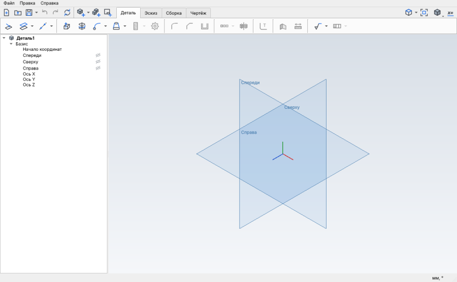

## 2. Навигация в 3D-виде

Профиль мыши по умолчанию — **«Вращение средней кнопкой»**. Для ноутбуков без средней кнопки есть профиль **«Вращение правой кнопкой (для ноутбуков)»**: Файл → «Настройки программы…», вкладка «Мышь и колесо» (раздел 8а).

| Действие | Вращение средней кнопкой | Вращение правой кнопкой |
|---|---|---|
| Вращение | средняя кнопка (СКМ) | правая кнопка (ПКМ) |
| Панорама | Ctrl + СКМ | СКМ или Ctrl + ПКМ |
| Плавный зум | Shift + СКМ (вверх — ближе) | Shift + ПКМ |
| Зум по шагам | колесо (к курсору) | колесо |
| Выбор | левая кнопка | левая кнопка |
| Контекстное меню | клик ПКМ | клик ПКМ без перетаскивания |

Вращение идёт вокруг точки под курсором. Направление зума колесом можно поменять там же — флажок «Инвертировать зум колесом».

**Стандартные виды**: Ctrl+1 спереди, Ctrl+2 сзади, Ctrl+3 слева, Ctrl+4 справа, Ctrl+5 сверху, Ctrl+6 снизу, Ctrl+7 изометрия, Ctrl+8 «нормально к» выбранной плоскости или плоской грани (повторное нажатие — вид с обратной стороны), F — вписать модель. Стандартный вид сразу вписывает модель в окно и ставит её по центру. Переходы плавные; любое движение мышью или клавишей прерывает переход. Над лентой справа — кнопка **«Изометрия ▾»**: щелчок — изометрия, стрелка — все стандартные виды; рядом — **«Вписать»** (F).

**С клавиатуры** (фокус в виде): стрелки — поворот, Shift+стрелки — поворот на 90°, Alt+←/→ — поворот в плоскости экрана, Ctrl+стрелки — панорама, Shift+Z / Z — приблизить / отдалить.

**Выбор**: наведение подсвечивает грань, ребро или вершину, клик выбирает, Ctrl+клик (или Shift+клик) добавляет к выбору или убирает из него, клик в пустоту снимает выбор.

**Стиль отображения** — кнопка «Стиль ▾» справа над лентой: тонированный с рёбрами (по умолчанию), тонированный, невидимые линии удалены, невидимые линии пунктиром, каркас. Стиль действует на весь вид и запоминается между запусками. Грани и рёбра выбираются в любом стиле; в каркасе можно выбрать и ребро, скрытое за гранями. Цвета детали и граней видны только в тонированных стилях.

## 3. Первая деталь за 5 минут

Пластина 100 × 60 × 10 с отверстием Ø20 и бобышкой Ø30 высотой 15; в конце — правка ширины. На каждом снимке обведено место, куда щёлкнуть, номер — порядок щелчков. Кнопки ленты — значки; название кнопки видно во всплывающей подсказке, если задержать над ней мышь.

1. **Плоскость.** Щёлкните в дереве плоскость «Сверху».

   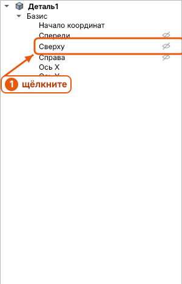

2. **Эскиз.** Щёлкните кнопку «Эскиз» на ленте — или нажмите **Shift+S** (или дважды щёлкните плоскость). Вид повернётся к плоскости.

   

3. **Прямоугольник.** Щёлкните кнопку «Прямоугольник» — или нажмите **R**. Щёлкните в начале координат (появится привязка ●) и затем во втором углу. Эскиз сразу определён бледными слабыми размерами (раздел 4.6).

   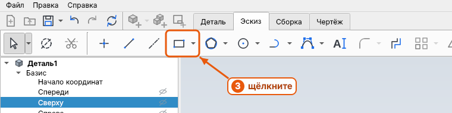

   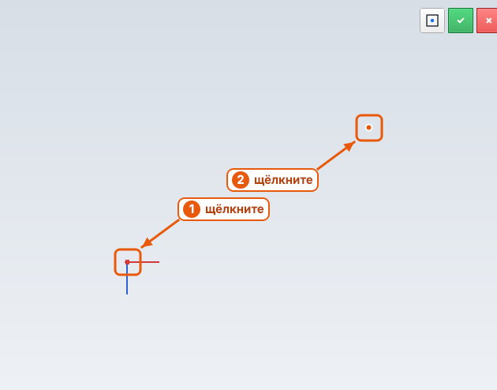

4. **Размеры.** Дважды щёлкните бледный размер ширины и введите `100`, Enter; так же — для высоты (`60`). Размеры станут вашими — тёмными.

   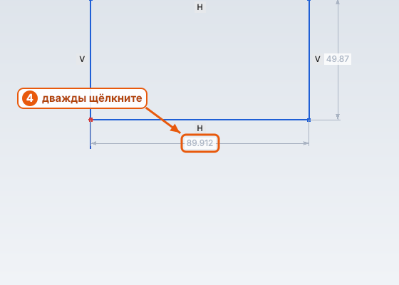

   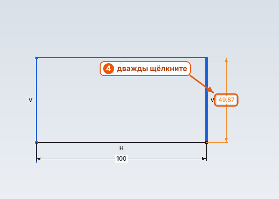

5. **Окружность.** Щёлкните кнопку «Окружность» — или нажмите **C**; щёлкните центр внутри прямоугольника и точку на окружности.

   

   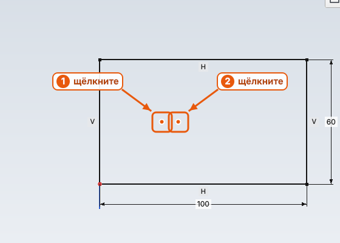

6. **Диаметр.** Щёлкните кнопку «Размер» — или нажмите **D**; щёлкните окружность, затем место надписи и введите `20`, Enter.

   

   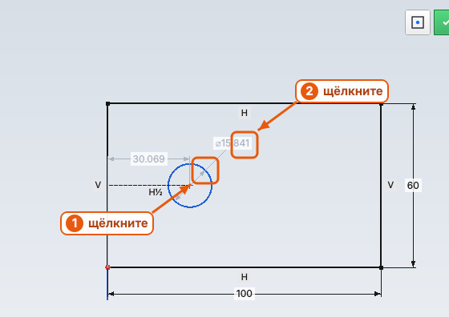

7. **Выход из эскиза.** Щёлкните кнопку «Выйти из эскиза» — или нажмите **Ctrl+Enter** (или ✓ в углу вида).

   

8. **Выдавливание.** Щёлкните кнопку «Выдавливание» — или нажмите **Shift+E**: эскиз уже выбран, окружность станет отверстием.

   

9. **Глубина.** Щёлкните поле глубины в панели и введите `10`.

   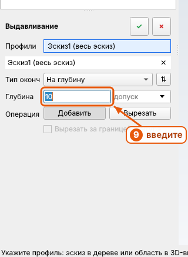

10. **OK.** Щёлкните «OK» — или нажмите **Enter**. Готова пластина с отверстием.

    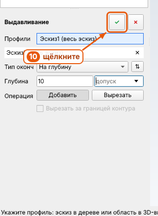

11. **Грань для бобышки.** Щёлкните верхнюю грань пластины (вид — «Изометрия», кнопка над лентой).

    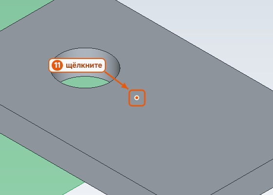

12. **Эскиз на грани.** Щёлкните «Эскиз» — или **Shift+S**.

    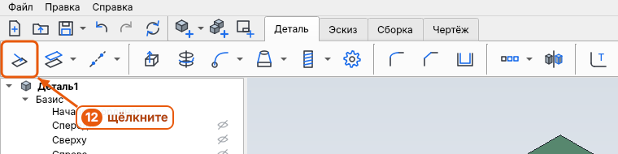

13. **Окружность бобышки.** Как в шагах 5–6: окружность рядом с отверстием и диаметр `30`.

    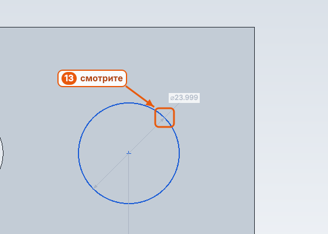

14. **Выход из эскиза** — «Выйти из эскиза» или **Ctrl+Enter**.

    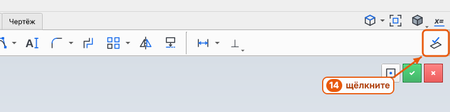

15. **Выдавливание бобышки.** «Выдавливание» или **Shift+E**.

    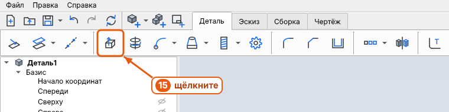

16. **Высота бобышки.** В поле глубины введите `15`.

    

17. **Добавить.** Щёлкните операцию «Добавить» — бобышка прибавится к пластине.

    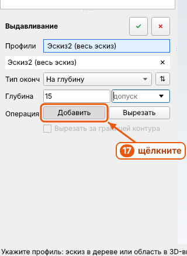

18. **OK** — или **Enter**.

    

19. **Правка.** Дважды щёлкните «Эскиз1» в дереве — эскиз откроется.

    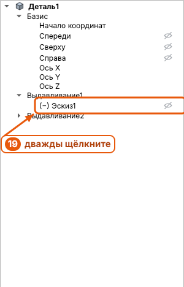

20. **Новая ширина.** Дважды щёлкните размер `100` и введите `140`, Enter.

    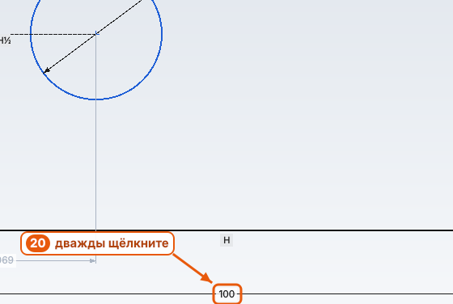

21. **Выход.** «Выйти из эскиза» или **Ctrl+Enter**. Вся модель перестроится, бобышка останется на верхней грани.

    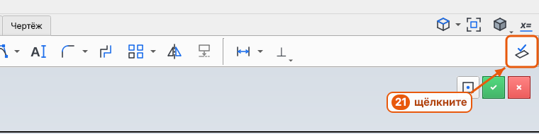

    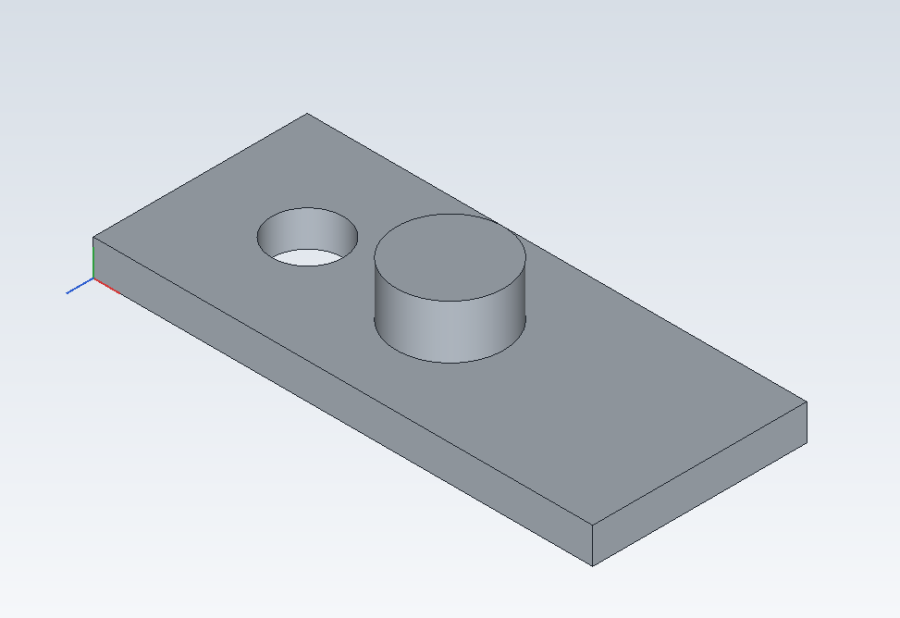

## 3а. Урок: ограничения, размеры, привязки

Профиль скобы из отрезков и дуг в одной цепочке: совпадения и касания ставят привязки, горизонтальность и вертикальность — подсказки при рисовании; лапки симметричны относительно осевой линии; три размера — и эскиз «Полностью определён»; длина лапок — переменная документа. На каждом снимке обведено место, куда щёлкнуть, номер — порядок щелчков.

1. **Плоскость.** Щёлкните в дереве плоскость «Спереди».

   

2. **Эскиз.** Щёлкните кнопку «Эскиз» на ленте — или нажмите **Shift+S**.

   

3. **Отрезок.** Щёлкните кнопку «Отрезок» — или нажмите **L**; щёлкните низ и верх правой лапки. Отрезок встанет вертикально сам — подсказка при рисовании.

   

   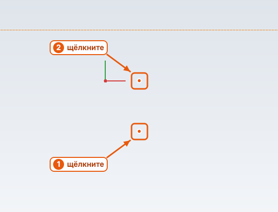

4. **Касательная дуга.** Щёлкните вариант «Касательная» в группе «Дуга» — или нажмите **T**: следующий участок цепочки — дуга, касательная к отрезку. Щёлкните её конец над левой лапкой, затем — низ левой лапки с нажатым **Ctrl** (без привязок и подсказок: его положение задаст симметрия, шаг 6), низ и верх её внутренней стороны: отрезки продолжают цепочку, концы совпадают по привязке.

   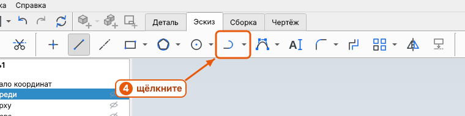

   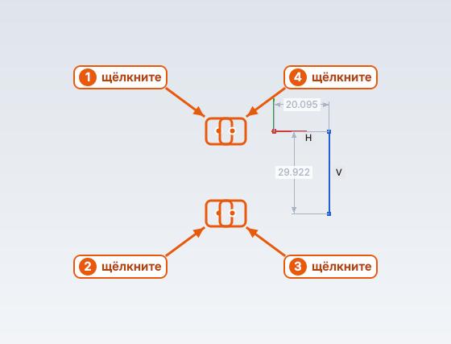

5. **Вторая дуга.** Снова «Касательная» (**T**): внутренняя дуга, затем вниз по правой лапке и обратно к первой точке — контур замкнут. Центры дуг притянуты к началу координат и друг к другу — дуги концентричны без команды.

   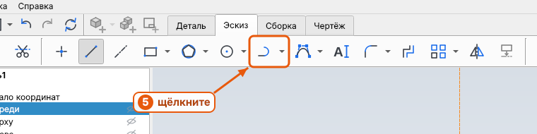

   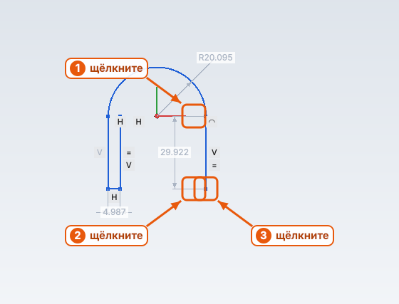

   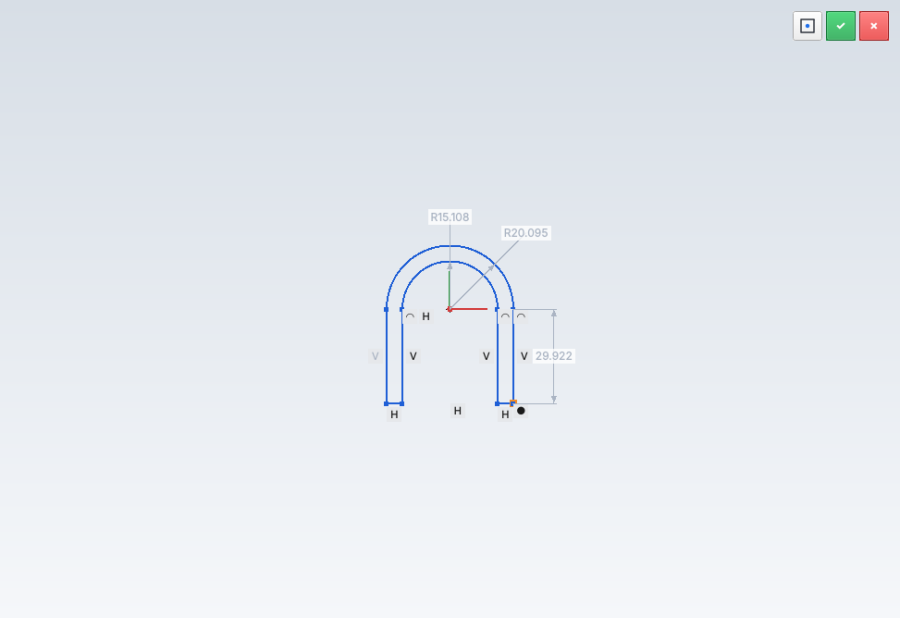

6. **Осевая и симметрия.** Щёлкните кнопку «Осевая линия» и нарисуйте вертикальную осевую через начало координат — снизу вверх. Затем щёлкните наружный нижний угол левой лапки, Ctrl+щелчок — такой же угол правой лапки и осевую, и выберите «Ограничения ▾» → «Симметрия» — или нажмите **Y**: левая лапка встанет зеркально правой (значок симметрии у осевой).

   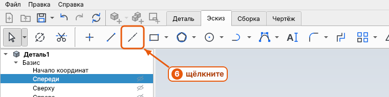

   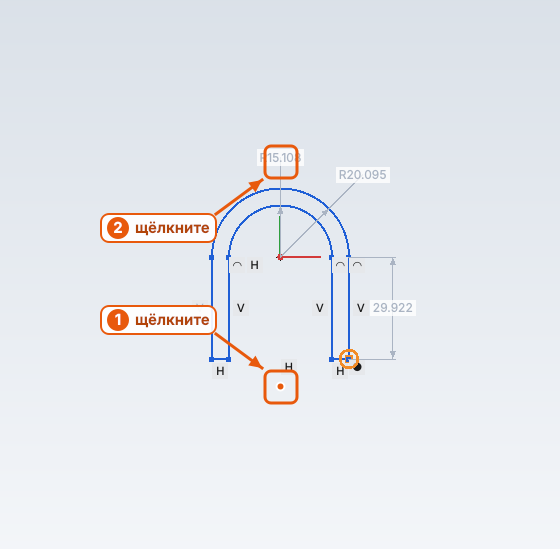

   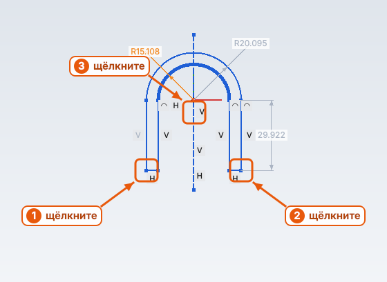

   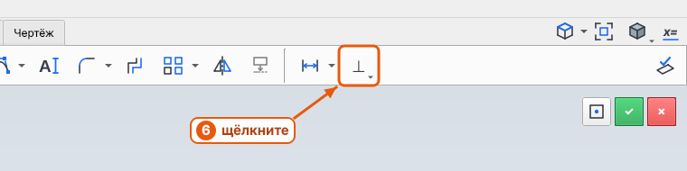

7. **Размеры.** Щёлкните «Размер» — или **D**; щёлкните внешнюю дугу и место надписи, введите `20` (радиус); затем внешний и внутренний отрезок правой лапки — толщина `5`.

   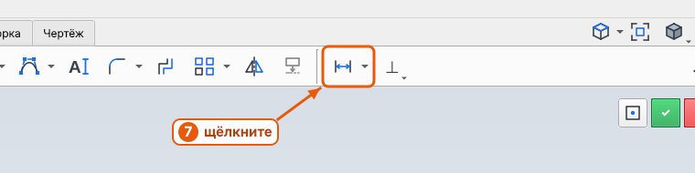

   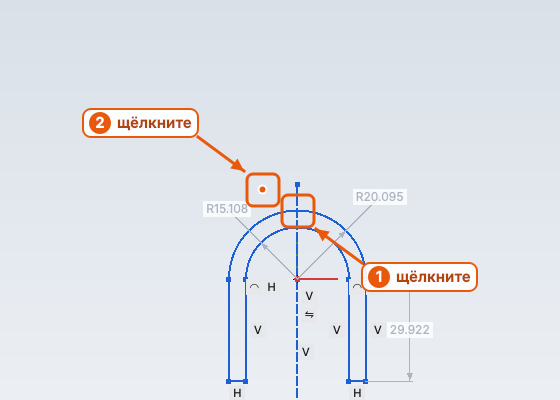

   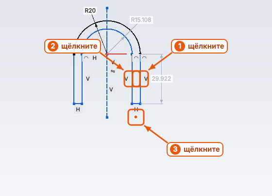

8. **Переменная.** Щёлкните кнопку «Переменные» в правом верхнем углу — откроется панель; щёлкните «+» и введите имя `L` и значение `30`.

   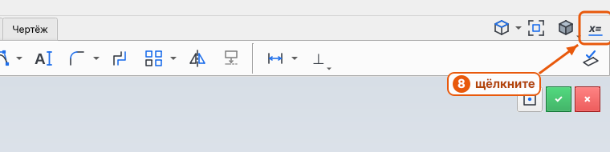

   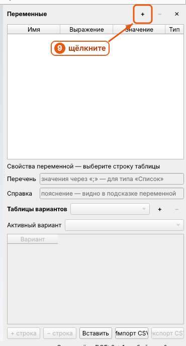

9. **Размер — переменной.** Размер длины правой лапки: щёлкните отрезок и место надписи и введите вместо числа `L`. В строке состояния — «Полностью определён».

   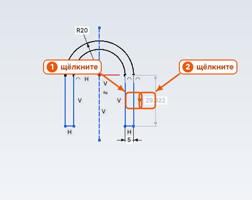

   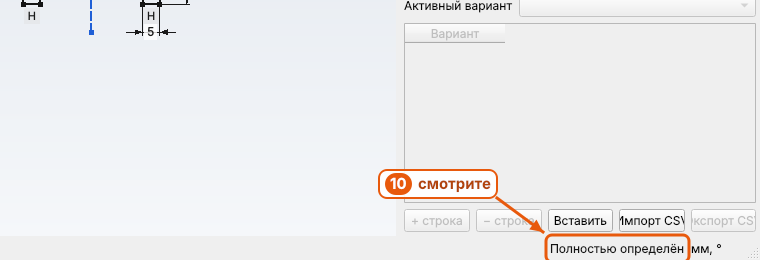

10. **Деталь.** «Выйти из эскиза» (**Ctrl+Enter**), «Выдавливание» (**Shift+E**), глубина `12`, «OK».

    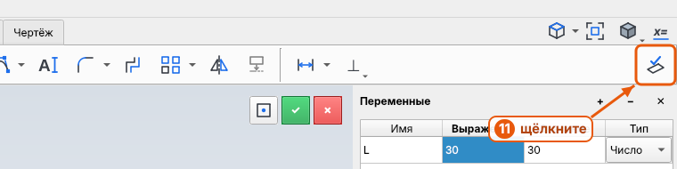

    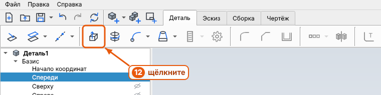

    

    

11. **Правка переменной.** Дважды щёлкните значение `L` в панели переменных и введите `40`, Enter: лапки удлинятся, деталь перестроится.

    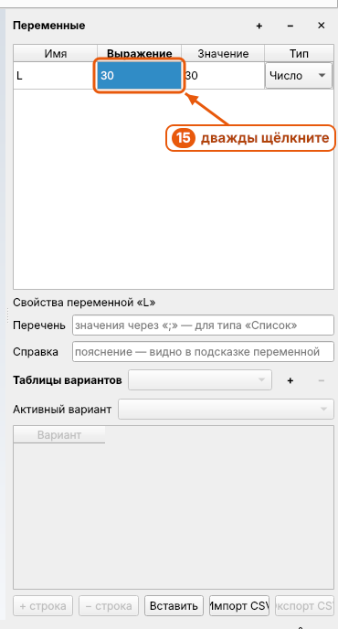

    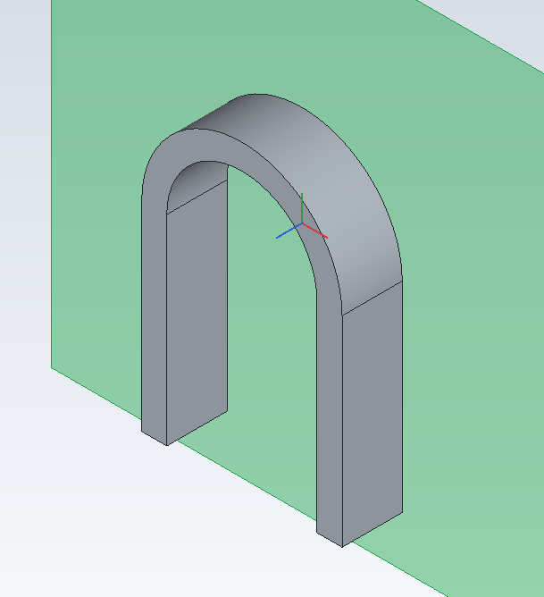

## 3б. Урок: сложный профиль

Пластина со скруглением и фаской эскиза, отверстие, отражённое зеркалом относительно вспомогательной линии, расширение отверстия смещением с обрезкой лишнего и бобышка над отверстием, отцентрированная по проекции ребра детали.

1. **Эскиз и прямоугольник.** Плоскость «Сверху» в дереве, «Эскиз» (**Shift+S**), «Прямоугольник» (**R**) от начала координат; размеры `60` и `40` («Размер», **D**).

   

   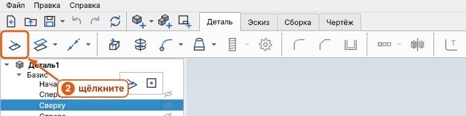

   

   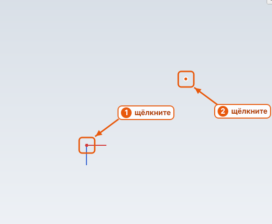

   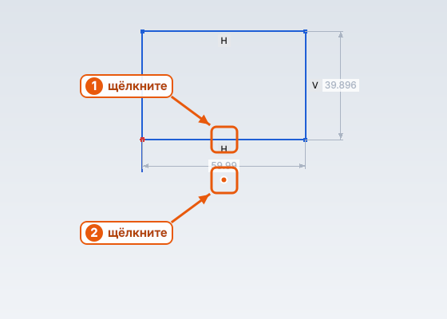

   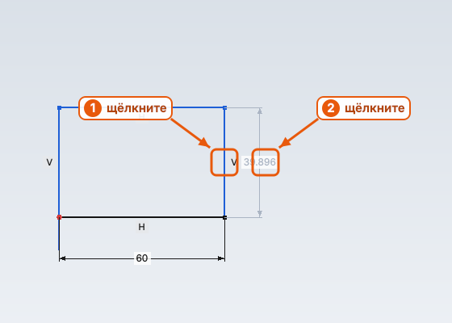

2. **Скругление эскиза.** Выберите «Скругление» в группе «Скругление» на ленте эскиза, щёлкните правый верхний угол и введите радиус `8`, Enter.

   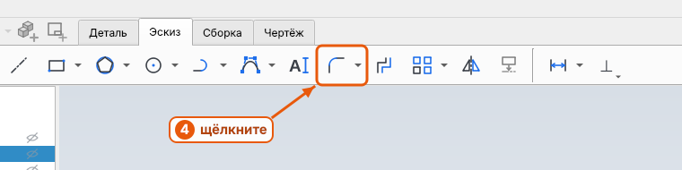

   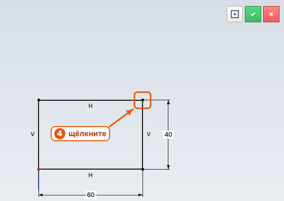

   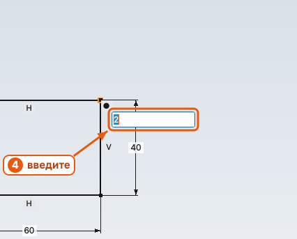

3. **Фаска эскиза.** Там же «Фаска»: щёлкните левый нижний угол и введите `5`, Enter.

   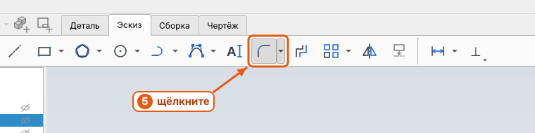

   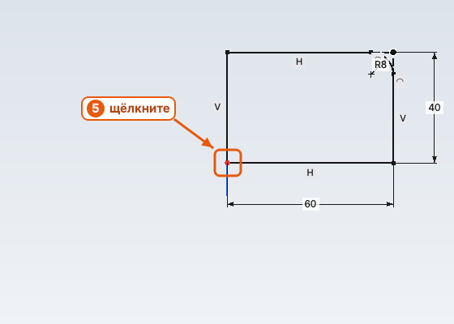

   

4. **Вспомогательная линия.** Включите кнопку «Конструктивная геометрия» (**Q**) и нарисуйте «Отрезком» (**L**) вертикальную линию посередине — она штриховая и не входит в контур детали; затем выключите «Конструктивную геометрию».

   

   

   

5. **Отверстие.** «Окружность» (**C**) слева, диаметр `10` («Размер», **D**).

   

   

   

6. **Зеркало.** Щёлкните окружность, затем кнопку «Зеркало» и вспомогательную линию: справа появится копия, связанная симметрией.

   

   

   

7. **Смещение.** Щёлкните левую окружность, кнопку «Смещение», щёлкните снаружи окружности и введите `3`, Enter — появится окружность больше на 3.

   

   

   

8. **Обрезка.** Щёлкните кнопку «Обрезка» — или нажмите **M** — и щёлкните исходную окружность: она подсвечивается перед щелчком и удаляется.

   

   

9. **Выдавливание.** «Выйти из эскиза» (**Ctrl+Enter**), «Выдавливание» (**Shift+E**), глубина `10`, «OK».

   

   

   

   

10. **Проекция ребра.** Щёлкните верхнюю грань, «Эскиз» (**Shift+S**), кнопку «Проекция» (**U**) и ребро левого отверстия — в эскизе появится его проекция, связанная с деталью.

    

    

    

    

11. **Бобышка.** «Окружность» (**C**): центр — щелчок в центр проекции (привязка), диаметр `24`. «Выйти из эскиза», «Выдавливание», глубина `5`, операция «Добавить», «OK» — над отверстием встанет бобышка, соосная с ним.

    

    

    

    

    

    

    

    

    

## 3в. Урок: вал — вращение, фаски, скругления, оболочка, отверстие

Ступенчатый вал Ø20 / Ø30 / Ø20 вращением половины сечения вокруг оси, оболочка — полый вал с донышком, — фаски на концах, скругление бурта и резьбовое отверстие M6 в донышке.

1. **Эскиз.** Плоскость «Спереди» в дереве, затем «Эскиз» — или **Shift+S**.

   

   

2. **Половина сечения.** «Отрезок» (**L**): щёлкайте точки по порядку номеров — от начала координат вверх, вдоль ступеней и обратно по оси; последний щелчок — в первую точку.

   

   

3. **Размеры.** «Размер» (**D**): длины ступеней `30`, `40`, `30`, радиус конца `10` (высота торца) и радиус бурта `15` (между буртом и осью). Эскиз «Полностью определён».

   

   

   

   

   

   

4. **Вращение.** «Выйти из эскиза» (**Ctrl+Enter**), кнопка «Вращение» — или **Shift+W**; щёлкните в дереве «Ось X» — ось вращения; «OK».

   

   

   

   

5. **Оболочка.** Вид «Справа» (меню кнопки «Изометрия» над лентой); кнопка «Оболочка», щёлкните правый торец — он станет открытым; толщина стенки `2`, «OK»: вал станет полым (оболочку делайте до фасок и скруглений — с ними ядро её не строит), у левого торца останется донышко толщиной 2.

   

   

   

   

6. **Фаски.** Щёлкните ребро одного торца, Ctrl+щелчок — ребро другого; кнопка «Фаска» — или **Shift+C**; размер `1`, «OK».

   

   

   

   

7. **Скругление.** Так же оба наружных ребра бурта и кнопка «Скругление» — или **Shift+F**; радиус `2`, «OK».

   

   

   

   

8. **Точка отверстия.** Вид «Слева» (меню кнопки «Изометрия» над лентой), щёлкните торец, «Эскиз», кнопка «Точка» (**P**) и щелчок в центре торца; «Выйти из эскиза».

   

   

   

   

   

9. **Резьбовое отверстие.** Кнопка «Отверстие» (в группе «Резьба»), тип «Под резьбу», размер «M6», конец «Насквозь», «OK» — резьбовое отверстие в донышке с условным изображением резьбы.

   

   

   

   

   

   

## 3г. Урок: кронштейн — ребро, зеркало, массив, протягивание, лофт

Уголок, выдавленный симметрично, ребро жёсткости в средней плоскости на проекциях рёбер, отверстие в основании и его зеркальная копия, ряд отверстий в стенке линейным массивом, крючок, протянутый по траектории, и сужающаяся опора лофтом.

1. **Профиль уголка.** Плоскость «Спереди», «Эскиз» (**Shift+S**), «Отрезок» (**L**) — точки по порядку номеров, последняя — в первую.

   

   

   

   

2. **Размеры.** «Размер» (**D**): основание `40`, высота `30`, толщины полок `5` и `5`.

   

   

   

   

3. **Симметричное выдавливание.** «Выйти из эскиза», «Выдавливание» (**Shift+E**), конец «Симметрично», глубина `30`, «OK» — уголок шириной 30, по 15 в обе стороны от плоскости «Спереди».

   

   

   

   

   

4. **Ребро жёсткости.** Снова «Спереди» и «Эскиз»; кнопка «Проекция» (**U**) и щелчки по двум внутренним рёбрам уголка; «Отрезок» — треугольник: внутренний угол, середина ребра основания и середина ребра стенки (привязка ◆ «середина»), обратно в угол. Размеры не нужны — вершины держат привязки (катеты 17,5 и 12,5).

   

   

   

   

   

   

5. **Выдавливание ребра.** «Выйти из эскиза», «Выдавливание», «Симметрично», глубина `4`, операция «Добавить», «OK».

   

   

   

   

   

   

6. **Отверстие в основании.** Щёлкните верх основания, «Эскиз», окружность у края с диаметром `6`, «Выйти из эскиза», «Выдавливание», конец «Через всё», операция «Вырез», «OK».

   

   

   

   

   

   

   

   

7. **Зеркало фичи.** Кнопка «Зеркало» на ленте детали, щёлкните в дереве «Вырез1» (что отражать) и плоскость «Спереди» (относительно чего), «OK» — отверстие появится по другую сторону.

   

   

   

   

8. **Отверстие в стенке.** Вид «Слева», щёлкните наружную сторону стенки, «Эскиз», окружность `6`, выход, «Выдавливание» «Через всё», «Вырез», «OK».

   

   

   

   

   

   

   

   

9. **Линейный массив.** Кнопка «Массив» → «Линейный», в дереве «Вырез2» и «Ось Y» (направление), число `2`, шаг `12`, «OK» — ряд из двух отверстий.

   

   

   

   

   

   

10. **Траектория.** Плоскость «Спереди», «Эскиз»; «Отрезок» (**L**) — от наружной стороны стенки на высоте 20 наружу на 12, затем «Касательная» (**T**) — дуга вниз (четверть окружности R8); «Выйти из эскиза».

    

    

    

    

    

    

    

11. **Сечение.** Вид «Слева», щёлкните наружную сторону стенки, «Эскиз», окружность `6` с центром в начале траектории, «Выйти из эскиза».

    

    

    

    

12. **Протягивание.** Кнопка «Протягивание» (группа «Протягивание»): щёлкните поле «Профиль» и в дереве — эскиз окружности, поле «Путь» и в дереве — эскиз траектории, «OK» — из стенки выйдет изогнутый крючок Ø6.

    

    

    

    

    

    

13. **Первое сечение лофта.** Плоскость «Сверху» (по ней — низ основания), «Эскиз», «Прямоугольник» (**R**) 12 × 12 под основанием, «Выйти из эскиза».

    

    

    

    

    

14. **Плоскость ниже.** Снова «Сверху» в дереве, «Плоскость ▾» → «Смещённая», расстояние `8`, кнопка «Обратить» (⇅) — плоскость ниже «Сверху», «OK».

    

    

    

    

    

15. **Второе сечение.** Новая плоскость в дереве, «Эскиз», «Окружность» (**C**) Ø8 под центром прямоугольника, «Выйти из эскиза».

    

    

    

    

    

16. **Лофт.** Кнопка «Лофт» (группа «Лофт»), в дереве — эскиз прямоугольника, затем эскиз окружности, «OK» — под основанием встанет опора, сужающаяся от квадрата к кругу.

    

    

    

    

    

## 3д. Урок: чертёж детали

Чертёж вала из урока 3в: лист A3 в масштабе 2:1, главный вид, проекционный вид, разрез по оси, размеры из модели и свой размер от оси, шероховатость, допуск, заданный в чертеже, текст технических требований в рамке и вывод в PDF. Откройте вал из урока 3в или свою деталь и поставьте на ней обозначения (раздел 6в): шероховатость Ra 1,6 на бурт и посадку k6 на шейку — их перенесёт на чертёж шаг 7 и размер шага 11. На каждом снимке обведено место, куда щёлкнуть, номер — порядок щелчков.

1. **Новый чертёж.** Щёлкните кнопку «Новый чертёж» над лентой. Откроются лист и вкладка «Чертёж», справа — панель «Чертёж и лист».

   

2. **Формат и ориентация.** В панели справа выберите формат «A3» и ориентацию «Альбомная».

   

3. **Масштаб.** В поле «Масштаб» введите `2:1`, Enter (или выберите из списка ряда ГОСТ 2.302).

   

4. **Главный вид.** Щёлкните «Вид ▾» на вкладке «Чертёж», выберите «Вал» и щёлкните на листе, где поставить вид.

   

   

5. **Проекционный вид.** Пока главный вид выбран, щёлкните «Проекционный вид» и затем справа от главного вида — встанет вид слева, выровненный с главным.

   

   

6. **Разрез по оси.** Щёлкните главный вид (он выберется рамкой), кнопку «Разрез», наведите курсор на ось вала — она подсветится — и щёлкните: линия разреза пройдёт по всей оси и привяжется к ней (после правки вала разрез останется на оси). Третьим щелчком — ниже вида — поставьте разрез.

   

   

   

7. **Дополнительная информация.** Щёлкните «Расставить всю дополнительную информацию» — на виды встанут обозначения из модели: знак шероховатости бурта.

   

8. **Перемещение обозначения.** Перетащите знак шероховатости мышью на свободное место — выноска сама пойдёт к ближайшей точке поверхности. Delete удаляет выбранный знак, Ctrl+Z возвращает.

   

9. **Размеры из модели.** Щёлкните «Проставить все размеры из модели» — на виды встанут размеры эскиза вала (знак шероховатости уже отодвинут и не мешает).

   

10. **Размер от оси.** Щёлкните «Размер», затем ось вала (она подсвечивается раньше совпадающих линий), верхнюю линию бурта и место размера — получится радиус бурта `15`. Esc — выйти из режима размеров.

    

    

11. **Допуск, заданный в чертеже.** «Размер», щёлкните верхнюю и нижнюю линии шейки и место — размер `Ø20k6` (посадка из модели); Esc — размер остаётся выбранным. В панели справа включите «Задать в чертеже» и введите в поле допуска `h6`, Enter: на этом чертеже — `Ø20h6` (на экране фиолетовым), в детали посадка не меняется.

    

    

    

    

12. **Текст в рамке.** Щёлкните «Текст» и растяните рамку мышью на свободном месте листа; введите заголовок «Технические требования», Enter, и текст требования — строки сами переносятся по ширине рамки; **Ctrl+Enter** — готово, текст остаётся выбранным. В блоке «Текст» панели справа выделите заголовок и щёлкните «Ж» (курсив — «К», подчёркнутый — «Ч»; при вводе на листе — **Ctrl+B**, **Ctrl+I**, **Ctrl+U**), **Ctrl+Enter**.

    

    

    

13. **PDF.** Файл → Экспорт → PDF… — справа появится список чертежей с отмеченным текущим; щёлкните «OK» и задайте имя файла. Лист сохранится в векторном PDF формата A3.

    

    

## 4. Эскиз

### 4.1. Вход и выход

- Новый эскиз: выбрать плоскость или плоскую грань → Shift+S (или кнопка «Эскиз», или двойной клик по плоскости в дереве). Если ничего не выбрано, «Эскиз» ждёт щелчка: щёлкните исходную или справочную плоскость (в виде или в дереве) или плоскую грань тела — в том числе плоский торец тела вращения; Esc — отказ.
- Редактировать: двойной клик по эскизу в дереве или «Редактировать эскиз» в контекстном меню.
- При входе вид поворачивается «нормально к» плоскости эскиза и вписывает в окно эскиз вместе с деталью. Стрелки маленьких размеров, которым не хватает места на размерной линии, сами выносятся наружу.
- Выход: Ctrl+Enter, ✓ в углу вида, кнопка «Выйти из эскиза». Если в эскизе ничего не меняли, Esc (когда нет инструмента и выделения) закрывает его, как ✗; после правок Esc из эскиза **не** выходит — чтобы случайно не потерять работу.
- **Отменить**: красная ✗ рядом с зелёной ✓ в углу вида — выйти из эскиза, отменив все его изменения с момента, когда вы его открыли (одним шагом; Ctrl+Z вернёт их). Новый эскиз, оставшийся пустым, удаляется, а его плоскость или грань остаётся выбранной — можно сразу начать заново.

  

- Все изменения записываются сразу; каждое действие — отдельный шаг отмены. Ctrl+Z в эскизе отменяет одно действие и оставляет эскиз открытым, вид не меняется.

### 4.2. Инструменты рисования

На вкладке «Эскиз» первая кнопка — **Выделить ▾** (режим по умолчанию; в её меню — «Выделить всё», Ctrl+A), рядом — «Конструктивная геометрия» и «Обрезка». Кнопка текущего инструмента показана нажатой. Esc и завершение разовых команд возвращают в режим «Выделить».

Варианты одного инструмента собраны в кнопку со стрелкой: Прямоугольник ▾, Примитивы ▾, Окружность ▾, Дуга ▾, Скругление ▾, Массив ▾. Стрелка открывает список вариантов, сама кнопка запускает последний выбранный (после запуска программы — первый в списке; у «Дуга ▾» это «Касательная»).

| Инструмент | Клавиша | Как рисовать |
|---|---|---|
| Точка | P | клик |
| Отрезок | L | клик — клик — …: цепочка; щелчок по началу цепочки замыкает контур, двойной клик или Esc заканчивает цепочку; можно и нажать в начале, протянуть и отпустить в конце — один отрезок |
| Прямоугольник по углам | R | два клика по противоположным углам |
| Прямоугольник от центра | Shift+R | центр, затем угол |
| «N-угольник вписанный (по вершине)» / «N-угольник описанный (по середине стороны)» (Примитивы ▾) | — | центр, затем вершина (вписанный) или середина стороны (описанный); число сторон (3…40) — поле «Сторон» в левой панели под деревом, по умолчанию 6 |
| Звезда (Примитивы ▾) | — | центр, затем вершина луча; число лучей — поле «Лучей» в левой панели под деревом (по умолчанию 5); внутренний диаметр — половина внешнего |
| Окружность | C | центр, затем точка на окружности |
| Окружность по 3 точкам (Окружность ▾) | — | три точки на окружности |
| Эллипс (Окружность ▾) | — | центр, конец первой полуоси (её длина и наклон), затем щелчок, задающий вторую полуось |
| Сплайн (Сплайн ▾: «По управляющим точкам», «Через точки») | — | щелчки по точкам; щелчок по последней точке ещё раз (или двойной щелчок, Enter) — готово; щелчок по первой точке — замкнутый сплайн |
| Дуга по 3 точкам | A | начало, конец, точка на дуге |
| Дуга центр–начало–конец | Shift+A | центр, начало, конец |
| Касательная дуга | T | от конца отрезка или дуги; в цепочке отрезков — следующий сегмент дугой, затем цепочка продолжается отрезками |
| Осевая линия | кнопка ленты | конструктивный отрезок (ось для вращения) |
| Конструктивная геометрия | Q | с выбранными кривыми — переключает их в конструктивные и обратно (конструктивные участвуют в ограничениях, но не в профилях); без выделения — включает и выключает **режим конструктивной геометрии**: пока кнопка нажата, всё, что вы рисуете, сразу получается конструктивным, а щелчок по элементу (без инструмента рисования) переключает его. Если после переключения конструктивный элемент лёг точно на другой (например, конструктивная линия под обычной), лишний удаляется, а его ограничения и размеры переходят на оставшийся — чертёж не меняется; если так не получается, оба остаются и в строке состояния появляется подсказка. Esc выключает режим; при каждом открытии эскиза он выключен |
| Надпись | кнопка ленты | клик ставит начало первой строки, в окне — текст, шрифт, высота прописных, угол; текст может быть в несколько строк (Enter — новая строка, Ctrl+Enter или OK — готово); кнопки «Ж», «К», «Ч» (Ctrl+B, Ctrl+I, Ctrl+U) делают выделенные слова полужирными, курсивом или подчёркнутыми (начертания строятся программой из обычного шрифта, подчёркивание — полоска под строкой); кнопка «⌀°±» рядом — меню знаков (⌀, R, □, ⌒, °, ±, × и др.): знак вставляется в место курсора. Поле текста растёт вместе с числом строк (до половины высоты окна, дальше — прокрутка); за уголок справа внизу его можно растянуть мышью. Двойной клик по надписи — правка; надпись перетаскивается захватом за сам текст. Буквы можно выдавить или вырезать как обычные области; трафаретные шрифты — из папки шрифтов: по умолчанию — Sowjetschablone (советский трафарет), есть трафарет по ГОСТ 2.304 Construe Stencil GOST A и B (буквы с замкнутыми контурами разрезаны на штрихи: «О» — на две половины, у «Б», «Р» чаша отделена от стойки — внутренности букв не выпадают); в списке есть и чертёжные шрифты ГОСТ (OpenGost) и ISO (osifont). Шрифт по умолчанию меняется в настройках программы |
| Обрезка | M | наведите на участок кривой — он подсветится; клик удаляет его до ближайших пересечений (окружность без пересечений удаляется целиком). Если при этом пропали ограничения, уведомление скажет об этом и предложит отменить |
| Проекция | U | клик по ребру или вершине тела — оно появится в эскизе штрихпунктиром и будет следовать за моделью |

Пока элемент рисуется, предпросмотр лежит в плоскости эскиза: при взгляде под углом окружность выглядит эллипсом. Слишком маленький элемент не создаётся — подсказка «Слишком маленький элемент». Знаки привязок у курсора (H, V, ∥, ⊥, =, ◠) крупные и полужирные; если радиус или длина почти равны уже нарисованным (так же близко, как при других привязках), элемент-образец обводится и новый элемент получает «Равенство».

**Привязки к рёбрам вне плоскости.** К вершинам и рёбрам деталей, лежащим выше или ниже плоскости эскиза (прямым, дугам, окружностям), можно привязываться при любом повороте вида — к их проекции на плоскость эскиза: подведите курсор туда, где проекция ребра лежит в плоскости эскиза (при виде «нормально к» — прямо на ребро), и цель подсветится; щелчок сам создаст вспомогательную проекцию и привяжет к ней точку, а при изменении детали точка последует за ребром. Ребро, перпендикулярное плоскости эскиза, — цель-точка. Где ребро детали или линия другого эскиза протыкает плоскость эскиза, есть цель-точка прокола: щелчок туда ставит точку ровно в место прокола, и при изменении модели она переходит на новое место прокола (отдельной кнопки «Прокалывание» больше нет). В инструментах «Размер» и «Ограничение» объект, к которому привяжется щелчок (в том числе ребро детали без проекции, образующая, ось), подсвечивается ещё до щелчка. Подсвечивается только цель под курсором; если в одном месте их несколько, побеждает ближайшая к плоскости эскиза.

**Привязки к телам вращения.** Если ось вала, трубы или отверстия лежит в плоскости эскиза (или параллельна ей), к боковой поверхности можно привязаться прямо, без кнопки «Проекция»: у цилиндров и конусов — к их образующим (крайним линиям, наружным и внутренним), у скруглений-торов и других кривых поверхностей — к самой дальней и самой ближней к оси точке профиля. Точка ставится на образующую, размер можно поставить от образующей; при изменении диаметра детали эскиз следует за ней. Образующая, за которую зацепилась привязка, подсвечивается.

**Скругление и фаска в эскизе** — кнопка «Скругление ▾»: щёлкните по углу двух отрезков и введите радиус (у фаски — «3» для равных сторон, «3; 4» — две стороны, «3; 45°» — сторона и угол). Если на том же контуре уже есть скругления, поле сразу предлагает радиус ближайшего из них. Стороны угла не сдвигаются, а только укорачиваются. Угол остаётся «виртуальным»: размеры сторон по-прежнему отсчитываются от него, и при их изменении скругление сохраняется.

**Зеркало и смещение.** «Зеркало» (на ленте — сразу за «Массив ▾»): выделите элементы, нажмите кнопку и щёлкните по оси (отрезку, проекции-отрезку или оси эскиза) — появятся отражённые копии, связанные симметрией. «Смещение»: выделите элементы (в том числе проекции и вспомогательные линии), нажмите кнопку, щёлкните с той стороны, куда сместить, введите расстояние — появится смещённая копия. Без выделения: нажмите «Смещение» и щёлкните элемент — появится меню **«Отрезок»** (сместить только его) или **«Контур»** (весь замкнутый контур, в который входит элемент, — и из проекций, и из вспомогательных линий): для контура сразу вводится значение — положительное смещает наружу, отрицательное внутрь; углы сопрягаются сами, дуги меняют радиус. Щелчок по **ребру тела** (кнопка доступна и в пустом эскизе) сам проецирует весь видимый контур, в который входит ребро, и сразу предлагает значение смещения. У смещённого контура **одно значение** и одна надпись размера: измените её — сместится весь контур; значение с минусом переводит весь контур на другую сторону. Смещённый контур не переопределяет эскиз: касательные стыки (отрезок с дугой, дуга с дугой) остаются касательными без лишних ограничений; документы прежних версий при открытии получают смещение в таком виде. Двойной щелчок по смещённому контуру — правка: Ctrl+щелчок по элементу добавляет его в контур или убирает, Enter — применить, Esc — выйти без изменений. Смещённые линии всегда обычные (контур для выдавливания), даже от вспомогательных линий и проекций. Эллипсы зеркало отражает, а массив размножает так же, как окружности.

**Примитивы.** N-угольник и звезда остаются связанными: двойной щелчок по стороне или вершине открывает окно примитива — число сторон и вид (вписанный или описанный) у N-угольника, число лучей и два диаметра у звезды. Размеры и ограничения, которые вы поставили к сторонам и вершинам, сохраняются (к исчезнувшим сторонам — удаляются вместе с ними). Кнопка «Развязать» в окне превращает примитив в обычные отрезки с ограничениями.

**Эллипс.** Размер эллипса — инструмент «Размер»: щелчок по эллипсу и по месту у конца нужной полуоси ставит большую («a») или малую («b») полуось; контекстное меню размера переключает полуоси и поворот («∠»). Эллипс касается отрезка, окружности, дуги и другого эллипса («Касательно»), проходит через точку («Совпадение» точки и эллипса), концентричен окружности; два эллипса можно сделать равными («Равенство»). Выдавливается как обычный контур. Эллипс обрезается инструментом «Обрезка», как окружность: щелчок по участку между двумя пересечениями удаляет его, остаётся **дуга эллипса**; она обрезается как дуга и сама обрезает другие линии. Дуга эллипса входит в контур вместе с отрезками и дугами (например, половина эллипса и отрезок через центр — «полуэллипс»). Если эллипс или дуга эллипса пересекает другие линии не в своих концах, она в контур не входит (появится предупреждение).

**Сплайн.** «По управляющим точкам» строит плавную кривую по точкам-«полюсам»: кривая начинается в первой точке, заканчивается в последней и тянется к промежуточным (их соединяет штриховой многоугольник). Из 2–4 точек получается кривая Безье, из большего числа — B-сплайн; щелчок по первой точке замыкает кривую. «Через точки» строит кривую, проходящую через все указанные точки. Форма меняется перетаскиванием полюсов; отмена — одним шагом. Размеры ставятся на полюса (расстояния, координаты); «Размер» по полюсу и его сплайну задаёт **вес** полюса (чем больше, тем сильнее кривая к нему притягивается). В стыке сплайна с отрезком, дугой или другим сплайном (концы соединены «Совпадением») можно поставить «Касательно» и «Равенство кривизны» — стык становится гладким. Точку можно поставить на сплайн («Совпадение» точки и сплайна). Замкнутые контуры со сплайнами выдавливаются, вращаются и вырезают, как обычные; сплайн обрезается инструментом «Обрезка» и сам обрезает другие линии; деталь со сплайнами сохраняется в STEP.

**Массив в эскизе.** Кнопка «Массив ▾»: выделите элементы (отрезки, окружности, дуги, эллипсы, точки) и выберите «Линейный массив» — появится окно с числом копий, шагом и направлением по двум осям (вторая ось включается числом больше 1); «Круговой массив» — затем щёлкните центр (точку или начало координат) и задайте число копий и угол (360° — равномерно по кругу). Пока окно открыто, копии видны пунктиром; OK создаёт их. В полях можно писать выражения с переменными документа (например, число копий `n` и шаг `p`): при изменении переменной массив перестраивается. Кнопка «По отрезку» в окне линейного массива — затем щелчок по отрезку эскиза: направления осей отсчитываются от этого отрезка, и массив поворачивается вместе с ним. У «Направления 2» своя кнопка «По отрезку»: так вторую ось задают другим отрезком эскиза — копии встают сеткой по двум отрезкам, и вторая ось следует за поворотом своего отрезка. Массив остаётся связанным: двойной щелчок по любой копии открывает окно снова, а правка исходных элементов (размеры, перетаскивание) сразу меняет все копии. Пункт «Развязать массив/примитив» в меню кнопки «Массив ▾» (под чертой; доступен, только когда выделена копия массива или сторона примитива; его подсказка объясняет, что он делает) или «Развязать» в окне правки превращает массив (и N-угольник, звезду) в обычную геометрию: копии остаются на месте, держатся за исходные взаимосвязями «перенос» ⇉ или «поворот» ↻, которые можно удалить. Delete на копии удаляет весь массив; обрезать или скруглить копию можно только после «Развязать».

**Размер при рисовании.** Поставив начало отрезка (или центр окружности), просто наберите число — у курсора появится поле; Enter создаст отрезок такой длины в направлении курсора (окружность — такого диаметра) сразу с размером.

### 4.3. Привязки и авто-ограничения

При рисовании курсор «прилипает», значок рядом с курсором показывает к чему:

- ● к точке (концы, центры, начало координат) → совпадение;
- ✕ к пересечению двух кривых → точка на обеих;
- ◆ к середине отрезка → середина;
- ⌒ на кривую или её продолжение → точка на кривой;
- H / V горизонтально / вертикально → ограничение у отрезка;
- ⊥ / ∥ перпендикулярно / параллельно предыдущему отрезку (или отрезку, над которым вы задержали курсор);
- ◠ касательно продолжению дуги; так же — в любом стыке с дугой: отрезок или дуга, начатые или законченные в конце отрезка или дуги почти по касательной (до 20°), касаются его — скруглённый прямоугольник «отрезок, дуга, отрезок, дуга…» получает все касания, даже если точки поставлены неточно;
- линии выравнивания с другими точками и серединами отрезков (пунктир) → точка встаёт на одну горизонталь или вертикаль с ними.

Всё, что подсвечено в момент щелчка, становится ограничением. Такие автоматические ограничения уступают вашим: если поставленный вами размер или взаимосвязь с ними противоречит, лишнее автоматическое ограничение снимается само (уведомление предложит «Сделать справочным», если вы хотели только посмотреть значение).

**Геометрия тела в плоскости эскиза** доступна сразу: вершины и рёбра тел, которые лежат в плоскости эскиза (например, нижний контур бруска, стоящего на этой плоскости), работают как точки и кривые для привязок. При такой привязке программа сама добавляет конструктивную проекцию этой вершины или ребра — ваш элемент будет следовать за телом при изменениях.

Удерживайте **Ctrl** при клике, чтобы поставить точку без привязок и авто-ограничений.

### 4.4. Ограничения

Выберите сущности и нажмите клавишу (или щёлкните значок на контекстной панели) — или нажмите клавишу и кликайте по сущностям (инструмент остаётся активным для следующих). Все ограничения есть и в списке «Ограничения ▾» на ленте.

| Ограничение | Клавиша | Для чего |
|---|---|---|
| Совпадение / на объекте | I | точка + точка; точка + кривая |
| Горизонтально | H | отрезок; две точки; точка + отрезок (на одной горизонтали с его серединой) |
| Вертикально | V | отрезок; две точки; точка + отрезок (с серединой) |
| Параллельно | Shift+L | два отрезка |
| Перпендикулярно | Shift+T | два отрезка |
| Касательно | N | отрезок + окружность/дуга; две окружности/дуги |
| Равенство | E | два отрезка; две окружности/дуги |
| Концентрично | O | две окружности/дуги |
| Коллинеарно | — | два отрезка на одной прямой |
| Корадиально | — | две окружности/дуги: общий центр и радиус |
| Середина | Shift+M | точка + отрезок; точка + дуга |
| Точка в пересечении | — | точка + две кривые (точка ложится на обе) |
| Длина пути (сумма длин) | — | два и более отрезков/дуг — размер суммы их длин (с префиксом «Σ»; значок кнопки — Σ) |
| Симметрично | Y | две точки + отрезок-ось |
| Зафиксировать | X | точка, окружность, эллипс (целиком — становится определённым), отрезок (у дуги фиксируйте точки) |

С несколькими выделенными сразу: несколько отрезков + H или V — каждый получит своё ограничение; три и больше отрезков (окружностей) + «Параллельно», «Равенство», «Концентрично» — каждый с первым выбранным. Ограничение, которое уже есть, второй раз не ставится. Ограничение можно ставить и к ребру или вершине тела — проекция создастся сама.

Значки ограничений показываются у сущностей; пункт «Показать ограничения» в конце меню кнопки «Ограничения ▾» на вкладке «Эскиз» (или Shift+C) прячет и показывает их. Совпадение и точка на кривой видны, только когда курсор над точкой. Выбранный значок удаляется клавишей Del.

**Оси эскиза.** Горизонтальная и вертикальная оси через начало координат на эскизе не нарисованы, но ими можно пользоваться: щёлкните рядом с осью, ставя ограничение («Симметрично», «Касательно», «Совпадение» и др.) или размер, — ось выберется, и ограничение встанет к ней. С этого момента ось видна на эскизе как вспомогательная линия. Рисовать осевую линию для симметрии относительно оси не нужно. Точка, поставленная при рисовании у оси, сама выравнивается с началом координат — то есть лежит на оси.

### 4.5. Размеры

Один инструмент **D** ставит нужный размер сам: отрезок — длина; две точки — расстояние; окружность — диаметр; дуга — радиус; эллипс — полуось; два параллельных отрезка — расстояние между ними; два непараллельных отрезка — угол (какой именно — по сектору, где стоит курсор); точка и отрезок — расстояние до прямой; точка, отрезок или окружность и обод другой окружности — ближайшее расстояние до окружности (до центра — щёлкните точку центра). Для отрезка и пары точек положение курсора выбирает горизонтальный, вертикальный или прямой размер. Размер можно поставить и к проекции, и прямо к ребру или вершине тела — проекция создастся сама.

Как ставить: щёлкните один-два объекта (они подсветятся), затем щёлкните пустое место, где должен стоять размер: отрезок и место — длина отрезка; отрезок, второй отрезок и место — расстояние между ними (или угол). Если задержать мышь, не щёлкая, программа покажет бледным цветом, какой размер и где встанет при щелчке в этой точке; при движении мыши подсказка исчезает. Esc сбрасывает выбранное (как будто ничего не щёлкали), второй Esc — выход из режима. Режим «Размер» остаётся включённым — можно сразу ставить следующий размер. Постановка размера геометрию не сдвигает: размер сначала получает текущее значение.

Только что поставленный размер сразу выделен, рядом появляется его панель: например, «Диаметр от оси» можно включить, не выходя из инструмента. В инструменте «Размер» щелчок по надписи любого размера открывает его панель, а надпись можно перетащить. После размещения сразу открывается поле значения: введите число или выражение (`= L/2`), Enter; Esc оставит измеренное значение. Размеры всегда положительные: ввод отрицательного числа переставляет геометрию на другую сторону. Двойной клик по размеру — изменить (в любом режиме эскиза; после ввода инструмент остаётся прежним). Размер с выражением показан с префиксом «ƒ». В режиме «Выделить» размер можно перетащить за текст или размерную линию — меняется только положение надписи.

В контекстном меню размера: «Изменить значение», «Радиус»/«Диаметр», у дуги — «Длина дуги» (префикс «⌒») и «Центральный угол» (префикс «∠»), у эллипса — «Большая полуось», «Малая полуось», «Поворот», у расстояния до окружности — «Дальнее»/«Ближайшее», у размера от точки или отрезка до оси (осевой линии), а также у размера от точки на оси (например, от начала координат или от точки на осевой линии) поперёк оси — переключатель «Радиус от оси»/«Диаметр от оси» (для тел вращения: размер вводится и показывается как Ø и рисуется симметрично в обе стороны от оси; геометрия при переключении не меняется; то же — Shift+D или «Ø» на контекстной панели; на чертеже размер из модели тоже будет Ø). Осью может быть и справочная ось детали («Ось1» и т. п.): в инструменте «Размер» щёлкните точку, затем ось в окне — размер ляжет на её проекцию в эскиз и тоже переключается в Ø. Размер между отрезком и осевой линией меряется от оси, «Справочный»/«Управляющий» (справочный показан в скобках), «Допуск…» (допуск размера — см. §6в), «Удалить». Удаление размера не удаляет взаимосвязей. В инструменте «Размер» можно, не выходя из него, щёлкнуть существующий размер (он подсветится) и нажать Delete — размер удалится. Щелчок по любому размеру, в том числе бледному слабому, показывает у курсора панель размера; у слабого на ней «Изменить значение» и «Диаметр / радиус от оси» (размер при этом становится обычным).

Если новый размер переопределил бы эскиз, он становится справочным (показывает значение, но не управляет) — уведомление сообщит об этом и предложит «Сделать управляющим».

### 4.6. Состояние эскиза

Цвет кривых: **синий** — держится только слабыми размерами (можно перетаскивать), **чёрный** — полностью определено вашими размерами и взаимосвязями, **красный** — конфликт. Конструктивная геометрия — пунктиром того же цвета, проекции — штрихпунктиром. Индикатор в строке состояния: «Определён · DOF: 0 + n слабых», «Полностью определён», «Избыточные ограничения», «Конфликт ограничений», «Не решён» («Недоопределён · DOF: n» — только у свободной вспомогательной геометрии, которая ни к чему не привязана).

**Слабые размеры.** Эскиз всегда полностью определён: размеры, которые вы не поставили, программа «додумывает» по тому, как нарисовано, и показывает их бледными. Это по возможности ширина и высота (длины сторон, расстояния по горизонтали и вертикали между концами наклонных отрезков), а положение каждого контура задаёт одна его опорная точка. От начала координат образмеривается только первая фигура пустого эскиза; следующие фигуры — от ближайших точек уже нарисованных, а если в эскизе есть проекции вершин тела — от ближайшей из них. Фигура, уже привязанная к началу координат (например, прямоугольник от центра в начале), образмеривается по своим размерам — шириной и высотой, а не от начала до углов; стороны конструктивного прямоугольника тоже получают ширину и высоту. Опорную точку можно выбрать самому: правый щелчок по точке — «Сделать опорной»; выбор сохраняется в файле. Бледный размер ведёт себя как обычный: его надпись можно перетащить (размер станет обычным на новом месте), а двойной щелчок открывает поле значения — введите точное значение, Enter — размер станет обычным. Бледную взаимосвязь (значок) щелчок сразу делает обычной. Самостоятельные точки рисуются крупными кружками с белой обводкой, концы отрезков — маленькими квадратиками: так видно, где вы поставили точку. Если поставить размер или взаимосвязь, которые противоречат слабому размеру, слабый просто исчезнет — конфликта не будет. Когда вы меняете свой размер, остальное держат слабые размеры: например, изменение ширины прямоугольника двигает одну его сторону, а не обе, а изменение координаты угла сдвигает весь прямоугольник.

**Образмерить основное** и **Образмерить всё, включая сплайны** — пункты меню кнопки «Размер ▾» на вкладке «Эскиз» (доступны, когда в эскизе есть слабые размеры): слабые размеры и взаимосвязи становятся обычными (первый пункт оставляет слабыми размеры точек сплайнов, второй образмеривает и их), нарисованное не сдвигается; отменяется одним Ctrl+Z. Размеры получает основная геометрия и вспомогательная, на которой она держится (у оси длина не ставится); надписи раскладываются так, чтобы не накладываться друг на друга и на геометрию. Уведомление сообщит, сколько размеров стали обычными.

Геометрию, которую держат только слабые размеры, можно тянуть мышью — слабые размеры меняются вместе с ней, решатель сохраняет ваши ограничения.

При **конфликте** в углу вида открывается панель конфликта: список противоречащих ограничений, предложение, что удалить (метка «предложено»), значок корзины у каждой строки, кнопки «Удалить предложенное» и «Отменить последнее действие». Панель сворачивается стрелкой; щелчок по индикатору в строке состояния открывает её снова (для избыточных ограничений — только так). Модель при этом не ломается.

### 4.7. Выбор и удаление в эскизе

Клик — выбор, Ctrl+клик — добавить. Рамка выбора с пустого места: слева направо — только целиком попавшие, справа налево — задетые. Ctrl+A — выбрать всё. Del — удалить выбранное (конечную точку отдельно от кривой удалить нельзя).

Esc действует «лесенкой»: закрыть поле ввода или окно массива → отменить перетаскивание → закрыть меню → сбросить выбранное в «Размере» → выйти из инструмента → снять выделение.

## 5. Фичи

Команды — на вкладке «Деталь» или клавишами. **Две ленты «Деталь».** У обычной детали на вкладке нет инструментов листа, у листовой — вращения, протягивания, лофта и оболочки (раздел 5б): лента сама меняется при смене активной детали и при преобразовании детали. Редкие инструменты — в меню кнопок-групп (стрелка ▾ справа от кнопки; основная часть кнопки запускает последний выбранный вариант): «Протягивание ▾» — «Протягивание» и «Пружина / нестандартная резьба», «Лофт ▾» — «Лофт» и «Уклон», «Резьба ▾» — «Резьба» и «Отверстие», «Шероховатость ▾» — «Шероховатость» и «Шероховатость остальных». Свойства детали — пункт «Свойства» контекстного меню детали в дереве. Если перед командой выбран эскиз (или рёбра для скругления), он сразу попадает в нужное поле; если эскиз только что нарисован и ещё не использован, он подставляется сам. Модель показывает предпросмотр, пока вы меняете параметры: добавляемое — полупрозрачным цветом, вырезаемое — цветом выреза. ✓, Enter или Ctrl+Enter — создать, ✗ или Esc — отменить. Если предпросмотр показывает ошибку, фичу всё равно можно создать — она будет отмечена ошибкой в дереве, и её можно доработать позже.

**Эскиз можно не рисовать заранее.** Если команда ждёт эскиз (выдавливание, вращение, протягивание, лофт, отверстие), а вы щёлкнули по плоскости (в виде или в дереве) или по плоской грани тела, — на ней сразу открывается новый эскиз. Нарисуйте его и выйдите из эскиза: панель команды вернётся с уже введёнными значениями, а новый эскиз окажется в её поле. У лофта так можно построить сечения одно за другим.

**Выбрано, потом нажато.** Если выбрать плоскость (в дереве или в виде) или плоскую грань и нажать «Выдавливание», «Вращение», «Протягивание», «Лофт» или «Отверстие», программа сразу создаёт на ней эскиз; после выхода из эскиза открывается панель команды с этим эскизом. Выбранный в дереве эскиз и кнопка «Эскиз» — эскиз открывается на правку.

**Выдавливание «Через всё»** сразу ставит операцию «Вырезать» (если тело уже есть). Если затем обратить направление, операция выбирается по материалу с новой стороны: материала нет — «Добавить», весь профиль над материалом — «Вырезать». Как только вы сами нажали «Добавить» или «Вырезать», программа операцию больше не меняет. Вырез по эскизу на грани тела сразу направлен в материал. Вырез называется в дереве «Вырез1», «Вырез2»…; если сменить операцию правкой, имя «Выдавливание N» ↔ «Вырез N» поменяется само, пока вы его не переименовали.

| Фича | Клавиша | Параметры |
|---|---|---|
| Выдавливание | Shift+E | профили (эскиз целиком или отдельные области — щелчком по области в виде); окончание: «На глубину», «Симметрично», «Через всё», «Через всё в обе стороны» (только при «Вырезать» — сквозной вырез в обе стороны от плоскости эскиза), «До следующей» (до первой грани тела по направлению), «До» (до выбранного объекта: грань или плоскость — до неё; вершина или ребро, параллельное эскизу, — до плоскости через них параллельно эскизу; окружность или плоская кривая — до её плоскости; два ребра или ребро и вершина — до плоскости через них; «Смещение» — не доходя до объекта на заданную величину; объекты указываются щелчком в виде или в дереве, ✕ — убрать); глубина (можно тянуть стрелку-манипулятор в виде, Shift — без округления); обратить направление; операция: «Добавить» (материал сливается с деталью) или «Вырезать» (внутри контура; флажок «Вырезать за границей контура» — снаружи) |
| Вращение | Shift+W | профили; ось — отрезок эскиза или исходная ось (если в эскизе ровно одна осевая линия, она выбирается сама); угол: «Полный оборот», «На угол», «Симметрично»; операция |
| Скругление | Shift+F | рёбра тела; радиус |
| Фаска | Shift+C | рёбра тела; «Тип»: «Расстояние» (равные катеты, то же, что угол 45°), «Расстояние и угол» (по умолчанию 45°) или «Два расстояния»; ⇅ — откладывать расстояние на другой грани ребра |
| Пружина | — | профиль (окружность или другой контур) и ось в его плоскости — осевая линия эскиза или исходная ось; «Шаг»; «Число витков» или «Высота»; навивка «Правая»/«Левая»; «Начальный угол»; операция — пружины и витки нестандартной резьбы |

Вложенные контуры эскиза становятся отверстиями: прямоугольник с окружностью внутри выдавливается в пластину с дыркой. Если кривые эскиза пересекаются, они делятся в точках пересечения и дают все замкнутые области: например, две пересекающиеся окружности — три области (линза и два серпа), любую можно выдавить отдельно, щёлкнув по ней. Исключение — окружность, касающаяся другой кривой в одной точке: тогда области не строятся (разнесите кривые или обрежьте их, M). Спроецированные рёбра, которые пересекаются с вашими кривыми, в профили не берутся (об этом предупредит сообщение). Если «Добавить» не изменило тело, фича получит предупреждение.

Редактирование фичи: двойной клик в дереве или «Редактировать» в контекстном меню. Фичу с ошибкой тоже можно править: у каждого выбранного элемента в полях панели (рёбра, грани, фичи массива, оси, траектория…) есть крестик ✕ — он убирает этот элемент, у поля одного элемента — очищает поле; наведение мыши на строку элемента подсвечивает его в 3D-виде, а щелчок по строке, не меняя направления взгляда, сдвигает и приближает вид так, чтобы элемент занял около трети окна; например, у массива с подавленной исходной фичей уберите её крестиком и щёлкните в дереве другую. Поля выбора устроены одинаково во всех панелях, в том числе в разрезе, обозначении, сопряжении, шве и массиве экземпляров: заголовок поля показывает подсказку, пока поле пустое, подпись объекта («Грань 3», «Спереди», «Деталь1 <1>: плоская грань»), если выбран один, и число («Рёбер: 2»), если несколько; где полей несколько и щелчок идёт в одно из них, активное поле подсвечено синим, щелчок по заголовку делает поле активным, а пустое обязательное поле написано красным.

Наведение мыши на строку дерева подсвечивает в виде то, что построила эта фича (её грани и рёбра), а на строку эскиза — показывает эскиз. Выбранные рёбра тела рисуются зелёными и толстыми.

**Справочные плоскости и оси** — кнопки «Плоскость ▾» и «Ось ▾» на вкладке «Деталь»; вид построения можно сменить и в строке «Тип» панели:
- плоскость: «Смещённая» (от плоскости или плоской грани на расстояние; «Обратить» — в другую сторону); «Смещённая до объекта» (параллельно выбранной плоскости через вершину, ребро или грань; если до команды «Смещённая» выделить плоскость или плоскую грань и точку (вершину, точку эскиза), панель сразу откроется в этом режиме либо касательно к цилиндрической, конической или сферической грани; флажок «Дальняя касательная» выбирает из двух касательных дальнюю); «Смещённая на расстояние от объекта» (то же, но на заданном расстоянии от объекта — например, 5 мм от касательной к цилиндру); «Под углом» (через ось или прямое ребро под углом к плоскости); «По трём точкам» (вершины); «Средняя» (между двумя параллельными плоскостями или гранями);
- ось: «По двум точкам», «По ребру» (прямое ребро), «По оси грани» (цилиндр или конус), «Пересечение плоскостей».

**Плоскость по выбранному.** Если до «Смещённой» (или «Плоскости» на вкладке «Сборка») выделить только плоскую грань, плоскость пройдёт через неё (расстояние 0); выделите плоскость — смещённую на расстояние; три точки, прямую и точку, две прямые или ось — панель сразу откроется с плоскостью через выбранное.

Ссылки выбираются щелчками в виде или в дереве (плоскости, оси, начало координат); повторный щелчок убирает ссылку. Справочная геометрия следует за моделью при правках. На справочной плоскости можно начать эскиз: выберите её и нажмите «Эскиз». Справочная ось годится как ось вращения и направление массива.

### 5.1. Выбор: щёлкайте то, что есть, — программа построит нужное

Командам не нужно «правильное» выделение заранее. Щёлкните то, что видите, — программа сама поймёт, что из этого получается для поля команды, и покажет результат серым (как предлагаемый размер). Если прочтение одно и ничего не строится, оно принимается сразу; если что-то строится или вариантов несколько — у щелчка появляется подсказка с кнопками **«Да»**, **«Другой»** и **«Сброс»**, и до «Да» в модели ничего не меняется (OK панели в это время недоступна).

- **Эскиз на плоскости.** Щелчок по плоскости или плоской грани — эскиз сразу, как раньше. Чтобы построить плоскость, начните с точки: «Эскиз» → щелчок по вершине → щелчок по грани или плоскости в дереве — появится серая плоскость, параллельная грани и проходящая через вершину; «Да» — открывается эскиз на ней. Так же работают три вершины, ребро и вершина, два ребра одной грани, плоскость и ребро, плоскость и цилиндр (касательная — «Другой» переключает ближнюю и дальнюю), плоскость и круговое ребро. Набор можно начать и Ctrl+щелчком по плоскости. Построенная плоскость видна в дереве строкой перед эскизом, её можно поправить; удалите эскиз или отмените его (Ctrl+Z) — исчезнет и плоскость.
- **Направление массива** — что угодно, что задаёт направление: ребро, ось (исходная, справочная), отрезок или осевая видимого эскиза, плоскость или плоская грань (направление — её нормаль), цилиндрическая или коническая грань (её ось), вращение в дереве (его ось; сначала щёлкните по полю «Направление»), две точки (от первой ко второй, после «Да»). Стрелка в виде показывает, куда пойдут копии; «Обратить» разворачивает. Ось кругового массива — так же (вместо нормали — пересечение двух плоскостей).
- **Плоскость зеркала** — плоскость или грань сразу; две параллельные грани — средняя плоскость, после «Да».
- **Клавиши** при курсоре в виде: Enter — «Да», Tab / Shift+Tab — другой вариант, Esc — сбросить набор (второй Esc — отменить команду).

Пример: «Массив ▾» → «Линейный» → щёлкните вырез в дереве → щёлкните боковую грань детали — копии пойдут по нормали к грани.

## 5а. Свойства детали

Пункт «Свойства» в контекстном меню детали в дереве открывает панель свойств; кнопка ✓ закрывает её. Каждое изменение применяется сразу и отменяется Ctrl+Z.

- **Наименование** — имя детали в дереве.
- **Обозначение** — свободный текст; подсказка показывает формат ГОСТ 2.201 (`АБВГ.123456.001`), но не проверяет его. Имя файла экспорта по умолчанию — «<обозначение> <наименование>».
- **Материал** — из библиотеки (стали Ст3, 20, 45, 40Х, 12Х18Н10Т; чугун СЧ20; алюминиевые сплавы АМг6, Д16Т, АД31; латунь Л63, бронза, медь; пластики PLA, PETG, ABS, PA12) или «Свой…»: наименование, плотность, модуль упругости, коэффициент Пуассона, пределы текучести и прочности и кнопка «Назначить». Свой материал хранится в файле.
- **Цвет детали** — образцы цветов, поле `#RRGGBB` (кнопка «…» рядом открывает окно выбора цвета с палитрой и спектром) или «По материалу». **Цвет грани** — щёлкните грань в виде, пока панель открыта, и выберите цвет; «Сбросить» возвращает цвет детали. Цвет грани сохраняется после правок детали.
- **Масс-характеристики** (только просмотр): объём, площадь поверхности, масса (когда задан материал), центр масс, главные моменты инерции; пересчитываются после каждой правки.
- **Прозрачная в сборках** — флажок (раздел 6а).

## 5б. Листовая деталь

Листовая деталь — деталь постоянной толщины, которую получают гибкой плоской заготовки. Программа хранит её как плоскую
заготовку, разбитую линиями гибов на стенки и зоны гибов, поэтому развёртка всегда точная. У листовой детали своя лента
«Деталь»: сразу после эскиза, плоскости и оси — кнопки **«Листовая деталь»**, **«Базовая стенка»**, **«Отгиб»**, **«Гиб
по линии»**, **«Вырез в листе»** и переключатель **«Развернуть»**; первая из них в листовой детали называется
**«Параметры листа…»**. В обычной детали на её месте — **«Преобразовать в листовую деталь…»**: то же, что пункт дерева
«Преобразовать в листовую» (ниже); кнопка доступна, только если форму детали можно преобразовать, а иначе неактивна, и
подсказка на ней называет причину. Все числовые поля принимают выражения с переменными.

**Вид детали при создании.** «Новая деталь ▾» над лентой — стрелка открывает «Обычная деталь» и «Листовая деталь» (то же — «Новая листовая деталь» в контекстном меню дерева). Листовая деталь сразу получает «Лист1» с параметрами по умолчанию, и на её ленте только инструменты, имеющие смысл для листа: эскиз, плоскости и оси, фичи листа, выдавливание, отверстие, резьба, зубчатый венец, скругление и фаска, массив и зеркало; вращения, протягивания, лофта, пружины, оболочки и уклона на ней нет. В листовой детали **выдавливание** работает с листом: «Вырезать» по эскизу на плоскости, параллельной стенке, — вырез сквозь лист (у нового выреза сразу выбран тип «Через всё»), он остаётся на развёртке и в DXF; «Добавить» по эскизу на торце стенки (прямоугольник на всю толщину листа) — стенка удлиняется на глубину выдавливания (язычок) и разворачивается вместе с ней. Остальные выдавливания меняют тело как обычно, с предупреждением, что развёртка их не учитывает.

**Язычок с вылетами.** При «Добавить» на глубину в листовой детали в панели выдавливания есть поля «Вылет влево» и «Вылет вправо» (пусто — 0): язычок становится шире профиля на эти длины вдоль торца — влево и вправо, как смотреть на эскиз. Глубина выдавливания — высота язычка. Язычок может быть шире стенки, пока в развёртке он ни на что не накладывается; если вылет наложился на другую часть развёртки, фича получает ошибку, которая называет эту часть, — уменьшите вылет. Значения — выражения (можно с переменными); к рёбрам язычка можно строить отгибы.

**Преобразовать обычную деталь в листовую и обратно.** Контекстное меню детали в дереве: у обычной детали — «Преобразовать в листовую», у листовой — «Преобразовать в обычную». При преобразовании в листовую программа проверяет форму: толщина везде одинакова (пары параллельных граней на расстоянии толщины), гибы — цилиндрические с внутренним радиусом r и наружным r + толщина, стенки соединены гибами без замкнутого кольца, развёртка не накладывается сама на себя. Если форма годится, в конец истории добавляется фича «Лист» («лист из тела»): она распознаёт стенки и гибы, берёт толщину и радиус гиба из формы и строит развёртку; появляются инструменты листа и «Развернуть». История остаётся: если потом изменить фичи выше «Листа», он распознаёт тело заново. После преобразования лента меняется на ленту листовой детали. Если форма не годится, деталь не меняется, а сообщение называет причину (например, «толщина непостоянна» или «есть наклонная грань (скос)»), и грань, где найдена причина, выделяется в виде. «Преобразовать в обычную» доступно всегда: геометрия и история не меняются, возвращаются обычные инструменты (скругление, вращение и др.). Каждое преобразование отменяется одним Ctrl+Z.

**По шагам:**
1. Создайте листовую деталь («Новая деталь ▾ → Листовая деталь») — в дереве появится «Лист1» (тела ещё нет); параметры листа правятся кнопкой «Параметры листа…».
2. Нарисуйте эскиз: замкнутый контур (пластина) или открытую цепочку отрезков и дуг (гнутый профиль) →
   «Базовая стенка» → ✓. Появится «Стенка1», а её эскиз скроется, как у других фич.
3. Выберите прямые кромки стенки → «Отгиб», задайте длину и угол → ✓ («Отгиб1»).
4. При необходимости — «Гиб по линии» (эскиз с одним отрезком на стенке), «Вырез в листе» (эскиз на плоскости,
   параллельной стенке) и отверстия кнопкой «Отверстие» (только тип «Простое», всегда насквозь через лист).
   **Скругление и фаска** в листовой детали — для рёбер через толщину листа: углов контура стенки и углов вырезов
   (выделите эти короткие рёбра и нажмите «Скругление» или «Фаска»). Скругление и фаска попадают и в развёртку, и в DXF
   (дуги и срезы углов). Рёбра на лицевой стороне листа скруглять нельзя — программа так и скажет.
   **Массив и зеркало** в листовой детали повторяют вырезы, отверстия, язычки и отгибы: щёлкните в дереве по вырезу или
   отгибу, затем по направлению (или по плоскости симметрии). Копии входят в развёртку. Копия должна лечь на стенку:
   копия отгиба — на прямую кромку, иначе фича получит ошибку «не легла на стенку листа». Гиб по линии, базовую стенку и
   скругления углов так повторить нельзя.
5. «Развернуть» показывает развёртку вместо детали (повторное нажатие — снова согнутую деталь); в DXF для лазерной резки
   её выводит Файл → Экспорт → «DXF развёртки…» (раздел 9).

Изменение толщины в «Лист1» перестраивает все фичи листа.

| Панель | Поля (по умолчанию) |
|---|---|
| «Параметры листа…» | «Толщина» (2 мм); «Радиус гиба» — внутренний радиус всех гибов (2 мм, можно 0); «Коэффициент K» — положение нейтрального слоя от внутренней поверхности гиба, от 0 до 1 (0.44); «Разгрузка» — «Прямоугольная», «Скруглённая», «Без разгрузки»; «Ширина разгрузки» и «Глубина разгрузки» (пусто — равны толщине). Кнопка открывает те же параметры на правку, если они уже заданы: параметры одни на деталь |
| «Базовая стенка» | «Профили» (эскиз или его области); «Ширина (открытый профиль)» (20 мм) и ⇅ — откладывать толщину или ширину в другую сторону; «Сторона материала» — «Материал внутрь», «Материал наружу», «По середине». У замкнутого контура ширина и сторона не нужны. Открытый профиль — одна цепочка без развилок; углы между отрезками становятся гибами радиуса листа, дуга допускается только по касательной между двумя отрезками и задаёт свой радиус |
| «Отгиб» | «Рёбра» — прямые рёбра между стороной листа и торцом стенки (щелчок добавляет или убирает); «Длина» прямого участка (20 мм); «Угол» — больше 0° и до 180° (90°), ⇅ — на другую сторону листа; «Радиус» (пусто — радиус листа); «Положение» — «Материал внутрь» (деталь не выходит за контур стенки), «Материал наружу», «Линия гиба по ребру»; «Смещение начала», «Смещение конца»; «Разгрузка» («Как у листа» или своя). Отгибы на рёбрах, сходящихся в углу, сами укорачиваются с зазором 0,5 мм — лоток из четырёх отгибов строится без пересечений |
| «Гиб по линии» | «Линия гиба» — эскиз с одним отрезком на плоской стенке, проведённым поперёк стенки между параллельными кромками; «Угол» (90°), ⇅; «Радиус»; переключатель «Неподвижна правая сторона». Длина развёртки при этом не меняется |
| «Вырез в листе» | «Профили». Вырез идёт сквозь толщину «как на развёртке»: если контур заходит на гиб или соседнюю стенку, вырез продолжается через них. На развёртке он всегда точный, в зоне гиба в 3D — точный, если границы идут вдоль и поперёк гиба |

Длина зоны гиба на развёртке — длина нейтрального слоя: θ·(r + K·T), где θ — угол гиба в радианах, r — внутренний
радиус, T — толщина. «Развернуть» — состояние показа, а не правка: в отмену не входит; в эскизе и в панели фичи всегда
показана согнутая деталь. Перекрытие частей развёртки и вырожденный гиб отмечаются предупреждением ⚠ у фичи.

**Ограничения:** одно листовое тело и одна базовая стенка на деталь; нет подгибов, подсечек, замыкания углов и
формовки; нельзя развернуть готовое или импортированное тело; нет таблиц K и радиусов по материалу; развёртки нет на
чертеже (только показ и DXF); если обычная фича (выдавливание не по правилам выше) изменила тело листа, следующие
фичи листа не строятся.

## 5в. Зубчатый венец

Кнопка **«Зубчатый венец»** на вкладке «Деталь» (после «Резьбы») нарезает прямозубый эвольвентный венец на
цилиндрической грани: на валу — наружный, в отверстии — внутренний (вид определяется по грани сам). «Операция»: «Вырезать» (по умолчанию) — впадины вырезаются в грани; «Нарастить» — зубья растут от грани (наружу у вала, внутрь у отверстия), число зубьев подбирается так, чтобы с гранью совпала окружность впадин. Исходный контур —
ГОСТ 13755-2015 (угол 20°). В дереве фича называется «Венец1», «Венец2»…

**По шагам:**
1. Постройте вал (например, окружность Ø44, выдавленная на 30 мм) или отверстие.
2. Выделите цилиндрическую грань и нажмите «Зубчатый венец» (или нажмите кнопку и щёлкните грань).
3. Задайте «Модуль» — «Число зубьев» подставится само так, чтобы окружность вершин совпала с гранью (Ø44, m 2 → z 20).
4. При необходимости — «Смещение», ширину, сектор, степень точности; ✓. Пока вы не ввели число зубьев сами, оно пересчитывается и при смене модуля и смещения — так, чтобы вершины помещались на грани (Ø44, m 2, смещение 0,5 → z 19).

| Поле | Что задаёт (по умолчанию, пределы) |
|---|---|
| «Грань» | цилиндрическая грань вала или отверстия |
| «Модуль» | модуль m (2) |
| «Число зубьев» | z: наружный 5…1000, внутренний 20…1000 |
| «Смещение» | коэффициент смещения x, −0,8…0,8 (0) |
| «На всю длину» / «Ширина» | венец по всей грани (флажок включён) или на заданную ширину; ⇅ — от другого торца грани |
| «Сектор»: «от», «угол» | зубья только в секторе (флажок выключен; 0° и 90°) |
| «Степень точности» | строка по ГОСТ 1643 (например, `7-C`) — только для таблицы на чертеже |

Строка под полями показывает диаметры: «Наружный венец на Ø44: d = 40, da = 44, df = 35». Если вершины не помещаются на
грани — ошибка; если грань больше окружности вершин — предупреждение «Грань … проточена до диаметра вершин зубьев …»
(материал за окружностью вершин срезается). Предупреждения подсказывают о подрезании ножки (мало зубьев без смещения),
тонкой вершине и узкой впадине. Формулы: d = m·z; наружный венец — da = d + 2m(1 + x), df = d − 2m(1,25 − x);
внутренний — da = d − 2m(1 − x), df = d + 2m(1,25 + x). Последней в строке сказано, с чем венец зацепляется: с венцами того
же модуля, межосевое расстояние — по делительным окружностям, a = (d₁ + d₂)/2 (с внутренним — (d₂ − d₁)/2).

**Зацепление в сборке.** У каждого венца есть делительный цилиндр — пока открыта панель «Сопряжение», он виден в группе
«Построения» детали как «Венец1: делительный цилиндр». Выберите делительные цилиндры двух венцов одного модуля — тип сам
станет «Зацепление», а строка под полями покажет передаточное число (z₂/z₁). Зацепление ставит колёса в правильное
положение (оси параллельны, межосевое — (d₁ + d₂)/2, с внутренним венцом — (d₂ − d₁)/2) и **связывает их поворот**:
поверните одно колесо (перетащите его или кольцо манипулятора, задайте угол его сопряжения) — второе повернётся по
передаточному числу: наружные — в разные стороны, шестерня внутри внутреннего венца — в ту же. Если нужно только
положение без связи поворота, выберите «Касание» — оно тоже работает и с внутренним венцом.

**В листовой детали** венец режется из листа — так делают звёздочку или зубчатый сектор: выделите кромку стенки
(цилиндрическую грань круглой пластины или скругления контура) — плоскость венца параллельна стенке, зубья проходят
через всю толщину. Впадины («Вырезать») и зубья («Нарастить») видны после «Развернуть» и попадают в DXF развёртки —
эвольвенты в DXF записаны ломаной с отклонением не больше 0,001 мм. Если грань — не кромка плоской стенки (например,
поверхность гиба) или ширина венца меньше толщины листа, фича получает ошибку: текст называет стенку или гиб, на чьей
грани построен венец, и причину; деталь не меняется.

**На чертеже** (ГОСТ 2.402) зубья не рисуются: колесо показано цилиндром до окружности вершин, делительная окружность и
образующие — тонкой штрихпунктирной, в осевом разрезе — ещё образующие впадин. В правом верхнем углу листа сама
появляется **таблица параметров** (ГОСТ 2.403): модуль, число зубьев, исходный контур, коэффициент смещения, степень
точности, делительный диаметр.

**Ограничения:** только прямые зубья (нет косозубых, червячных, конических колёс, реек и шлицев); один исходный контур;
у внутреннего венца не проверяется зацепление с шестернёй; на чертеже сборки венцы не изображаются условно.

## 6. Дерево и история

- **Дерево построения**: верхний уровень — объекты документа (детали, импортированные тела, сборки, чертежи, спецификации); внутри детали — «Базис» (начало координат, плоскости, оси) и фичи по порядку; внутри выдавливания или вращения — эскиз, по которому оно построено (если эскиз использован ещё раз, там он отмечен «↗»). Узлы сворачиваются стрелкой.
- **Несколько деталей в одном файле**: «Новая деталь» — над лентой слева (после «Перестроить») или в контекстном меню дерева. Щелчок по детали в дереве делает её текущей — в виде показывается она. Переименовать (F2), переместить выше/ниже, удалить — контекстным меню детали. Отмена (Ctrl+Z) общая для всех деталей и возвращает к детали, где была правка.
- **Правая колонка дерева** — значки: ⓧ ошибка, ⚠ предупреждение; у плоскостей — глаз: щелчок закрепляет плоскость видимой, даже когда есть тело. У эскизов и обозначений (шероховатость, допуски, базы) — тоже глаз: показать или скрыть их в виде (то же — «Показать»/«Скрыть» в контекстном меню). Эскиз, по которому построена фича, по умолчанию скрыт — глаз показывает его. Видимость не сохраняется в файле.
- **Разрезы** — кнопка «Разрез» на вкладке «Деталь». «Плоскостью»: щёлкните плоскость (в виде или в дереве) или плоскую грань, задайте смещение числом или перетащите стрелку в виде; кнопка «Обратить» (⇅) отрезает другую сторону. «По эскизу» (ломаный разрез): нарисуйте заранее эскиз — цепочку отрезков, например ступенькой, и выберите его в списке. Если в эскизе замкнутый контур (например, прямоугольник на четверть детали), разрез вырезает его насквозь, как вырез выдавливанием; «Обратить» оставляет только то, что внутри контура. Разрез только показывает деталь в разрезе: сама деталь, её масса и экспорт не меняются; сечение залито цветом детали, выбирать можно только видимую часть. Разрезы стоят внизу дерева в узле «Разрезы»: глаз в правой колонке включает и выключает разрез, двойной щелчок — правка, в контекстном меню — переименовать, скрыть, удалить. Несколько включённых разрезов действуют вместе: две плоскости вырезают четверть. **Включённый разрез действует всегда** — в эскизе, в панелях фаски, скругления, плоскости, выдавливания и любых других, в сопряжениях, швах, мастере соединений, библиотеке: так можно увидеть и выбрать внутреннее ребро или грань (например, для фаски или проекции в эскиз). Включается и выключается разрез только глазом в дереве. Разрезы сохраняются в файле.

  

  

  

- **Замер** — кнопка «Замер» на вкладке «Деталь» открывает в углу вида панель замера (✕ или повторное нажатие кнопки закрывают её). Щёлкните грань, ребро, вершину или плоскость — панель покажет длину ребра, радиус дуги или диаметр окружности, площадь грани, координаты вершины, а также объём, массу (если назначен материал) и центр масс тела. Ctrl+щелчок по второй сущности — расстояние между ними (точки, параллельные рёбра и грани, точка и грань, ребро и параллельная ему грань; центр окружности считается точкой, ось цилиндра — прямой) или угол (между гранями, рёбрами, ребром и гранью), а для двух разных тел — ещё и кратчайшее расстояние между телами. Пока идёт замер расстояния, в виде показана размерная стрелка — от чего до чего измерено (между ближайшими точками, по направлению измеренного расстояния).

- **Маркер отката** — полоса в дереве. Перетащите её выше фичи — модель покажется на тот момент истории; новые фичи вставляются у маркера. В конце истории полоса прозрачна — не отвлекает, но её так же можно схватить и потянуть вверх; в любом другом месте она синяя. «Откатить сюда» и «Откатить в конец» — в контекстном меню.
- **Какая фича сделала грань.** Щёлкните грань в виде — строка фичи, которая её создала, подсветится в дереве (узлы раскроются, дерево прокрутится к ней); выделение в дереве при этом не меняется.
- **Массив** — «Массив ▾» на вкладке «Деталь»: «Линейный» или «Круговой». Щёлкните в дереве по фичам, которые нужно повторить (выдавливания, вращения, протягивания, лофты, отверстия, зубчатые венцы, пружины, а также другие массивы и зеркала — повторяются их копии), затем — по тому, что задаёт направление (ребро, ось, отрезок эскиза, грань — по нормали, цилиндр — по оси, две точки; раздел 5.1; для кругового — ось, цилиндрическая грань, две точки или две плоскости), задайте количество и шаг (или угол). У линейного флажок «Направление 2» добавляет второе направление; его задают так же, как первое, — ребром, осью, отрезком эскиза, гранью или двумя точками. Копии работают как исходная фича: отверстия режут, бобышки добавляют. Количество и шаг можно потом поменять двойным щелчком по массиву в дереве.
- **Зеркало** — кнопка «Зеркало» на вкладке «Деталь»: щёлкните в дереве по фичам (как у массива), затем по плоскости симметрии (плоскость или плоская грань). Отражённая копия следует за исходной фичей при её правке; копия, касающаяся детали или перекрывающая её, сливается с ней в одно тело.
- **Оболочка** — кнопка «Оболочка» на вкладке «Деталь»: щёлкните по граням, которые нужно убрать (например, верх коробки), задайте толщину стенки. Переключатель «Наружу» строит стенку снаружи, сохраняя внутренние размеры. Оболочка действует на всё тело, в которое входит выбранная грань, — в том числе на части, добавленные к нему другими фичами.
- **Уклон** — «Лофт ▾» → «Уклон» на вкладке «Деталь»: выберите нейтральную плоскость (в дереве или плоскую грань), щёлкните по граням, которые нужно наклонить, задайте угол. Деталь сужается в сторону направления вытягивания; «⇅» меняет направление. Кнопка «Выбрать все прилегающие грани» добавляет к выбору все грани, примыкающие к нейтральной плоскости (или к уже выбранным граням): у бруска на нижней грани — четыре боковые.
- **Протягивание (sweep)** — нарисуйте траекторию (цепочку отрезков и дуг; можно с углами и замкнутую) в одном эскизе и профиль — в другом, на плоскости, через которую проходит траектория: у незамкнутой — её начало, у замкнутой — любая её точка (точку профиля ставьте прямо в место, где траектория протыкает плоскость эскиза: привязка ● там есть, и точка останется на траектории при её изменении). Кнопка «Протягивание»: выберите в дереве эскиз профиля, затем эскиз траектории (или щёлкните по рёбрам модели — например, по всем рёбрам нижней грани, чтобы получить канавку или валик по контуру), выберите «Добавить» или «Вырезать». Профиль идёт вдоль траектории, сохраняя наклон к ней, на углах куски сопрягаются «под ус». Оба эскиза показываются в дереве внутри протягивания (сначала профиль, затем траектория); у незамкнутой траектории предупреждения «незамкнутые кривые» нет. Сплайны и эллипсы в траектории пока не поддерживаются — протягивание сообщит об этом ошибкой с названием такой кривой.
- **Лофт** — нарисуйте сечения (по одному контуру) в эскизах на разных плоскостях. Кнопка «Лофт»: щёлкните по эскизам сечений в дереве в нужном порядке, выберите «Добавить» или «Вырезать». Тело плавно переходит от сечения к сечению (например, от квадрата к окружности). Если тело получилось скрученным, задайте **начальные точки**: щёлкните поле «Начальные точки» и затем по одной вершине в каждом сечении — вершины сечений соединяются, начиная с выбранных; крестик в строке снимает точку.
- **Отверстие** — поставьте точки в эскизе на грани (инструмент «Точка»), выйдите из эскиза, нажмите «Резьба ▾» → «Отверстие»: тип (простое, с цековкой, с зенковкой, под резьбу), размер крепежа (M3…M20), для резьбового — шаг, для остальных — ряд («Точный», «Средний», «Грубый»), окончание («На глубину» или «Насквозь») и глубина. Диаметры и цековки берутся из таблиц ГОСТ/ISO и видны строкой под полями — с пояснением, что это за диаметр: у простого отверстия M6 это проход под винт Ø6,6 (он больше самого винта), у «Под резьбу» — сверло под резьбу Ø5, а резьба M6 показывается условно кольцами внутри отверстия; каждая точка — отдельное отверстие. Вершины конструктивной геометрии тоже считаются: нарисуйте многоугольник, переведите его стороны в конструктивные — отверстия встанут в вершинах (центр многоугольника — нет). Можно и сразу нажать «Отверстие» и щёлкнуть грань — откроется эскиз на ней.
- **Резьба** — кнопка «Резьба»: щёлкните по цилиндрической грани (стержню или отверстию) — обозначение подберётся само по диаметру грани, а в списке останутся только подходящие (например, для отверстия Ø6,8 — M8 и M8x1); длина — «На всю длину» (по умолчанию) или своя, «⇅» — от другого конца грани. Резьба рисуется условно кольцами, форма детали не меняется; внутренняя резьба принимается и на отверстии под резьбу (M8 — Ø6,8), и на отверстии по номиналу (M8 — Ø8; тогда под списком подсказка «под резьбу нужно Ø6,8»). Если диаметр не подходит ни к одной резьбе, список пуст, а под ним — какие диаметры нужны ближайшей резьбе и какие резьбы ближайшие (например, «Ø7,3 не подходит: для M8 нужно Ø6,5–7,0 (под резьбу) или Ø7,7–8,0 (номинал); ближайшие: M8, M10»); OK недоступна. Если диаметр грани изменится позже и перестанет подходить — фича получит ошибку. Отверстие «под резьбу» создаёт резьбу само. **Своя резьба**: флажок «Своя резьба» открывает поля «Шаг» и «Высота профиля» (пусто — профиль по ISO 68-1); им задают резьбу, когда к диаметру не подходит ни одна стандартная. Обозначение — «M<диаметр>x<шаг>»; резьба рисуется условно, а при экспорте STL с галочкой реалистичной резьбы её витки строятся с заданными шагом и высотой.
- **Порядок фич** — перетащите фичу в дереве выше или ниже (вместе с её эскизом); модель перестроится. Фичу нельзя поставить выше того, на что она опирается (например, эскиз на грани — выше фичи, создавшей грань): программа подскажет и порядок не изменит.
- **Порядок объектов документа** — перетащите деталь, сборку, чертёж или спецификацию в дереве выше или ниже (один шаг отмены; Esc во время перетаскивания — отмена); на ссылки порядок не влияет. Пункты меню «Переместить выше / ниже» тоже остались.
- **Группы объектов** — правой кнопкой по детали (сборке, чертежу, спецификации) → «Сгруппировать»: объект (и другие выделенные) попадает в новую папку «Группа 1». Другие объекты добавляются перетаскиванием на строку группы или между её объектами; вынос — перетаскиванием за пределы группы или пунктом «Убрать из группы». Группу можно переименовать (F2), перетащить целиком и расформировать (объекты остаются на местах). Группа одного уровня — группы внутри групп не бывает; группа без объектов исчезает. Группы сохраняются в файле.
- **Чертёж одной детали или сборки** показан в дереве внутри её узла (как спецификация — внутри своей сборки); чертёж с видами разных моделей — на верхнем уровне. Узел переезжает сам, когда вы добавляете или удаляете виды.
- **Маркер отката** есть только там, где есть фичи истории: у пустой детали и у сборки без фич его нет. В сборке маркер двигается только среди фич сборки (плоскости, оси, эскизы, вырезы, отверстия, соединения) — детали и сопряжения откатом не отключаются, и детали остаются на месте.
- **Подавить / Включить** — временно исключить фичу из модели.
- **Переименовать** — F2; **удалить** — Del (уведомление предложит отменить и скажет, сколько зависимых фич получили ошибки).
- Префикс эскиза в дереве: `(−)` — недоопределён (держится слабыми размерами — ещё не образмерен вами), `(+)` — переопределён или конфликт, `(?)` — не решён; без префикса — полностью определён.
- Фичи с ошибкой выделены красным и значком ⓧ, с предупреждением — значком ⚠; подсказка при наведении объясняет причину.

Ссылки на грани и рёбра (эскиз на грани, скругление ребра, проекция) хранятся по устойчивым именам — после правок ранних шагов они остаются на «тех же» гранях и рёбрах.

## 6а. Сборки

- **Новая сборка** — кнопка «Новая сборка» над лентой (или контекстное меню дерева). Сборка — объект файла, как деталь; пока она активна, открыта вкладка «Сборка».
- **Вставить ▾** — выберите деталь, импортированное тело или другую сборку этого файла. Первый вставленный экземпляр закрепляется. Экземпляры называются как деталь с номером: «Палец <1>», «Палец <2>».
- **Расстановка**: перетащите экземпляр левой кнопкой — он движется параллельно экрану; с Shift — поворачивается. Закреплённый экземпляр не двигается — освободите его в контекстном меню. С сопряжениями экземпляр движется только так, как они позволяют (палец в отверстии — вращается и скользит вдоль оси).
- **Сопряжения** — кнопка «Сопряжение» на вкладке «Сборка»: щёлкните два объекта в виде (грани, рёбра, вершины, исходные плоскости, а также точки, отрезки и осевые, окружности эскиза сборки; эскиз сборки в дереве — его плоскость) — выбранные подсвечиваются, а в панели видно, что выбрано («Деталь1 <1>: плоская грань»); повторный щелчок по объекту снимает выбор. Выберите тип — совпадение, концентричность (для двух цилиндров подставляется сама), расстояние, угол, параллельность, перпендикулярность, касание, заделка; для расстояния и угла введите значение (расстояние задаётся и между осями двух цилиндров); сторону сопряжение не навязывает — деталь остаётся той стороной, которой стоит сейчас, а кнопка «Развернуть» (есть, когда у пары есть сторона; у сопряжений с точкой её нет) переворачивает деталь на другую сторону, сохраняя остальные сопряжения. Деталь встаёт на место сразу, ещё до ✓: смена типа, значения или «Развернуть» тут же показывает новое положение, под полями — состояние (ошибка сопряжения или сколько степеней свободы осталось); ✗ или Esc возвращает всё как было. Если детали после этого сопряжения ещё могут двигаться, под полями есть кнопка **«ОК / Следующее»**: она сохраняет сопряжение и сразу начинает следующее для той же пары деталей. Угол 0° или 180° работает как параллельность; третье сопряжение к «концентричность + совпадение торцов» (перпендикулярность, угол, параллельность или совпадение граней вдоль оси) снимает последний поворот и не считается лишним. **Вставка детали в сборку, где уже есть детали, сразу открывает сопряжения для неё:** создавайте сопряжения одно за другим (✓), пока деталь не станет полностью определённой (тогда режим закроется сам) или пока не нажмёте Esc. Сопряжения показаны в дереве под экземпляром — под тем из сопряжённых, что вставлен последним: двойной щелчок или «Редактировать» — правка (можно сменить тип, значение и сами объекты), в меню — развернуть (перевернуть деталь на другую сторону), подавить, переименовать, удалить. Противоречащие сопряжения отмечаются ⓧ (сборка при этом цела), лишние — ⚠. Экземпляр, который ещё может двигаться, помечен «(−)». При правке детали сопряжения держатся на тех же гранях. **Эскиз сборки как разметка:** нарисуйте в сборке эскиз с осевыми и точками и сопрягайте детали с ними (например, ось вала — концентричность с осевой эскиза, торец — совпадение с точкой); правка размеров эскиза передвигает сопряжённые детали.
- **Дерево сборки** — экземпляры; у вставленной сборки внутри видны её экземпляры. Глаз справа скрывает экземпляр. В контекстном меню: открыть деталь, переименовать, закрепить/освободить, скрыть, подавить, «Прозрачный», удалить. Двойной щелчок открывает деталь для правки; в уведомлении есть «Вернуться в сборку».
- **Прозрачность** — у экземпляра (контекстное меню) или у детали целиком (флажок «Прозрачная в сборках» в свойствах детали). Сквозь прозрачную деталь можно щёлкать по деталям за ней.
- **Из другого файла** — «Вставить ▾ → Из файла…» (сборку сначала сохраните — путь записывается относительно её папки; пока документ не сохранён, пункт недоступен): выберите файл, а в нём — деталь или сборку. «Открыть деталь» у такого экземпляра открывает тот файл в отдельном окне. Если файл изменился (например, вы правили и сохранили деталь), появится одно уведомление «Обновить по ссылкам с: …» — кнопка «Обновить» перестроит все такие экземпляры; то же — Файл → «Обновить ссылки». Пропавший файл — ошибка экземпляра с путём, остальная сборка цела.
- **Копирование между проектами** — в контекстном меню объекта в дереве (деталь, тело, сборка, чертёж) выберите
  «Копировать», откройте другой проект (в этом окне или в другом окне программы) и выберите «Вставить» в меню любого
  объекта или пустого места дерева. Для сборки или чертежа программа спросит: «Скопировать все зависимости в проект» —
  детали и подсборки копируются вместе с ней (уже имеющиеся точно такие же не дублируются), сопряжения и размеры
  сохраняются; «Вставить ссылками» — копируется только сама сборка (чертёж), а её детали остаются в исходном файле и
  подключаются ссылками (оба проекта должны быть сохранены). Совпадающее имя получает приписку «(2)». Вставка
  отменяется одним действием.
- **Скопировать к себе** — пункт меню экземпляра детали или сборки из другого файла (и базового вида чертежа с моделью
  из другого файла): объект копируется в проект, экземпляр (вид) ссылается на копию, сопряжения и размеры остаются на
  месте.
- **Заменить на…** — пункт меню экземпляра (и базового вида чертежа): выберите объект этого проекта или «Из файла…» —
  объект другого проекта (он подключается ссылкой, без копирования). Если это другая версия той же детали, сопряжения
  и размеры к её граням сохраняются; сопряжения, для которых в новой детали нет нужной грани, не удаляются, а
  отмечаются ошибкой ⓧ с подсказкой «объект не найден» — исправьте или удалите их.
- **Разрез сборки** — кнопка «Разрез» на вкладке «Сборка»: плоскость сборки, плоская грань любой детали или эскиз сборки (ломаный разрез или замкнутый контур — например, прямоугольник, вырезающий четверть сборки), смещение, «Обратить»; в списке «Не резать» отметьте детали, которые должны остаться целыми (например, крепёж): щелчок по строке ставит и снимает флажок — так во всех списках с флажками. Сечения залиты цветом своих деталей.
- **Плоскости, оси и эскизы сборки** — кнопки «Эскиз», «Плоскость», «Ось» на вкладке «Сборка» работают как в детали; опираться можно на исходные плоскости сборки и на грани, рёбра, вершины любых деталей. Они появляются в дереве сборки после сопряжений; «Базис» сборки — вверху дерева. Эскиз сборки годится для ломаного разреза. С плоскостью или осью сборки можно сопрягать детали, если она построена от исходной геометрии сборки (а не от деталей): щёлкните её в виде при выборе объектов сопряжения (закрепите видимой глазом в дереве).
- **Деталь в контексте сборки** — «Вставить ▾ → Новая деталь в контексте» создаёт деталь прямо в сборке, а пункт «Редактировать в контексте» в меню экземпляра открывает уже вставленную деталь. Остальные детали сборки видны полупрозрачными серыми: на их грани можно поставить эскиз, их рёбра — спроецировать и привязаться к ним (например, сделать окружность концентричной отверстию соседней детали). Деталь следует за ними: если отверстие в соседней детали переедет, ваша деталь перестроится. Такая деталь в дереве помечена « →», её фичи со ссылками — «→» справа. В меню детали в дереве: «Заморозить ссылки» (деталь больше не следует за соседями, помечена « →*»; «Разморозить» возвращает слежение) и «Разорвать ссылки» (ссылки убираются, форма детали сохраняется). Детали из других файлов для ссылок не предлагаются; если ссылки двух деталей замыкаются в круг, программа не даст создать такую ссылку. Вернуться в сборку — кнопка «Вернуться в сборку» в уведомлении или, если уведомление уже закрыто, пункт «Выйти из редактирования в контексте» в меню детали в дереве. Открыв в контексте другую деталь, вы выходите из контекста прежней (если в ней ещё нет ссылок, она перестаёт быть деталью в контексте).
- **Свойства экземпляра** — пункт «Свойства» в меню экземпляра или кнопка «Свойства» на вкладке «Сборка», когда экземпляр выделен в дереве: имя экземпляра, вставленный объект, обозначение, материал и масса детали (только для просмотра), флажки «Закреплён», «Скрыт», «Подавлен», «Прозрачный», **цвет экземпляра** (образцы, «По детали», поле `#RRGGBB` и «…» — как «Цвет детали»; цвет хранится в сборке, сама деталь не меняется, так два экземпляра одной детали могут быть разного цвета; работает и для деталей из библиотеки) и кнопка «Открыть объект». Каждое изменение отменяется Ctrl+Z. Без выделенного экземпляра кнопка показывает свойства сборки.
- **Пересечения** — кнопка «Пересечения» на вкладке «Сборка»: список пар деталей, которые заходят друг в друга, с объёмом общей части; выбранная пара подсвечивается красным. Касание гранями пересечением не считается; резьба тоже: болт с гайкой того же размера (шпилька или винт в резьбовом отверстии) в зоне резьбы не пересекаются, а гайка, надетая мимо оси или за пределы резьбы, — пересечение. Если пересечений нет, уведомление «Пересечений нет».
- **Состав и масса** — подсказка экземпляра в дереве: наименование, обозначение, материал, масса. «Свойства» на вкладке «Сборка» — масса, центр масс и моменты инерции всей сборки (если у какой-то детали нет материала, это будет указано).
- Правка детали сразу видна во всех её вставках. Если удалить вставленную деталь, программа предупредит, а экземпляры в сборке покажут ошибку ⓧ; документ при этом цел. Переименование детали переименовывает и её экземпляры с именами по умолчанию.
- **Вырез и отверстие сборки** — кнопки «Вырез» и «Отверстие» на вкладке «Сборка» (после «Эскиз», «Плоскость», «Ось»):
  обработка «по месту» после сборки или сварки. Вырез и отверстие существуют **только в сборке** — документы деталей не
  меняются (открытая отдельно деталь — без них). «Вырез» открывает панель «Вырез сборки» — как у выдавливания, но
  всегда вырез: «Профили» — эскиз сборки (кнопка «Эскиз» вкладки «Сборка», например на грани экземпляра), окончание
  «На глубину», «Симметрично», «Через всё» или «Через всё в обе стороны», глубина, обратить направление. «Отверстие»
  открывает панель «Отверстие сборки» — как у отверстия детали (точки эскиза сборки, тип, размер, окончание);
  например, отверстие «Насквозь» через пакет пластин даёт в каждой проходное отверстие по таблице. Эскиз заранее не
  нужен: пока поле «Положение» пусто, в нём написано «поставьте точку там, где будет отверстие» — щёлкните грань детали
  в виде там, где нужно отверстие: программа сама создаст эскиз на этой грани с точкой; каждый следующий щелчок
  добавляет ещё одну точку (эскиз потом можно открыть и образмерить точки). Строка «Где резать» — «В сборке» (как
  обычно) или «В деталях»: тогда пробитые детали получают отверстие как свою ведомую фичу (с пометкой отверстия сборки,
  правится только через него) и видят его, даже открытые отдельно; при сдвиге детали в сборке отверстие в ней следует
  за сборкой (детали обновляются, когда вы уходите из сборки или сохраняете документ). В обеих панелях —
  список «Экземпляры»: отмеченные экземпляры (подсборка — все её детали); ничего не отмечено — все, которые задевает
  инструмент. В дереве сборки фичи стоят после экземпляров («Вырез1», «Отверстие1»), правятся, подавляются, удаляются
  и откатываются маркером, как фичи детали. Вырез виден в виде, на чертеже сборки (размеры можно ставить к его граням),
  в разрезах, пересечениях и массе сборки; спецификация не меняется. Сопряжения решаются до фич сборки, поэтому
  сопрягать с гранью выреза сборки нельзя. Отверстие «Под резьбу» в сборке резьбу не создаёт.
- **Массив экземпляров** — кнопка «Массив» на вкладке «Сборка»: повторяет деталь (экземпляр) сборки. Нажмите кнопку
  «Экземпляр» в панели и щёлкните деталь в виде (или выделите экземпляр в дереве до команды), затем выберите «Тип»:
  - «Линейный» — щёлкните «Направление»: ребро или ось детали, ось «X/Y/Z» в дереве, отрезок или осевую эскиза сборки
    (плоская грань — по её нормали); задайте «Количество» (вместе с исходным) и «Шаг»;
  - «Круговой» — «Ось» (ось цилиндра, ребро, «Ось Y» в дереве, осевая эскиза сборки), «Количество» и «Угол» (360 —
    равномерно по кругу);
  - «По массиву детали» — щёлкните деталь, в которой отверстия сделаны массивом, и выберите «Массив детали»: копии
    встают в копии отверстий (исходный экземпляр сопрягите с исходным отверстием).

  Кнопка «Обратить» (⇅) меняет сторону. Количество, шаг и угол — выражения (можно ссылаться на переменные). Исходный экземпляр
  сопрягается как обычно, копии своих сопряжений не имеют и следуют за ним и за параметрами массива. В дереве — узел
  «Массив экземпляров1» с копиями внутри («Палец <1> [1]», «Палец <1> [2]»…): «Редактировать», «Подавить»,
  «Переименовать», «Удалить» (копии исчезают вместе с массивом). Спецификация считает копии в количестве детали.
  Пока нет: второго направления в панели, пропуска отдельных копий, сопряжений с копиями.
- **Манипулятор свободных степеней** — выделите экземпляр, который ещё может двигаться (в дереве или щелчком по его
  грани): в центре детали появится значок со стрелками и круговой стрелкой. Потяните за него мышью — деталь движется
  туда, куда вы тянете, но только так, как позволяют её сопряжения: если сдвиг запрещён, она поворачивается (палец в
  отверстии крутится вокруг оси; деталь на рычаге поворачивается вместе с рычагом), деталь с одним совпадением плоскостей
  скользит по плоскости. Тяните за центр — свободно; за стрелку — только вдоль неё; за круговую стрелку — поворот вокруг
  оси, направленной на вас (в пределах сопряжений). Простое перетаскивание детали мышью (без значка) работает так же:
  связанные детали следуют за ней. Отпускание — одно действие, отменяется Ctrl+Z. Подсборка двигается так же — целиком (выделите её
  в дереве или щёлкните по любой её детали). Пока открыта панель «Сопряжение», значок стоит у детали, которую сейчас
  сопрягают: её можно подвинуть по уже созданным сопряжениям, не закрывая панель и не теряя выбранных объектов.
- **Несколько деталей сразу** — выделите их рамкой (нажмите кнопку мыши на пустом месте вида и протяните: слева
  направо выбираются детали, целиком попавшие в рамку, справа налево — задетые ею; с Ctrl — добавить к выделенному) или
  щёлкайте по деталям с нажатым Ctrl. У группы появляется один общий значок со стрелками и круговой стрелкой в её центре:
  группа двигается и поворачивается как одно целое (в том числе в разнесённом виде), отпускание — одно действие,
  отменяется одним Ctrl+Z. Сопряжения с деталями вне группы выполняются после отпускания. Если в группе есть закреплённая
  или полностью определённая деталь, значка нет. **В разнесённом виде** в группу можно взять и крепёж мастера соединений
  (болты, гайки, шайбы): рамка выбирает каждый болт, гайку и шайбу отдельно, как деталь; Ctrl+щелчок — по крепежу в виде
  или по его строке под соединением в дереве. Группа из деталей и крепежа двигается вместе, а крепёж остаётся там, куда
  его передвинули (сохраняется в файле).
- **Добавить сопряжение** — пункт контекстного меню экземпляра в дереве: открывает сопряжения для этой детали (как после
  вставки). У закреплённой и у полностью определённой детали этого пункта нет. Кнопка «Сопряжение» стоит на ленте сразу
  после «Вставить».
- **Удаление детали** из сборки удаляет и всё, что к ней привязано: её сопряжения (в том числе показанные под другими
  деталями), сварные швы и болтовые соединения с ней (вместе с крепежом). Вырезы и отверстия сборки остаются — с ошибкой
  потерянной ссылки. Удаление нескольких выделенных деталей — одно действие, Ctrl+Z возвращает всё.
- **Порядок деталей** в дереве сборки можно менять перетаскиванием узла детали или подсборки. Нельзя поставить
  привязанную деталь выше детали, к которой она привязана (и базу — ниже привязанных к ней): на таком месте курсор
  запрещающий, а подсказка называет мешающее сопряжение. Положения деталей при перестановке не меняются; Ctrl+Z
  возвращает порядок.
- **Сопряжения с построениями деталей:** пока открыта панель «Сопряжение», в дереве под каждой деталью (ниже её
  сопряжений) видна группа «Построения» с её плоскостями «Спереди», «Сверху», «Справа», осями, началом координат,
  вспомогательными плоскостями и осями, делительными цилиндрами зубчатых венцов и плоскостями эскизов; после закрытия панели группы нет. У плоскостей — «глазик»,
  по умолчанию закрытый: откройте его (или наведите курсор на строку), и плоскость появится в виде — по ней можно
  щёлкнуть. Флажок панели «Эскизы деталей» показывает в виде точки, отрезки и осевые эскизов деталей. Всё это можно
  выбирать объектами сопряжения, как грани: например, совпадение грани с плоскостью «Справа» детали, концентричность по
  осевой эскиза детали или совпадение точки эскиза (даже вне тела) с гранью. При правке детали сопряжение
  пересчитывается.
- **Тип сопряжения подбирается под пару:** если для выбранных объектов «Совпадение» невозможно (например, мешают уже
  созданные сопряжения), а «Параллельность» возможна, тип переключается сам, и под полями видно почему. Если невозможна
  и параллельность, ставится «Расстояние» или «Угол» с текущим значением — детали остаются на месте. Выберите тип в
  списке вручную — он больше не меняется.
- **Подвижная подсборка** — если детали внутри подсборки закреплены сопряжениями не полностью (например, шарнир:
  ось и рычаг на ней), у каждого её экземпляра в сборке своё положение этих деталей. Щелчок по подсборке — манипулятор
  двигает её целиком; повторный щелчок по детали уже выбранной подсборки (или выбор вложенной детали в дереве) —
  манипулятор этой детали: рычаг поворачивается вокруг оси только в этом экземпляре, другие экземпляры и сама подсборка
  (открытая отдельно) не меняются. Сопряжения сборки можно ставить и на детали подсборки — они доворачивают её подвижные
  детали. Положения сохраняются в файле сборки. Полностью определённая подсборка движется только целиком.
- **Подсборка выглядит так же, как открытая отдельно:** её швы, справочные оси и плоскости и видимые эскизы (на любой
  глубине вложенности) показываются в сборке на своих местах и двигаются вместе с подсборкой. В панели «Сопряжение»
  их оси, плоскости (когда видны), точки, отрезки и окружности эскизов можно щёлкнуть в виде и сопрягать с ними детали
  сборки; эллипсы и сплайны эскизов подсборки тоже видны.
- **Разнесённый вид** — кнопка-переключатель «Разнесённый вид» на вкладке «Сборка»: детали раздвигаются автоматически —
  от центра сборки вдоль своих сопряжений (болт выходит из отверстия по оси). В этом режиме детали можно раздвигать
  мышью (по оставшимся сопряжениям — например, болт скользит по оси отверстия), а в дереве — подавить или включить
  сопряжения режима; рабочие положения и сопряжения при этом не меняются. Повторное нажатие кнопки собирает сборку,
  следующее — возвращает именно ваш разнесённый вид; он сохраняется в файле. «Разнести заново» (в меню стрелки кнопки
  «Разнесённый вид») — снова автоматический разнос. Детали при разнесении только сдвигаются, не поворачиваются; переход
  в разнесённый вид и обратно — плавный. Сопряжения относятся к собранному виду: в разнесённом виде их значки не
  меняются и предупреждений вроде «избыточно» не появляется. **На чертеже:** у вида сборки в свойствах вида «Сборка» — «Разнесённая»; такой вид показывает разнесённый
  вид и следует за его правкой (размеры из модели на него не ставятся). **Крепёж** (болты, винты, гайки, шайбы, шпильки
  из библиотеки и крепёж стандартных соединений) раздвигается по своему правилу: болт выходит по своей оси целиком выше
  опорной поверхности головки и ещё на 2 своих диаметра, гайка и шайба отходят от своей поверхности на 2 диаметра (и не
  налегают друг на друга); крепёж движется вместе с деталью, на которую опирается. Его можно перетащить мышью отдельно —
  после этого он остаётся там, где вы его оставили, и за деталью больше не следует («Разнести заново» возвращает правило).
  Сварные швы на разнесённом виде не показываются (снова видны, когда сборка собрана). Перемещение мышью в разнесённом виде
  начинается от того места, где деталь стоит, — она не прыгает в собранное положение. Библиотечные детали (подшипники,
  рым-болты и прочие, кроме крепежа) разносятся и тянутся мышью так же, как свои. Деталь, вставленная и сопряжённая уже
  после того, как разнесённый вид сохранён, при следующем показе разнесённого вида тоже разносится автоматически и не
  держится сопряжениями за соседнюю деталь. В файле, сохранённом прежней версией программы, такая деталь могла остаться
  «приклеенной» к соседней — тогда один раз выберите «Разнести заново».
- **Сварные швы** — кнопка «Шов» на вкладке «Сборка» (после «Сопряжения»; доступна, когда в сборке не меньше двух
  экземпляров). Шов — условное обозначение по ГОСТ 2.312; геометрию деталей он не меняет. Нажмите «Шов» и щёлкните
  **грани свариваемых деталей** — например, боковую грань стенки и верхнюю грань основания тавра или торец гильзы и
  цилиндр трубы (повторный щелчок убирает грань): линия шва — место, где детали касаются, — найдётся сама, ребро
  выбирать не нужно (по-прежнему можно щёлкнуть и рёбра — прежний способ). Заполните панель и нажмите ✓:
  - «Стандарт» — ГОСТ 5264-80 (ручная дуговая сварка) или ГОСТ 14771-76 (в защитном газе); «Тип» — например «Т1 —
    тавровое, без скоса кромок, односторонний» (стыковые С…, угловые У…, тавровые Т…, нахлёсточные Н…); «Способ» —
    у ГОСТ 14771-76 (ИН, ИНп, ИП, УП);
  - «Катет» (5; у типов с катетом), «Сторона» — «Лицевая» или «Оборотная»;
  - флажки «По замкнутой линии», «Монтажный», «Снять усиление», «Плавный переход», «Прерывистый» (тогда — «Длина
    участка», «Шаг» и «Расположение»: «Цепное» или «Шахматное»);
  - строка «Обозначение» сразу показывает надпись, например «ГОСТ 5264-80-Т3-⊿6-50Z100».

  Шов виден в 3D как **тело шва** — красный наплавленный металл: у углового и таврового шва — «треугольная колбаска»
  с катетом шва вдоль линии, у стыкового — валик. Тело шва затеняется и закрывается деталями, как обычная деталь (сквозь
  детали шов не виден), отдельных линий шва нет; тело следует за деталями. Щелчок по телу шва выбирает шов, Delete
  удаляет (тело только показывается: в массу, спецификацию и на чертёж не
  входит). В
  дереве — узел «Швы» («Шов 1», «Шов 2»…): двойной щелчок или «Редактировать» — правка, «Переименовать», «Удалить». На
  **чертеже сборки** швы ставит кнопка «Расставить всю дополнительную информацию» (только швы самой сборки; там же — её обозначения технических требований, раздел 6в): видимая часть — основной линией, невидимая — штриховой, обозначение с
  выноской и полкой — один раз на чертёж (выноска с односторонней стрелкой от изображения шва; если шов на этом виде
  невидим — выноска от штриховой линии и надпись под полкой, как для оборотной стороны; «Сторона: Оборотная» — тоже под
  полкой; замкнутая линия — окружность, монтажный — флажок у излома; надпись — стандарт, тип, способ, знак катета и
  катет, прерывистость, вспомогательные знаки). Если ребро или грань пропали (деталь изменили, экземпляр удалили) или
  выбранные грани не касаются, шов получает ошибку ⓧ. Пока нет: сварных точек, обозначений по ISO 2553, швов на разрезах и выносных элементах, швов в
  спецификации.

## 6б. Чертежи

Чертёж строится по 3D-модели: можно настроить листы, поставить виды детали или сборки, разрезы, сечения и выносные элементы, проставить размеры, заполнить основную надпись и экспортировать лист в PDF, SVG и DXF.

- **Новый чертёж** — кнопка «Новый чертёж» над лентой. Чертёж — объект файла, как деталь и сборка; создаётся с одним листом A3 альбомным в масштабе 1:1 (стандарт и метод проекции — из настроек программы). Пока чертёж активен, вместо 3D-вида показан лист и открыта вкладка «Чертёж». С первым видом чертёж «Чертёж1» сам получает имя по модели — «Чертёж Вал» (если имя занято — с номером); имя, заданное вами при переименовании, больше само не меняется.
- **Лист:** формат (A4…A0 и дополнительные по ГОСТ 2.301), ориентация и масштаб — в верхнем блоке «Чертёж и лист» панели справа от листа (она открыта сразу; кнопка «Редактировать данные для основной надписи» скрывает и показывает её, двойной щелчок по чертежу в дереве — тоже показывает); масштаб можно выбрать из ряда ГОСТ 2.302 или ввести свой («1:3»). Колесо мыши — масштаб у курсора, средняя кнопка — сдвиг листа.
- **Листы чертежа:** «Новый лист» — в меню стрелки кнопки «Редактировать данные для основной надписи ▾» на вкладке «Чертёж»; листы — в дереве под чертежом, щелчок по листу показывает его; удалить лист — в контекстном меню листа (последний лист удалить нельзя).
- **Главный вид:** «Вид ▾» на вкладке «Чертёж» — выберите деталь, тело или сборку, затем щёлкните на листе, где поставить вид. Вид строится по 3D-модели с точным удалением невидимых линий: видимые рёбра — основной линией. Ориентацию (спереди, сзади, сверху, снизу, слева, справа, изометрия) и масштаб вида («По листу» или свой) меняют в блоке «Вид» панели справа, пока вид выбран.
- **3 проекции:** «3 проекции ▾» на вкладке «Чертёж» — выберите модель и щёлкните на листе: появятся главный вид, вид сверху и вид слева (при третьем угле — вид справа) с промежутками под размеры. Виды встают в рамку, не заходя на основную надпись: если щёлкнуть у края, они сдвинутся внутрь листа. На новом чертеже, пока вы не меняли масштаб листа, масштаб сам уменьшается по стандартному ряду (1:2, 1:2,5, 1:4…), чтобы большая деталь поместилась; масштаб, выбранный вами, программа не меняет. Это обычные виды: каждый можно передвинуть, изменить или удалить; отменяются все три одним действием. Модель другого файла — последний пункт «Из файла…» в «3 проекции ▾» и «Вид ▾»: выберите файл (чертёж должен быть сохранён, иначе пункт недоступен), затем щёлкните на листе.
- **Проекционные виды** (ЕСКД, метод первого угла): выберите вид и нажмите «Проекционный вид» (или нажмите кнопку, а потом щёлкните по виду-родителю), затем щёлкните в стороне от него: ниже — вид сверху, выше — вид снизу, справа — вид слева, слева — вид справа (у чертежа ISO с методом «Третий угол» — наоборот: вид сверху ставится выше, вид слева — слева). Проекционный вид всегда выровнен с родителем и двигается вместе с ним.
- **Работа с видами:** щелчок по виду выбирает его (рамка), перетаскивание переносит; главный вид переносится вместе со всеми своими проекционными видами как одно целое, а проекционный вид двигается один и только вдоль линии связи с главным (главный остаётся на месте). Правой кнопкой по виду на листе или в дереве — «Невидимые линии» (штриховыми), «Линии перехода», «Удалить» (вместе с проекционными видами от него). Esc отменяет постановку вида или снимает выбор.
- **Разрез** (ГОСТ 2.305): выберите вид и нажмите «Разрез» на вкладке «Чертёж» (или нажмите кнопку, а потом щёлкните по виду), затем щёлкните две точки линии сечения — проводите её через изображение (разрез строится от того вида, по которому проведена линия, даже если до этого был выбран другой), штрихи линии лягут за её концами; третьим щелчком укажите, где поставить разрез: взгляд (стрелки) направлен в ту сторону, а разрез встаёт в проекционной связи с видом. На разрезе — штриховка сечения под 45° (ГОСТ 2.306), над ним — надпись «А–А», на виде — линия сечения со стрелками и буквами. Буквы ставятся по порядку (А, Б, В…, без Ё, З, Й, О, Ч, Ъ, Ы, Ь). В контекстном меню разреза: «Сечение» — показывать только фигуру в секущей плоскости, «Обратное направление» — смотреть в другую сторону. Линия разреза привязывается к элементам вида: при вводе линии подсвечиваются ось, центр окружности, вершина, середина ребра или ребро под курсором; щелчок по оси сразу проводит линию вдоль всей оси, щелчок по точке ставит конец линии в неё. Привязанная линия идёт за моделью: после изменения размеров разрез по-прежнему проходит через ту же ось или центр. Если привязка потерялась (элемент удалён), разрез строится по прежней линии с предупреждением.
- **Выносной элемент:** выберите вид и нажмите «Выносной элемент» (или щёлкните по виду после нажатия), щёлкните центр и затем точку на окружности — какую часть вида увеличить, третьим щелчком — место. Масштаб выносного элемента — вдвое крупнее вида (ближайший из ряда ГОСТ 2.302), его меняют в блоке «Вид» панели справа. На виде появляется тонкая окружность с буквой на полке, над выносным элементом — надпись «Б (2:1)»; линии за окружностью обрезаются.
- **Осевые линии и резьба** рисуются сами: оси отверстий и валов, видимых сбоку, и центровые линии окружностей с торца — штрихпунктирными тонкими с выходом за контур на 3 мм; резьба модели (фича «Резьба» и резьбовые отверстия) — по ГОСТ 2.311: тонкая линия по внутреннему диаметру наружной резьбы или по наружному диаметру внутренней, граница резьбы, с торца — дуга в 3/4 окружности. Выключить осевые у вида — флажок «Осевые линии» в контекстном меню вида. Удаление вида удаляет и разрезы и выносные элементы, построенные от него. Esc отменяет ввод разреза или выносного элемента на любом шаге.
- **Виды следуют за моделью:** после правки детали виды перестраиваются сами. Если модель удалена, вид в дереве помечен красным значком ⓧ, подсказка объясняет причину; сам чертёж не теряется.
- **Размеры** (ГОСТ 2.307): кнопка «Размер» на вкладке «Чертёж» включает режим размеров (повторное нажатие или Esc — выключает). Ребро или вершина вида под курсором подсвечивается. Щёлкните ребро — затем место размерной линии: получится размер длины ребра; тип (горизонтальный, вертикальный или параллельный) выбирается по тому, где вы щёлкнули. Щелчок по второму объекту того же вида перед размещением даёт расстояние между ними (у окружности — от её центра), два непараллельных ребра — угол. Окружность — диаметр «Ø», дуга — радиус «R». У тел вращения (валы, втулки) окружности, видимые сбоку, — тоже объекты размера: щелчок по такой окружности (она видна отрезком) — диаметр «Ø», две такие окружности — расстояние между ними. Контурные линии без своего ребра тоже выбираются: образующие цилиндра или конуса сбоку (щелчок по обеим и место — диаметр вала или отверстия «Ø20») и очертание шара, а на разрезе — линии среза. Кривые тоже выбираются — рёбра-сплайны, эллипсы и очертание тела вращения со сплайновым профилем (например, из кривой Безье): размер идёт до крайней точки кривой вдоль размера (дальней от второго объекта), поэтому щелчки по верхнему и нижнему очертанию такого тела и место сбоку дают его наибольший диаметр «Ø», а ребро и сплайн — расстояние до «верхушки» сплайна; у кривой размер только горизонтальный, вертикальный или перпендикулярный выбранному ребру. Число — размер модели в миллиметрах (масштаб вида на него не влияет), шрифт 3,5 мм, стрелки и выносные линии — по ГОСТ (на чертеже ISO — по ISO 129: стрелки 30°, просвет у выносных линий). Если число не помещается между стрелками, оно встаёт за выносной линией, а если не помещаются и стрелки — на полку линии-выноски. Размеры ставятся и на разрезах и выносных элементах; на выносном элементе размер обрезается его кругом.
- **Работа с размерами:** щелчок по размеру выбирает его — в панели справа появляется блок «Размер»: «Тип» (сменить горизонтальный, вертикальный, параллельный или диаметр/радиус), «Префикс» (например, «2 отв. Ø»), «Текст» (свой текст вместо числа), «Суффикс» (например, посадка «H7»; у полей «Префикс», «Текст» и «Суффикс» справа — стрелка вниз: меню знаков ГОСТ 2.307 — диаметр ⌀, радиус R, квадрат □, дуга ⌒, сфера S⌀ и SR, резьба M, градус °, минута ′, секунда ″, ±, ×, уклон ⌳, конусность ⌲; щелчок по знаку вставляет его в место курсора — Enter применяет), «Допуск» — как показать допуск из модели (посадку грани или допуск размера эскиза): поле с отклонениями («Ø10H7(+0,015)», так по умолчанию), скрыть, только поле («Ø10H7») или отклонения («Ø10 +0,015»), — и флажок «С обрывом» (размерная линия с одной стрелкой заходит за середину — для половины симметричного изображения). Перетаскивание переносит размерную линию; Delete или «Удалить» в контекстном меню — удаляет. Размеры показаны в дереве под своими видами.
- **Размеры из модели:** кнопка «Проставить все размеры из модели» на вкладке «Чертёж» сама наносит на виды листа размеры, заданные в модели. У детали — все: размеры эскизов — на вид, где эскиз виден в натуральную величину (если угол срезан скруглением или фаской, размер привязывается к соседним рёбрам), глубину выдавливания — на вид сбоку, радиусы скруглений («R3»), фаски («2×45°»), диаметры отверстий, угол вращения (и больше 180°), длины («⌒40») и центральные углы дуг, длину пути, расстояние до ближней или дальней точки окружности, толщину оболочки, угол уклона, шаг линейного массива («3×20»), смещение плоскости (например, между сечениями лофта), обозначение резьбы («M10» вместо числа); переносятся и справочные размеры эскизов, а также размеры деталей из других файлов; у тел вращения размеры от оси становятся диаметрами. Лишние размеры можно просто удалить. Линейные размеры встают рядами над видом и слева от него: цепочка — в одном ряду, меньшие размеры ближе к виду. У сборки — только размеры, заданные в самой сборке (ненулевые сопряжения «Расстояние» и «Угол»), и габаритные размеры всей сборки по всем трём осям — справочными в скобках, например «(90)» (крайняя точка может лежать и на контуре цилиндра или шара, на сплайне или очертании тела вращения). У детали габаритные размеры в скобках ставятся тоже — но только там, где габарит ещё не задан другим размером: так у тела вращения со сплайновым профилем появляются его длина и наибольший диаметр «(Ø50)», а у коробки, уже образмеренной эскизом, лишних габаритов нет. Каждый размер ставится один раз на весь чертёж — повторное нажатие и другие листы с той же моделью повторов не добавляют. Это обычные размеры чертежа (их можно передвинуть, изменить, удалить). Размеры, которые не удаётся привязать к рёбрам модели, пропускаются.
- **Размеры из модели по виду:** если перед нажатием «Проставить все размеры из модели» выбран вид, размеры ставятся сначала на него, а те, которые на нём показать нельзя, — на другие виды той же модели; без выбора — на связанные виды каждой модели, в первую очередь на главный вид, если там хватает места (размер не должен выходить за рамку, заходить в основную надпись и на другие виды), иначе — на другой вид, где место есть. Размеры не ставятся друг на друга: если место занято, размер отодвигается дальше от вида (у диаметра — поворачивается выноска). Размер, уже стоящий на любом виде той же модели, на другом не повторяется. У вала с фасками на торцах и уступах длины уступов и расстояния до торцов привязываются к окружностям торцов и уступов, а диаметр, заданный от точки на оси до образующей, — к окружности или контуру цилиндра.
- **Номера позиций на сборочном чертеже:** на вкладке «Чертёж» нажмите «Номер позиции» и щёлкните по линии детали на виде — у детали появится номер позиции из спецификации сборки на полке с линией-выноской, которая заканчивается точкой на детали (ГОСТ 2.109, ГОСТ 2.316). Можно щёлкать детали подряд; Esc — выход. Полку номера можно перетащить мышью (например, выстроить номера в колонку); выноска сама идёт к детали, а при перемещении вида номер переезжает вместе с ним. Номер следует за спецификацией: если позиции перенумеровались, номер на чертеже меняется сам. Delete — удалить номер.

- **Перечень составных частей на листе:** кнопка «Перечень составных частей» вкладки «Чертёж» ставит над основной надписью таблицу позиций сборки чертежа — «Поз.», «Обозначение», «Наименование», «Кол.», «Примечание» — те же строки, что в спецификации, включая крепёж соединений. Таблица обновляется сама при правке сборки; её можно перетащить мышью и удалить клавишей Delete.

- **Показать необразмеренное:** кнопка-переключатель «Показать необразмеренное» (значок — размер с глазом) на вкладке «Чертёж» рисует синим всё из модели, чего ещё нет на чертеже: размеры (с допусками из модели) и обозначения — шероховатости, допуски формы и расположения, базы, сварные швы. Двойной щелчок по синему размеру или обозначению ставит его на чертёж (он становится обычным, чёрным); повторное нажатие кнопки скрывает синие. Выбран вид — синее показывается сначала на нём (как его поставили бы «Проставить все размеры из модели» и «Расставить всю дополнительную информацию» с этим видом), двойной щелчок ставит его туда же; без выбора обозначения встают на виды, где не мешают уже стоящему. На сборочном чертеже синим проступают и номера позиций деталей, которым номер ещё не поставлен (в том числе крепежа мастера соединений): номер — по спецификации сборки, по одному на деталь; выбран вид — на нём, без выбора — на главном виде; двойной щелчок по синему номеру ставит его обычным номером позиции. Синее не попадает ни в PDF, ни на печать.

- **Размеры от оси и центра:** в режиме размеров выбираются и осевые линии цилиндров и конусов (вид сбоку), и центры окружностей (вид с торца) — то, что выберет щелчок, подсвечивается при наведении, а ось и центр выбираются раньше совпадающих с ними линий. Щелчок по оси вала, по его образующей и место — радиус; по центру отверстия, по ребру и место — расстояние от центра. После правки модели размер остаётся на той же оси или центре.
- **Допуск, заданный в чертеже:** выберите размер и включите «Задать в чертеже» в его панели; в поле «Поле допуска» введите, например, «h6» — допуск действует только на этот размер чертежа, допуск в детали не меняется и на размер больше не влияет. Выключите флажок — снова допуск из модели. На экране такие размеры (и обозначения, заданные в чертеже) — фиолетовые; в PDF, SVG, DXF и на печати — обычного цвета.
- **Обозначения, заданные в чертеже:** кнопки вкладки «Чертёж» «Шероховатость» и «Допуск формы и расположения ▾» (в меню его стрелки — «База») — щёлкните линию поверхности на виде, задайте значения в панели справа и нажмите ✓: обозначение стоит только в этом чертеже, в деталь не попадает (на экране — фиолетовое). Двойной щелчок по обозначению шероховатости, допуска или базы на листе открывает ту же панель: у обозначения из модели включите «Задать в чертеже», чтобы задать ему свои значения в этом чертеже (деталь не меняется), выключите — снова значения из модели.
- **Шероховатость остальных на чертеже:** на вкладке «Чертёж» «Шероховатость ▾» → «Шероховатость остальных» — те же поля, что у детали, но значение хранится только в чертеже (деталь не меняется; на экране знак фиолетовый, в PDF и на печати — обычный). Если в детали тоже задана шероховатость остальных, на этом чертеже действует значение чертежа; «не задано» снимает значение чертежа.
- **Размеры следуют за моделью:** после правки детали число и положение размера обновляются сами — размер держится на тех же рёбрах. Если ребро пропало (например, удалили отверстие), размер в дереве помечен ⓧ и на листе не рисуется; его можно удалить из контекстного меню.
- **Рамка и основная надпись** (ГОСТ 2.104) рисуются на каждом листе сами: на первом листе — форма 1 (185 × 55 мм), на остальных — форма 2а (185 × 15 мм), слева — графы поля подшивки (инв. № подлинника и т. д.), вверху слева — обозначение, повёрнутое на 180°. Шрифт — чертёжный ГОСТ тип Б (OpenGost Type B). Обозначение, наименование, материал и масса берутся из свойств детали первого вида чертежа (масса — когда у детали есть материал), масштаб, формат, номер листа и число листов — из чертежа; при изменении свойств детали надпись обновляется. Обозначение самого чертежа, если оно задано, заменяет обозначение детали. Фамилии, организацию и другие графы, одинаковые для ваших чертежей, задайте один раз в настройках программы, вкладка «Значения полей надписи в чертежах по умолчанию», — новый чертёж заполнит ими надпись. **Дата:** в любую графу можно ввести шаблон `{now:d.m.Y}` — на листе, в PDF и на печати будет сегодняшняя дата («05.03.2026»), а в файле останется шаблон; `d` — день, `m` — месяц, `Y` — год, `y` — год двумя цифрами (`{now:d.m.y}` → «05.03.26»); обычный текст остаётся как есть.
- **Заполнить основную надпись:** кнопка «Редактировать данные для основной надписи» на вкладке «Чертёж» открывает панель справа от листа (повторное нажатие — скрыть). В ней — графы текущего листа: обозначение, наименование, материал, масса, литера, организация, фамилии и даты (Разработал, Проверил, Т. контроль, доп. графа, Н. контроль, Утвердил), инвентарные номера. Пустое поле показывает серым значение по умолчанию (из модели или с первого листа); введённый текст заменяет его, очищенное поле возвращает значение по умолчанию. Изменение применяется по Enter или при переходе в другое поле и отменяется, как любое действие (кнопка «Отменить» или Ctrl+Z вне поля ввода). Графы первого листа действуют и на остальных листах, пока на листе не введено своё значение. Слишком длинный текст уменьшается по высоте, чтобы поместиться в графу.
- **Стандарт ГОСТ или ISO:** в блоке «Чертёж и лист» панели справа — «Стандарт» (ГОСТ или ISO) и «Метод проекции» (первый или третий угол; только для ISO). Стандарт действует на весь чертёж. ISO: рамка по ISO 5457 (поле 20 мм слева, 10 мм с остальных сторон, центровые метки), основная надпись ISO 7200 шириной 180 мм с графами на английском (отдел, техническая справка, тип и статус документа, владелец, разработал, утвердил, наименование, обозначение, изменение, масштаб, материал, масса, дата выпуска, язык, лист «1/2») и символом метода проекции, шрифт ISO 3098 (osifont). Графы ISO заполняются в той же панели основной надписи (у ISO в ней видны только его графы); заполненные общие графы сохраняются при смене стандарта. Смена метода проекции переносит проекционные виды на другую сторону главного: при третьем угле вид сверху — над главным, вид слева — слева от него. Стандарт и метод для новых чертежей задаются в настройках программы, вкладка «Оформление чертежей». Спецификация всегда по ГОСТ.
- **Экспорт листа:** Файл → Экспорт → PDF… или SVG… (пункты доступны, когда открыт чертёж) — текущий лист в векторном виде, размер страницы — формат листа, линии — по ГОСТ 2.303, тексты — контурами букв (файл выглядит одинаково на любом компьютере, шрифты не нужны). Имя файла по умолчанию — обозначение и наименование чертежа (и имя листа, если листов несколько). Экспорт идёт в фоне, по окончании появится уведомление.
- **PDF нескольких чертежей и спецификаций:** при открытом чертеже или спецификации Файл → Экспорт → PDF… сначала показывает справа от листа список чертежей и спецификаций проекта с флажками (отмечен текущий; «Выделить все», «Снять все»); панель основной надписи на это время скрывается. «OK» — выбор файла, все листы отмеченных чертежей и все страницы отмеченных спецификаций попадают в один PDF по странице на лист; «Отмена» или крестик в правом верхнем углу списка — закрыть список (панель основной надписи возвращается).
- **Печать:** Файл → Экспорт → «Печать…» — тот же список чертежей и спецификаций, затем обычное окно печати системы: листы печатаются так же, как в PDF, каждый лист — страница своего формата.
- **Текст на листе:** кнопка «Текст» на вкладке «Чертёж», затем щелчок по листу — поле ввода прямо на листе: Enter — новая строка, Ctrl+Enter — готово, Esc — отмена. Щелчок по тексту выбирает его: в панели справа — блок «Текст» с большим полем для правки, шрифтом («По чертежу» или любой шрифт из списка: шрифты, поставляемые с программой, и ваши шрифты из папки `fonts` в папке данных программы и из своих папок шрифтов в настройках; системные шрифты Windows в список не входят), размером (по ГОСТ 2.304: 2,5; 3,5; 5; 7…) и поворотом; двойной щелчок — правка на листе, перетаскивание — перенос, Delete — удалить. Тексты попадают в PDF, SVG, DXF и на печать. Как у надписи эскиза, выделенные слова можно сделать полужирными, курсивом или подчёркнутыми — кнопки «Ж», «К», «Ч» над полем или Ctrl+B, Ctrl+I, Ctrl+U; кнопка «⌀°±» — меню знаков (⌀, R, □, ⌒, °, ±, × и др.), знак вставляется в место курсора. Рядом — кнопки выравнивания строки с курсором: влево (по умолчанию), по центру, вправо (в рамке — по её ширине, без рамки — по самой длинной строке); выравнивание видно и в PDF, SVG, на печати. **Рамка текста:** у выбранного текста — рамка с четырьмя ручками по углам; потяните за угол — меняется ширина рамки, строки сами переносятся по словам (размер шрифта не меняется). Новый текст можно сразу создать в рамке: после кнопки «Текст» не щёлкните, а растяните рамку мышью.
- **Дополнительные построения:** кнопка «Построение ▾» на вкладке «Чертёж» дочерчивает на виде тонкие линии по ГОСТ 2.303 — «Отрезок», «Окружность» (центр и точка на окружности), «Дуга» (центр, начало, конец против часовой стрелки), «Центровая окружность» и «Осевая линия» (через две точки). Точки цепляются к модели: к вершине, к центру отверстия (щелчок по его окружности), к середине или точке ребра — подсвечивается то, к чему прицепится точка; щелчок на пустом месте вида ставит свободную точку. Например, окружность расположения отверстий муфты: «Центровая окружность», щелчки по трём и более отверстиям, Enter. Центровая и осевая линии — тонкие штрихпунктирные, остальные — сплошные тонкие; тип линии и радиус окружности меняются в блоке «Построение» панели справа. Построения привязаны к модели: при правке модели и при перетаскивании вида они перестраиваются сами; размер, поставленный на построение кнопкой «Размер» (окружность — диаметр), тоже пересчитывается. Если элемент модели, к которому была привязана точка, исчез, построение остаётся на прежнем месте и выделяется красным — привяжите его заново. Свободные точки выбранного построения перетаскиваются мышью; Delete или «Удалить» в контекстном меню — удалить построение вместе с размерами на нём. Построения попадают в PDF, SVG, DXF и на печать.
- **Свойства вида:** в блоке «Вид» панели справа, кроме ориентации и масштаба, — «Модель» (показать в виде другую деталь или сборку), «Плоскость проекции» (вид смотрит прямо на выбранную плоскость: «Спереди», «Сверху», «Справа» или справочную плоскость модели; ориентация вида тогда — «По плоскости»), «Отображение» («Чертёж по стандарту» или «Рендер» — картинка модели, как в окне 3D: цвета деталей, затенение; на печати и в PDF — та же картинка, а в SVG и DXF такой вид выводится линиями, как обычный чертёж) и «Листовая деталь» («Согнутая» или «Развёртка» — у листовой детали можно показать развёртку в любом виде, например согнутую — в изометрии, развёртку — спереди с размерами; развёртка следует за изменениями детали), «Сборка» («Собранная» или «Разнесённая» — вид сборки в разнесённом виде, см. «Разнесённый вид» в разделе 6а). Свойства вида открываются и правой кнопкой по виду — «Свойства»: тогда в панели только настройки вида, а настройки чертежа и основная надпись скрыты (и наоборот — кнопка «Редактировать данные для основной надписи» показывает настройки чертежа). **В панели справа всегда одно:** выбран вид — его свойства, размер — свойства размера, текст — свойства текста, обозначение (шероховатость, допуск, база, шов) — его блок «Обозначение» с кнопками «Изменить» и «Удалить»; щелчок мимо или Esc возвращает «Чертёж и лист» с основной надписью (если кнопка «Редактировать данные для основной надписи» нажата). Панель обозначения при постановке и правке обозначения на чертеже тоже открывается справа. **Разрезы на виде:** если в детали или сборке есть разрезы, в свойствах вида — флажки «Разрезы», по одному на разрез; включённые в модели разрезы отмечены сразу, и вид показывает модель рассечённой (так и в изометрии); снимите или поставьте флажок — вид перестроится. Флажки есть у каждого вида, в том числе у вида сверху и сбоку: разрез включается и выключается на одном виде, а связанные виды остаются как были; там, где разрез режет материал, сечение заштриховано.
- **Экспорт листа в DXF:** Файл → Экспорт → DXF… — сначала тот же список чертежей и спецификаций с флажками, что у PDF; каждый лист отмеченных чертежей — отдельный файл: первый под выбранным именем, следующие с окончанием «-2», «-3»… (`план.dxf`, `план-2.dxf`); файл — лист для других САПР (DXF версии AutoCAD 2000, единицы — мм, масштаб 1:1 по листу). Линии разложены по слоям по назначению: `FRAME` (рамка), `TITLEBLOCK` (основная надпись), `VISIBLE` (видимые линии), `HIDDEN` (невидимые), `TANGENT` (линии перехода), `CENTER` (осевые), `THREAD` (резьба), `HATCH` (штриховка), `DESIGNATION` (обозначения разрезов и выносных элементов), `TRIM` (граница листа); типы линий — по ГОСТ 2.303 (`GOST_DASHED`, `GOST_DASHDOT`…), толщины — 0,7 и 0,35 мм. Тексты видны залитыми контурами букв (как в PDF); редактируемые копии текстов лежат на выключенном слое `TEXT-EDITABLE` — включите его, если нужно править надписи (вид тогда зависит от шрифтов на вашем компьютере).
- **План реза** (для лазерной резки и гравировки): в блоке «Чертёж и лист» выберите «Стандарт» → «План реза». У плана реза нет рамки и основной надписи, масштаб всегда 1:1, а лист заведомо большой (2500 × 1250 мм) и сам растёт, если деталь вынести за край, — поля 20 мм остаются. «Вид ▾» → листовая деталь — деталь сразу встаёт в ряд правее уже поставленных: контур разогнутой детали чёрным, под ним синяя подпись материала и толщины («Сталь 3, 6 мм»; без материала — только толщина). Других линий чертежа нет. Детали передвигаются мышью, как виды. На одном листе — детали одной толщины: деталь другой толщины, нелистовая деталь, проекционные виды, разрезы и «3 проекции» не ставятся (появится сообщение); для другой толщины добавьте лист («Новый лист»). Свободные эскизы для гравировки надписей — видимые эскизы на поверхности детали (на стенке согнутой или плоской детали), по которым не построено ни одной фичи, — показываются красным на своём месте на развёртке; подавленный эскиз и эскиз, по которому сделан вырез или стенка, не показываются. Надписи («Текст») на плане реза — синие, как подписи деталей. В DXF у контуров, гравировки и надписей свои слои и цвета: `CUT` (контур, белый/чёрный), `ENGRAVE` (гравировка, красный), `LABEL` (подписи и надписи, синий). В списках PDF и печати планы реза по умолчанию не отмечены, в списке DXF — отмечены.

## 6в. Технические требования в 3D

Шероховатость, допуски размеров, допуски формы и расположения и базы задаются прямо на 3D-модели детали и
держатся на своей грани при правках детали. Кнопки — на вкладке «Деталь»: **Шероховатость** и **Допуск формы и
расположения ▾** (в её меню — «Допуск формы и расположения» и «База»); доступны, когда у детали есть тело. Отдельной
кнопки «Допуск размера» нет: допуск — часть размера (см. ниже).

- **Как задать:** нажмите кнопку, щёлкните грань в виде, заполните поля в панели слева и нажмите ✓ (Esc или ✗ —
  отмена). Знак ставится туда, где вы щёлкнули грань. Числа можно вводить с запятой.
- **Шероховатость** (ГОСТ 2.309): знак (без указания способа обработки, удалением материала, без удаления
  материала), параметр Ra, Rz или Rmax и значение в мкм, способ обработки и направление неровностей.
- **Допуск размера** (ГОСТ 25347 / ISO 286) на цилиндрической грани — отверстии или вале: выберите грань в виде —
  на панели у курсора появится кнопка «Допуск размера». Поле допуска (H7, h6,
  js9…; по умолчанию H7 у отверстия, h6 у вала) — предельные отклонения программа берёт из таблиц стандарта (размеры
  до 500 мм, квалитеты 5–14) и сразу показывает: «⌀8H7: +0,015 / 0»; либо явные отклонения — верхнее и нижнее в мм.
- **Допуск размера эскиза** — часть самого размера, по умолчанию его нет. Справа от поля значения размера (когда
  ставите размер или дважды щёлкаете по нему) — поле допуска: Tab переходит в него, Enter применяет значение и допуск
  вместе (одна отмена). Пишите как в надписи: «h6», «H7(+0,015)» (поле с отклонениями), «±0,1», «+0,1/−0,05»; пустое
  поле снимает допуск. Стрелка вниз в поле допуска (или F4) открывает список стандартных полей — для отверстия (H7,
  H8, …) и для вала (h6, f7, …), частые сверху: выбранное подставляется в поле. Надпись размера получает допуск по
  стандарту — поле с отклонениями («40h6(−0,016)», «Ø30h6(−0,013)», «20 +0,1/−0,05»), он же стоит у этого размера на
  всех чертежах. В дереве допуск размера отдельно не показывается — он часть размера. То же можно задать в окне: правый щелчок по размеру → «Допуск…» («Убрать» снимает допуск).
- **Допуск размера фичи** — так же у каждого размера в панелях фич: глубина выдавливания, угол вращения, радиус
  скругления, катет фаски, толщина оболочки, угол уклона, шаг массива, смещение плоскости, размеры листовых фич,
  длина резьбы, ширина венца и другие. Справа от поля значения — поле допуска (по умолчанию пустое; Tab переходит в
  него, Enter — OK панели), запись та же: «h6», «H7(+0,015)», «±0,1», «+0,1/−0,05»; тот же список стандартных
  полей по стрелке вниз. У отверстия поле допуска стоит
  справа от списка «Размер» — это допуск диаметра отверстия; кнопка «Допуск размера» на стенке такого отверстия
  открывает правку отверстия прямо в этом поле (допуск один). Неверная запись подсвечивается красной рамкой, OK её не
  принимает. Допуск фичи стоит у её размера на чертеже, поставленного командой «Проставить все размеры из модели»
  («20 ±0,1», «Ø9H7»); «Задать в чертеже» у размера чертежа, как и раньше, заменяет его своим. Число копий массива,
  коэффициент K, модуль и число зубьев венца, шаг резьбы — не размеры, поля допуска у них нет.
- **Допуск формы и расположения** (ГОСТ 2.308): вид (плоскостность, параллельность, позиционный, биение и др.),
  значение в мм, знак ⌀, зависимый допуск Ⓜ/Ⓛ и до трёх баз. Для допусков формы базы не нужны — поля выключены.
- **База:** буква (по умолчанию — следующая свободная: А, Б, В…) на грани.
- **На сборке** — те же обозначения на гранях деталей сборки: на вкладке «Сборка» кнопки **Шероховатость** и **Допуск
  формы и расположения ▾** (с «Базой» в меню), допуск отверстия или вала — кнопкой у курсора после выбора
  цилиндрической грани. Обозначения хранятся в сборке (не в детали), видны в дереве сборки, закрываются деталями,
  перетаскиваются так же; в разнесённом виде обозначение уезжает вместе со своей деталью и возвращается с ней, когда
  сборка снова собрана; на **чертеже сборки** их ставит «Расставить всю дополнительную информацию» (обозначения,
  заданные в самих деталях, — только на чертежах деталей).
- **Шероховатость остальных** — «Шероховатость ▾» → «Шероховатость остальных»: знак шероховатости поверхностей, у которых нет своего обозначения;
  это свойство всей детали, грань выбирать не нужно. Поля: «Знак» («— не задана —» снимает знак), «Параметр» и
  «Значение, мкм» (по умолчанию — удалением материала, Ra 6,3). Знак виден только на чертеже — в правом верхнем углу
  листа, где деталь показана впервые (ГОСТ 2.309); если у детали есть и свои знаки на гранях, после него в скобках
  стоит знак √ («остальные поверхности»).
- **В виде** обозначения рисуются у своей грани с выноской и всегда обращены к экрану; знак грани, закрытой
  моделью (например, нижней грани при взгляде сверху), не виден. Знак шероховатости стоит на полке выноски со стрелкой
  у грани, как на чертеже (ГОСТ 2.309). Двойной щелчок по обозначению — правка. Знак можно **перетащить** мышью: за сам знак — он идёт за курсором, а точка крепления на грани подстраивается; за точку крепления (конец выноски у грани) — она скользит по той же грани, знак стоит над ней по нормали на прежнем расстоянии. Положение сохраняется в обозначении и отменяется Ctrl+Z.
- **В дереве** — узел «Обозначения» (шероховатости, допуски формы и расположения, базы, допуски на гранях; допуск размера эскиза — в надписи размера, не в дереве): двойной щелчок — правка, в контекстном меню — «Редактировать», «Показать» /
  «Скрыть» и «Удалить» (или клавиша Delete). Обозначение, у которого пропала грань или размер или не обозначена база,
  показано красным, а подсказка объясняет причину.
- Каждое действие отменяется (Ctrl+Z) и сохраняется в файле.
- **На чертеже** шероховатость, допуски формы и расположения и базы детали ставит кнопка «Расставить всю
  дополнительную информацию» на вкладке «Чертёж» (новый вид — только изображение) — по одному разу на
  чертёж: на первом виде, где грань видна линией контура (иначе — на первом виде, обращённом к грани, с выноской от
  точки на грани). Знак шероховатости стоит на контуре или на полке выноски со стрелкой, рамка допуска — на выноске со
  стрелкой к контуру, база — зачернённый треугольник на контуре с буквой в рамке. Знак (шероховатость, рамку допуска,
  базу, полку шва) можно перетащить мышью — стрелка выноски сама встанет на ближайшую точку линии своей грани и
  останется на этой грани после изменения детали; выбранное обозначение удаляет клавиша Delete; повторное нажатие
  кнопки ставит всё, чего на листе нет, в том числе удалённое, и не дублирует уже стоящие обозначения. Так же и
  «Проставить все размеры из модели»: удалённый размер модели появится снова. Чтобы скрыть
  обозначения на виде, снимите флажок «Технические требования» в контекстном меню вида; если снять его до нажатия
  кнопки, обозначения встанут на следующий подходящий вид.
  Допуск отверстия или вала попадает в надпись размера диаметра этой грани: «Ø10H7», «Ø10H7(+0,015)»; свой суффикс
  размера заменяет его, очищенный — возвращает.

## 6г. Спецификации

Спецификация сборки по ГОСТ 2.106 строится по составу сборки сама.

- **Новая спецификация** — откройте сборку и нажмите «Новая спецификация» на вкладке «Сборка» (или щёлкните сборку в дереве правой кнопкой — «Создать спецификацию»). В дереве спецификация показана внутри своей сборки. Спецификация — объект файла, как чертёж; пока она активна, вместо 3D-вида показан лист A4 со спецификацией, справа — панель строк и основной надписи.
- **Строки:** каждая деталь, тело или подсборка, вставленная в сборку, — одна строка; количество — число её экземпляров (подавленные не считаются). Детали и тела — в разделе «Детали», подсборки — в «Сборочных единицах»; если для сборки есть сборочный чертёж, он попадает в «Документацию» с обозначением сборки и «СБ». Обозначение и наименование берутся из свойств объектов, строки внутри раздела идут по обозначению, позиции нумеруются по порядку. В графе «Формат» — формат чертежа детали или «БЧ», если чертежа нет.
- **Спецификация следует за сборкой:** вставили ещё экземпляр — количество выросло; вставили новый объект — появилась новая строка.
- **Крепёж стандартных соединений** — болты, гайки, шайбы, которые ставит мастер соединений, — попадает в раздел «Стандартные изделия», как детали из библиотеки: одинаковые изделия всех соединений сборки — одна строка, количество — по всем болтам (соединение на 8 отверстиях с болтом, двумя шайбами и гайкой — «Болт …» 8, «Шайба …» 16, «Гайка …» 8). Изменили число болтов или длину болта — количества и строки следуют за соединением.
- **Правка строк** — в таблице панели двойным щелчком: у строки из сборки — позиция (номер, например для резерва; следующие строки продолжают от него) и примечание; у ручной строки — все графы. Ручную строку добавляет кнопка «Добавить строку» в раздел, выбранный в списке «Раздел» (например, «Материалы» или «Прочие изделия»); «Удалить строку» удаляет выделенную ручную строку.
- **Основная надпись** — форма 2 на первом листе, 2а на следующих; обозначение и наименование — сборки, число листов — по числу строк. Поля надписи — в панели, как у чертежа.
- **Листы** появляются сами, когда строк больше, чем помещается на лист; они перечислены в дереве под спецификацией, щелчок по листу показывает его. Длинное наименование переносится на следующую строку.
- **Экспорт:** Файл → Экспорт → PDF… или SVG… — текущий лист спецификации.
- Если сборка удалена, узел спецификации в дереве помечен ⓧ, а в панели показана причина; ручные строки сохраняются.

## 6д. Библиотека стандартных деталей

Библиотека — каталог параметрических деталей с таблицами типоразмеров по стандартам: крепёж, шайбы, подшипники, кольца,
шпонки, штифты. Элемент вставляется в **сборку**; в файл кладётся его копия, поэтому документ открывается и без
библиотеки, на любом компьютере. Сами копии не обновляются — только командой «Обновить из библиотеки».
**Язык библиотеки** — язык интерфейса: в английском интерфейсе разделы, названия элементов, привязки и подсказки
переменных — по-английски, и новый экземпляр называется по-английски («Bolt <1>»); обозначения по ГОСТ (текст для
спецификации, имена типоразмеров подшипников) остаются по-русски, как в стандарте. Смена языка не переименовывает уже
вставленные экземпляры.

**Вставка.** Сделайте активной сборку → «Вставить ▾» → «Из библиотеки…». Справа от вида откроется панель «Библиотека
стандартных деталей» (дерево слева остаётся):
1. **Поиск** — «Поиск: название, стандарт, обозначение»: ищет по каждому слову запроса в названии, разделе, номере
   стандарта (и соответствующих стандартов ГОСТ ↔ ISO) и обозначениях типоразмеров. Регистр, «ё»/«е», русские буквы,
   похожие на латинские, пробелы и дефисы не важны: «м10х40» находит болты M10×40, «7089» — шайбу ГОСТ 11371 (через
   соответствие ISO 7089), «36205К6» — подшипник ГОСТ 831. Подшипники находятся и по **обозначению ISO**: «NU220» —
   тот же элемент, что «32220» (ГОСТ 8328), «7208C» — радиально-упорный 36208; запись производителей тоже подходит
   («6205-2RS», «6205 2RS», «6205ZZ» = «6205-2Z»). При выборе найденного элемента в списке «Типоразмер» сразу выбран
   найденный типоразмер.
2. **Каталог** — разделы («Крепёж» → «Болты», «Винты», «Гайки», «Шайбы», «Шпильки» и т. д.) и элементы
   «<название> - <стандарт>», например «Подшипник шариковый радиальный однорядный - ГОСТ 8338-1975».
3. **Типоразмер** — один список: размеры, заданные стандартом, отдельно не выбираются. Строка списка — номер
   типоразмера и его ключевые размеры, например «205 (d=25,D=52,B=15)» или «M10×50 (d=10,l=50)». У подшипников под списком — строка «Обозначение ISO»
   (например, «6205» для 205; «нет», если соответствия в таблицах взаимозаменяемости нет). Пометка «(аналог)» у
   радиально-упорных значит: размеры те же, но номинальный угол контакта по ГОСТ и по ISO различается (подсказка
   строки).
4. «Вставить» (или ✓). В пустую сборку экземпляр встаёт закреплённым; если в сборке уже есть детали, сразу начинается
   серия сопряжений, как при обычной вставке (раздел 6а). «Обновить каталог» перечитывает папки (например, после
   копирования пакета вручную), «Закрыть» — закрыть панель.

**После вставки** экземпляр — обычный экземпляр детали; в подсказке дерева — «Библиотека: <название>», обозначение —
по правилу стандарта. Сменить типоразмер — в свойствах экземпляра (таблица типоразмеров в переменных экземпляра,
раздел 7); размеры, заданные стандартом (например, D подшипника), там отдельно не задаются — их поля недоступны с
подсказкой «по стандарту — выберите типоразмер». Копию элемента нельзя открыть и править (правьте пакет в папке
библиотеки и выполните «Обновить из библиотеки»). **Замена:** двойной щелчок по элементу библиотеки в дереве (или
кнопка «Заменить…» в его свойствах) открывает панель библиотеки в режиме замены — выбраны элемент, типоразмер и места
привязок; смените типоразмер, сам элемент или места и нажмите «Заменить»: элемент встанет на те же места, его
сопряжения сохранятся. В **спецификации** элементы библиотеки попадают в раздел «Стандартные изделия»:
одинаковые — одной строкой с количеством, полное обозначение — в графе «Наименование».

**Файл → «Обновить из библиотеки»** (доступно, когда в документе есть элементы библиотеки) заменяет изменившиеся копии
текущими элементами библиотеки; выбранные типоразмеры сохраняются по имени (пропавший типоразмер — ошибка экземпляра).
Уведомление скажет, сколько элементов обновлено и каких нет в библиотеке. Обновление отменяется одним Ctrl+Z.

**Свой элемент.** Постройте параметрическую деталь с переменными (удобно — с таблицей вариантов, раздел 7) и выберите
Файл → «Сохранить как элемент библиотеки…» (доступно, когда активна деталь). Поля панели:
- «Название» (по умолчанию — имя детали), «Стандарт» (можно пусто), «Раздел каталога» — разделы через «/», например
  «Крепёж/Болты» (по умолчанию «Мои детали»);
- «Обозначение» — правило для спецификации, `{имя}` подставляет значение переменной: `Втулка {d}×{L}`;
- «Таблица типоразмеров (вставка из Excel: имя, затем переменные):» — первая строка: подпись столбца имён и имена
  переменных детали, далее строки «имя типоразмера; значения»; разделитель — табуляция, «;» или «,», так что таблицу
  можно вставить прямо из Excel (по умолчанию — первая таблица вариантов детали);
- «Ключевые параметры (выбирает пользователь):» — флажки столбцов, по которым выбирают при вставке.

«Сохранить» записывает пакет в пользовательскую папку библиотеки и сразу проверяет его (ошибка — в строке под полями);
элемент тут же виден в каталоге. Пакет — обычная папка (описание, шаблон детали, таблица `sizes.csv`): им можно
обмениваться копированием, таблицу можно править в Excel, затем «Обновить каталог» и «Обновить из библиотеки».

**Папки** — Файл → «Настройки программы…», вкладка «Библиотека» (раздел 8а): «Пользовательская папка» (кнопка
«Изменить…»; по умолчанию — папка данных программы), «Общие папки» («Добавить папку…», «Удалить папку»; можно сетевые)
и системная папка программы. Если один и тот же элемент есть в нескольких папках, действует пользовательская, затем
общие по порядку списка, затем системная; перекрытый элемент показан в каталоге серым с пометкой «(перекрыт элементом
из «…»)». Изменения папок действуют сразу.

**Стандарты ГОСТ и ИСО** — там же, флажки «Стандарты»: «ГОСТ» и «ИСО» (по умолчанию оба). Если снять «ГОСТ», в
каталоге остаются только элементы, у которых есть обозначение ИСО (стандарт ISO среди соответствующих или обозначения
ISO типоразмеров), в подписях — только стандарты ISO, а подшипники в списке «Типоразмер» показаны обозначениями ISO
(«6205 (d=25,D=52,B=15)»; типоразмеры без обозначения ISO скрыты); если снять «ИСО» — наоборот, только ГОСТ и без
строки «Обозначение ISO». Снять оба флажка нельзя — программа оставит последний отмеченным и напомнит об этом. Флажки
меняют только то, что показывает каталог: уже вставленные экземпляры, их обозначения и спецификация не меняются.

**Что поставляется** (данные введены по текстам стандартов дважды и проверены; размеры «в скобках» не включены):

| Раздел | Элементы |
|---|---|
| Крепёж / Болты | ГОСТ Р ИСО 4014-2013, ГОСТ 7798-70 (M3–M20) |
| Крепёж / Винты | ГОСТ Р ИСО 4017-2013, ГОСТ Р ИСО 4762-2012, ГОСТ 11738-84 (M3–M20) |
| Крепёж / Гайки | ГОСТ ISO 4032-2014, ГОСТ 5915-70 (M3–M20) |
| Крепёж / Шайбы | плоские ГОСТ 11371-78 (M3–M20), увеличенные ГОСТ 6958-78 и уменьшенные ГОСТ 10450-78 (M1–M36), пружинные ГОСТ 6402-70 — лёгкие, нормальные, тяжёлые, особо тяжёлые |
| Крепёж / Шпильки | с ввинчиваемым концом 1d ГОСТ 22032-76, 1,25d ГОСТ 22034-76, 2d ГОСТ 22038-76 (M3–M20) |
| Крепёж / Рым-болты | ГОСТ 4751-73 (M8–M100×6) |
| Крепёж / Штифты | цилиндрические ГОСТ 3128-70, конические ГОСТ 3129-70, конические с внутренней резьбой ГОСТ 9464-79 и с резьбовой цапфой ГОСТ 9465-79 |
| Подшипники качения | шариковые радиальные ГОСТ 8338-75, радиально-упорные ГОСТ 831-75, роликовые радиальные с короткими цилиндрическими роликами ГОСТ 8328-75, роликовые конические ГОСТ 27365-87, шариковые упорные одинарные и двойные ГОСТ 7872-89 |
| Детали соединений / Кольца пружинные упорные | наружные ГОСТ 13940-86, 13942-86 и внутренние ГОСТ 13941-86, 13943-86 |
| Детали соединений / Шпонки | призматические ГОСТ 23360-78, призматические высокие ГОСТ 10748-79, сегментные ГОСТ 24071-97 |

Особенности моделей:
- **Болты, винты, гайки, шпилька ГОСТ 22032** — с фасками (конец стержня P × 45°, углы шестигранника — коническая фаска
  под 30°, у гайки — с обеих сторон) и **условной резьбой** с крупным шагом (длина резьбы болтов — по ISO 888); отверстие
  гайки — по внутреннему диаметру резьбы. Резьба не меняет форму тела: на чертеже она показана условно, а при экспорте
  «Для печати с допусками» (раздел 9) становится настоящими витками. Скругления под головкой не моделируются.
- **Подшипники** — упрощённые кольца с присоединительными размерами по таблице; имя типоразмера — обозначение
  подшипника («36205К6», «8206Н»), в спецификации — «Подшипник 36205К6 ГОСТ 831-75», даже если подшипник найден по
  обозначению ISO. Обозначения ISO взяты из открытых таблиц взаимозаменяемости только там, где их подтверждают два
  источника, у конических ГОСТ 27365 со знаком «А» — по размерным сериям самого стандарта («30206» находит 7206А); у
  обозначений со знаками «Н», «К» и у конических 276..А их пока нет. Выбор: сначала тип
  («type»), затем d, D, B (T, H). На вал подшипник сажают одним действием — вставкой по привязкам (ниже).
- **Вставка по привязкам.** У элементов есть **привязки** — места, к которым элемент ставится: у подшипника «Шейка
  вала» и «Заплечик», у болтов, гаек, шайб и рым-болтов — ось («Отверстие», «Резьбовое отверстие», «Болт или
  шпилька») и «Опорная поверхность», у шпонок — «Дно паза» и «Боковая грань паза». В панели библиотеки под кнопками —
  группа «Привязки»: щёлкните в 3D-виде грани для каждого места и нажмите «Вставить по привязкам» — элемент встанет на
  место сразу с сопряжениями. Например, рым-болт: щёлкните резьбовое отверстие (типоразмер сам станет равным его
  диаметру) и поверхность детали вокруг него.
- **Канавка под кольцо.** Пружинное упорное кольцо, вставленное по привязкам, само делает канавку в детали, на шейку
  (или отверстие) которой оно поставлено: щёлкните шейку вала и плоскую грань, к которой кольцо прилегает (заплечик,
  торец подшипника), — в дереве детали появится вырез «Канавка (<кольцо>)» с дном и шириной канавки по стандарту.
  Канавка видна в детали везде: в других сборках, на чертеже, при экспорте. Изменить её можно только через кольцо:
  замена кольца пересчитывает канавку, удаление кольца удаляет и канавку; Ctrl+Z отменяет вставку вместе с канавкой.
  Сопряжения на шейке, разделённой канавкой, не ломаются. Пазы под шпонки пока не делаются.
- **Посадка подшипника на вал** — тот же механизм. Выберите подшипник, затем щёлкните в 3D-виде цилиндрическую шейку
  вала — она появится в дереве мест под узлом «Шейка вала», а типоразмер сам станет подходящим по диаметру шейки;
  нажмите «Вставить по привязкам». Программа вставит подшипник и сразу создаст два сопряжения — «Концентричность» отверстия и шейки и
  «Совпадение» базового торца внутреннего кольца с заплечиком (уступом у шейки); свободным остаётся только поворот
  вокруг оси, а к наружному кольцу можно сопрягать корпус. Заплечик программа находит сама; если шейка между двумя
  уступами (или уступа нет), щёлкните нужный плоский торец — он встанет под узел «Заплечик» (повторный щелчок по
  выбранной грани снимает выбор). Узел, выделенный рамкой, — текущий: щелчок в виде добавляет грань в него (грань
  другого вида сама идёт в своё место); щелчком по узлу место делается текущим, строка состояния называет его; пустое
  обязательное место помечено «обязательно». Если диаметр отверстия не равен диаметру шейки или выбрана не та грань, под кнопкой
  появится пояснение, а сборка не изменится. Посадка отменяется одним Ctrl+Z.
- **Пружинные шайбы** показаны сжатыми до толщины s (разведение концов не моделируется); **кольца** — в установленном
  состоянии, по дну канавки; **шпонки** — исполнение 2 (плоские торцы); у шпилек ГОСТ 22034/22038, колец, шпонок,
  штифтов и рым-болтов резьба и фаски пока не моделируются.
- Центровые отверстия ГОСТ 14034, пазы под шпонки и гнёзда рым-болтов — не элементы каталога, а данные соединений
  (раздел 6е).

**Ограничения:** вставка только в сборку; копию в документе нельзя править напрямую; выбора стандарта обозначения
внутри одного элемента нет (старый ГОСТ и ГОСТ Р ИСО — отдельные элементы; обозначение подшипника по ISO в спецификацию
не идёт); сборки как элементы библиотеки пока нельзя.

## 6е. Стандартные соединения

**Соединение** — готовый способ конструирования, который программа ставит сама: вы указываете место (грань, отверстие,
точку) и выбираете варианты, а программа подбирает по таблицам стандартов детали библиотеки (болт, шайбы, гайку,
кольцо, шпонку…) и делает нужные вырезы (отверстия, резьбовые отверстия, канавки, пазы). Способы («решения») хранятся
в папках библиотеки вместе с деталями (раздел 6д); копия решения кладётся в документ, как копия детали библиотеки.

**Мастер соединений.** В активной сборке нажмите кнопку «Соединение» на вкладке «Сборка» (значок «болт с гайкой через
две пластины», после «Отверстие»). Справа откроется панель «Мастер соединений» (слева остаётся дерево; после «OK» или
«Отмена» правая панель скрывается):
- вверху — список решений (например, «Болтовое соединение») и под ним **дерево мест** «Места соединения — щёлкните по
  месту, затем укажите в 3D-виде:» — оно всегда видно целиком, без прокрутки; выделенное (текущее) место заполняется
  щелчком по грани детали в виде (место-грань и место-точка принимают только плоскую грань, место-ось — цилиндрическую
  грань или другой объект на оси, см. ниже); под местом — выбранное: каждая грань, ось, точка — отдельной строкой с ✕
  (убрать), наведение подсвечивает её в виде, щелчок — показывает крупно; после каждого щелчка выбирается следующее
  незаданное обязательное место, другое место выбирайте щелчком по нему; что указать сейчас — всегда написано в строке
  состояния внизу окна;
- ниже (прокручивается) — описание решения;
- строки вариантов — в списках остаются только варианты, с которыми соединение строится (размеры резьбы, для которых
  нужен новый промер пакета, проверяются в фоне сразу после открытия и неподходящие исчезают из списка через мгновение;
  выбор вариантов и вход в правку детали не перестраивают — тяжёлое делается после «OK»);
- «Где резать:» — «В сборке» или «В деталях» (ниже);
- «Соединений: N» — сколько соединений будет создано (подробный план — вырезы с диаметрами и детали с обозначениями —
  во всплывающей подсказке этой строки); ошибки — красным под ней;
- «OK» (или ✓; доступна, когда расчёт прошёл без ошибки) создаёт соединение, «Отмена» (✗, Esc) — ничего не меняет.

**Пример: болтовое соединение.**
1. Сборка из двух пластин, лежащих друг на друге; «Соединение» → «Болтовое соединение».
2. Щёлкните верхнюю грань верхней пластины — это «Грань под головку», а точка щелчка — «Точка на грани» (место болта).
   Затем мастер попросит «Грань под гайку» — поверните вид (например, «Изометрия ▾ → Снизу») и щёлкните нижнюю грань
   нижней пластины: длина болта подбирается по пакету между этими двумя гранями; пока обе грани не указаны, мастер
   ничего не считает. Гайки ставятся на указанную грань под гайку, а отверстия прорезаются только в деталях между
   гранью под головку и гранью под гайку — то, что лежит за гранью под гайку (например, второй фланец муфты), не
   режется. **Несколько болтов в точках:** щёлкните в дереве мест «Точка на грани» и затем ещё точки на той
   же грани — получится болт в каждой точке («Соединений: 1, болтов: N»); по «OK» программа создаст эскиз на
   грани с этими точками — откройте его в дереве, чтобы образмерить точки, а каждая добавленная в него точка — ещё
   один такой же болт. Если отверстие уже есть, вместо точки укажите его цилиндрическую грань как «Ось отверстия».
   **Несколько отверстий за раз:** щёлкните в дереве мест «Ось отверстия» и затем все нужные отверстия (повторный щелчок
   убирает ось, ✕ — тоже) — получится одно соединение с болтом на каждой оси, а длина болта подберётся для каждой оси по
   своему пакету («Соединений: 1, болтов: N»); в дереве под ним — все его болты, шайбы и гайки. Отверстие можно указать не только его цилиндрической гранью, но и
   круговым ребром (кромкой), окружностью или точкой эскиза в его центре, справочной осью на его оси; кнопка «Все такие
   же отверстия детали» добавляет оси всех отверстий той же детали того же диаметра и направления, что последняя
   выбранная ось (массив отверстий). Правка соединения открывается со всеми его осями; так же можно добавить или убрать
   оси — они остаются в этом же соединении. Файлы, где раньше на каждую ось было своё соединение, открываются как есть.
3. Варианты: «Крепёж» — болт ГОСТ Р ИСО 4014 (по умолчанию) или ГОСТ 7798, винты ГОСТ Р ИСО 4017, 4762, ГОСТ 11738,
   шпилька ГОСТ 22032; «Резьба» (M10); «Ряд отверстий» — «Точный», «Средний», «Грубый» (ГОСТ 11284); «Шайба под
   головку»; «Гайка» — ГОСТ ISO 4032, ГОСТ 5915 или «Без гайки (резьба в детали)»; «Шайба под гайку». У каждой шайбы —
   один список: «нет» или стандарт плоской шайбы — ГОСТ 11371, увеличенные ГОСТ 6958 или уменьшенные ГОСТ 10450 (обе
   плоские шайбы одного стандарта и того же размера резьбы, что и крепёж); «Шайба пружинная» — «нет» или тип ГОСТ 6402:
   лёгкая, нормальная, тяжёлая, особо тяжёлая (в
   списке — только типы, у которых есть выбранная резьба: особо тяжёлые — от M10). Пружинная шайба ставится под гайку,
   а без гайки — под головку винта; её высота учитывается в длине крепежа. Список «Крепёж» всегда полный — и при
   правке соединения; если у выбранного крепежа нет текущей резьбы, «Резьба» переходит к M10 (или к ближайшей
   доступной).
   В 3D-виде сборки крепёж, поставленный мастером, — слегка красноватый, а детали из библиотеки без своего цвета —
   слегка голубоватые; цвет, заданный экземпляру в «Свойствах», важнее.
4. ✓. Пластины 10 + 12 мм, M10, средний ряд, обе шайбы и гайка дают отверстия Ø11 и болт M10×45; утолщите вторую
   пластину до 20 мм — болт сам сменится на M10×50.

Длина крепежа подбирается по толщине пакета деталей (с шайбами), которые ось пересекает от указанной грани: болт выступает за гайку
не меньше чем на два шага резьбы; винт без гайки ввинчивается не меньше чем на d, в последней детали — резьбовое
отверстие, в остальных — проходные.

**Что создаётся.** В дереве сборки — фича «Болтовое соединение1», под ней — её детали крепежа. Крепёж закреплён по оси
соединения и виден в виде, пересечениях, массе и спецификации сборки; сопрягать с ним другие детали нельзя. Когда
меняются сами детали (толщина пластины, диаметр вала), соединение при перестроении заново подбирает вырезы и крепёж.
Двойной щелчок по соединению открывает «Правка соединения» (места, варианты, где резать; само решение не меняется);
на время правки сборка показана такой, какой была до этого соединения: его крепёж (и крепёж соединений, созданных
после него) скрыт, детали — без его отверстий, грани под болтом можно выбрать заново. Если панель мастера не помещается по высоте (небольшой экран), её содержимое прокручивается, а «OK» и
«Отмена» всегда видны внизу.
Удаление соединения убирает его вырезы и крепёж; создание, правка и удаление — по одному шагу отмены.

**Где резать** — в мастере («Где резать:») и по умолчанию для новых соединений в настройках программы, вкладка
«Библиотека» («Где резать соединения»):
- **«В сборке»** — отверстия есть только в этой сборке, документы деталей не меняются (как «Вырез»
  сборки, раздел 6а);
- **«В деталях»** (по умолчанию) — каждый вырез становится фичей в документе детали, например «Отверстие (Болтовое соединение1)» со
  значком соединения: отверстие видно у детали, открытой отдельно, на её чертеже, при экспорте и во всех её вставках.
  Такую фичу правят только через соединение (правка, переименование и удаление напрямую подскажут «правьте
  соединение»). Детали из других файлов переписываются при сохранении сборки (отмена в сборке эту запись не
  откатывает); детали библиотеки всё равно режутся только в сборке.

**Поставляемые решения:**

| Решение | Места | Что делает |
|---|---|---|
| Болтовое соединение | грань под головку; ось отверстия или точка на грани | отверстия, крепёж, шайбы, гайка (пример выше) |
| Кольцо упорное на валу / в отверстии | вал (отверстие) и его торец | канавка ГОСТ 13940–13943 на заданном «Расстоянии от торца до канавки» и кольцо (вал Ø20 — канавка Ø18,6 × 1,4 и кольцо A20 ГОСТ 13942-86) |
| Шпоночное соединение | вал и торец ступицы | пазы вала и ступицы и шпонка ГОСТ 23360 или 10748 наибольшей стандартной длины, не длиннее ступицы (вал Ø30, ступица 40 — шпонка 2-8×7×40) |
| Центровое отверстие | вал и торец | центровое отверстие ГОСТ 14034 формы A, B, C или E по диаметру вала |
| Рым-болт | грань и точка | гнездо с цековкой и резьбой и рым-болт ГОСТ 4751 (до M20) |
| Штифт | грань и точка | отверстие через пакет (цилиндрическое H7 или коническое 1:50) и штифт ГОСТ 3128, 3129, 9464 или 9465 наименьшей стандартной длины, не короче пакета |

**Записать своё решение** — Файл → «Записать решение…» (доступно, когда активна сборка). Решение записывается на
примере: в открытой сборке вы указываете входы, а панель сразу показывает, что получится.
- «Название», «Раздел», «Описание»;
- «Входы» — «Плоская грань», «Цилиндрическая грань», «Точка на грани» (точка — после своей грани): «Добавить вход»,
  выберите вход в списке и щёлкните грань в виде; у входов есть измерения для формул (`cyl1.diameter`, `face1.depth`);
- «Измерять пакет деталей, радиус зонда» — толщина пакета деталей по оси (`pack.thickness`);
- «Таблицы» — детали библиотеки или «Таблица отверстий (встроенная)»;
- «Правила» — «Формула» (например, `c = cyl1.diameter / 10`) или «Выбор строки таблицы» (столбец, условие, выражение,
  порядок); подсказка «Имена для выражений: …» перечисляет доступные имена;
- «Выходы» — «Вырез телом вращения» (профиль «r; z» по вершинам), «Вырез бруском» или «Деталь библиотеки» (таблица,
  строка-правило, смещение по оси, направление); для выреза — какие детали резать (деталь входа или детали пакета);
- «Итог» — расчёт на примере, как в мастере.

«Сохранить как решение» записывает его в пользовательскую папку библиотеки, и оно сразу появляется в мастере
соединений. Пока нельзя записать в панели варианты для мастера, необязательные входы, резьбу и поле допуска выреза и
открыть сохранённое решение для правки — такое дописывают правкой файла `solution.json` в папке решения.

## 7. Переменные и выражения

Кнопка «Переменные» над лентой справа — таблица «Имя | Выражение | Значение | Тип»; все столбцы помещаются в панель. Кнопка «+» над таблицей создаёт переменную — безразмерную, со значением `0` (единицу — мм, градусы — пишите в выражении сами: `40 mm`; число без единицы в поле длины считается в единицах документа), «−» удаляет выбранную, крестик ✕ в правом верхнем углу скрывает панель; имя и выражение редактируются на месте (двойной щелчок или F2; Enter — применить, Esc — отменить правку ячейки).

Строки таблицы всегда идут по алфавиту имён (без учёта регистра; числа в именах — по значению: `Var2` раньше `Var10`); новая или переименованная переменная сразу встаёт на своё место и остаётся выбранной.

В любом числовом поле — размере эскиза, глубине, радиусе — можно написать выражение: `= L`, `L/2 + 5`, `2*W`. Изменение переменной перестраивает всю модель. Циклические и ошибочные выражения подсвечиваются с объяснением; модель при этом не ломается. При удалении переменной, на которую есть ссылки, уведомление скажет, сколько их, и предложит отменить. Знак `=` необязателен: просто имя переменной (`L`) тоже связывает поле с ней. Опечатка в имени не ломает эскиз: значение не применяется, а у поля и в строке состояния — «Неверное имя переменной: L2. Возможно, имелось в виду: L.». Если переименовать переменную, которая уже используется в формулах, программа спросит, переименовать ли её и во всех формулах: «Да» — переименование везде (одним Ctrl+Z отменяется всё), «Нет» — имя остаётся прежним.

Числа можно вводить с запятой (`2,5`). В поле с числом ↑/↓ меняют значение на шаг (Shift — в 10 раз больше, Ctrl — в 10 раз меньше); Tab — перейти к следующему полю.

**Типы переменных.** За столбцом «Значение» — столбец «Тип»; «Перечень» и «Справка» — поля **свойств переменной** под
таблицей: щёлкните строку переменной, впишите и нажмите Enter. «Тип» — список: «Число» (по
умолчанию; с единицей или без), «Целое» (безразмерное целое: `7/2` или `5 mm` — ошибка), «Строка» (текст, не
вычисляется; подставить его в числовое поле нельзя) и «Список» — значение выбирается в ячейке «Выражение» из
«Перечня» (поле «Перечень» в свойствах: числовые выражения через «;», например `8 mm; 10 mm; 12 mm`); выбор пункта
перестраивает модель.
«Справка» — описание переменной: видна подсказкой у имени и значения, у столбца таблицы вариантов, в свойствах
экземпляра и при вставке из библиотеки. Значения переменных можно подставлять в обозначение детали: `Болт M{d}x{L}`
при d = 8 и L = 40 даёт в сборке и спецификации «Болт M8x40».

**Таблицы вариантов** — блок «Таблицы вариантов» под таблицей переменных: набор значений нескольких переменных по
строкам-вариантам (как типоразмеры M6, M8, M10).
1. Выделите строки нужных переменных и нажмите «+» у «Таблицы вариантов» — появится «Таблица1» со столбцами этих
   переменных (без выделения — все, ещё не входящие в таблицы) и одной строкой «1» из текущих значений.
2. «+ строка» добавляет копию активной строки, «− строка» удаляет строку; ячейки и имена вариантов (первый столбец
   «Вариант») правятся двойным щелчком.
3. «Активный вариант» — выбор строки: модель перестраивается по её значениям.

«Вставить» берёт таблицу из буфера обмена — диапазон, скопированный из Excel: первая строка — подпись и имена
существующих переменных, далее строки «вариант, значения» (выбранная таблица заменяется, без таблиц — создаётся
новая). «Импорт CSV» и «Экспорт CSV» — то же через файл. Переменная входит только в одну таблицу; её «Выражение» в
панели показывает и правит ячейку активного варианта. Таблиц может быть несколько, у каждой свой активный вариант.
Удаление таблицы оставляет переменные с их выражениями. Все действия отменяются Ctrl+Z.

**Переменные в сборке.** Выделите экземпляр и откройте его «Свойства» (раздел 6а): если у вставленной детали есть
переменные, ниже флажков появляются строка «Имя в выражениях: …», список варианта для каждой таблицы вариантов детали
(«По умолчанию (…)» или любая строка) и поле формулы для каждой переменной (серым — значение по умолчанию, справа —
вычисленное). Выбор и формулы действуют только на этот экземпляр: два экземпляра одной детали могут быть M8 и M10
одновременно. Формула важнее варианта; пустое поле её снимает. В выражениях переменных и полей можно ссылаться на
переменные экземпляров: `plate1.t` — переменная `t` экземпляра `plate1` (имя экземпляра, если оно годится как имя
переменной, иначе его код, например `i3`), например `s = plate1.t + plate2.t`. Работает один уровень (`a.b`);
циклическая зависимость деталь ↔ сборка — ошибка с перечнем имён.

## 8. Единицы

Единицы — общие для документа: Файл → «Настройки документа…» или клик по единицам в строке состояния. Длина: мм, см, м, дюйм, фут; угол: градусы, радианы.

В полях и размерах вы вводите и видите **просто числа** в единицах документа — без «mm». Явную единицу можно указать как исключение (`2 in`). При смене единиц модель не меняется: числа пересчитываются в новые единицы.

## 8а. Настройки программы

Файл → «Настройки программы…» — одно окно с вкладками; оно не мешает работать в главном окне. Изменения действуют сразу
и запоминаются.

| Вкладка | Что настраивается |
|---|---|
| Мышь и колесо | «Профиль мыши» («Вращение средней кнопкой» или «Вращение правой кнопкой (для ноутбуков)»), «Инвертировать зум колесом» |
| Отображение | стиль отображения (то же, что кнопка «Стиль») |
| Шрифты | шрифт надписи по умолчанию; свои папки шрифтов — «Добавить папку…», «Удалить папку» (кроме того, всегда читается папка `fonts` в папке данных программы; системные папки шрифтов не используются) |
| Оформление чертежей | шрифт надписей чертежа по ГОСТ (по умолчанию OpenGost тип Б) и по ISO (osifont); стандарт новых чертежей (ГОСТ или ISO) и метод проекции для ISO (первый или третий угол) |
| Импорт | «Допуск лечения формы STEP» (по умолчанию 0.05 мм; «Выключено» — не лечить) и «Округление размеров восстановленной детали» (по умолчанию 0.001 мм; «Выключено» — точные значения) — раздел 9а |
| Библиотека | «Пользовательская папка» библиотеки («Изменить…»), «Общие папки» («Добавить папку…», «Удалить папку») — раздел 6д; «Стандарты» — флажки «ГОСТ» и «ИСО» (раздел 6д); «Где резать соединения» — «В сборке» или «В деталях» (раздел 6е) |
| Печать | «Зазор принтера» — от 0 до 0.5 мм (по умолчанию 0.2 мм) для экспорта «Для печати с допусками» (раздел 9) |
| Язык | «Язык интерфейса»: «Как в системе» (по умолчанию), «Русский» или «English» |
| Значения полей надписи в чертежах по умолчанию | организация, «Разработал», «Проверил», «Т. контроль», доп. графа, «Н. контроль», «Утвердил» и их даты, графы ISO «Отдел», «Дата выпуска», «Язык» — ими заполняется основная надпись нового чертежа (раздел 6б); в дате можно задать шаблон `{now:d.m.Y}` — сегодняшняя дата на листе |

**Язык интерфейса** меняется сразу, без перезапуска: лента, меню, панели, подсказки, сообщения и подписи 3D-вида
переходят на выбранный язык. «Как в системе» — язык, выбранный в системе; если программа его не знает — английский.
Справка открывается на языке интерфейса (язык справки можно сменить в её окне). Отдельные составные надписи, которые не
обновились сразу, обновятся при следующем изменении или после перезапуска — окно настроек об этом напоминает. Числа в
любом языке пишутся с точкой (0.5 мм). Новые детали, сборки, чертежи, эскизы, фичи и сопряжения получают имена на языке интерфейса
(«Деталь1» — по-русски, «Part1» — по-английски); имена уже созданных объектов не меняются.

«Экспорт настроек…» сохраняет все настройки в файл JSON, «Импорт настроек…» загружает их обратно (например, на другом
компьютере). Неизвестные или неверные записи файла пропускаются — окно сообщает, какие. Единицы документа — не здесь, а
в настройках документа (раздел 8).

## 9. Файлы и экспорт

- Ctrl+N — новый, Ctrl+O — открыть, Ctrl+S — сохранить, Ctrl+Shift+S — сохранить как. Файл — `.construe` (текстовый JSON: модель — это описание шагов построения). При закрытии с несохранёнными изменениями программа спросит («Сохранить», «Не сохранять», «Отмена»). Изменённый документ отмечен «*» в заголовке окна. Файл → «Выход» закрывает программу (с тем же вопросом о несохранённых изменениях).
- **Быстрое повторное открытие**: результат расчёта модели запоминается в служебной папке программы, поэтому документ, который уже открывали, открывается без пересчёта. Если документ или версия программы изменились, модель просто пересчитывается заново. Сам файл `.construe` от этого не меняется и открывается на любом компьютере.
- **Недавние файлы**: Файл → Недавние файлы — последние открытые и сохранённые.
- **Автосохранение**: раз в минуту несохранённая работа копируется в служебную папку программы. Если программа закрылась аварийно, при следующем запуске появится уведомление «Найдена несохранённая работа» — «Восстановить» откроет её (документ останется несохранённым, сохраните его), «Удалить» — откажется от копии.
- **STEP**: Файл → Экспорт → STEP… сохраняет активный объект — деталь со всеми телами, цветом детали и цветами граней или сборку со структурой, именами экземпляров и положениями. Импорт STEP — раздел 9а.
- **Экспорт STL и 3MF** (для 3D-печати): Файл → Экспорт → STL… или 3MF…. В панели: «Объект» — любая деталь или сборка документа; «Состав» — флажки тел детали или экземпляров сборки (снятые в файл не попадут); детали сборки попадают в файл в своих положениях. Для STL — формат двоичный или ASCII и флажок «Файл на деталь» (выберите каталог — каждая деталь запишется отдельным файлом в своих координатах). 3MF хранит каждый экземпляр отдельным объектом с именем и цветом детали (и цветами граней). Точность — «Грубо», «Нормально», «Тонко» или «Своя» (хорда и угол). Под полями — проверка сетки: «Сетка замкнута и ориентирована» или предупреждение с числом открытых, несогласованных и неманифолдных рёбер и вырожденных треугольников (экспорт при этом возможен). Имя файла по умолчанию — обозначение и наименование. Экспорт идёт в фоне — работать можно сразу, по окончании появится уведомление.
  - **Для печати с допусками** — флажок в той же панели. Поверхности с допуском размера (Технические требования → «Допуск размера» на цилиндрической грани: вал, отверстие) печатаются по середине поля допуска с зазором принтера: вал тоньше, отверстие шире на зазор. Условные резьбы (наружные и отверстия с резьбой) становятся настоящими витками метрического профиля — болт и гайку можно напечатать и свинтить (поля 6g и 6H плюс зазор принтера). Зазор принтера задаётся в «Настройки программы» → «Печать» (по умолчанию 0,2 мм) и показан в подписи флажка. Сама модель при этом не меняется — изменения есть только в файле. Витки резьбы строятся несколько секунд.
  - Пример: вал Ø20 h7 и отверстие Ø20 H7 при зазоре 0,2 мм печатаются Ø19,79 и Ø20,21; болт M10 — наружный диаметр 9,77 мм. Учитывается только «Допуск размера» на цилиндрической грани детали — допуски размеров эскиза и плоских поверхностей (пазы, шпонки) не применяются; если поверхность с допуском — это поверхность резьбы, действует резьба. Поля резьбы 6g/6H выбрать нельзя; левые и многозаходные резьбы не печатаются витками; в режиме печати в файл не переносятся цвета отдельных граней (цвет детали — переносится). Усадка, поддержки и ориентация не учитываются.
- **Экспорт развёртки в DXF** (для лазерной резки): Файл → Экспорт → DXF развёртки… — пункт доступен, когда активна листовая деталь с базовой стенкой или сборка. В панели экспорта: «Объект» — деталь или сборка (из сборки берётся каждая листовая деталь по одному разу), «Состав» — флажки листовых деталей, «Линии гиба» — выводить ли линии гибов, «Файл на деталь» — каждая деталь в свой файл в выбранном каталоге (иначе все детали в одном файле рядом слева направо с зазором 10 мм). Под полями — проверка: число контуров реза и площадь развёртки каждой детали. Файл — DXF версии AutoCAD 2000, единицы — мм, масштаб 1:1, развёртка видна со стороны, куда гибы «вверх». Каждый контур реза — одна замкнутая полилиния с точными дугами (окружность отверстия — окружностью) на слое `CUT`; отверстия идут раньше наружного контура и обходятся по часовой стрелке, наружный контур — против. Линии гиба — на слоях `BEND-UP` (гиб вверх) и `BEND-DOWN` (вниз), штрихпунктирные с двумя точками; если линии гиба не нужны программе резки, снимите флажок или отключите эти слои.
  - Пункт доступен, когда активна листовая деталь с базовой стенкой или сборка с экземплярами, и не идёт другой экспорт; как построить листовую деталь — раздел 5б. Строка проверки для каждой детали — «<имя>: контуров реза N, площадь S мм²». Если листовых деталей с развёрткой нет или контур развёртки не замкнут («Контур развёртки «…» не замкнут: разрыв … мм в точке (…)»), надпись проверки выделена и OK недоступна. При «Файл на деталь» каждая деталь пишется в файл «<обозначение и наименование>.dxf».

## 9а. Импорт и распознавание конструкции

**Импорт.** Файл → Импорт → STEP… или STL, 3MF… — выберите файл, и слева откроется панель импорта. В ней:

- «Импортировать как тело» (по умолчанию) или «Распознать конструкцию» — сразу построить по телу деталь с историей (ниже);
- «Допуск лечения формы» — только для STEP (ниже);
- «Округление размеров» — только при «Распознать конструкцию».

Значения в панели заполнены из настроек программы (вкладка «Импорт») и действуют только на этот импорт. ✓ (или Ctrl+Enter) — импортировать; ✗ или Esc — ничего не меняется, файл даже не читается.

- **STEP**: каждая деталь файла становится **импортированным телом** — объектом в дереве со значком детали и подсказкой «Импортированное тело»; внутри — «Базис» и фича «Импорт1». У тела нет истории построения — фичи к нему не добавляются, но его можно вставлять в сборки, сопрягать, резать разрезами, задавать наименование, обозначение, материал и цвета («Свойства»). Сборка файла становится сборкой из этих тел с теми же положениями и именами.
- **Лечение формы STEP**: файлы других программ иногда сохранены с завышенными допусками — такие тела не принимают операций. Программа их лечит при импорте (допуск лечения по умолчанию 0.05 мм) и сообщает: «Импортировано: «…»; форма вылечена (тел: N, допуск сущностей A → B мм)». Если допуск файла больше допуска лечения или вылечить не удалось, уведомление предупредит, что распознавание конструкции даст только тело-основу «Импорт»; тогда увеличьте допуск лечения и импортируйте снова.
- **STL и 3MF** (сетки треугольников): программа распознаёт по сетке плоскости, цилиндры, конусы, сферы и торы и строит из них обычное тело с точными гранями — уведомление «Импортировано «…»: тело из N граней». Если распознать поверхности не удалось (например, у детали свободной формы), тело импортируется как сетка — уведомление скажет, сколько в нём треугольников (так же — если распознавание одного тела заняло больше двух минут: импорт не зависает); такое тело можно вставлять в сборки, но распознавание конструкции даст только тело-основу. Незамкнутая (дырявая) сетка не импортируется — сообщение назовёт число открытых рёбер.

**Распознать конструкцию** — пункт «Распознать конструкцию» контекстного меню тела в дереве и пункт Правка → «Распознать конструкцию»; доступна, когда активно импортированное тело (в том числе импортированное раньше, без лечения — форма будет вылечена так же, как при импорте). Допуски берутся из настроек программы, вкладка «Импорт». Программа распознаёт операции от последней к первой и строит **деталь с историей**; деталь всегда совпадает по форме с исходным телом — это проверяется. Распознанная полностью деталь **встаёт на место тела**: получает его имя, все экземпляры сборок, где было тело, переходят на неё и остаются на своих местах, сопряжения на гранях тела переносятся на те же по положению грани детали, а само тело удаляется — всё это отменяется одним «Отменить». Если какое-то сопряжение перенести не удалось, уведомление сообщает их число, а в сборке такое сопряжение отмечено ошибкой — укажите его грани заново. Распознанная не полностью деталь строится рядом с телом под именем «<имя тела> (история)»; тело и сборки при этом не меняются.

- **Что распознаётся:** основа — выдавливание (в том числе несколько слоёв с бобышками и карманами, а также одно выдавливание с литейным уклоном плоских и скруглённых боковых граней) или вращение; вырезы; скругления постоянного радиуса, в том числе цепочки касательных скруглений по контуру (верхний контур поверх скруглённых вертикальных рёбер, все рёбра бруска с угловыми сферами, скругление у основания бобышки) — каждое отдельной фичей в порядке построения; фаски (равные на прямых рёбрах и на круглых кромках, в том числе по контуру поверх скруглений); отверстия — простые, с цековкой, с зенковкой, резьбовые (фича «Отверстие»), нестандартные — вырезом; радиальное отверстие через стенку втулки в её расточку — глухим до расточки, а не насквозь; массивы и зеркала отверстий; массивы одинаковых элементов (бобышек, пазов, карманов, рёбер) по прямой, по сетке и по окружности — «элемент + массив»; на валах и втулках — шпоночные пазы, лыски, поперечные пазы и проточки; выдавленные и вырезанные надписи — эскизом из контуров букв и одной операцией.
- **Эскизы** восстановленной детали полностью определены вашими (не слабыми) размерами. Значения округляются в пределах «Округления размеров»: при 0.01 мм размер 40,003 станет 40. Если с округлёнными значениями деталь не совпадает с телом, программа строит её с точными значениями.
- **Тело-основа «Импорт».** Нераспознанное (лофт, протягивание, оболочка, скругления переменного радиуса, несимметричные фаски, частичные вращения, сплайновые контуры и т. п.) остаётся первой фичей детали «Импорт1», а распознанные операции строятся поверх неё. В дереве она погашена, её глаз закрыт: откройте глаз — тело-основа покажется поверх детали, а сама деталь станет полупрозрачной, так видно, что распознано. У полностью распознанной детали фичи «Импорт» нет.
- **Итог** — в уведомлении: «История восстановлена: «…»», «История восстановлена частично: «…», нераспознанное — в теле-основе «Импорт»» или «Операции не распознаны: «…» содержит только тело-основу «Импорт»»; к нему добавляются сведения о лечении формы. Очень сложное тело (больше 2500 граней) не распознаётся, а распознавание тела с множеством неснимаемых элементов ограничено числом попыток — тогда в уведомлении будет «Тело слишком сложное…», а нераспознанное останется в теле-основе «Импорт». Долгое распознавание можно прервать кнопкой «Прервать».
- **Изделие из нескольких тел** (многотельная деталь STEP) — каждое тело восстанавливается в свою деталь «<имя тела> (история, тело N)», и из них сразу собирается сборка «<имя тела> (история)» с исходными положениями (первый экземпляр закреплён); активной становится сборка. **Одинаковые тела — одна деталь:** 25 одинаковых болтов в разных положениях дадут одну деталь и 25 её экземпляров в сборке (распознаётся деталь один раз). Одинаковыми считаются тела, совпадающие после перемещения и поворота; зеркальная копия несимметричного тела — другая деталь. Уведомление сообщит, сколько деталей восстановлено полностью, частично и только телом-основой и сколько в сборке экземпляров.
- При импорте с выбором «Распознать конструкцию» распознавание идёт сразу, и **на каждую импортированную деталь в дереве остаётся одна**: распознанная полностью (до эскизов и операций) — деталь с историей вместо тела; распознанная не полностью — только импортированное тело (об этом сообщает уведомление). У одного тела активным становится результат; если в файле сборка, каждое её тело распознаётся, экземпляры сборки ссылаются на детали с историей, а активной остаётся импортированная сборка.
- **Имена**: деталь называется по имени файла (например, деталь из файла «вал» называется «вал»); у сборки — сборка по имени файла, а её детали — «имя файла - имя детали из файла». Одинаковые имена не повторяются: второй импорт того же файла даёт «вал 2». Файл с одной деталью, записанной другой программой внутри сборки-обёртки, импортируется одной деталью. Повторные вхождения одной детали в сборке файла и одинаковые по форме детали (например, 25 болтов, записанных другой программой отдельными изделиями) становятся одним телом с несколькими экземплярами в сборке — и распознаются один раз. Импорт и распознавание отменяются по шагам Ctrl+Z: сначала распознавание (возвращается тело), затем импорт.

**Долгие операции.** Импорт STEP, STL и 3MF, открытие файла FreeCAD и «Распознать конструкцию» идут в фоне: если
операция длится дольше доли секунды, появляется окно хода с полосой и кнопкой **«Прервать»**. Программа при этом не
«замирает». «Прервать» (или Esc) останавливает операцию — документ остаётся таким, каким был до неё, отменять нечего.

## 9б. Сообщить о проблеме

Справка → «Сообщить о проблеме…» открывает окно отчёта (работать в программе можно и пока оно открыто):

- **Описание проблемы** и **e-mail для ответа** — обязательны; без них кнопка «Отправить» недоступна. E-mail
  запоминается после первой успешной отправки и в следующий раз подставляется сам.
- **Снимки экрана** — «Снимок окна» (снимок окна программы) или «Добавить файл…» (картинка PNG или JPG); лишний снимок
  убирается кнопкой «Удалить».
- **«Приложить файл детали для воспроизведения проблемы»** — по умолчанию включено: к отчёту прикладывается текущий
  документ, чтобы разработчики могли повторить проблему. Снимите галочку, если деталь прикладывать нельзя.
- Журнал программы (`construe.log`), список ваших действий за последние 15 минут (`actions.log`), версия и система
  прикладываются всегда — они показаны в окне. В списке действий — выбранные команды и пункты меню, нажатые кнопки,
  открытые окна и выделенные объекты, из полей ввода — только числа и выражения; текст описания, e-mail и другие
  набранные тексты туда не попадают, домашняя папка в путях заменена на `~`.
- **«Знаки с картинки»** — защита от рассылки отчётов программами-роботами: окно показывает картинку с пятью
  латинскими буквами и цифрами; введите их в поле рядом (регистр не важен), без этого «Отправить» недоступна. Не
  разобрать знаки — «Другая картинка». Картинка действует несколько минут и только для одной отправки: если сервер
  отказал (знаки введены неверно, картинка устарела или любая другая причина), окно сразу показывает новую картинку —
  введите знаки с неё и отправьте снова.

Если программа завершилась с ошибкой, при следующем запуске откроется окно «Программа завершилась с ошибкой» — то же,
с уже приложенными дампом падения, журналом и действиями перед падением. «Не отправлять» — окно больше не появится для этого падения.

Нет интернета или сервер недоступен — вместо картинки окно сообщит, что не удалось её получить, а при отправке
программа предложит сохранить отчёт в zip-файл; отправьте его разработчикам вручную. Если сервер отказал (например, слишком много отчётов подряд), в окне будет его сообщение.

## 9в. Обмен с FreeCAD

Программа читает и пишет документы FreeCAD 1.0 и новее (`.FCStd`) — сам FreeCAD для этого не нужен. Детали переходят
вместе с историей построения: эскизы, фичи, переменные и сборки остаются редактируемыми. Что перенести как
редактируемое нельзя, переносится формой — «телом-основой» (фича «Импорт», как у распознанной детали, раздел 9а), а
всё, что изменилось или пропало, перечисляется в окне отчёта.

**Импорт.** Файл → Импорт → «FreeCAD (.FCStd)…» (или Файл → «Открыть…» и выбрать файл `.FCStd`). Файл открывается
**новым несохранённым документом** вместо текущего (если в текущем есть несохранённые изменения, программа спросит о
сохранении); добавить объекты FreeCAD в уже открытый документ нельзя — сохраните импортированный документ и вставьте
нужное «Из файла…» (раздел 6а). Единицы нового документа — мм и градусы. Сохраняется он командой «Сохранить как…» в
`.construe`. После импорта открывается окно отчёта. Файлы FreeCAD 0.21 и старше не читаются — сообщение предложит
открыть и сохранить файл в FreeCAD 1.0 или новее.

**Экспорт.** Файл → Экспорт → «FreeCAD (.FCStd)…» — весь документ: все детали, тела и сборки и лист переменных;
чертежи и спецификации не переносятся. «FreeCAD — активный объект (.FCStd)…» — только активная деталь или тело (пункт
недоступен, когда активна сборка, чертёж или спецификация; сборку выгружайте экспортом всего документа). После записи —
уведомление «Экспортировано во FreeCAD: «…»» и окно отчёта. Файл открывается во FreeCAD сразу с видимыми телами и
пересчитывается там без ошибок; одинаковый документ всегда даёт одинаковый файл.

| FreeCAD | construe |
|---|---|
| тело PartDesign | деталь с эскизами и фичами |
| твёрдое тело верстака Part и других верстаков | импортированное тело (только форма) |
| сборка встроенного верстака Assembly | сборка с экземплярами и сопряжениями |
| лист Spreadsheet | переменные документа (ячейка с псевдонимом — переменная с этим именем) |
| Pad / Pocket | выдавливание «Добавить» / «Вырезать» (на глубину, симметрично, через всё) |
| Revolution / Groove | вращение «Добавить» / «Вырезать» |
| Fillet, Chamfer (равные расстояния), Thickness, Draft | скругление, фаска, оболочка, уклон |
| Hole (метрическая резьба ISO, без цековки и зенковки) | отверстие (простое или под резьбу) |
| LinearPattern, PolarPattern, Mirrored, MultiTransform с одним преобразованием | массив, зеркало |
| AdditivePipe / SubtractivePipe, AdditiveLoft / SubtractiveLoft | протягивание, лофт |
| Plane (смещение от исходной плоскости) | справочная плоскость «Смещённая» |

**Эскизы** переходят в обе стороны с отрезками, окружностями, дугами, точками, эллипсами и их дугами, сплайнами (кривые
Безье и B-сплайны с весами полюсов) и конструктивной геометрией, с размерами и взаимосвязями; выражения в размерах и
полях фич (`Spreadsheet.L * 2`, единицы и обычные функции) становятся выражениями с переменными. Гиперболы, параболы,
смещённые кривые FreeCAD не переносятся. Окружности в эскизе, который используют только отверстия, становятся
точками-центрами.

**Сборки.** Компоненты становятся экземплярами (закреплённые и скрытые — такими же), сочленения — сопряжениями: Fixed —
заделка, Cylindrical — концентричность, Ball — совпадение точек, Distance — совпадение или расстояние, Parallel,
Perpendicular, Angle — те же. Revolute и Slider переносятся концентричностью — у экземпляра остаётся одно лишнее
свободное движение (в отчёте — «приближённо»). Сочленения передач и ремней и сочленения, ссылки которых не удалось
сопоставить, становятся заделкой в положении из файла; пределы сочленений не переносятся. При экспорте не переносятся
касание, сопряжения точки или оси с плоскостью, расстояние между осями, сопряжения с геометрией самой сборки,
подавленные экземпляры и экземпляры из других файлов и библиотеки.

**Тело-основа.** При импорте деталь строится по шагам, и после каждой фичи программа сверяет тело с телом FreeCAD. Если
фичу нельзя перенести или тело не совпало, вся история до неё включительно становится фичей «Импорт» (формой из
файла), а дальнейшие фичи строятся поверх неё; эскизы переносятся всегда. При экспорте так же: фичи без соответствия и
всё до них уходят в форму (BaseFeature тела). **Важно:** скругления, фаски, оболочки, уклоны и другие фичи, которые
ссылаются на грани и рёбра, во FreeCAD могут опираться только на тело-основу, поэтому история **до первой такой фичи**
уходит в форму — редактируемыми остаются эта фича и всё после неё (эскизы записываются все).

**Окно отчёта** — «Отчёт импорта из FreeCAD: «…»» или «Отчёт экспорта во FreeCAD: «…»»; оно не мешает работать.
Объекты разложены по группам с числом в скобках: «Перенесено» (свёрнута), «Перенесено приближённо», «Телом-основой»,
«Пропущено»; в колонке «Что изменилось или почему» — причина, например «тело не совпало с телом FreeCAD» или
«фиксация точки — размерами от начала координат». Тип объекта показан внутренним именем: у импорта — типом FreeCAD
(`PartDesign::Pad`), у экспорта — по-английски (`extrude`, `part`). «Копировать» — весь отчёт текстом в буфер обмена
(например, чтобы приложить к сообщению о проблеме), «Закрыть» — закрыть окно. Следующий обмен заменяет содержимое окна.

**Ограничения:**
- не переносятся цвета и материалы, чертежи, строковые переменные (переменная-список — выбранным значением), таблицы
  вариантов (записывается действующее значение), условная резьба, листовые фичи (уходят в форму), положение самого
  тела PartDesign, ссылки на другие файлы;
- при экспорте эскизы на гранях и справочных плоскостях ложатся на исходную плоскость тела со смещением, без привязки к
  грани; фиксация точки записывается размерами от начала координат; проекции и надписи (контурами букв) —
  заблокированной геометрией; массивы и примитивы эскиза — обычной геометрией, как после «Развязать»; слабые размеры не
  записываются;
- сборки сторонних верстаков FreeCAD переносятся только формой;
- импорт и экспорт идут, пока окно ждёт (курсор ожидания), — на больших файлах это заметно.

## 9г. Обновление программы

Программа сама узнаёт о новых версиях: при запуске, не чаще раза в неделю, она проверяет сервер construe. Если сервер
недоступен или новой версии нет, ничего не происходит — проверка не мешает работе. Если вышла новая версия, откроется
окно «Вышла новая версия construe … Обновить?» с номером новой и установленной версии и кратким описанием изменений.

- **«Скачать и установить»** — программа скачивает новую версию (ход загрузки виден в окне, работать можно и пока она скачивается)
  и проверяет её контрольную сумму. Дальше — в зависимости от системы:
  - **Windows** — как при выходе, программа спросит о несохранённых изменениях, закроется и запустит установщик — новая
    версия ставится поверх прежней, в ту же папку; ваши файлы и настройки остаются. Если в вопросе нажать «Отмена»,
    программа не закроется — нажмите «Скачать и установить» снова, когда будете готовы.
  - **Linux, AppImage** — новый файл программы заменяет прежний на том же месте, и в окне появляется кнопка
    **«Перезапустить»**: она спросит о несохранённых изменениях и запустит новую версию. Если в папку программы нельзя
    записывать, новая версия сохраняется в папку «Загрузки» — окно покажет путь; замените ей прежний файл сами.
  - **Linux, Flatpak** — программу обновляет система: окно покажет команду `flatpak update …` (кнопка **«Копировать»**
    кладёт её в буфер обмена); можно обновить и в центре приложений.
  - **macOS** — программа скачивает образ диска (DMG), спросит о несохранённых изменениях, откроет образ и закроется;
    перетащите construe в папку «Программы».
  - **Windows, без установки** (программа запущена из распакованного zip, [памятка установки](install.ru.md)) — вместо
    «Скачать и установить» кнопка **«Скачать архив»**: архив новой версии сохраняется в папку «Загрузки», программа не
    закрывается; распакуйте архив в новую папку и перенесите туда папку `construe-data` из прежней — с ней перейдут
    настройки и недавние файлы.
  - **Программа собрана из исходников** — вместо «Скачать и установить» кнопка **«Открыть страницу»**: новая версия скачивается
    со страницы проекта.
- **«Отмена»** во время загрузки — прекращает её.
- **«Позже»** — закрывает окно; программа напомнит при следующей проверке.
- Если загрузка оборвалась или файл повреждён (контрольная сумма не совпала), установщик не запускается — в окне будет
  сообщение; нажмите «Скачать и установить» ещё раз.

Проверка обновлений только узнаёт номер новой версии — сама новая версия скачивается лишь после нажатия «Скачать и установить».
У каждой системы (Windows, Linux, macOS) свои выпуски: программа спрашивает только о выпусках для своей.

**Справка → «Проверить обновления»** — проверить сразу, не дожидаясь недели. Сразу откроется окно обновления
(«Проверка обновлений…»), и итог всегда будет в нём: если новой версии нет — «Обновлений нет: у вас последняя версия
construe …» (если для вашей системы выпусков ещё нет, ниже — «Для вашей системы обновления пока не выпускаются»;
автоматическая проверка в этом случае молчит); если вышла новая версия — её номер, что нового и кнопка «Скачать и
установить»; если нет связи с сервером — «Не удалось проверить обновления: нет связи с сервером обновлений …» и кнопка
**«Повторить»**. Окно без новой версии закрывается кнопкой «Закрыть». Номер установленной версии и сборки — в Справка → «О программе».

## 10. Отмена и повтор

Ctrl+Z — отменить, Ctrl+Y или Ctrl+Shift+Z — повторить; в меню Правка пункты называют отменяемое действие («Отменить: …»). Отменяется любое изменение документа: эскизы, фичи, переменные, единицы, откат, переименования, свойства. Отмена возвращает и режим — например, снова в эскиз; в открытом эскизе Ctrl+Z отменяет одно действие и не выходит из эскиза. Камера и выделение в отмену не входят. Пока открыта панель фичи, экспорта или импорта, отмена документа недоступна (в поле ввода Ctrl+Z отменяет правку текста).

## 11. Сообщения об ошибках

Длинное сообщение показывается целиком: если текст не помещается, в уведомлении появляется прокрутка; текст можно выделить мышью и скопировать. Сообщение о том, что сейчас мешает команде (например, «Сначала выйдите из эскиза…»), закрывается само, как только перестало быть верным, — крестик нажимать не нужно.

Каждое сообщение называет источник: фичу, ограничение или размер. Предупреждение «Рёбра пересечения поверхностей построены приближённо (точность … мкм)» у фичи означает, что при пересечении почти касающихся или сплайновых поверхностей ядро построило рёбра с небольшой погрешностью: деталь верна, размеры не меняются; если другие программы жалуются на STEP, сдвиньте элемент так, чтобы поверхности не касались почти по касательной. Ошибки фич видны в дереве (красный текст, подсказка) и в уведомлении с кнопками «Показать» и «Редактировать». Ошибка эскиза — в индикаторе состояния и панели конфликта. Если часть граней тела не удалось отобразить, появится предупреждение — модель при этом цела, но экспорт такого тела невозможен.

**Потерянные привязки.** Если удалить или подавить фичу, на грани и рёбра которой опираются другие (например, фаску,
ребро которой скруглено), или так изменить эскиз, что ребра больше нет, окно ошибки не появляется: фичи, потерявшие
привязки, краснеют в дереве, и открывается мастер «Восстановление привязок». Он проводит по таким фичам по порядку:
пропавшие грани и рёбра показаны красным полупрозрачным, щёлкните в виде замену для каждой и нажмите «Применить»
(«Пропустить» — к следующей фиче). ✗ «Отменить удаление или правку целиком» возвращает модель как до разрушения; ✓
закрывает мастер — его можно открыть снова пунктом «Восстановить привязки» контекстного меню красной фичи. Привязки на
рёбра, которых правка не коснулась, не теряются.

В сборке так же восстанавливаются сопряжения (и посадки элементов библиотеки), швы и соединения, опиравшиеся на
пропавшие грани и рёбра детали: после правки детали вернитесь в сборку — мастер откроется на таком объекте, пропавшая
геометрия показана красным на месте в сборке; щёлкните грань или ребро нужного экземпляра. У красного сопряжения и шва
в дереве тоже есть пункт «Восстановить привязки». Размеры чертежа, элементы модели которых пропали, не восстанавливаются,
а удаляются при показе листа с сообщением «Удалены размеры, элементы модели которых пропали: N»; кнопка «Отменить» в
сообщении возвращает их (они остаются на листе с отметкой ошибки).

## 12. Горячие клавиши

Полный список — Справка → «Горячие клавиши» (тема окна справки).

| Где | Клавиши |
|---|---|
| Везде | Ctrl+N/O/S, Ctrl+Shift+S — файлы; Ctrl+Z, Ctrl+Y — отмена/повтор; Ctrl+Q — перестроить; Ctrl+1…8 — виды; Esc — отмена по шагам |
| Вид | F — вписать; Z / Shift+Z — зум; стрелки — поворот; Del — удалить |
| Панели | Enter или Ctrl+Enter — OK; Esc — отмена; Tab — следующее поле |
| Деталь | Shift+S эскиз · Shift+E выдавливание · Shift+W вращение · Shift+F скругление · Shift+C фаска |
| Эскиз | P точка · L отрезок · R / Shift+R прямоугольник · C окружность · A / Shift+A дуга · T касательная дуга · M обрезка · U проекция · Q конструктивная · D размер · Shift+D диаметр/радиус от оси · I H V Shift+L Shift+T N E O Shift+M Y X — ограничения · Shift+C показать/скрыть ограничения · Ctrl+A выбрать всё · Ctrl+Enter выйти |
| Дерево | F2 переименовать · Del удалить · Enter редактировать · ↑/↓ перемещение |
